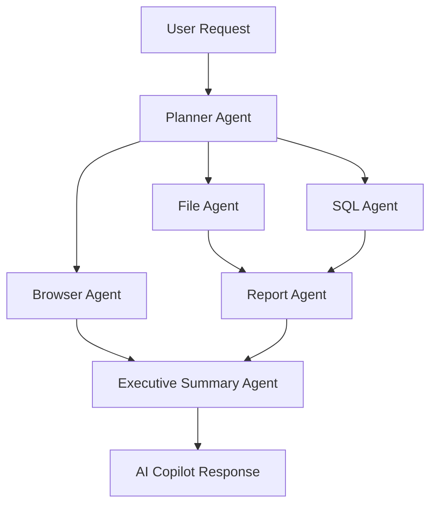
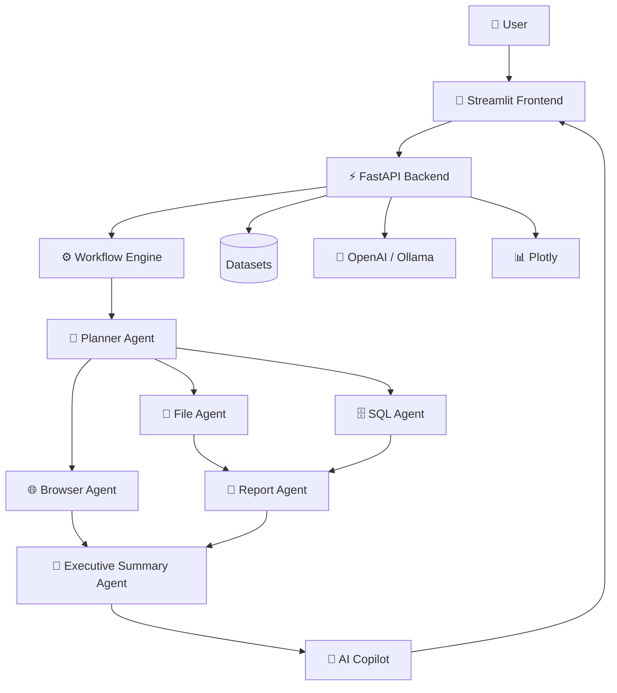
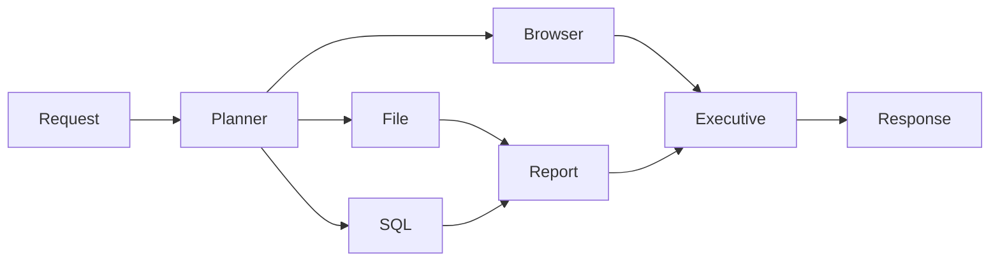

<div align="center">

# 🚀 InsightPilot

### AI-Powered Business Intelligence Platform built with Agentic AI

### Powered by LangGraph • LangChain • FastAPI • Streamlit • OpenAI/Ollama

Transform raw business data into intelligent insights using autonomous AI agents.

Upload → Clean → Analyze → Visualize → Ask AI → Generate Reports

---


---

**Enterprise AI-powered Business Intelligence Platform combining Agentic AI, Data Analytics, Interactive Visualization, SQL Analytics, and Conversational Business Intelligence.**

</div>

---

# 🌟 Overview

InsightPilot is an enterprise-grade **AI-powered Business Intelligence platform** that transforms raw business datasets into actionable insights through an intelligent multi-agent architecture.

Unlike traditional BI tools that require users to manually clean data, create dashboards, and interpret results, InsightPilot combines **Agentic AI**, **Large Language Models (LLMs)**, and **interactive analytics** to automate the complete analytics lifecycle.

Users can upload datasets, clean and analyze data, generate interactive visualizations, ask business questions in natural language, and produce executive-ready reports—all from a unified AI-assisted workspace.

The platform is designed around **specialized AI agents** orchestrated using **LangGraph**, enabling intelligent task planning, autonomous execution, and context-aware reasoning across multiple business intelligence workflows.

---

# ✨ Highlights

- 🤖 Multi-Agent AI Architecture
- 🔗 LangGraph Workflow Orchestration
- 🦜 LangChain LLM Integration
- 💬 AI Business Copilot
- 📊 Interactive Business Dashboards
- 📈 Automated KPI Generation
- 📂 Dataset Management
- 🧹 Automated Data Cleaning
- 🗄 SQL Analytics
- 📑 Executive Report Generation
- ⚙ Intelligent Workflow Planning
- 🚀 FastAPI Backend
- 🎨 Streamlit Frontend
- 📈 Plotly Interactive Visualizations
- 🧪 Production-quality Testing (2200+ Tests)

---

# 🎯 Why InsightPilot?

Traditional Business Intelligence platforms focus on dashboards.

InsightPilot focuses on **decision making**.

Instead of simply visualizing data, InsightPilot understands your business context, collaborates through multiple AI agents, and provides meaningful recommendations in natural language.

The platform bridges the gap between traditional analytics and modern AI by allowing users to interact with data conversationally while still providing the depth and flexibility expected from enterprise BI solutions.

---
# 🤖 Agentic AI Architecture

Unlike traditional Business Intelligence platforms, **InsightPilot** is powered by a team of specialized AI agents rather than a single LLM.

Each agent is responsible for a specific business capability and collaborates with other agents through **LangGraph** to complete complex analytics workflows.

This modular design makes the platform scalable, maintainable, and capable of handling end-to-end business intelligence tasks autonomously.

---

## 🧠 AI Agent Ecosystem

| Agent | Responsibility |
|--------|----------------|
| 🧠 **Planner Agent** | Understands the user's request, analyzes available resources, and creates an optimal execution plan. |
| 📂 **File Agent** | Imports datasets, validates files, extracts metadata, and prepares datasets for downstream analysis. |
| 🗄️ **SQL Agent** | Connects to SQL databases, executes queries, retrieves structured data, and prepares results for analysis. |
| 🌐 **Browser Agent** | Retrieves relevant external business information and market context whenever additional knowledge is required. |
| 📑 **Report Agent** | Generates comprehensive business reports by combining analysis results, KPIs, and visualizations. |
| 📄 **Executive Summary Agent** | Produces concise executive-level summaries, recommendations, risks, and action items using LLM reasoning. |

---

# 🔄 Multi-Agent Workflow

```text
                    User Request
                          │
                          ▼
                🧠 Planner Agent
                          │
                          ▼
         Determines Optimal Execution Plan
                          │
         ┌────────────────┼────────────────┐
         │                │                │
         ▼                ▼                ▼
📂 File Agent      🗄️ SQL Agent     🌐 Browser Agent
         │                │                │
         └────────────────┼────────────────┘
                          ▼
                  📑 Report Agent
                          │
                          ▼
          📄 Executive Summary Agent
                          │
                          ▼
                🤖 AI Copilot Response
```

---

# 🔗 LangGraph Workflow Orchestration

InsightPilot uses **LangGraph** to orchestrate multiple AI agents into a coordinated execution graph.

Instead of issuing isolated LLM calls, LangGraph enables:

- Stateful workflow execution
- Multi-step reasoning
- Conditional routing
- Context preservation
- Structured agent collaboration
- Intelligent task sequencing

The execution graph allows each specialized agent to focus on its own responsibility while sharing context through a controlled workflow.



---

# 🦜 LangChain Integration

InsightPilot leverages **LangChain** to simplify interaction with Large Language Models while maintaining structured, reliable AI workflows.

LangChain is used for:

- Prompt Engineering
- Context Management
- Structured LLM Outputs
- AI Service Integration
- Chat History Management
- Retrieval of Business Context
- Report Generation
- Executive Summary Generation

Rather than allowing unrestricted LLM responses, InsightPilot structures prompts and outputs to ensure business-oriented and grounded responses.

---

# 🧩 AI Workflow Lifecycle

Every AI interaction follows a structured pipeline.

```text
Business Request

        │

        ▼

Context Collection

        │

        ▼

Planner Agent

        │

        ▼

Workflow Generation

        │

        ▼

Agent Execution

        │

        ▼

Business Analysis

        │

        ▼

Report Generation

        │

        ▼

Executive Summary

        │

        ▼

Natural Language Response
```

---

# ⚙️ AI Capabilities

InsightPilot combines multiple AI capabilities into a single platform.

### 🧠 Intelligent Planning

- Natural Language Understanding
- Workflow Planning
- Task Routing
- Context Awareness

---

### 📊 Business Analytics

- KPI Generation
- Statistical Analysis
- Correlation Detection
- Trend Analysis
- Outlier Detection

---

### 💬 Conversational AI

Users can interact with the platform using natural language.

Example questions include:

- Which region generated the highest revenue?
- Why did profit decline this quarter?
- Explain this dashboard.
- Summarize the dataset.
- Generate an executive report.
- What are the key business risks?

---

### 📑 AI Report Generation

Automatically generates:

- Business Reports
- Executive Summaries
- Recommendations
- Risk Analysis
- Action Items

---

### 📈 Business Intelligence

The AI can reason over:

- Uploaded datasets
- SQL query results
- KPIs
- Charts
- Dashboards
- Generated reports
- Workflow outputs

instead of responding only from general knowledge.

---

# 🚀 Why a Multi-Agent Architecture?

Instead of relying on a single general-purpose LLM, InsightPilot decomposes complex business intelligence tasks into specialized AI agents.

This architecture provides several advantages:

- Better separation of responsibilities
- Improved scalability
- Easier maintenance
- Reusable AI components
- Structured execution
- Transparent workflows
- Better reasoning through task specialization

Each agent focuses on solving one problem well, while LangGraph coordinates their collaboration to deliver a seamless user experience.

# ✨ Features

InsightPilot provides a complete end-to-end Business Intelligence workflow, allowing users to transform raw datasets into actionable business insights through AI-assisted analytics.

The platform combines traditional data analysis with modern AI capabilities, enabling users to work more efficiently without sacrificing analytical depth.

---

# 📂 Data Management

Efficiently manage structured business datasets from multiple sources.

### Features

- Upload CSV datasets
- Import Excel spreadsheets
- Connect to SQL databases
- Automatic dataset validation
- Metadata extraction
- Dataset preview
- Dataset catalog
- Dataset search
- Data source management

### Supported Data Sources

- CSV
- Excel
- SQL Databases

Every uploaded dataset is automatically validated before entering the analytics pipeline.

---

# 🧹 Intelligent Data Preparation

Preparing data is often the most time-consuming stage of analytics.

InsightPilot automates common data quality tasks and provides actionable recommendations before analysis begins.

### Automated Quality Checks

- Missing value detection
- Duplicate row detection
- Empty column identification
- Invalid data type detection
- Dataset completeness score
- Data quality score
- Summary statistics

### Cleaning Operations

- Remove duplicates
- Handle missing values
- Drop empty columns
- Standardize data types
- Generate cleaned dataset
- Cleaning history

The platform presents cleaning suggestions in an intuitive interface, allowing users to review recommendations before applying changes.

---

# 📊 Business Analytics

Generate business insights automatically without writing code.

The analytics engine computes descriptive statistics, detects trends, and highlights anomalies that matter for business decision-making.

### Analytical Capabilities

- Statistical Summary
- Descriptive Statistics
- KPI Generation
- Correlation Analysis
- Trend Detection
- Distribution Analysis
- Outlier Detection
- Feature Relationships

### Automatically Generated KPIs

Examples include:

- Total Revenue
- Average Sales
- Growth Rate
- Customer Count
- Product Performance
- Regional Performance
- Revenue Distribution
- Category Breakdown

These KPIs become immediately available to the AI Copilot for natural-language questioning.

---

# 📈 Interactive Visualization

InsightPilot automatically generates interactive dashboards to help users explore their data visually.

Built using **Plotly**, every visualization supports zooming, filtering, and interactive exploration.

### Supported Charts

- Bar Charts
- Line Charts
- Scatter Plots
- Histograms
- Box Plots
- Pie Charts
- Heatmaps
- Correlation Matrix
- Distribution Charts
- KPI Cards

### Dashboard Features

- Interactive filtering
- Responsive layout
- Business KPI cards
- Dynamic chart recommendations
- Download-ready visualizations

Visualizations are automatically selected based on dataset characteristics, reducing manual effort while still allowing user customization.

---

# 🤖 AI Copilot

The AI Copilot is the primary interface for interacting with InsightPilot.

Rather than navigating multiple dashboards, users can simply ask questions in natural language and receive context-aware answers.

### Example Questions

> What are the key insights from this dataset?

> Which region generated the highest revenue?

> Explain the correlation between sales and profit.

> Summarize the dashboard.

> Generate an executive summary.

> What business risks should I be aware of?

### AI Capabilities

- Context-aware conversations
- Business insight generation
- Chart explanations
- KPI interpretation
- Report summarization
- Workflow assistance
- SQL result explanation
- Executive recommendations

The AI understands the user's current dataset, generated reports, visualizations, and workflow context, enabling intelligent conversations grounded in the analysis.

---

# 📑 Reports & Executive Summaries

Generate professional business reports with a single click.

Reports combine analytical findings, visualizations, KPIs, and AI-generated insights into a structured document suitable for business stakeholders.

### Report Sections

- Executive Summary
- Dataset Overview
- Business KPIs
- Statistical Analysis
- Interactive Visualizations
- AI Insights
- Recommendations
- Business Risks
- Follow-up Actions

Reports are designed for both technical analysts and executive audiences.

---

# ⚙️ Workflow Engine

InsightPilot includes an intelligent workflow engine that guides users through the complete analytics lifecycle.

Instead of manually performing each step, workflows automate the process from data ingestion to report generation.

### Workflow Stages

```text
Upload Dataset
        │
        ▼
Data Validation
        │
        ▼
Data Cleaning
        │
        ▼
Business Analysis
        │
        ▼
Visualization
        │
        ▼
Report Generation
        │
        ▼
Executive Summary
```

### Workflow Features

- Intelligent planning
- Execution monitoring
- Progress tracking
- Approval support
- Workflow history
- Automatic report generation

---

# 💼 Enterprise Business Intelligence

InsightPilot is designed to provide capabilities commonly found in enterprise BI platforms while enhancing them with modern AI.

Business users can:

- Explore datasets interactively
- Generate executive reports
- Build visual dashboards
- Ask questions in natural language
- Monitor workflow execution
- Discover trends and anomalies
- Make data-driven decisions faster

All from a single integrated platform.

---

# 🎨 User Experience

The application is organized around business tasks rather than technical implementation.

Core modules include:

```text
🏠 Dashboard

📂 Data
   ├── Upload
   ├── Datasets
   └── SQL

🧹 Prepare

📊 Analyze

📈 Visualize

🤖 AI Copilot

📑 Reports

⚙️ Workflows

🔧 Settings
```

Advanced engineering capabilities remain available through Developer Mode without cluttering the primary user experience.

---

# 🚀 Designed for Modern Analytics

InsightPilot combines the strengths of:

- Business Intelligence
- Artificial Intelligence
- Interactive Analytics
- Data Visualization
- Conversational AI
- Workflow Automation

to provide a unified analytics platform capable of supporting both technical users and business stakeholders.


# 🏗️ System Architecture

InsightPilot follows a modular, layered architecture that separates the user interface, business logic, AI orchestration, analytics engine, and infrastructure concerns.

This design enables scalability, maintainability, and extensibility while allowing new AI capabilities to be added without modifying existing modules.

---

# 🏛 High-Level Architecture



---

# 🧠 Agent Execution Architecture

InsightPilot adopts a **specialized multi-agent architecture** where every agent has a single responsibility.

Rather than relying on one large prompt, business requests are decomposed into smaller tasks that are executed by dedicated AI agents.



This architecture enables:

- Intelligent task decomposition
- Modular agent development
- Easier maintenance
- Reusable AI components
- Better scalability

---

# 🔗 LangGraph Workflow

InsightPilot uses **LangGraph** as the orchestration framework for coordinating AI agents.

LangGraph manages:

- Stateful execution
- Agent routing
- Context preservation
- Multi-step workflows
- Conditional execution
- Execution planning

Typical execution flow:

```text
User Prompt

↓

Planner Agent

↓

Execution Graph

↓

Specialized Agents

↓

Report Generation

↓

Executive Summary

↓

Natural Language Response
```

---

# 🦜 LangChain Integration

LangChain provides the foundation for interacting with Large Language Models.

It is used throughout the platform for:

- Prompt Templates
- Structured Outputs
- Context Injection
- Conversation Management
- LLM Invocation
- Response Formatting

The combination of **LangGraph + LangChain** enables structured AI workflows instead of isolated LLM calls.

---

# ⚙️ Backend Architecture

The backend is implemented using **FastAPI** and follows a modular service-oriented architecture.

```text
FastAPI

│

├── REST APIs

├── Business Services

├── AI Services

├── Workflow Engine

├── Analytics Engine

├── Visualization Engine

├── Report Generator

└── Infrastructure Layer
```

Core responsibilities include:

- Data ingestion
- Data cleaning
- Statistical analysis
- Visualization generation
- Workflow orchestration
- AI integration
- Report generation
- API management

---

# 🎨 Frontend Architecture

The frontend is built with **Streamlit** and organized around business workflows rather than engineering components.

```text
Dashboard

↓

Data

↓

Prepare

↓

Analyze

↓

Visualize

↓

AI Copilot

↓

Reports

↓

Workflows

↓

Settings
```

The interface emphasizes:

- Simplicity
- Minimal clicks
- Guided workflows
- Interactive dashboards
- Business-first terminology

Advanced engineering features remain available through **Developer Mode** without overwhelming standard users.

---

# 🔄 End-to-End Data Flow


Every stage enriches the available business context, allowing downstream AI agents to provide increasingly informed responses.

---

# 📦 Project Structure

```
InsightPilot/

├── backend/
│   ├── agents/
│   ├── analysis/
│   ├── api/
│   ├── cleaning/
│   ├── reporting/
│   ├── visualization/
│   ├── workflows/
│   ├── ai/
│   ├── services/
│   ├── security/
│   ├── memory/
│   ├── plugins/
│   └── ...
│
├── frontend/
│   ├── pages/
│   ├── components/
│   ├── api/
│   ├── layouts/
│   └── state/
│
├── config/
├── deploy/
├── shared/
├── tests/
├── data/
└── README.md
```

---

# 🌐 REST API Architecture

InsightPilot exposes a RESTful API through FastAPI.

Core API groups include:

- Dataset Management
- Data Preparation
- Analytics
- Visualization
- AI Copilot
- Reports
- Workflows
- Authentication
- Administration

This separation allows the frontend to remain lightweight while keeping all business logic centralized within the backend.

---

# 🔌 Extensible Design

The platform was designed with extensibility in mind.

Current architecture supports:

- Additional AI agents
- New visualization types
- Custom report templates
- Multiple LLM providers
- Additional data sources
- New workflow steps
- Plugin-based extensions

New capabilities can be integrated without modifying the existing system architecture.

---

# 🛡️ Software Engineering Principles

InsightPilot follows modern software engineering best practices:

- Modular Architecture
- Separation of Concerns
- Dependency Injection
- Layered Design
- Strong Typing with Pydantic
- Automated Testing
- Static Analysis (MyPy)
- Linting (Ruff)
- RESTful API Design
- Scalable Agent-Based Architecture

These principles ensure that the platform remains maintainable as it grows while supporting enterprise-grade development practices.

# 🛠 Technology Stack

InsightPilot combines modern AI technologies, data analytics libraries, and enterprise-grade backend frameworks into a unified Business Intelligence platform.

---

## Backend

| Technology | Purpose |
|------------|---------|
| **Python** | Primary programming language |
| **FastAPI** | High-performance REST API framework |
| **Pydantic** | Data validation and serialization |
| **Uvicorn** | ASGI server |
| **Dependency Injection** | Modular service architecture |

---

## Artificial Intelligence

| Technology | Purpose |
|------------|---------|
| **LangGraph** | Multi-agent workflow orchestration |
| **LangChain** | LLM application framework |
| **OpenAI API** | Cloud-based Large Language Models |
| **Ollama** | Local LLM execution |
| **Agentic AI** | Autonomous task planning and execution |

---

## Data Analytics

| Technology | Purpose |
|------------|---------|
| **Pandas** | Data manipulation |
| **NumPy** | Numerical computing |
| **SQL** | Structured data analysis |
| **Statistics** | KPI & business analytics |

---

## Visualization

| Technology | Purpose |
|------------|---------|
| **Plotly** | Interactive dashboards |
| **Streamlit** | Web-based analytical interface |

---

## Software Engineering

| Technology | Purpose |
|------------|---------|
| **Pytest** | Automated testing |
| **MyPy** | Static type checking |
| **Ruff** | Code linting |
| **Git** | Version control |

---

# 🚀 Getting Started

## Clone the Repository

```bash
git clone https://github.com/YOUR_USERNAME/InsightPilot.git

cd InsightPilot
```

---

## Create Virtual Environment

### Windows

```bash
python -m venv .venv

.venv\Scripts\activate
```

### Linux / macOS

```bash
python3 -m venv .venv

source .venv/bin/activate
```

---

## Install Dependencies

Using **uv** (recommended)

```bash
uv sync
```

or using pip

```bash
pip install -r requirements.txt
```

---

# ⚙️ Configuration

Create a `.env` file in the project root.

Example:

```env
# OpenAI

OPENAI_API_KEY=your_openai_api_key

# Ollama

OLLAMA_BASE_URL=http://localhost:11434

OLLAMA_MODEL=llama3

# Application

LOG_LEVEL=INFO
```

If you prefer local inference, install **Ollama** and pull a supported model:

```bash
ollama pull llama3
```

---

# ▶️ Running the Backend

Start the FastAPI backend:

```bash
uv run uvicorn backend.main:app --reload
```

Backend will be available at

```
http://localhost:8000
```

Interactive API documentation

```
http://localhost:8000/docs
```

OpenAPI specification

```
http://localhost:8000/openapi.json
```

---

# 🎨 Running the Frontend

Launch the Streamlit application:

```bash
uv run streamlit run frontend/app.py
```

The application will be available at

```
http://localhost:8501
```

---

# 🤖 Running with OpenAI

Configure your API key:

```env
OPENAI_API_KEY=your_key_here
```

Then choose OpenAI from the application settings.

---

# 🦙 Running with Ollama

Start the Ollama server

```bash
ollama serve
```

Download a model

```bash
ollama pull llama3
```

Update your configuration

```env
OLLAMA_BASE_URL=http://localhost:11434

OLLAMA_MODEL=llama3
```

InsightPilot will automatically use the configured local model.

---

# 🧪 Running Tests

Execute the full test suite:

```bash
pytest
```

Run a specific test:

```bash
pytest tests/test_analysis.py
```

---

## Static Type Checking

```bash
mypy backend

mypy frontend
```

---

## Code Quality

```bash
ruff check .
```

Automatically fix formatting issues:

```bash
ruff check . --fix
```

---

# 📸 Application Screenshots

## 🏠 Dashboard

> *Add screenshot here*

```
assets/dashboard.png
```

---

## 📂 Data Upload

> *Add screenshot here*

```
assets/upload.png
```

---

## 🧹 Data Preparation

> *Add screenshot here*

```
assets/cleaning.png
```

---

## 📊 Analysis

> *Add screenshot here*

```
assets/analysis.png
```

---

## 📈 Visualization

> *Add screenshot here*

```
assets/visualization.png
```

---

## 🤖 AI Copilot

> *Add screenshot here*

```
assets/copilot.png
```

---

## 📑 Reports

> *Add screenshot here*

```
assets/report.png
```

---

## ⚙️ Workflows

> *Add screenshot here*

```
assets/workflow.png
```

---

# 🎥 Demo

A complete walkthrough of InsightPilot is available below.

> **Demo Video**

```
https://youtu.be/YOUR_VIDEO_LINK
```

or

```
assets/demo.gif
```

The demonstration covers:

- Uploading datasets
- Cleaning data
- Running analysis
- Building dashboards
- Querying the AI Copilot
- Generating reports
- Executing workflows

---

# 📊 Performance & Quality

The project emphasizes engineering quality alongside functionality.

Highlights include:

- ✅ Modular architecture
- ✅ Type-safe codebase
- ✅ Automated testing
- ✅ Production-ready REST APIs
- ✅ AI-powered analytics
- ✅ Multi-agent orchestration
- ✅ Interactive dashboards
- ✅ Professional reporting

---

# 📈 Project Statistics

| Metric | Value |
|---------|------:|
| Programming Language | Python |
| Backend Framework | FastAPI |
| Frontend Framework | Streamlit |
| AI Framework | LangGraph + LangChain |
| Visualization | Plotly |
| Data Processing | Pandas |
| Testing Framework | Pytest |
| Type Checking | MyPy |
| Code Quality | Ruff |

> **Note:** Update metrics such as test count, code size, or repository statistics over time as the project evolves.

# 📂 Project Structure

The project follows a modular architecture that separates presentation, business logic, AI orchestration, analytics, and infrastructure.

```
InsightPilot
│
├── backend/
│   ├── agents/                 # AI agents
│   ├── ai/                     # LLM integration
│   ├── analysis/               # Data analysis
│   ├── api/                    # FastAPI routes
│   ├── approval/               # Workflow approvals
│   ├── cleaning/               # Data cleaning
│   ├── datasource/             # Data ingestion
│   ├── memory/                 # Context & memory
│   ├── observability/          # Logging & tracing
│   ├── orchestration/          # LangGraph orchestration
│   ├── planning/               # Workflow planning
│   ├── plugins/                # Extension framework
│   ├── reporting/              # Report generation
│   ├── security/               # Authentication & authorization
│   ├── services/               # Business services
│   ├── tools/                  # Tool abstraction layer
│   ├── visualization/          # Dashboard generation
│   ├── workflows/              # Workflow engine
│   └── ...
│
├── frontend/
│   ├── api/
│   ├── components/
│   ├── layouts/
│   ├── pages/
│   └── state/
│
├── config/
├── data/
├── deploy/
├── shared/
├── tests/
│
├── README.md
├── pyproject.toml
└── uv.lock
```

---

# 💼 Use Cases

InsightPilot can be used for a variety of business intelligence and analytics scenarios.

### 📊 Business Analytics

- Sales Analysis
- Revenue Analysis
- Customer Analytics
- Product Performance
- Financial Reporting
- KPI Monitoring

---

### 🏢 Enterprise Reporting

- Executive Reports
- Management Dashboards
- Business Reviews
- Quarterly Reports
- Decision Support

---

### 📈 Data Science

- Exploratory Data Analysis
- Statistical Analysis
- Feature Exploration
- Data Cleaning
- Interactive Visualization

---

### 🤖 AI-Assisted Analytics

- Conversational Data Analysis
- Natural Language BI
- Automated Insight Generation
- AI-powered Recommendations
- Executive Summaries

---

# 🚀 Future Roadmap

InsightPilot will continue to evolve with new AI-powered capabilities.

### Planned Enhancements

- [ ] Multi-dataset analytics
- [ ] Time-series forecasting
- [ ] Predictive analytics
- [ ] AutoML integration
- [ ] Custom dashboard builder
- [ ] Scheduled report generation
- [ ] Cloud deployment
- [ ] Mobile-friendly interface
- [ ] Collaboration features
- [ ] Advanced AI visual analytics

---

# 🤝 Contributing

Contributions are welcome!

If you'd like to improve InsightPilot:

1. Fork the repository.
2. Create a feature branch.

```bash
git checkout -b feature/amazing-feature
```

3. Commit your changes.

```bash
git commit -m "Add amazing feature"
```

4. Push the branch.

```bash
git push origin feature/amazing-feature
```

5. Open a Pull Request.

Please ensure that:

- All tests pass.
- Code follows project style guidelines.
- New features include documentation.
- Type checking and linting remain clean.

---

# 🧪 Code Quality

InsightPilot emphasizes engineering quality alongside functionality.

The project follows modern software engineering best practices:

- ✅ Modular Architecture
- ✅ Clean Code Principles
- ✅ Dependency Injection
- ✅ Type-safe Python
- ✅ RESTful API Design
- ✅ Multi-Agent Architecture
- ✅ Automated Testing
- ✅ Static Type Checking
- ✅ Code Linting
- ✅ Comprehensive Documentation

---

# 🎓 Skills Demonstrated

This project showcases practical experience across multiple domains.

### Artificial Intelligence

- Agentic AI
- Multi-Agent Systems
- LangGraph
- LangChain
- Large Language Models (LLMs)
- Prompt Engineering
- AI Workflow Orchestration
- Conversational AI
- Context-aware AI Applications

---

### Data Analytics

- Business Intelligence
- Data Cleaning
- Exploratory Data Analysis
- Statistical Analysis
- KPI Generation
- Dashboard Design
- Interactive Visualization
- SQL Analytics

---

### Backend Engineering

- FastAPI
- REST APIs
- Dependency Injection
- Pydantic
- Async Programming
- Service-Oriented Architecture

---

### Frontend Engineering

- Streamlit
- Interactive Dashboards
- State Management
- User Experience Design

---

### Software Engineering

- Python
- Git
- Automated Testing
- Pytest
- MyPy
- Ruff
- Clean Architecture
- Modular Design
- Documentation

---

# 📄 License

This project is licensed under the **MIT License**.

See the `LICENSE` file for additional details.

---

# 👨‍💻 Author

## Muhammed Nasimudheen

**M.Tech in Artificial Intelligence**

**Indian Institute of Technology Bombay**

### Connect with me

- GitHub: https://github.com/mhdnasim6-boop
- LinkedIn: *(Add your LinkedIn profile here)*
- Email: *(Add your email here)*

---

# ⭐ Support

If you found this project helpful, please consider giving it a ⭐ on GitHub.

It helps others discover the project and motivates future development.

---

<div align="center">

## 🚀 InsightPilot

### Transforming Business Intelligence with Agentic AI

**Built with ❤️ using Python, LangGraph, LangChain, FastAPI, Streamlit, Plotly, and Large Language Models.**

*"From raw data to intelligent decisions."*

---

**Thank you for visiting InsightPilot!**

</div>
