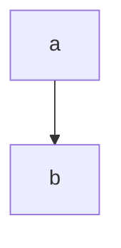

# InsightPilot

**InsightPilot** is an Agentic AI-powered Business Intelligence Assistant. Users
will be able to upload business data, analyze it with AI agents, generate
professional reports and dashboards, and interact with the system through an
intelligent chatbot.

> **Phase 40 status:** InsightPilot now has an **Autonomous Optimization &
> Self-Healing Platform** layer (`backend/autonomous/`) — a pure, additive,
> **read-only reporting layer** sitting entirely *outside* every existing
> subsystem, with **zero changes to Agents/Workflows/Execution/Planning/
> Distributed/Federation/Security/Memory/Reflection/Realtime/
> Observability/Adaptive Planning/Plugins**. Unlike every prior phase's own
> "bookkeeping wraps real execution" shape (Phase 38's workers, Phase 39's
> clusters), this phase has no execution/dispatch hook at all — it never
> wraps a service call, never sits in a request's critical path unless a
> caller explicitly asks for one. `AutonomousService` is the one public
> entry point: `analyze()` gathers a `PerformanceProfile` from ten reused
> services' own already-computed `.statistics()`/`.summary()`/`.list_*()`
> surfaces (`WorkflowService`, `AdaptivePlanningService`,
> `ObservabilityService`+`MetricsService`, `ReflectionService`,
> `MemoryService`, `DistributedExecutionService`, `FederationService`, plus
> a light, justified read of `AuditService.total_events()`), runs it
> through six category-scoped `analyzers/` (each a pure threshold-rule
> function — **never a raw recomputation** of anything a reused service
> doesn't already aggregate) to detect `Bottleneck`s across the phase's
> twelve named categories, then through `optimizer/` (`BottleneckDetector`
> → three category-scoped optimizers → `RecommendationEngine`) and
> `healing/` (`SelfHealingEngine`, consulting a `RecoveryStrategyCatalog`
> and `HealingValidator`) to produce a final `OptimizationReport`. **The
> self-healing rule is structural, not just documented**: "generate
> recommendations only; never automatically modify workflows, execution,
> memory, or security" is enforced by `Literal[False]`/`Literal[True]`
> fixed-value fields — `OptimizationAction.safe_to_automate` and
> `HealingRecommendation.requires_human_approval` — that no caller can
> flip even by trying (a dedicated model test proves the attempt raises
> `ValidationError`), and `HealingValidator` re-checks the invariant at
> runtime as one more explicit gate before a recommendation is ever
> allowed into a report. Twelve categories had to map onto six analyzer
> files and three optimizer files — resolved by grouping thematically
> (e.g. `execution_analyzer.py` covers Execution efficiency, Approval
> bottlenecks, *and* Reflection trends, since all three already come from
> `MetricsService.summary()`/`ReflectionService.statistics()`) and
> documenting the grouping rationale in each file's own docstring.
> "Parallelism opportunities" has no existing aggregate metric anywhere in
> the codebase, so `WorkflowAnalyzer` computes one narrow, honestly-labeled
> proxy — a "concurrency ratio" from real `ExecutionTrace.agent_traces`
> durations vs. wall-clock duration — with an explicit "proxy signal, not
> a dependency-graph guarantee" caveat in both the docstring and the
> bottleneck's own description text. "Plugin usage" needed no new
> dependency at all: a plugin-contributed tool already flows through the
> same `ToolRegistry`/`TracingTool`/`MetricsService.tool_metrics()` path as
> every first-party tool, so `ObservabilityAnalyzer` covers it implicitly.
> A naming collision — this phase's own `OptimizationStatistics`
> (report-history aggregate) vs. Phase 32's `OptimizationStatistics`
> (plan-optimization-history aggregate) — is resolved via an aliased
> import in the one file (`performance_profile.py`) where both are used
> together. A platform with zero historical data produces a report with
> zero bottlenecks, zero actions, zero recommendations, and a HEALTHY
> verdict from every one of the six analyzers — proven live by a dedicated
> zero-data test at the analyzer level. New REST endpoints
> (`backend/api/v1/autonomous.py` — `POST /analyze`, `GET /reports`,
> `GET /reports/{id}`, `GET /statistics`, `GET /recommendations`,
> permission-gated via Phase 35's own `require_permission()`) and a new
> frontend page (`27_Autonomous.py`) round out the phase: run analysis,
> browse reports, bottlenecks, analyzer verdicts, suggested actions,
> healing recommendations, and the underlying performance-profile
> snapshot. See Autonomous Optimization Architecture below.
>
> **Earlier phases:** InsightPilot previously gained a **Federated
> Multi-Cluster Orchestration & Cloud-Native Coordination** layer
> (`backend/federation/`, Phase 39) — a pure, additive coordination layer
> *above* Phase 38's own distributed layer, with zero changes to
> Execution/Workflow/Distributed/Planner/Approval/Memory/Observability/
> Security/Realtime/Agent logic. `FederationService` is the one public
> entry point: remote clusters register, and every real workflow
> execution is credited to a cluster via a `RoutingDecision`/
> `RemoteExecution` pair — the exact `Lease`/`TaskAssignment` shape Phase
> 38 already established, one layer up. "No automatic networking or RPC —
> all communication is represented as routing decisions only." A
> `RoutingDecision` records *which cluster a workload is credited to*; it
> never ships anything anywhere. `FederationCoordinator` (mirrors the
> `RealtimePublishingWorkflowService`/`DispatchingAgentService` decorator
> shape) is layered outermost around `WorkflowService`, routing each
> `execute()` call to a credited cluster (always the local one in a
> single-cluster deployment) before delegating to the real, unmodified
> `WorkflowService.execute()`. Failover is equally literal: "reroute only
> work that has not yet begun execution" means exactly "a `RoutingDecision`
> still PENDING" — a decision already DISPATCHED is never touched again.
> A **Distributed Execution & Horizontal Scaling** layer (`backend/distributed/`, Phase
> 38) — a pure, additive coordination layer on the existing single-process
> execution stack, with zero changes to it. `DistributedExecutionService`
> is the one public entry point: workers register/heartbeat/drain/shut
> down, and each dispatched step is credited to an eligible worker via a
> `TaskAssignment`/`Lease` pair — `DispatchingAgentService` (mirrors
> `RealtimePublishingAgentService`'s own shape) credits the worker inside
> the same `NodeDispatcher` choke point, while the real agent call always
> still executes in-process (this codebase has no message broker/RPC
> transport). Zero workers registered means every existing execution
> path behaves identically to before Phase 38 existed. Recovery reuses
> the real `ExecutionCheckpointStore` directly, so a lost lease can never
> duplicate already-finished work. A **Real-Time Event Streaming & Live
> Collaboration** layer (`backend/realtime/`, Phase 37) — `RealtimeService`
> publishes 24 `EventType`s through transparent decorators (mirroring
> `TracingTool`) with zero changes to eight protected subsystems, fanning
> out live over `/ws/events` and into a bounded, replayable buffer. An
> **Autonomous
> Workflow Engine** (`backend/workflows/`, Phase 36) — the highest
> orchestration layer in the platform, coordinating the Planner Agent, the
> parallel DAG execution engine, approvals, memory, observability,
> reflection, adaptive planning, tools, plugins, and security into one
> system with **zero new business intelligence logic** of its own:
> `WorkflowService` is the single public entry point, `WorkflowValidator`/
> `WorkflowOptimizer` call the real `PlanValidator`/`PlanOptimizer`/
> `AdaptivePlanningService`, `WorkflowEngine` calls the real
> `ExecutionService`, and `WorkflowDispatcher` discovers every agent
> dynamically through `AgentCapabilityRegistry` (Phase 30's own mechanism)
> so a step's `node_name` never hardcodes an agent name. Pause/resume
> honestly distinguish the two real pause mechanisms that exist
> (approval-gated vs. voluntary/caller-initiated); two real bugs were
> caught live — a redundant cycle-check made dead code by
> `topological_order()`'s own `CycleDetectedError`, and a
> `TraceNotFoundError` crash from double-finalizing an already-terminal
> execution's observability trace, both fixed at the orchestration layer
> without touching `ExecutionService`. New REST endpoints
> (`backend/api/v1/workflows.py`) and a frontend page (`23_Workflows.py`)
> provide a builder, execution status, dependency graph, statistics, and
> history. A complete, purely additive
> **security layer** (`backend/security/`) — JWT authentication, role-
> based authorization, user management, and automatic audit logging —
> layered entirely through middleware and FastAPI dependencies, with
> **zero changes to any existing service**: nothing in Agent/Tool/
> Planner/Memory/Reflection/Adaptive Planning/Collaboration/Execution/
> Plugin/Operations logic imports `AuthenticationService`, and no
> endpoint anywhere inspects a role or permission directly. Login issues
> an HS256 **access/refresh token pair** (PyJWT) — a short-lived,
> stateless access token (no `jti`, verified by signature/expiry alone)
> and a longer-lived refresh token that carries a `jti` `SessionManager`
> tracks as a `Session`; **logout** is what a stateless JWT can't do to
> itself — revoking that session, so refresh-token reuse (and only
> refresh-token reuse) is genuinely rejected afterward, while an already-
> issued access token simply expires on its own short clock, a
> documented, industry-standard tradeoff. **Refresh-token rotation** is
> automatic: every `POST /refresh-token` revokes the presented token's
> session and issues a brand-new pair, so a stolen-and-reused old refresh
> token is rejected the moment the legitimate client refreshes first —
> caught structurally by a real end-to-end test, not assumed. Passwords
> are hashed with **PBKDF2-HMAC-SHA256** (260,000 iterations, a fresh
> random salt per hash, constant-time verification) — no new C-extension
> dependency, built entirely from `hashlib`/`hmac`/`secrets`. Six
> built-in **roles** (Admin/Analyst/Viewer/Operator/Developer/Plugin) map
> to eight **permissions** through one hardcoded `Policy`
> (`backend/security/authorization/`); every protected endpoint declares
> its requirement as `Depends(require_permission(Permission.X))` — a
> FastAPI dependency, deliberately not a blanket ASGI middleware, since
> authorization (unlike authentication or request-correlation) needs a
> different answer per route and this codebase has no routing table a
> blanket middleware could consult. `AuthenticatedUser.permissions` is
> recomputed from the live Policy on every single request rather than
> cached in the JWT itself, so a Policy change takes effect on a caller's
> very next request, not just their next login. **Audit logging is fully
> automatic**: `AuthenticationMiddleware` records one `AuditEvent` per
> authenticated request (user, action, endpoint, method, duration,
> status, success, correlation id) after the response is already
> computed — no business service, and no endpoint handler, has any idea
> it's happening. A new `RequestContextMiddleware` establishes a
> correlation id per request (mirrors `backend.observability.context`'s
> own `ContextVar` pattern from Phase 24 exactly) and echoes it back as
> `X-Request-ID`, which `AuthenticationMiddleware`'s own audit record
> reuses rather than minting a second id. A fresh install seeds exactly
> one `admin` account on first use (`UserService.ensure_default_admin()`)
> — with a loudly logged warning if the recognizable insecure default
> password (or JWT secret) is still in effect, so an operator sees it at
> startup rather than discovering it in production. New REST endpoints
> (`backend/api/v1/security.py`, mounted with no `/security` prefix —
> `/login`/`/logout`/`/refresh-token`/`/me`/`/users`/`/audit`/`/roles`/
> `/permissions`, exactly as specified) and a new frontend page
> (`22_Security.py`): login form, current user, masked token info with a
> manual refresh control, a permission checklist plus the full roles
> catalog, an audit log viewer, and (permission-permitting) user
> management. Explicitly out of scope, per this phase's own instruction:
> MFA, OAuth2/OIDC/SSO/LDAP/SCIM, a dynamic RBAC editor, and ABAC — see
> Security Architecture below. Before that, InsightPilot gained a
> complete, purely additive **operations layer** (`backend/operations/`) — configuration profiles,
> environment validation, liveness/readiness probes, feature flags,
> ordered startup/shutdown coordination, and full diagnostics — the
> production-readiness layer around a system whose Agent/Tool/Planner/
> Memory/Reflection/Adaptive Planning/Collaboration/Execution/Plugin
> logic is completely untouched. Five **configuration profiles**
> (`development`/`testing`/`staging`/`production`/`local`,
> `backend/operations/configuration/`) each declare a small `overrides`
> dict on top of `Settings`' own defaults; `ConfigurationLoader` applies
> a profile's override to a field only when that field still equals its
> class-declared default — proven empirically (not assumed) that
> `pydantic-settings` gives constructor kwargs *higher* priority than
> real environment variables, so a naive `Settings(**overrides)` would
> have silently clobbered an operator's actual `LOG_LEVEL=DEBUG`; this
> loader guarantees the environment always wins instead, with the
> `development` profile's own `overrides` deliberately empty so
> `backend.main`'s module-level `app` (now built via
> `create_app(settings=ConfigurationLoader().load())`) behaves byte-for-
> byte identically to every prior phase unless `ACTIVE_PROFILE` is
> actually set. **Environment validation** (`ConfigurationValidator`)
> checks all seven named areas — directories, the plugin folder, memory/
> AI-provider/database/MCP configuration, and logging — and reports
> findings as a severity-leveled list (never raises itself); a genuinely
> invalid log level or an unresolvable AI provider is an error, a
> not-yet-created plugin folder is informational, matching how
> `PluginLoader` already treats a missing directory as zero plugins, not
> a failure. A **StartupManager**/**ShutdownManager** pair
> (`backend/operations/startup/`) coordinate the exact "Configuration ->
> Plugin loading -> Registries -> Memory -> Observability -> Execution ->
> API ready" sequence this phase names, and its reverse on the way down
> — every stage is a bound method on an already-existing singleton
> (`PluginRegistry.load`, `ToolRegistry.list_tools`, ...), so this adds
> zero new construction logic, only ordering, timing, and per-stage
> failure containment (one bad stage is recorded `FAILED` and never
> stops the rest, mirroring `PluginRegistry`'s own Phase 33 philosophy).
> `backend.main`'s `lifespan()` runs it once; a failed stage never
> crashes the app — it surfaces as `GET /api/v1/operations/readiness`
> honestly reporting `ready: false`, the textbook Kubernetes "liveness
> stays up, readiness reflects reality" split, which the Kubernetes
> deployment template (`deploy/kubernetes/deployment.yaml`) wires
> directly into its own liveness/readiness probes. Six typed **feature
> flags** (`memory_enabled`/`plugins_enabled`/`reflection_enabled`/
> `adaptive_planning_enabled`/`browser_agent_enabled`/`mcp_enabled`) are
> runtime-readable only — every flag defaults to today's always-on
> behavior and nothing reads them yet, an honest scope boundary (wiring
> one to actually gate its subsystem is future work, not attempted here,
> since that would mean touching the very subsystems this phase is
> forbidden from modifying). **Diagnostics** composes an environment
> report, a dependency report (loaded plugins, registered tools, and —
> reusing the existing `GraphBuilder.export()` — registered agents),
> memory statistics, the active profile, and every feature flag into one
> snapshot, built entirely from already-existing collaborators. New REST
> endpoints (`backend/api/v1/operations.py`): health, readiness,
> diagnostics, configuration, feature-flags. A new frontend page
> (`21_Operations.py`). Deployment templates
> (`deploy/docker/`, `deploy/compose/`, `deploy/kubernetes/`) live
> entirely outside `backend/` — no Docker-specific logic anywhere in
> Python, only environment variables `config/settings.py` already reads
> — and were validated with a real `docker compose config` pass plus
> full YAML-parse/shape tests, since no Docker daemon was available in
> this environment to run an actual image build. Explicitly out of
> scope, per this phase's own instruction: authentication (Phase 34 had
> none yet — Phase 35, above, is what added it), distributed execution,
> autoscaling, and CI/CD pipelines — see Operations Architecture below.
> Before that, InsightPilot became a true extensible
> platform — third-party developers can add new Agents, Tools,
> Exporters, Visualizations, AI Providers, Memory Providers, Approval
> Policies, Analyzers, and Optimizers **without modifying the core
> codebase** — a strongly-typed **Plugin & Extension SDK**
> (`backend/plugins/`), not a marketplace and not dynamic code
> downloading. A manifest-driven `Plugin` ABC
> (`metadata()`/`initialize()`/`register(context)`/`shutdown()`) is
> discovered from `backend/extensions/` (immediate subfolders only, no
> recursive package crawling) by a fixed, documented convention — every
> plugin folder exposes exactly one `plugin.py` with a module-level
> `PLUGIN` instance — never `inspect.getmembers()`-based scanning or
> monkeypatching. Core never imports plugin code directly: a `Plugin`
> only ever touches the platform through `PluginContext`'s nine
> `register_*()` methods, each strictly typed against either a real
> existing interface (`Tool`) or a small, purpose-built `Protocol`
> defined for kinds with no existing one. Of those nine kinds, only
> `register_tool()` reaches a genuine, live, process-wide registry
> (`ToolRegistry` — the one existing registry in the whole codebase that
> is a real `@lru_cache`'d singleton with a public, mutable `register()`
> method); every other kind (agent/exporter/visualization/ai_provider/
> memory_provider/approval_policy/analyzer/optimizer) is recorded in
> `PluginRegistry`'s own catalog for introspection, an explicit, honestly
> documented scope boundary rather than a silent no-op or a reach into
> internals a plugin has no business touching (`ProviderFactory`, the
> chart-generator factory, `ApprovalPolicy`, and `NodeDispatcher` were
> each individually audited and rejected as live-mutation targets — none
> of them are genuine runtime-mutable registries). A 7-state lifecycle
> (`DISCOVERED` -> `VALIDATED` -> `LOADED` -> `INITIALIZED` ->
> `REGISTERED`, or `FAILED` at any step, or `UNLOADED`) is enforced
> entirely inside `PluginRegistry`, the single public entry point
> (`load()`/`unload()`/`reload()`/`list()`/`lookup()`); one plugin's
> failure — a bad import, a missing manifest field, an incompatible
> version, a duplicate id, a dependency cycle, or an exception from
> `initialize()`/`register()`/`shutdown()` — is always caught and
> recorded as `FAILED` with its error message, **never re-raised**,
> exactly satisfying "one bad plugin should not affect the platform."
> Dependency ordering reuses Kahn's-algorithm *conceptually* (a fresh,
> small implementation over plugin ids, deterministic by alphabetical
> tie-break) rather than reusing `topological_order()` literally, since
> that function's input shape is keyed by `ExecutionStep`, not
> `PluginManifest`. Plugins load exactly once, at startup, inside
> `main.py`'s existing `lifespan()` — never rescanned per request. A
> complete, self-contained demo plugin (`backend/extensions/
> csv_statistics_plugin/`) registers one real Tool and one Analyzer,
> living entirely outside `backend/plugins/` core. New REST endpoints
> (`backend/api/v1/plugins.py`): list, get, load, unload, reload. A new
> frontend page (`20_Plugins.py`): installed plugins, status/version/
> author, extensions contributed, failure reasons, and Load/Unload/
> Reload controls. Three real bugs were caught by live HTTP/filesystem
> testing, not assumed: a method literally named `list` inside
> `PluginRegistry` shadowed the builtin `list` for every later
> `list[...]` annotation in the same class body (Python evaluates
> annotations eagerly as the class body executes) — fixed by defining it
> last; `Settings` is unhashable, so `get_plugin_registry` could never
> declare it as an `@lru_cache`'d parameter (mirroring the existing
> `get_provider_factory`/`get_health_service` convention of calling
> `get_settings()` directly instead); and `functools.lru_cache` treats a
> positional call and FastAPI's own keyword-based `Depends()` call as
> *different cache keys*, so `lifespan()`'s manual
> `get_plugin_registry(get_tool_registry())` silently created a second,
> divergent singleton until changed to match FastAPI's own
> `tool_registry=...` keyword convention exactly. Explicitly out of
> scope, per this phase's own instruction: dynamic package installation,
> remote plugin downloads, authentication, and sandboxing — see Plugin &
> Extension SDK Architecture below. Before that, the system gained the
> ability to use previous reflections, execution history, collaboration history, and
> memory to **improve future plans automatically** — deterministic plan
> optimization
> (`backend/adaptive/`), not machine learning: every decision names the
> exact historical count that produced it. `AdaptivePlanningService`
> depends on exactly `MemoryService` + `ReflectionService` (plus optional
> `ObservabilityService`) — deliberately *not* the full
> `CollaborationService`: that would pull in its own execution-engine
> dependency chain down to `get_planner_service()`, and
> `AdaptivePlanningService` is itself now a dependency of
> `get_planner_service()` — a real DI cycle, the same class of problem
> Phase 30 already solved once. `collaboration_patterns.py` instead reads
> the `MemoryType.COLLABORATION` memories `CollaborationService` already
> writes; `execution_patterns.py` reads the `execution_score`/
> `tool_summary` every `ReflectionResult` already embeds — so
> `ExecutionService` is never touched, satisfying "do not modify
> ExecutionService" by construction. Pattern detection reuses Phase 31's
> own `RecommendationCategory` values as the signal: a single execution's
> "FileAgent failed" advice becomes a multi-execution *pattern* once it
> recurs twice — no new failure-detection logic. Only two mutations are
> ever mechanically safe enough to apply automatically: skipping a
> `browser_agent` step nothing depends on, and reordering `plan.steps`
> into a valid topological order (reusing `topological_order()` directly
> — Phase 5's own ordering truth, never reimplemented); everything else
> (tool choice, approval reduction, artifact reuse, parallelization) stays
> advisory, since applying it would require semantic judgment this phase
> deliberately keeps out of an automatic mutation. Planner integration
> needed one optional collaborator and one private step, no rewrite:
> `PlannerService.plan()` now runs the freshly-built plan through
> `AdaptivePlanningService.optimize()` *before* validation, folding every
> decision's message into the existing `PlannerOutput.warnings` field —
> `PlannerAgent`/`PlannerAgentService` untouched, Planner still owns plan
> generation end to end. Every optimization is remembered as one
> `MemoryType.ADAPTIVE_PLAN` memory — `backend/adaptive/` has no store of
> its own, mirroring `backend/reflection/`'s "Memory is the store" design
> exactly. New REST endpoints (`backend/api/v1/adaptive.py`): optimize
> (stores), explain (side-effect-free preview — the two share one
> implementation), statistics, history, export (JSON/Markdown). A new
> frontend page (`19_Adaptive.py`): before/after plan comparison,
> estimated savings, a decisions table with reasoning, and the full
> historical evidence. A real bug was caught by the test suite before it
> could reach any caller: `CollaborationService`'s own stored
> `failed_subtasks`/`completed_subtasks` fields are lists of subtask ids,
> not counts — a `> 0` comparison crashed with a `TypeError` the moment a
> real collaboration memory existed; fixed to measure list length — see
> Adaptive Planning & Execution Optimization Architecture below. Before
> that, after every completed execution, the system
> reflects on what happened, what succeeded/failed/was slow, and what to
> do differently next time — deterministic execution reflection
> (`backend/reflection/`, Phase 31 — not reinforcement learning; five
> analyzers plus a `recommendation_engine` turning patterns into
> deterministic `Recommendation`s; three 0-100 scores
> (`ExecutionScore`/`EfficiencyScore`/`ConfidenceScore`), each with a
> transparent `breakdown`; stored as `MemoryType.REFLECTION` with no
> store of its own — Memory is the store; Planner integration was one
> loop entry in `_recall_memory_context()`, no rewrite); agents can
> delegate work, spawn subtasks, exchange artifacts, and negotiate shared
> dependencies — structured, autonomous multi-agent collaboration
> (`backend/collaboration/`, Phase 30 — built entirely on the existing
> DAG execution engine: `CollaborationExecutor` calls
> `ExecutionService.start()`/`resume()` repeatedly, once per
> dependency-satisfied "wave" of `SubTask`s; `ArtifactRouter` merges a
> producer's result into a dependent's inputs using conventional keys
> agents already expected, no new artifact models; dynamic follow-up
> requests driven by one convention on the free-form `metadata` dict
> every agent Result already carries; `DependencyNegotiator` dedupes
> identical work; agents never call each other directly, only through
> `MessageBus`); a generic, architecture-wide **long-term memory and
> knowledge layer** (`backend/memory/`, Phase 29 — not chat history;
> `MemoryService` the single public entry point
> (`remember()`/`recall()`/`forget()`/`search()`/`summarize()`/
> `statistics()`/`export()`); entirely deterministic, no vector database/
> embeddings/RAG, built so a future vector-backed implementation can plug
> in beneath one function (`word_overlap_score()`); wired into eight
> optional-collaborator integration points — Planner, Chat, File/SQL/
> Browser/Report/ExecutiveSummary agents, Approval, Execution — each
> writing its own memory type automatically; reused observability tracing,
> zero new mechanism); plan execution is no longer strictly sequential —
> a dependency-aware, **parallel DAG execution engine**
> (`backend/execution/`, Phase 27 — dispatches independent steps
> concurrently via `asyncio.TaskGroup` instead of replaying the full
> orchestration graph once per step; additive, not a replacement,
> reached only through `/execution/*`; `DependencyResolver` reuses
> `topological_order()` for ordering and cycle detection;
> `NodeDispatcher` is a `dict[node_name, AgentService]` registry with no
> if/else chains; `DAGScheduler` dispatches runnable steps concurrently,
> retries with exponential backoff, pauses one approval-gated step
> without blocking siblings, cascades `CANCELLED` to dependents only;
> `ExecutionService` tracks in-flight `asyncio.Task`s for genuine
> cancellation; measured **10.0s sequential vs. 4.0s parallel — a 2.49x
> speedup**); every plan execution automatically produces a
> structured **ExecutionTrace** — Observability & Tracing
> (`backend/observability/`, Phase 24 — `ExecutionTrace`/`AgentTrace`/
> `ToolTrace`/`AICallTrace`, a `MetricsService` computing per-agent/
> per-tool/AI/approval aggregates; instrumentation touches exactly four
> existing seams — `GraphBuilder._wrap()`, a new `TracingTool` decorator,
> `AIService.generate()`, and `PlanExecutor` — and adds no new business
> logic; agent-level tracing needed zero new instrumentation, reading
> straight out of `state.artifacts`; new REST endpoints in
> `backend/api/v1/observability.py`; a new `13_Observability.py`
> frontend page with a Trace Viewer); `ExecutionPlan`s can **pause and wait for a human
> decision** before continuing — Human-in-the-Loop execution
> (`backend/approval/`, Phase 23 — `ExecutionApproval`/
> `ExecutionHistoryEvent`/`ApprovalPolicy` (six configurable strategies)/
> `ApprovalService`; five `ApprovalNode` interrupt points, one before
> each real agent, compiled with LangGraph's own `interrupt_before` plus
> a real checkpointer (`InMemorySaver`, finally activating
> `ExecutionEngine.resume()`); `PlanExecutor` extended with a
> pause-aware step loop that auto-resumes past any gate the active
> policy doesn't require and only pauses (`PlanStatus.PAUSED`) at one
> that does; five new REST endpoints in `backend/api/v1/approvals.py`;
> the Planning page gained an Approval Policy selector, Execution
> Status section, and History timeline); every agent calls **tools**, never a service
> directly (`backend/tools/`, Phase 22 — a `Tool` ABC exposing `name`/
> `description`/`input_schema()`/`output_schema()`/`metadata()`; eight
> tools, each a thin wrapper around one existing service call;
> `ToolRegistry` a dynamic, name-keyed registry with no hardcoded list;
> all five agents refactored to take tools instead of services,
> 1:1, same behavior); `PlannerNode`, the placeholder that only did
> execution-trace bookkeeping, replaced by a real, dynamically
> agent-discovering **Planner Agent**
> (`backend/agents/planner/`, Phase 21 — `PlannerAgentNode` ->
> `PlannerAgentService` -> `PlannerAgent`, which reads
> `GraphBuilder.export()` fresh on every call rather than a hardcoded
> agent list; every existing AgentNode got a `metadata()` override to
> self-describe; `plan_examples.py`/`templates.py` rewritten around 7
> categories keyed to real agent node names; `backend/api/v1/planner.py`
> grew from one endpoint to five — generate/preview/validate/explain/execute;
> the Planning page gained Preview/Validate/Approve & Execute/Reject
> controls); a true AI-reasoning agent that writes executive
> summaries (`backend/agents/executive_summary/`, Phase 20 —
> `ExecutiveSummaryAgentNode`; `ExecutiveSummaryAgent` calling
> `AIService.generate()` exactly once, grounded structurally in an
> already-validated `ReportDocument` via the existing
> `MarkdownReportExporter` plus optional `BrowserAgentResult` context;
> the graph's second node with a genuine data dependency on another
> node's `state.artifacts`; its own `ExecutiveSummaryResultStore`); a
> real LangGraph execution node that orchestrates
> (never builds) reports
> (`backend/agents/report/`, Phase 19 — `ReportAgentNode`; `ReportAgent`
> calling the existing `ReportService.build_report()` exactly once,
> reusing `ReportDocument` directly and summarizing any
> `BrowserAgentResult` into its own result's metadata rather than into
> the report itself; the first node to read another node's
> `state.artifacts` instead of `state.variables`); a real LangGraph
> execution node that enriches (never analyzes) with external context
> (`backend/agents/browser/`, Phase 18 — `BrowserAgentNode`; `BrowserAgent`
> calling the new, abstract `BrowserService`/`BrowserProvider`
> (`backend/browser/`, today backed by a deterministic
> `MockBrowserProvider`); a new `ExecutionStatus.SKIPPED` value for a step
> with nothing to search for); a real LangGraph execution node for SQL
> (`backend/agents/sql/`, Phase 17 — `SQLAgentNode`; `SQLAgent` mirroring
> `FileAgent` via `SQLDataSourceService.import_table()`/`.import_query()`
> -> `CleaningService` -> `AnalysisService` -> `VisualizationService` ->
> optionally `ReportService`, reusing `AgentExecutionResult` directly and
> sharing FileAgentService's own result store); a real LangGraph execution
> node for files
> (`backend/agents/file/`, Phase 16 — `FileAgentNode` replacing the
> placeholder `RouterNode`; `FileAgent` orchestrating Ingestion ->
> Cleaning -> Analysis -> Visualization -> optional Report; the
> `AgentExecutionResult` model this phase now reuses); a reusable MCP
> (Model Context Protocol) foundation
> (`backend/mcp/`, Phase 15 — `MCPServerDefinition`/`MCPServerRegistry`/
> `MCPService`, a 5-state connection lifecycle enforced by a real
> transition-validation state machine, and a pure-`ABC` `MCPClient` with
> zero concrete implementations — the seam a future real MCP server plugs
> into via `MCPService.attach_client()`); a report generation framework
> (`backend/reporting/`,
> Phase 14 — `ReportDocument`, a 7-type discriminated `ContentBlock` union,
> 5 templates, 4 themes, `ReportBuilder`/`ReportValidator`/`ReportService`,
> and JSON/Markdown exporters, with PDF/Word/PowerPoint as honest
> placeholders); a relational-database ingestion layer
> (`backend/datasource/sql/`, Phase 13 — one abstract `SQLConnector`
> with SQLite/PostgreSQL/MySQL subclasses, a `ConnectorRegistry`,
> `SQLDataSourceService` as the only entry point, and a new
> `IngestionService.ingest_dataframe()` so a SQL-imported dataset is
> indistinguishable from a CSV-sourced one to every downstream consumer); a
> conversational BI layer (`backend/chatbot/`, Phase
> 12 — `ChatService`, a deterministic `QuestionClassifier`/`ContextBuilder`/
> `ContextValidator`, zero raw-data access, zero hallucinated references); a
> real, interactive Streamlit dashboard (`frontend/`, Phase 11 — 8 pages,
> `DashboardState`, an isolated `APIClient`, 7 reusable components)
> consuming every backend service exclusively over HTTP, backed by a thin,
> additive HTTP layer
> (`backend/api/v1/{sessions,datasets,analysis,visualizations,planner,system}.py`);
> a reusable visualization and presentation framework
> (`backend/visualization/`, Phase 10 — `VisualizationService`, a
> Plotly-independent `ChartSpecification`, ten chart generators, a
> deterministic `ChartRecommendationEngine`, four layout templates, three
> themes, and `PlotlyExporter`/`JSONExporter`); a reusable business
> analysis framework
> (`backend/analysis/`, Phase 9 — `AnalysisService`, `AnalysisResult`, six
> analyzer engines plus a reusable `AggregationEngine`); the Planner Agent
> (`backend/agents/planner/`, Phase 8 — `PlannerService`, prompt templates,
> LLM-response parsing, plan validation, tested only against
> `MockProvider`); a reusable data cleaning framework (`backend/cleaning/`,
> Phase 7 — `CleaningService`, `CleaningPipeline`, `DatasetProfilingService`);
> a reusable data ingestion layer (`backend/ingestion/`, Phase 6 —
> `IngestionService`, `BusinessDataset`, `LoaderRegistry`, `DataFrameStore`);
> a reusable planning subsystem (`backend/planning/`, Phase 5 —
> `PlanningService`, `ExecutionPlan`/`ExecutionStep`,
> `PlanValidator`/`PlanOptimizer`/`PlanExecutor`); a reusable orchestration
> layer (`backend/orchestration/`, Phase 4 — LangGraph hidden behind
> `OrchestrationService`, `InsightPilotState`, placeholder nodes, an event
> system, an execution engine); a provider-agnostic AI layer (Phase 3); and
> the layered backend foundation (Phases 1–2). See the architecture
> sections below for each.

---

## Project Overview

| Layer | Technology |
|---|---|
| Backend | FastAPI |
| Frontend | Streamlit |
| Configuration | Pydantic Settings |
| Logging | Loguru |
| Dependency management | uv |

The backend and frontend are independent processes that communicate only over
HTTP — the frontend never imports backend internals directly.

## Architecture

The backend is organized into layers with one-directional dependencies —
each layer only knows about the layer(s) below it:

```
API Layer (backend/api)
   -> depends on ->
Service Layer (backend/services)
   -> depends on ->
Repository Layer (backend/repositories)
   -> depends on ->
In-memory storage (today) / SQL database (later)
```

Cutting across all of them: **Core** (`backend/core`) holds custom exceptions
and the background job manager; **Models** (`backend/models`) hold internal
domain data; **Utils** (`backend/utils`) hold generic, stateless helpers;
**Dependencies** (`backend/dependencies`) wire everything together via
FastAPI's `Depends()` so nothing is ever constructed directly inside a
router.

### How a request flows

```
Client
  |
  v
Router (backend/api/v1/health.py)          <- thin: no business logic
  |  Depends(get_health_service)
  v
Service (backend/services/health_service.py) <- business logic lives here
  |  (would call a Repository, for endpoints that need storage)
  v
Repository (backend/repositories/...)       <- storage-agnostic contract
  |
  v
InMemory*Repository (today) / SQLite or Postgres implementation (later)
```

Every response — success or failure — is wrapped in the same envelope:

```json
// success
{ "success": true,  "message": "...", "data": { ... } }

// failure
{ "success": false, "message": "...", "errors": { "type": "...", "status_code": 404, "path": "...", "detail": null } }
```

Failures are never handled inside a router. Custom exceptions
(`NotFoundError`, `ValidationError`, `StorageError`, `ConfigurationError`,
defined in `backend/core/exceptions.py`) are raised from services and
converted into that envelope by a single set of global exception handlers
in `backend/middleware/exception_handlers.py` — a route never builds an
error response by hand.

### Why repositories exist even without a database yet

`backend/repositories/base.py` defines an abstract `BaseRepository`
contract. `InMemorySessionRepository` and `InMemoryFileRepository` are the
only implementations today, but services depend on the *abstract* type
(`SessionRepository`, `FileRepository`), never the concrete in-memory class.
When SQLite/Postgres is introduced, a new repository class implementing the
same contract replaces the in-memory one by changing a single factory
function in `backend/dependencies/repositories.py` — no service or router
code changes.

### Background jobs

`backend/core/job_manager.py` provides a minimal in-memory job framework
(`Job`, `JobStatus`, `JobManager`) — no Celery, no Redis. Jobs run as
`asyncio` tasks within the same process and report `pending -> running ->
completed/failed`. This exists so future long-running work (dataset
analysis, report generation, agent runs) has somewhere to register and be
polled for status.

### Where future agents will connect

LangGraph now exists (Phase 4 — see [Orchestration Architecture](#orchestration-architecture)
below), but no business agent, MCP, or memory does yet. The seams:

- **`OrchestrationNode`** is what a real Planner/File/SQL/Analysis agent
  implements — the same interface `PlannerNode`/`RouterNode`/`EndNode`
  already implement today.
- **`AIService`** is what a real node calls for every LLM interaction
  from inside its own `execute()` — a node never imports an LLM SDK,
  never talks to a provider directly.
- **`JobManager.submit(...)`** is where a long-running graph execution
  (dataset analysis, report generation) gets registered, so a router can
  return immediately with a job ID and the client can poll for status.
- **`FileMetadata`** (already modeled, already tracked per session) is
  what a future File node would read to locate a dataset on disk.
- **`CheckpointInterface`** is what a future Memory agent's persistence
  needs plug into — no implementation exists yet, only the contract.
- **The repository abstraction** means a real database for sessions/files
  plugs in without touching the service layer that already exists.

## AI Architecture

`backend/ai/` is a self-contained, provider-agnostic AI infrastructure
layer. No LLM SDK is imported anywhere outside it (and the one file that
wraps it, `backend/services/ai_service.py`) — swapping or adding a
provider never touches a router, a service, or (eventually) a LangGraph
node.

```
Caller (a future router, a future LangGraph node)
        |
        v
AIService (backend/services/ai_service.py)      <- the ONLY thing callers touch
        |  Depends(get_ai_service)
        v
ProviderFactory (backend/ai/providers/factory.py)  <- resolves a provider from Settings
        |
        v
AIProvider (abstract interface, backend/ai/providers/base.py)
        |
        v
MockProvider (today) / OpenAIProvider, AnthropicProvider, ... (later)
```

### Provider abstraction

Every provider — mock today, real SDKs later — implements one interface,
`AIProvider`, with exactly four methods:

| Method | Purpose |
|---|---|
| `generate(request) -> AIResponse` | Run a single, non-streamed generation. |
| `stream(request) -> AIStream` | Run a streamed generation. |
| `health_check() -> ProviderHealth` | Report whether the provider is reachable. |
| `get_model_info(model) -> ModelInfo` | Describe a model the provider exposes. |

All four operate exclusively on the provider-independent models in
`backend/ai/models/` (`AIRequest`, `AIResponse`, `StreamingChunk`,
`TokenUsage`, `ModelInfo`, `ProviderHealth`) — never a provider SDK's own
request/response/client type.

### Provider lifecycle

1. **Configuration** — `Settings.ai_default_provider` (and model,
   temperature, max tokens, timeout, streaming toggle, retry count) come
   from `config/settings.py`, overridable via env vars — never hardcoded.
2. **Resolution** — `ProviderFactory.create(name)` looks up the name in a
   small internal registry and returns an instance. An unrecognized name
   raises `ProviderNotFoundError`; a recognized-but-unimplemented name
   (`openai`, `anthropic`, `ollama`, `gemini`) raises
   `ProviderConfigurationError` rather than silently doing nothing.
3. **Execution** — `AIService` fills in any unset request fields (model,
   temperature, max tokens) from configured defaults, then calls the
   resolved provider.
4. **Response** — the provider returns a provider-independent
   `AIResponse` (or `AIStream`), which flows back through `AIService`
   unchanged.

### How to add a new provider

Implementing, say, OpenAI later means exactly two changes:
1. Add `OpenAIProvider(AIProvider)` in `backend/ai/providers/openai.py`,
   implementing the four interface methods against the `openai` SDK.
2. Register it in `backend/ai/providers/factory.py`'s `_REGISTRY` dict and
   remove `"openai"` from `_PLACEHOLDERS`.

Nothing in `AIService`, any router, or any future LangGraph node changes —
they already only depend on the `AIProvider` interface.

### Why provider independence matters

Business logic (and, later, agents) that depends directly on `openai` or
`anthropic` couples the entire application to one vendor's API shape,
rate limits, and pricing model. Routing every AI interaction through one
interface means: switching providers is a config change, testing never
needs real API keys or the network (`MockProvider` is deterministic and
free), and adding a second or third provider is additive, not a rewrite.

### Mock provider

`MockProvider` is the reference implementation every real provider must
also satisfy — deterministic (same input always produces the same
output), network-free, and streaming-capable (it simulates token-by-token
delivery by yielding the deterministic response word by word). It's the
default provider (`AI_DEFAULT_PROVIDER=mock`) so the entire AI layer is
testable and runnable today with zero external dependencies.

### Prompts and exceptions

`backend/ai/prompts/manager.py`'s `PromptManager` registers and renders
named prompt templates (`{variable}` substitution via `str.format`) — it
starts empty; no business prompts are registered anywhere in this phase.
`backend/ai/exceptions/errors.py` defines `AIError` and six subclasses
(`ProviderNotFoundError`, `ProviderConfigurationError`,
`ProviderTimeoutError`, `ProviderAuthenticationError`,
`InvalidPromptError`, `StreamingError`) — all inherit from the existing
`InsightPilotError`, so they flow through the same global exception
handlers into the same unified response envelope as every other error in
the app, with no AI-specific special-casing.

## Orchestration Architecture

`backend/orchestration/` builds a reusable graph-orchestration framework
on top of LangGraph — but LangGraph is an implementation detail. Only
five files in the whole codebase import it: `graph/builder.py`,
`graph/default_graph.py`, `graph/compiled.py`, `execution/engine.py`, and
`visualization/mermaid.py`. Every other file — including
`OrchestrationService`, and every future router or business agent — works
exclusively with `InsightPilotState`, `GraphMetadata`, and the
`OrchestrationNode` interface.

```
Caller (a future router, a future business agent)
        |
        v
OrchestrationService (backend/services/orchestration_service.py)   <- the ONLY thing callers touch
        |  Depends(get_orchestration_service)
        v
GraphBuilder (backend/orchestration/graph/builder.py)   <- registers nodes/edges, compiles
        |                                                    ExecutionEngine (backend/orchestration/execution/engine.py)
        v                                                    <- runs/streams/cancels/inspects
CompiledGraph  ---------------------------------------------------->
        |
        v
OrchestrationNode implementations: PlannerNode -> RouterNode -> EndNode (today)
                                    real business agents (later)
```

### Graph lifecycle

1. **Register** — `GraphBuilder.add_node(node)` wraps each
   `OrchestrationNode`, so every node automatically emits `NodeStarted`/
   `NodeCompleted` events without the node itself knowing about the event
   system. `add_edge()` / `set_entry_point()` wire the topology.
2. **Validate** — `GraphBuilder.validate()` (called automatically by
   `compile()`) checks there's an entry point and that every edge
   references a registered node, raising `GraphValidationError` with a
   clear message rather than surfacing LangGraph's own internal error.
3. **Compile** — `GraphBuilder.compile()` builds a LangGraph
   `CompiledStateGraph`, applying `GraphConfig`'s `interrupt_before`/
   `interrupt_after`/`debug` at compile time and `timeout_seconds`/
   `retry_max_attempts` per node — and wraps it in `CompiledGraph`, the
   one type in the app that carries a real LangGraph object.
4. **Export** — `GraphBuilder.export()` / `CompiledGraph.metadata()` both
   produce a `GraphMetadata` snapshot (nodes, edges, entry point) with
   zero LangGraph types in it — safe to hand to a router or a test.

### Execution flow

`OrchestrationService.execute(state)` calls `ExecutionEngine.run(graph,
state)`, which:
1. Emits `ExecutionStarted`.
2. Wraps the actual LangGraph `ainvoke()` call in a tracked `asyncio.Task`
   (keyed by `execution_id`), so a concurrent call to `cancel(execution_id)`
   can genuinely interrupt it.
3. On success: re-validates the raw result back into `InsightPilotState`,
   emits `ExecutionCompleted`, returns it.
4. On cancellation: marks the tracked state `CANCELLED`, emits
   `ExecutionFailed`, re-raises `CancelledError` (cancellation must
   propagate — it's never silently swallowed).
5. On any other exception: marks the tracked state `FAILED` with the
   error appended to `state.errors`, emits `ExecutionFailed`, re-raises.

`OrchestrationService.stream(state)` follows the same shape via
`ExecutionEngine.stream()`, yielding a validated `InsightPilotState` after
every node completes instead of only at the end.

`resume(execution_id)` deliberately raises `CheckpointNotConfiguredError`
— there is no checkpoint implementation in this phase (see below), so
resuming a past execution isn't possible yet, and the engine says so
explicitly rather than pretending to succeed.

### The default graph (Mermaid)

`build_default_graph()` wires the three placeholder nodes into a linear
graph — the reference topology proving registration, validation,
compilation, execution, streaming, and events all work end-to-end before
any real agent exists. Generated directly from the compiled graph via
`OrchestrationService.get_mermaid()`:

```mermaid
graph TD;
	__start__([<p>__start__</p>]):::first
	planner(planner)
	router(router)
	end(end)
	__end__([<p>__end__</p>]):::last
	__start__ --> planner;
	planner --> router;
	router --> end;
	end --> __end__;
	classDef default fill:#f2f0ff,line-height:1.2
	classDef first fill-opacity:0
	classDef last fill:#bfb6fc
```

A PNG is also available via `OrchestrationService.get_png()` — best-effort,
local graphviz rendering only. It deliberately does **not** fall back to
LangGraph's network-based Mermaid-rendering API (that would make
"infrastructure" secretly depend on a third-party service being up); if
`pygraphviz` isn't installed, it returns `None` and logs a warning instead
of raising.

### How to create and register a new node

1. Implement `OrchestrationNode` (`backend/orchestration/nodes/base.py`):
   an `execute(state) -> InsightPilotState` method is the only requirement
   — `validate()`/`metadata()` have sensible defaults. A real Planner
   would call `AIService.generate()` inside `execute()`, exactly like a
   router calls it today.
2. Register it: `builder.add_node(MyNode())`, then wire it in with
   `add_edge()` / `set_entry_point()` — the same `GraphBuilder` calls
   `build_default_graph()` uses for the placeholders.
3. Nothing else changes. `ExecutionEngine`, `OrchestrationService`, and
   the event system already work with any `OrchestrationNode` — they
   were built and tested against the interface, not against
   `PlannerNode`/`RouterNode`/`EndNode` specifically.

### How LangGraph is isolated

Every LangGraph-facing type stays inside `backend/orchestration/graph/`
and `execution/engine.py`. `CompiledGraph.compiled` (a real
`CompiledStateGraph`) is never returned by `OrchestrationService` — every
public method returns `InsightPilotState`, `GraphMetadata`, a Mermaid
`str`, or plain Python values. Swapping LangGraph for a different graph
engine later would mean rewriting those handful of files; nothing that
calls `OrchestrationService` would need to change.

### Events and checkpoints

`EventBus` (`backend/orchestration/events/bus.py`) is a minimal pub/sub —
`subscribe(listener)` accepts sync or async callables, `emit(event)`
awaits whichever it gets. Five event types
(`ExecutionStarted`/`NodeStarted`/`NodeCompleted`/`ExecutionCompleted`/
`ExecutionFailed`) cover the full lifecycle. `CheckpointInterface`
(`backend/orchestration/checkpoints/base.py`) defines `save`/`load`/
`list_checkpoints`/`delete` with **no implementation** — in-memory,
SQLite, Redis, and Postgres-backed checkpointers implementing *this*
contract remain future work. Phase 23 (Human-in-the-Loop) activated
pause/resume by wiring LangGraph's own, separate checkpointer protocol
(`InMemorySaver`) directly — a different, lower-level interface
(thread-based, owned by LangGraph itself) than `CheckpointInterface`'s
own `execution_id`-keyed snapshot contract; see Human-in-the-Loop
Execution Architecture below for why the two weren't merged.

## Planning Architecture

`backend/planning/` builds a reusable planning subsystem on top of
`OrchestrationService` — a plan is a first-class, structured description of
work; running it is a completely separate concern. A future Planner agent's
only job is to construct an `ExecutionPlan`; `PlanningService` is the only
thing anything (a router, that Planner agent, a test) should use afterward.

```
Caller (a future Planner agent, a future router)
        |
        v
PlanningService (backend/services/planning_service.py)   <- the ONLY thing callers touch
        |
        |-- PlanValidator  (backend/planning/validator/)   <- cycles, duplicate ids, missing/unknown deps
        |-- PlanOptimizer  (backend/planning/optimizer/)    <- topological reorder, metadata dedup
        |-- PlanExecutor   (backend/planning/executor/)     <- delegates each step to...
        v
OrchestrationService (backend/services/orchestration_service.py)
```

### Plan lifecycle

`PlanStatus`: `DRAFT` → `VALIDATED` → `READY` → `RUNNING` → `COMPLETED` /
`FAILED` / `CANCELLED` (`PAUSED` is reserved for future pause/resume, the
same way `CheckpointInterface` is reserved for future checkpointing —
defined, not yet wired to any code path).

1. **Register** — `PlanningService.register(plan)` emits `PlanCreated`. A
   hook point for a future Planner agent right after it constructs a plan.
2. **Validate** — `PlanningService.validate(plan)` runs `PlanValidator`
   against the plan's steps, sourcing the set of currently registered
   orchestration node names straight from
   `OrchestrationService.get_graph_metadata()` — a real, tested integration
   point between the two layers. Returns a `PlanValidationResult` (never a
   bare boolean): every issue found, plus a computed `execution_order` when
   the plan is structurally sound. Advances the plan to `VALIDATED` only if
   `is_valid` is `True`. Emits `PlanValidated`.
3. **Optimize** — `PlanningService.optimize(plan)` requires a `VALIDATED`
   plan (raises `PlanNotReadyError` otherwise), runs `DefaultPlanOptimizer`
   (topologically reorders `plan.steps`, dedupes list-valued metadata — no
   AI/cost-aware scheduling), and advances the plan to `READY`.
4. **Execute** — `PlanningService.execute(plan)` requires a `READY` plan
   and delegates to `PlanExecutor`, which runs each step **in dependency
   order**, one `OrchestrationService.execute()` call per step, tracking
   progress and emitting `PlanStarted` → `StepStarted`/`StepCompleted` (per
   step) → `PlanCompleted`/`PlanFailed`. On any step failure the plan is
   marked `FAILED` and the exception re-raised — never swallowed.
5. **Export / Inspect** — `export_mermaid()` / `export_json()` /
   `export_timeline()` visualize the plan itself (not the graph — see
   `Orchestration Architecture` above for that). `inspect(plan_id)` /
   `get_metrics(plan)` return the last tracked plan state / its estimate
   snapshot, mirroring `OrchestrationService.inspect(execution_id)`.

### ExecutionPlan schema

`backend/planning/models/plan.py` — immutable (`frozen=True`); every
transition above returns a new plan via `model_copy`, exactly like
`InsightPilotState`.

| Field | Type | Notes |
|---|---|---|
| `plan_id` | `str` | |
| `session_id`, `execution_id` | `str \| None` | `execution_id` is stamped when the plan starts running |
| `user_request`, `goal` | `str \| None` | |
| `status` | `PlanStatus` | see lifecycle above |
| `priority` | `int` | |
| `confidence` | `float \| None` | `0.0`–`1.0` |
| `estimated_duration`, `estimated_tokens`, `estimated_cost` | `float \| int \| None` | infrastructure only — no real calculation yet |
| `steps` | `list[ExecutionStep]` | |
| `metadata` | `dict[str, Any]` | |
| `created_at`, `updated_at` | `datetime` | |

### ExecutionStep schema

`backend/planning/models/step.py` — also immutable. `status` reuses
`backend.orchestration.state.state.ExecutionStatus` rather than a second,
near-identical enum, since a step, once dispatched, literally becomes one
orchestration execution.

| Field | Type | Notes |
|---|---|---|
| `step_id`, `name`, `description` | `str` / `str \| None` | |
| `node_name` | `str` | which orchestration node this step maps to (recorded, not yet used for per-node dispatch — see below) |
| `inputs`, `outputs`, `metadata` | `dict[str, Any]` | |
| `dependencies` | `list[str]` | other `step_id`s that must complete first — this is what would let independent steps run in parallel in a future executor |
| `retry_policy` | `StepRetryPolicy` | `max_attempts`, `backoff_seconds` |
| `timeout` | `float \| None` | |
| `status` | `ExecutionStatus` | |

### Validation flow

`PlanValidator.validate(plan, known_node_names=None)` returns a
`PlanValidationResult` — a full report, not a boolean:

- **Duplicate step ids**, **missing dependencies** (a step depends on a
  `step_id` absent from the plan), and, if a node registry is passed,
  **unknown node names** are always checked.
- If none of those produced an error, `topological_order()`
  (`backend/planning/validator/topology.py`, Kahn's algorithm) is attempted
  to prove a valid execution order exists and to compute
  `PlanValidationResult.execution_order`; a cycle is caught and reported as
  a `cyclic_dependency` issue rather than raising.
- `result.errors` / `result.warnings` split issues by severity;
  `result.is_valid` is `True` only when there are zero errors.

`DefaultPlanOptimizer` reuses the exact same `topological_order()` helper
to physically reorder `plan.steps` — validation and optimization share one
graph algorithm rather than each reimplementing cycle detection.

### Planning vs. execution

Planning (`backend/planning/`) only ever describes work — it has no
dependency on LangGraph, no knowledge of how a step's node will actually
run, and cannot itself execute anything. Execution
(`backend/orchestration/`) only ever runs a graph — it has no concept of a
"plan," "step," or multi-step dependency graph. `PlanExecutor` is the one
seam between them, and it depends in only one direction: planning calls
`OrchestrationService.execute()`; orchestration never imports planning.
This means the orchestration layer (already stable and tested) needed zero
changes to support planning, and a future smarter optimizer or a richer
executor (real parallel dispatch, checkpointed resume) can evolve without
touching graph execution at all.

### Mermaid example of an ExecutionPlan

Generated via `PlanningService.export_mermaid(plan)` for a two-step plan
(`b` depends on `a`):



### How future Planner agents will use this subsystem

1. Build an `ExecutionPlan` (likely via `AIService.generate()` to turn a
   user request into a goal + ordered `ExecutionStep`s) — the only new code
   a Planner agent needs to write.
2. `await PlanningService.register(plan)` → `await
   PlanningService.validate(plan)` → check `result.is_valid` → `
   PlanningService.optimize(plan)` → `await PlanningService.execute(plan)`.
3. Nothing else changes. `PlanValidator`, `DefaultPlanOptimizer`,
   `PlanExecutor`, and `OrchestrationService` were all built and tested
   against `ExecutionPlan`/`ExecutionStep`, not against any particular
   Planner's output — the same interface-first pattern used for
   `OrchestrationNode` in Phase 4.

## Data Ingestion Architecture

`backend/ingestion/` converts a supported data source into one
standardized `BusinessDataset` — the universal object every future agent
(File, Cleaning, Analysis, Visualization, Report) will consume instead of
reading a file, opening a database connection, or calling pandas directly.
`IngestionService` (`backend/services/ingestion_service.py`) is the only
entry point.

```
Caller (a future File agent, a future router)
        |
        v
IngestionService (backend/services/ingestion_service.py)   <- the ONLY thing callers touch
        |
        |-- LoaderRegistry    (backend/ingestion/registry/)    <- extension -> loader, no if/else chains
        |-- DatasetValidator  (backend/ingestion/validators/)  <- unsupported ext / missing / empty / corrupted / duplicate cols
        |-- DataLoader impls  (backend/ingestion/loaders/)      <- CSVLoader, ExcelLoader (pandas) — loading only
        |-- MetadataExtractor (backend/ingestion/metadata/)      <- columns, types, shape, missing values, memory, stats
        |-- DataFrameStore    (backend/ingestion/registry/)       <- dataset_id -> DataFrame, backs dataframe_reference
        v
BusinessDataset (backend/ingestion/models/dataset.py)
```

### Ingestion flow

1. **Validate the source** — `DatasetValidator.validate(source_location,
   known_extensions)` checks the extension is recognized and the file
   exists/is non-empty, *before* any loading is attempted. A failure here
   raises `DatasetValidationError`, carrying the full `DatasetValidationResult`
   (every issue found, not just the first) as `.detail`.
2. **Select a loader** — `LoaderRegistry.get_loader(extension)` is a plain
   dict lookup (`_REGISTRY: dict[str, Callable[[], DataLoader]]`), mirroring
   `backend.ai.providers.factory.ProviderFactory` exactly: a recognized but
   unimplemented extension (`.pdf`, `.docx`, `.pptx`) raises
   `SourceNotImplementedError`; a genuinely unknown one raises
   `UnsupportedSourceError`.
3. **Load** — `CSVLoader`/`ExcelLoader` call `pandas.read_csv`/`read_excel`.
   No cleaning, no transformation. Any parse failure (empty/malformed/
   truncated file) is caught and re-raised as `DatasetCorruptedError`,
   which `IngestionService` converts into a `DatasetValidationError` with a
   `corrupted_file` issue — one consistent external failure shape.
4. **Validate the DataFrame** — the same `DatasetValidator` now also checks
   the loaded DataFrame: zero columns (`invalid_schema`, an error), zero
   rows (`empty_dataset`, a warning — not fatal), and duplicate column
   names (an error; see the code-level note on why this mostly matters for
   future non-pandas loaders, since pandas auto-renames CSV/Excel header
   duplicates on read).
5. **Extract metadata** — `MetadataExtractor.extract(dataframe)` computes
   per-column facts (`ColumnMetadata`: dtype, non-null/null/unique counts),
   overall shape, memory usage, a JSON-safe sample (`sample_rows`), and
   `describe(include="all")`-based `statistics` — NaN and numpy scalars are
   sanitized to plain JSON-safe Python values (`backend/ingestion/metadata/json_safe.py`)
   so the resulting `BusinessDataset` always serializes cleanly.
6. **Store and return** — the DataFrame is stored in `DataFrameStore` keyed
   by a new `dataset_id`; `BusinessDataset.dataframe_reference` is set to
   that same ID. `IngestionService.get_dataframe(dataset)` is the one
   sanctioned way to resolve the real DataFrame later — never by re-reading
   `source_location`.

### BusinessDataset

The universal model every future agent consumes (`backend/ingestion/models/dataset.py`).
Not immutable like `ExecutionPlan`: a dataset is expected to be
progressively enriched (`quality_summary`, `relationships`) as it moves
through future cleaning/analysis stages.

| Field | Type | Notes |
|---|---|---|
| `dataset_id`, `dataset_name` | `str` | |
| `source_type` | `SourceType` | `csv`/`excel` implemented; `pdf`/`word`/`powerpoint`/`sqlite`/`postgresql`/`mysql`/`api` recognized only |
| `source_location` | `str` | file path today; a DSN/URL for future connection-based sources |
| `schema` | `dict[str, str]` | column name → dtype (field name shadows a deprecated `BaseModel.schema()` — harmless, verified) |
| `columns` | `list[ColumnMetadata]` | per-column dtype/non_null/null/unique counts |
| `row_count`, `column_count`, `file_size` | `int` / `int \| None` | |
| `created_at`, `loaded_at` | `datetime` | |
| `dataframe_reference` | `str \| None` | key into `DataFrameStore` — resolve via `IngestionService.get_dataframe()` |
| `sample_rows` | `list[dict[str, Any]]` | JSON-safe head of the data |
| `statistics` | `dict[str, Any]` | JSON-safe `describe(include="all")` |
| `quality_summary` | `dict[str, Any]` | validity + missing-value aggregates (`build_quality_summary`) |
| `metadata` | `dict[str, Any]` | e.g. which loader produced this dataset |
| `relationships`, `tags` | `list[str]` | `relationships` is an empty-by-default placeholder for future multi-dataset linking |
| `description` | `str \| None` | |

### Loader registry (no if/else chains)

```python
_REGISTRY: dict[str, Callable[[], DataLoader]] = {
    ".csv": CSVLoader,
    ".xlsx": ExcelLoader,
    ".xls": ExcelLoader,
}
_PLACEHOLDER_EXTENSIONS: frozenset[str] = frozenset({".pdf", ".docx", ".pptx"})
```

Adding PDF support later means writing a `PDFLoader(DataLoader)` and moving
`.pdf` from `_PLACEHOLDER_EXTENSIONS` into `_REGISTRY` — `IngestionService`,
`DatasetValidator`, and every caller stay exactly as they are, the same
extensibility guarantee `OrchestrationNode`/`ProviderFactory` give
elsewhere in the codebase. SQLite/PostgreSQL/MySQL/API are connection-based
(a DSN, not a file extension) and aren't addressable through this
extension-keyed registry at all — a future connection-based registry
(keyed by URI scheme) is separate, unbuilt work.

### Future extensibility

- **New file-based loader** (PDF, Word, PowerPoint): implement `DataLoader`
  (`load()` + `supported_extensions()`; `validate()`/`metadata()` already
  have working defaults), register it in `LoaderRegistry`, done.
- **New connection-based source** (SQLite, PostgreSQL, MySQL, API): needs a
  parallel registry keyed by connection scheme rather than file extension —
  `SourceType` already has these as recognized values, ready for that
  registry to map onto.
- **Real data profiling**: built in Phase 7 — see `DatasetProfilingService`
  in the Data Cleaning Architecture section below, which builds directly
  on `MetadataExtractor`.
- **The File agent** (not built in this phase): the one place that will
  bridge `backend.services.file_service.FileService` (upload metadata,
  `storage_path`) with `IngestionService.ingest(file.storage_path)`.

## Data Cleaning Architecture

`backend/cleaning/` turns a `BusinessDataset` into a new, cleaned
`BusinessDataset` — the original dataset and its DataFrame are never
modified. `CleaningService` (`backend/services/cleaning_service.py`) is
the only entry point.

```
Caller (a future Analysis agent, a future router)
        |
        v
CleaningService (backend/services/cleaning_service.py)   <- the ONLY thing callers touch
        |
        |-- IngestionService.get_dataframe(dataset)   <- resolve the ORIGINAL DataFrame (read-only)
        |-- .copy(deep=True)                            <- never touch the original
        v
CleaningPipeline (backend/cleaning/pipeline/)
        |-- CleaningRule impls (backend/cleaning/rules/)   <- 5 independent, deterministic rules
        |     each wrapping a pure function (backend/cleaning/transformations/)
        |-- post-clean validation (backend/cleaning/validators/)   <- reuses ingestion's check_dataframe
        v
cleaned DataFrame  ---->  DataFrameStore.put(NEW dataset_id, ...)   <- reused, not duplicated
        |
        |-- DatasetProfilingService (backend/cleaning/profiling/)   <- reuses MetadataExtractor
        v
CleaningOutcome { dataset: BusinessDataset (new id), result: CleaningResult, profile: DatasetProfile }
```

### Cleaning flow

1. **Resolve, never mutate** — `CleaningService.clean(dataset)` calls the
   existing `IngestionService.get_dataframe(dataset)` to get the original
   DataFrame (raising `DataFrameNotFoundError` if none is stored), then
   works on `original_dataframe.copy(deep=True)` — the original object in
   `DataFrameStore`, keyed by the original `dataset_id`, is untouched for
   the rest of the process's lifetime.
2. **Run the pipeline** — `CleaningPipeline.execute(dataframe, dataset_id)`
   runs every registered `CleaningRule` in order. Each rule's `validate()`
   is checked first (skip + warn if there's nothing to do); a rule whose
   `apply()` raises is logged and recorded as a warning, and the pipeline
   moves on — one independent rule failing never aborts the others.
3. **Post-clean sanity check** — the same structural checks ingestion uses
   (`backend.ingestion.validators.checks.check_dataframe`) run once more
   against the final cleaned DataFrame, so a rule bug that wipes out every
   row or column surfaces as a warning rather than silently passing
   through.
4. **Profile** — `DatasetProfilingService.profile(cleaned_dataframe,
   dataset_id)` builds a `DatasetProfile` from the cleaned data.
5. **Store under a new ID** — the cleaned DataFrame is stored via the
   *existing* `DataFrameStore.put()` (no second storage mechanism), keyed
   by a freshly generated `dataset_id`. A new `BusinessDataset` is built
   from fresh `MetadataExtractor` output (so schema/columns/row_count
   reflect the cleaned data, not stale ingestion-time values), with
   `relationships=[original.dataset_id]` and
   `metadata["derived_from_dataset_id"]` recording the lineage back to the
   source dataset.

### CleaningRule

`backend/cleaning/rules/base.py` — mirrors `OrchestrationNode`: only the
methods that genuinely differ per rule are abstract.

| Method | Required? | Notes |
|---|---|---|
| `validate(dataframe) -> bool` | abstract | cheap pre-check — "does this rule have anything to do here" |
| `apply(dataframe) -> tuple[DataFrame, CleaningStepRecord]` | abstract | the actual transformation + its audit record |
| `description() -> str` | abstract | human-readable explanation |
| `rollback(dataframe, original) -> DataFrame` | has a default (`return original`) | correct for any rule, since `CleaningPipeline` always holds the pre-rule snapshot — no rule needs to know how to "undo" itself |

The five built-in rules (`backend/cleaning/rules/`) are independent — none
assumes another has already run — and each wraps one pure function in
`backend/cleaning/transformations/`:

| Rule | Transformation | Configurable |
|---|---|---|
| `ColumnNameNormalizationRule` | `normalize_column_names` | — (dedupes collisions automatically) |
| `WhitespaceCleanupRule` | `cleanup_whitespace` | target `columns` |
| `MissingValueRule` | `handle_missing_values` | `strategy` (drop/fill mean/median/mode/constant), `columns` |
| `DuplicateRowRule` | `remove_duplicate_rows` | `subset`, `keep` |
| `DataTypeNormalizationRule` | `normalize_data_types` | explicit `dtype_map`, or strict coercion of columns that are *fully* numeric-string |

`build_default_pipeline()` registers them in that order — names/whitespace
first (so later rules and any caller-supplied column lists see clean
values), then missing values, then duplicates, then dtypes last.

### DatasetProfile and the profiling service

`DatasetProfilingService.profile()` calls the existing `MetadataExtractor`
once (columns, types, shape, memory usage, `describe(include="all")`
statistics) and adds what only cleaning/profiling needs: row-level
duplicate detection, a numeric/categorical split of the same statistics
(via `pd.api.types.is_numeric_dtype`), and structural signals — constant
columns (`unique_count <= 1`) and high-cardinality columns
(`unique_count / row_count` above a configurable ratio, default `0.9`).
"Detect potential issues" is expressed as these structured facts, not
prose recommendations — a future Analysis agent decides what they mean.

### Relationship with BusinessDataset

Cleaning never subclasses or wraps `BusinessDataset` — it produces a
plain new instance via `MetadataExtractor`, exactly the way `IngestionService`
builds the first one. The only new thing a cleaned dataset carries is
`relationships` (a real value at last — ingestion always left it `[]`) and
a `derived_from_dataset_id` in `metadata`. `file_size` is deliberately set
to `None` on a cleaned dataset — it's in-memory-only and no longer
corresponds to a file on disk; `profile.memory_usage_bytes` is the correct
figure to check instead.

## Planner Agent Architecture

`backend/agents/planner/` is the orchestration brain: it understands a
natural-language request, dynamically discovers which agents actually
exist in the running graph, and produces a structured `ExecutionPlan` —
it never executes anything. Phase 8 built the reasoning
(`PlannerService`, prompts, parsing, validation); Phase 21 connects it to
the real graph as `PlannerAgentNode`, makes agent discovery genuinely
dynamic, and exposes the full plan lifecycle over REST.

```
InsightPilotState (graph)          Direct REST call
        |                                  |
        v                                  v
PlannerAgentNode              backend/api/v1/planner.py
        |                                  |
        v                                  v
PlannerAgentService (backend/agents/planner/services/)  <- the only entry point either path uses
        |
        |-- PlannerAgent (backend/agents/planner/execution/)
        |     |-- GraphBuilder.export()          <- dynamic discovery, read fresh every call
        |     |-- PlannerService.plan(PlannerInput)
        |            |-- prompts/examples (7 categories, real agent node names)
        |            |-- AIService.generate(...)          <- reused as-is, provider-agnostic
        |            |-- PlanParser                          <- raw text -> PlannerPlanDraft
        |            |-- PlannerPlanValidator                  <- reuses planning's PlanValidator
        |            v
        |     PlannerOutput { goal, reasoning_summary, execution_plan, confidence, ... }
        v
PlannerAgentResult { status, planner_output, warnings, ... }   <- stored in PlannerAgentResultStore
        |
        v  (via POST /planner/execute, or a future chat endpoint)
PlanningService.register() -> .validate() -> .optimize() -> .execute() -> OrchestrationService
```

### Planning lifecycle

1. **Discover agents** — `PlannerAgent._discover_agents()`
   (`backend/agents/planner/execution/planner_agent.py`) calls
   `GraphBuilder.export()` fresh on every request and excludes only the
   infrastructure nodes (`planner`, `router`, `end`) — never a hardcoded
   agent list. Every real `AgentNode` (File/SQL/Browser/Report/
   ExecutiveSummary) has a small `metadata()` override describing its
   own purpose, so discovery yields genuine `{name: description}` pairs,
   not just bare names.
2. **Build the prompt** — `select_category(user_request)` picks one of
   seven categories by deterministic keyword matching (`csv_analysis`,
   `sql_analysis`, `report_generation`, `comparison_request`,
   `report_with_market_context`, `executive_summary_only`,
   `data_cleaning_request`), more specific categories checked before
   generic ones. The one shared template
   (`backend/agents/planner/prompts/templates.py`) is rendered via the
   existing `PromptManager`, substituting the category's worked-example
   plan (`backend/agents/planner/examples/plan_examples.py` — every
   `node_name` a real agent), the *dynamically discovered*
   `available_services`/descriptions, a dataset/SQL-connection/
   browser-context/existing-reports summary, and the request itself. The
   prompt explicitly instructs the model to write each step's
   `description` as the reason that agent was selected.
3. **Call AIService** — exactly `AIService.generate(AIRequest(prompt=...))`,
   unchanged from Phase 8.
4. **Parse** — `PlanParser` extracts the first balanced JSON object and
   validates it against `PlannerPlanDraft`, now including an `inputs`
   field (additive since Phase 8): populated only for source steps
   (File/SQL/BrowserAgent) whose raw input is knowable at planning time;
   dependent steps (Report/ExecutiveSummaryAgent) leave it empty since
   their real inputs are resolved automatically from `state.artifacts`
   at execution time, not at planning time.
5. **Build the real `ExecutionPlan`** — unchanged from Phase 8, always
   `status=DRAFT`.
6. **Validate** — `PlannerPlanValidator` reuses `PlanValidator` against
   the *dynamically discovered* `available_services` (not a
   caller-declared set anymore, for the graph/REST path) plus the
   `low_confidence` warning threshold, unchanged from Phase 8.
7. **Wrap and store** — `PlannerAgent.execute()` wraps the `PlannerOutput`
   in a `PlannerAgentResult` (mirroring `ReportAgentResult.report_document`)
   and `PlannerAgentService` stores it in `PlannerAgentResultStore`,
   fetchable later via `GET /planner/plan/{step_id}`. A downstream
   failure (malformed AI response, a plan that still fails validation)
   degrades to a FAILED result; only malformed *input* (empty
   `user_request`) raises `InvalidPlannerAgentInputError` immediately —
   the same split every other agent's execution class makes.

### Resolving the circular dependency in dynamic discovery

`PlannerAgent` needs to read the graph's registered nodes; the graph
needs a constructed `PlannerAgentNode` before it can be built. This is
resolved in `backend/dependencies/orchestration.py`'s `get_graph_builder()`:
a `GraphBuilder` is constructed first, handed directly to `PlannerAgent`
(which stores the reference — it does not need the graph fully populated
*yet*), and only then does `build_default_graph()` add every other node
plus the `PlannerAgentNode` itself. Discovery happens lazily, inside
`_discover_agents()`, called at plan-generation time — by which point DI
has already finished, so the builder is always complete when it matters.
No second `GraphBuilder`, no dependency on the fully-compiled
`OrchestrationService` — just a plain mutable object read at the right
time.

### Planner → PlanningService

`PlannerAgentService`/`PlannerAgent` still have no code dependency on
`PlanningService` — they only *produce* an `ExecutionPlan`.
`POST /planner/execute` is what finally closes this loop: it calls
`PlanningService.register()` → `.validate()` → `.optimize()` →
`.execute()` directly, the first REST exposure of that lifecycle
(previously `PlanningService` had none). `PlannerPlanValidator` still
uses the lower-level `PlanValidator` directly rather than
`PlanningService.validate()` — no structural validation logic is
duplicated between the two call paths, both reuse the same
`PlanValidator`.

### Planner → AIService

Unchanged from Phase 8: `PlannerService` depends on nothing but
`AIService.generate()`/`AIResponse.content`. `MockProvider` remains
sufficient for every test — including the five REST endpoints and the
live Planning-page smoke test — because the prompt embeds a concrete
worked-example plan as few-shot guidance, so `MockProvider`'s
deterministic echo legitimately contains parseable JSON referencing real
agent names.

### Planner → OrchestrationService

Now a real, deliberate dependency, but only from `PlannerAgent`, never
from `PlannerService` itself — `PlannerService`'s own `PlannerInput`
docstring still says it "never queries orchestration directly," and that
remains true. `PlannerAgent` holds a `GraphBuilder` reference (not an
`OrchestrationService`), the caller-side responsibility Phase 8's
docstring always reserved for whichever layer eventually needed live
discovery.

### REST API

```
POST /planner/plan              -> PlannerAgentService.execute_step()    (Generate)
GET  /planner/plan/{step_id}    -> PlannerAgentService.get_result()
POST /planner/preview           -> PlanningService.export_mermaid/json/timeline()   (Preview)
POST /planner/validate          -> PlanningService.validate()                        (Validate)
POST /planner/explain           -> PlanExplanation.from_plan()  (stateless reshape)  (Explain)
POST /planner/execute           -> PlanningService register/validate/optimize/execute
```

`/preview`/`/validate`/`/explain`/`/execute` all take `{"plan": ExecutionPlan}`
and work identically for a freshly-generated plan or one a user edited
by hand — none of them depend on `PlannerAgentResultStore`.

### Frontend: Planning page

`frontend/pages/6_Planning.py` shows the agents InsightPilot can
currently plan with (read from `GET /system`'s own graph metadata,
purely informational — the backend still discovers independently) above
the request box. After a plan is generated, `render_execution_plan()`
(unchanged) shows goal/reasoning/confidence/complexity/duration/steps
(each step's description is its own "why", plus node/dependencies/
inputs); new **Preview**, **Validate**, **Approve & Execute**, and
**Reject** buttons call the four corresponding endpoints, and an "Edit
plan before execution" expander lets a user hand-edit the plan's raw
JSON before re-validating — a deliberately simple textarea rather than a
bespoke per-field editor, since `ExecutionStep.inputs`/`dependencies`
are open-ended enough that a full structured editor is out of this
phase's scope.

### How future Memory and MCP integrate

Neither requires touching `PlannerAgentService`/`PlannerAgent`. Memory
would arrive as a richer `conversation_summary` (or a new field)
assembled by whichever caller invokes `PlannerAgentNode`/the REST
endpoint — `PlannerInput` is a plain data contract, indifferent to how
its fields were produced. MCP tools would simply become additional
nodes in the same `GraphMetadata` that `_discover_agents()` already
reads dynamically — a new MCP-backed `AgentNode` with its own
`metadata()` is discovered automatically, no Planner code change.

## Human-in-the-Loop Execution Architecture

`backend/approval/` lets an `ExecutionPlan` pause mid-execution and wait
for a real human decision before continuing — policy-driven, not
hardcoded, and layered on top of `ExecutionEngine`/`PlanExecutor`
without replacing either.

```
Plan step's graph run (Planner -> Approval -> FileAgent -> Approval -> SQLAgent -> ...)
        |
        v
LangGraph interrupt_before (always configured, every approval node)  <- GraphConfig field since Phase 4
        |
        v
PlanExecutor._settle()                          <- runtime decision, not compile-time
        |
        |-- ApprovalPolicyService.requires_approval(gated_node)
        |     |-- False -> OrchestrationService.resume(execution_id)   (transparent, loops until settled)
        |     |-- True  -> ApprovalService.request_approval(...)       (plan pauses, PlanStatus.PAUSED)
        v
ExecutionPlan { status: PAUSED, ... }  <-- returned to the caller (REST/frontend)
        |
        v  (a separate, later call)
POST /approvals/{id}/approve  ->  POST /approvals/plan/{plan_id}/resume  ->  PlanExecutor continues
```

### Why HITL exists

Every agent runs to completion unattended today. For risky operations —
a SQL query against a real database, a web search, publishing a report
— an organization often wants a human to see what's about to happen
before it happens. HITL turns plan execution from "fire and forget"
into "propose, then act only with approval where policy demands it."

### Why approvals are policy-driven

Hardcoding "always pause before SQL" would make the framework rigid and
untestable in isolation. `ApprovalPolicy` separates *the mechanism that
can pause* (always present in the graph, as interrupt points) from *the
decision whether a given pause is user-visible* (evaluated fresh, per
node, at run time, via `ApprovalPolicyService`). This is why
`PlanStatus.PAUSED` existed as an unused enum value since Phase 5 — the
seam was built for this before the mechanism existed.

### Why ExecutionEngine was reused, not replaced

`ExecutionEngine.resume()` raised `CheckpointNotConfiguredError`
unconditionally from Phase 4 through Phase 22 — a documented, intentional
gap. This phase doesn't replace `ExecutionEngine`: it wires a real
LangGraph checkpointer (`InMemorySaver`) through `GraphConfig.interrupt_before`
(also unused until now) so `run()`/`resume()` do real work, and adds one
small capability (`get_next_nodes()`, backed by LangGraph's own
`aget_state()`) so callers can tell *whether and where* a run paused.
`run()`/`stream()`/`cancel()`/`inspect()` are unchanged; every run now
also gets a LangGraph `thread_id` equal to its own `execution_id` (a
one-line addition to the config dict passed to `ainvoke`/`astream`), and
`ExecutionEngine` remembers which `CompiledGraph` backed each
`execution_id` so `resume()` can find its way back to the exact same
graph/checkpoint even from a completely fresh `OrchestrationService`
instance in a later, separate request — verified empirically (a minimal
LangGraph graph, then the real default graph, then the full REST layer)
before relying on it. `CheckpointInterface` (Phase 4's own abstraction —
`save`/`load`/`list_checkpoints`/`delete` keyed by `execution_id`) was
deliberately *not* implemented against `InMemorySaver` here: LangGraph's
own checkpointer protocol is thread-based and lower-level, built for
exactly this pause/resume mechanism; `CheckpointInterface` remains
reserved for a future, different need (persisting/restoring whole
`InsightPilotState` snapshots for inspection or replay), still unimplemented.

### Why PlanExecutor changed (extended, not duplicated)

A *plan* has multiple steps; a single step's graph run pausing is a
planning-level concern `ExecutionEngine` itself has no reason to know
about. `PlanExecutor`'s step loop now checks, after every step,
whether the graph paused (`OrchestrationService.get_next_nodes()`); if
policy doesn't require a stop there, it resumes automatically
(`orchestration_service.resume()`) and keeps checking — a single step
can legitimately pause more than once, once per gate the policy
actually cares about. `approval_service`/`approval_policy_service` are
optional constructor arguments: without them, `PlanExecutor` behaves
exactly as it did before this phase (every step always runs straight
through) — HITL is opt-in, never a silent behavior change for an
existing caller.

### The five approval interrupt points

```
Planner -> Approval -> FileAgent -> Approval -> SQLAgent -> Approval ->
BrowserAgent -> Approval -> ReportAgent -> Approval -> ExecutiveSummaryAgent -> End
```

`ApprovalNode` (`backend/orchestration/nodes/approval_node.py`) is
deliberately trivial — like `EndNode`/the old `PlannerNode` placeholder
— because the pause/resume decision never happens *inside* a node.
Every approval node is named `f"approval_{gated_node_name}"` (e.g.
`"approval_sql_agent"`), so `PlanExecutor` derives which agent an
interrupt gates by stripping that exact prefix
(`APPROVAL_NODE_PREFIX`) rather than maintaining a separate mapping
table. All five are *always* wired into `GraphConfig.interrupt_before`
(`backend.orchestration.graph.default_graph.approval_node_names()`) —
the topology never branches based on policy; only whether a given
interrupt is ever surfaced to a human does.

### Approval policies

| Policy | Requires approval before |
|---|---|
| `never` (default) | nothing |
| `always` | every real agent |
| `on_risky_operations` | `sql_agent`, `browser_agent`, `report_agent` |
| `on_sql` | `sql_agent` only |
| `on_browser` | `browser_agent` only |
| `on_report_publishing` | `report_agent` only |

One policy is active at a time, configurable via
`ApprovalPolicyService.set_policy()` (`PUT /api/v1/approvals/policy`) —
not per-node overrides, matching the six named strategies this phase
specifies exactly.

### REST API

```
GET  /approvals/pending                  -> ApprovalService.list_pending()
GET  /approvals/policy                   -> ApprovalPolicyService.get_policy()
PUT  /approvals/policy                   -> ApprovalPolicyService.set_policy()
GET  /approvals/{approval_id}            -> ApprovalService.get()
POST /approvals/{approval_id}/approve    -> ApprovalService.approve()
POST /approvals/{approval_id}/reject     -> ApprovalService.reject()
GET  /approvals/plan/{plan_id}           -> ApprovalService.list_for_plan()
GET  /approvals/plan/{plan_id}/history   -> ApprovalService.history_for_plan()
POST /approvals/plan/{plan_id}/resume    -> PlanningService.resume_execution()
POST /approvals/plan/{plan_id}/reject    -> PlanningService.reject_execution()
POST /approvals/plan/{plan_id}/cancel    -> PlanningService.cancel_execution()
```

`GET /approvals/policy`/`PUT /approvals/policy` are registered *before*
`GET /approvals/{approval_id}` — a real routing bug caught empirically
during development: FastAPI matches path templates by registration
order, so `/approvals/policy` was initially being captured by the
`{approval_id}` catch-all (`approval_id="policy"`) and returning 404
`ApprovalNotFoundError` instead of the policy. Approving/rejecting an
`ExecutionApproval` only records the *decision*; nothing runs until a
separate call to `/approvals/plan/{plan_id}/resume`, mirroring how
`POST /planner/execute` is itself a separate step after a plan is
generated.

### Frontend: Planning page

`frontend/pages/6_Planning.py` gained an "Approval policy" expander
(reads/writes the six policies above), and — once a plan is executed —
an "Execution Status" section: the plan's current status, its pending
approval gate if paused (agent name, reason, Approve/Reject), Resume/
Cancel controls, and a History expander rendering the full waiting/
approved/rejected/resumed/cancelled/completed timeline. A new
`current_plan_execution` session-state slot (`DashboardState`) tracks
whatever plan is currently running/paused, distinct from
`current_plan` (the freshly-generated, not-yet-approved one) — the two
are genuinely different things once a plan can pause and resume across
multiple reruns. The pending-approval widgets use one shared,
statically-keyed "Your name" field rather than a per-approval dynamic
key — a widget whose key changes across reruns as approvals are
decided and disappear from the page tripped up Streamlit's own
`AppTest` internal widget-state tracking during development; a stable
key sidesteps it entirely (and is simpler UX besides, since only one
gate is ever open at a time in this linear graph).

### How future MCP tools automatically inherit approval

Approval gates key off *node name*, not tool identity. A future
MCP-backed tool still executes inside an existing agent node
(`sql_agent`, `browser_agent`, etc. — per the Tool Layer's own design,
below) — since policy evaluation happens at the graph-node level, any
node an MCP tool eventually runs inside is already covered by whichever
policy currently applies to that node, with zero HITL code changes.

## Business Analysis Architecture

`backend/analysis/` turns a cleaned dataset into one structured,
deterministic `AnalysisResult` — the object every future visualization,
report, chatbot, or AI agent must consume instead of analyzing a raw
DataFrame itself. `AnalysisService` (`backend/services/analysis_service.py`)
is the only entry point.

```
Caller (a future visualization/report/chatbot/AI agent)
        |
        v
AnalysisService (backend/services/analysis_service.py)   <- the ONLY thing callers touch
        |
        |-- IngestionService.get_dataframe(cleaning_outcome.dataset)   <- resolve the cleaned DataFrame
        |
        |-- profiling/     -> DatasetSummary        (pure adapter over DatasetProfile — no recomputation)
        |-- statistics/    -> DescriptiveStatistics  (mean/median/mode/std/variance/quartiles/percentiles/skew/kurtosis)
        |-- kpis/          -> list[KPIResult]        (configurable, dict-dispatched, extensible)
        |-- trends/        -> TrendAnalysisResult    (rolling avg/% change/growth rate/running total, or Not Applicable)
        |-- correlations/  -> CorrelationAnalysisResult (Pearson/Spearman matrix + strong pairs, or Not Applicable)
        |-- anomalies/     -> AnomalyAnalysisResult  (Z-score + IQR, or Not Applicable)
        |-- insights/      -> list[Insight]          (rule-based, reuses aggregations/ internally)
        v
AnalysisResult
```

### Analysis lifecycle

1. **Resolve the DataFrame** — `AnalysisService.analyze(cleaning_outcome)`
   calls the existing `IngestionService.get_dataframe(cleaning_outcome.dataset)`
   — the same sanctioned resolution path ingestion/cleaning already use.
   Raises `DataFrameNotFoundError` if nothing is stored.
2. **Adapt, don't recompute, the dataset summary** —
   `build_dataset_summary(cleaning_outcome.profile)` is a pure adapter:
   every field (row/column count, numeric/categorical columns, missing
   values, memory usage, duplicate count, data types) already exists on
   the `DatasetProfile` cleaning produced. Zero DataFrame access.
3. **Run every analyzer** — statistics, KPIs, trends, correlations,
   anomalies each run independently against the same DataFrame.
4. **Generate insights** — `InsightEngine` runs fixed, deterministic rules
   over the sections already computed in step 3 (plus one live group-by
   via `AggregationEngine` for "concentration" insights).
5. **Bundle** — every section, plus a genuinely measured `execution_time`
   (`time.perf_counter()`, not an estimate), becomes one `AnalysisResult`.

### AnalysisResult

The central object (`backend/analysis/models/result.py`). **Future
analysis modules should extend this model — add fields, or compose a
subclass — never replace it or invent a parallel result type.**

| Field | Type | Notes |
|---|---|---|
| `analysis_id`, `dataset_id` | `str` | |
| `analysis_timestamp` | `datetime` | |
| `dataset_summary` | `DatasetSummary` | adapted from `DatasetProfile` |
| `descriptive_statistics` | `DescriptiveStatistics` | numeric columns only |
| `kpis` | `list[KPIResult]` | |
| `trends` | `TrendAnalysisResult` | `applicable=False` if no time column |
| `anomalies` | `AnomalyAnalysisResult` | `applicable=False` if no numeric columns |
| `correlations` | `CorrelationAnalysisResult` | `applicable=False` if fewer than 2 numeric columns |
| `insights` | `list[Insight]` | rule-based, reproducible |
| `warnings`, `metadata` | `list[str]` / `dict[str, Any]` | |
| `execution_time` | `float` | seconds, measured |

`TrendAnalysisResult`/`CorrelationAnalysisResult`/`AnomalyAnalysisResult`
all share a common `applicable: bool` / `reason: str | None` base
(`AnalysisSectionResult`) — a structured "Not Applicable" is a first-class
outcome, never an error or a silently-empty success.

### Statistics engine

`DescriptiveStatisticsEngine` computes, per numeric column: mean, median,
mode (a list — genuinely multimodal data is reported honestly, not
collapsed to one value), standard deviation, variance, min/max, quartiles
(q1/q2/q3), additional percentiles (p5/p10/p90/p95), and a distribution
summary (skewness/kurtosis). This *extends* what `DatasetProfile`/
`MetadataExtractor` already compute (mean/std/min/max/quartiles) rather
than duplicating them — mode, variance, extra percentiles, and skew/
kurtosis are the genuinely new facts only this layer needs.

### KPI engine

`KPIEngine` mirrors `ProviderFactory`: a dict-based calculator registry, no
if/else chains. Nine generic KPI types (`RECORD_COUNT`, `NULL_PERCENTAGE`,
`DISTINCT_COUNT`, `AVERAGE`, `SUM`, `MINIMUM`, `MAXIMUM`, `MEAN`,
`MEDIAN` — `AVERAGE`/`MEAN` are intentionally the same computation under
two spec-required names). Calling `.compute(dataframe)` with no
definitions generates a sensible default set: `RECORD_COUNT` once,
`NULL_PERCENTAGE`/`DISTINCT_COUNT` for every column, and the numeric
aggregates for numeric columns only.

**Future business KPIs (Revenue, Profit, Margin, ...) plug in without
touching the engine**: add a new `KPIType` value, then call
`engine.register(KPIType.MARGIN, my_calculator)`. A calculator receives
the full `KPIDefinition` (not just a column name), so a multi-column
ratio KPI can read extra context from `definition.params`.

### Trend engine

`TrendEngine` first calls `detect_time_column()` — a deterministic,
mechanical detector (prefers a real `datetime64` column, falls back to a
name-keyword match) — and returns a structured **Not Applicable** result
if none is found. Otherwise, for every numeric column (sorted by the
detected time column): a rolling average (`rolling_average` — "rolling
average" and "moving average" are the same windowed-mean computation,
represented once rather than duplicated under two names), point-to-point
percentage change, a running total (cumulative sum), and one overall
growth rate (first value to last).

### Correlation engine

`CorrelationEngine` computes both Pearson and Spearman correlation
matrices for all numeric columns, returning a structured **Not
Applicable** result if fewer than two exist. Every unique column pair
above a configurable threshold (default `0.7`, by Pearson) is classified
into `strong_positive` or `strong_negative`.

### Anomaly detection

`AnomalyEngine` implements two deterministic methods per numeric column —
Z-score (`|z| > 3.0` by default) and IQR (`1.5x` the interquartile range
by default) — each reporting an outlier count, percentage, and the exact
row indices flagged. `isolation_forest` is an explicit
`IsolationForestPlaceholder` (`implemented=False`) — no machine learning
in this phase. Constant columns (zero variance / zero IQR) correctly
report zero outliers rather than crashing or flagging everything.

### Insight engine

`InsightEngine` — **no AI, no LLM calls, no exceptions** — generates
reproducible facts via fixed threshold rules over sections other engines
already computed:

- **Missing data**: `"Column 'X' contains 42% missing values."` (from
  `DatasetProfile.missing_value_summary`, reused directly).
- **Trend**: `"'sales' increased by 18%."` (from `TrendAnalysisResult`).
- **Concentration**: `"'Region A' contributes 63% of total revenue."` —
  the one insight that computes something live, via the reusable
  `AggregationEngine.group_by()`.
- **Correlation**: `"Strong positive relationship between 'X' and 'Y' (r=...)."`
- **Anomaly**: `"Column 'X' has N outlier(s) (P% of values) detected via IQR."`

Every threshold is a constructor parameter with a documented default —
the same inputs always produce the same insights.

### Aggregation engine

`AggregationEngine` is standalone, reusable infrastructure — **not** a
field on `AnalysisResult` — supporting group-by (count/sum/average/
median/min/max) and pivot-style (index × columns) summaries. Used
internally by `InsightEngine` today; exposed via DI
(`get_aggregation_engine`) for a future dashboard/report module to call
directly without re-implementing group-by logic.

### Future extensibility

- New KPIs: register a calculator on the existing `KPIEngine` — no core changes.
- Real anomaly detection (Isolation Forest, or any ML method): implement
  it and replace the placeholder — `AnomalyAnalysisResult`'s shape already
  reserves the field.
- Deeper insights: add a new rule method to `InsightEngine`, still
  deterministic, still reusing already-computed sections.
- A future AI agent: reasons over `AnalysisResult` — real numbers, real
  correlations, real anomaly flags — instead of hallucinating statistics
  from a raw table.

## Visualization Architecture

`backend/visualization/` turns an `AnalysisResult` (and, optionally, the
cleaned `BusinessDataset` it describes) into structured chart
specifications, a layout, and export forms. `VisualizationService`
(`backend/services/visualization_service.py`) is the only entry point.

```
Caller (a future report, dashboard, chatbot response, or executive summary)
        |
        v
VisualizationService (backend/services/visualization_service.py)   <- the ONLY thing callers touch
        |
        |-- IngestionService.get_dataframe(dataset)   <- only if a BusinessDataset was given (optional)
        |
        v
ChartRecommendationEngine (backend/visualization/recommendations/)
        |-- tries every registered ChartGenerator's applicable() -> generate()
        v
LayoutEngine (backend/visualization/layouts/)   <- purely organizes chart_ids into named sections
        v
VisualizationResult { charts: list[ChartSpecification], layout, recommendations, warnings, ... }
        |
        v  (elsewhere, not this phase)
PlotlyExporter / JSONExporter / PNGExporter / SVGExporter, with a Theme
```

### Visualization lifecycle

1. **Resolve the DataFrame (optional)** — if a `BusinessDataset` is given,
   `VisualizationService` calls the existing
   `IngestionService.get_dataframe(dataset)` — the same sanctioned
   resolution path ingestion/cleaning/analysis already use. If it can't be
   resolved, that's recorded as a **warning**, never a hard failure —
   generation proceeds as if no dataset had been given at all.
2. **Recommend charts** — `ChartRecommendationEngine.recommend(context)`
   calls every registered `ChartGenerator`'s `applicable(context)`. Each
   generator's own check *is* the deterministic recommendation rule (a
   time column exists → line chart is applicable; a correlation matrix
   exists → correlation matrix chart is applicable; fewer than two
   numeric columns → scatter plot is not). Applicable generators run
   `generate()`; the rest are recorded as `SkippedChart`s with a
   human-readable reason.
3. **Organize into a layout** — `LayoutEngine.build(layout_type, charts)`
   groups the recommended charts' IDs into named sections. A layout never
   creates, modifies, or renders a chart.
4. **Bundle** — every chart, the layout, and a `recommendations` list
   (both what was generated and what was skipped, and why) become one
   `VisualizationResult`.

### ChartSpecification

The universal, **Plotly-independent** chart model
(`backend/visualization/models/chart.py`). Any rendering library could
draw a chart from one of these — Plotly is an internal detail of
`exporters/`, never imported anywhere else.

| Field | Type | Notes |
|---|---|---|
| `chart_id`, `title` | `str` | |
| `chart_type` | `ChartType` | 11 values — see below |
| `x_axis`, `y_axis` | `AxisSpec \| None` | label, source column, data type hint |
| `series` | `list[ChartSeries]` | the actual data: `x`/`y` (1D) or `z` (2D, heatmaps) — one uniform shape for all 11 chart types |
| `filters` | `list[str]` | filterable column names, informational (no interactive filtering is implemented) |
| `description`, `priority`, `interactive` | `str \| None` / `int` / `bool` | `priority` drives both recommendation ordering and layout grouping |
| `metadata` | `dict[str, Any]` | |

### Supported chart generators

Each implements `applicable(context) -> (bool, reason)` /
`generate(context) -> ChartSpecification` (mirrors
`backend.cleaning.rules.base.CleaningRule`'s `validate`/`apply` split).
`ChartContext` bundles the `AnalysisResult` and an optional DataFrame —
not every generator needs both:

| Generator | Chart type | Needs a DataFrame? | Built from |
|---|---|---|---|
| `KPICardGenerator` | KPI Card | No | `AnalysisResult.kpis` |
| `LineChartGenerator` | Line | No | `AnalysisResult.trends` |
| `BoxPlotGenerator` | Box | No | `AnalysisResult.descriptive_statistics` (quartiles already computed) |
| `CorrelationMatrixGenerator` | Correlation Matrix | No | `AnalysisResult.correlations` |
| `HeatmapGenerator` | Heatmap | No | Also correlation data today — see note below |
| `DistributionPlotGenerator` | Distribution | **Yes** | real values, annotated with skewness/kurtosis |
| `BarChartGenerator` | Bar | **Yes** | reuses analysis's `AggregationEngine.group_by()` |
| `PieChartGenerator` | Pie | **Yes** | same, buckets extra categories into "Other" |
| `ScatterPlotGenerator` | Scatter | **Yes** | prefers the pair from `correlations.strong_positive/negative` |
| `HistogramGenerator` | Histogram | **Yes** | pre-binned via numpy |
| `TreemapPlaceholderGenerator` | Treemap | **Yes** | detects high-cardinality categories; produces an honest placeholder, not a real treemap |

Half the generators need **no DataFrame at all** — they're built entirely
from facts `AnalysisResult` already computed. This is exactly why
`BusinessDataset` is optional on `VisualizationService.generate()`.

`HeatmapGenerator` and `CorrelationMatrixGenerator` share one
`build_heatmap_chart_spec()` helper and are functionally similar today
because correlation data is the only 2D matrix `AnalysisResult` currently
provides. Only `CorrelationMatrixGenerator` is registered by default (see
`registry.py`) to avoid two near-duplicate heatmap charts in one result;
`HeatmapGenerator` remains available as the general-purpose building
block for future matrix data (e.g. a cross-tab pivot).

### Chart recommendation engine

No AI — `ChartRecommendationEngine` is orchestration only. The actual
rules live inside each generator's `applicable()`:

- Time column exists → `LineChartGenerator` applicable.
- Categorical + numeric column pair (and a DataFrame) → `BarChartGenerator`/`PieChartGenerator` applicable.
- Correlation matrix exists → `CorrelationMatrixGenerator` applicable.
- High-cardinality categorical column (and a DataFrame) → `TreemapPlaceholderGenerator` applicable (still just a placeholder result).
- Fewer than two numeric columns → `ScatterPlotGenerator` not applicable, with a stated reason.

### Layouts

`LayoutEngine` supports four templates, all built from the same five
chart-type categories (Key Metrics, Trends, Relationships, Distributions,
Categories):

- **Executive Summary** — Key Metrics, then a capped "Highlights" section (top-N non-KPI charts by priority).
- **Detailed Analysis** — every non-empty category as its own section, in a fixed order.
- **KPI Dashboard** — Key Metrics first, everything else in one "Supporting Charts" section.
- **Comparison Dashboard** — Bar/Pie/Treemap charts first in "Comparisons", everything else in "Additional Detail".

A `LayoutSection` only ever references `chart_ids` — layouts organize, they never own or modify chart data.

### Themes

Three built-in themes (`light`, `dark`, `corporate` — background/font/grid
colors plus a color palette) via `ThemeRegistry`. Future custom themes
plug in with `registry.register(Theme(...))`, mirroring
`PromptManager`'s register/lookup pattern — no registry code changes
needed.

### Exporters

| Exporter | Output | Notes |
|---|---|---|
| `PlotlyExporter` | `plotly.graph_objects.Figure` | the only file in this entire project that imports `plotly`; dict-dispatched per chart type, KPI cards handled separately (each card needs its own grid `domain`) |
| `JSONExporter` | `str` | trivial — `ChartSpecification` is already a plain Pydantic model |
| `PNGExporter` | `ExportPlaceholder` | explicit placeholder, not implemented |
| `SVGExporter` | `ExportPlaceholder` | explicit placeholder, not implemented |

No PDF exporter exists at all, not even as a placeholder.

### VisualizationResult

The central object (`backend/visualization/models/result.py`):
`visualization_id`, `analysis_id`, `charts`, `layout`, `recommendations`
(human-readable rationale for both what was generated and what was
skipped), `warnings`, `metadata`, `execution_time` (measured, not
estimated).

### Future extensibility

- A future rendering library: one new exporter class — nothing that
  produces or consumes a `ChartSpecification` changes.
- Real treemap rendering: replace `TreemapPlaceholderGenerator`'s
  placeholder output — its `applicable()` detection logic already works.
- Real PNG/SVG export (e.g. via `kaleido`): replace the two placeholder
  exporters — nothing else changes.
- Trend line charts with real time-axis labels: `TrendSeriesResult`
  doesn't carry actual time values today, so `PlotlyExporter` falls back
  to positional indices for line charts with no explicit `x` — a natural
  follow-up would add them to the analysis layer's trend model.
- A future AI agent narrating a dashboard: reads
  `VisualizationResult.charts`/`.recommendations` — real chart specs and
  real deterministic rationale — instead of inventing which chart to show.

## Dashboard Architecture

`frontend/` is a production Streamlit dashboard that consumes every
backend service already built in Phases 2–10 — exclusively over HTTP. It
performs no analysis, no chart construction, and no business logic of its
own; it only displays data a backend service already computed. Getting
there first required a small, additive HTTP layer
(`backend/api/v1/{sessions,datasets,analysis,visualizations,planner,system}.py`)
since no phase before this one had exposed its service over a route —
every one of those routers is a thin wrapper with zero changes to the
service/engine logic underneath.

```
Browser
   |
   v
Streamlit page (frontend/pages/*.py, frontend/app.py)   <- presentation only
   |
   |-- reads/writes --> DashboardState (frontend/state/)     <- st.session_state wrapper, no business logic
   |
   |-- calls --------->  APIClient (frontend/api/client.py)  <- the ONLY thing that leaves the process
   |                          |
   |                          v  HTTP (JSON, multipart for uploads)
   |                     backend/api/v1/*.py routers
   |                          |
   |                          v
   |                     Existing Services (IngestionService, CleaningService,
   |                     AnalysisService, VisualizationService, PlannerService, ...)
   |
   v
Reusable components (frontend/components/) render whatever dict/list the
API client returned — st.metric, st.dataframe, go.Figure(rendered_json), ...
```

### Why Streamlit is only a presentation layer

Every page under `frontend/pages/` does three things and nothing else:
read state, call the API client, render the result. No page computes a
statistic, recommends a chart, or validates a dataset — those are exactly
the responsibilities Phases 6–10 already built and tested. Keeping that
boundary strict means the dashboard can't drift from the backend's
behavior: if `KPIEngine` changes how a KPI is computed, every page that
displays KPIs is automatically correct on the next request, with no
frontend code to update.

### Why all business logic remains in backend services

`AnalysisService`, `VisualizationService`, `CleaningService`, and
`PlannerService` are already fully implemented, tested, and deterministic
(or, for the Planner, tested against `MockProvider`). Reimplementing any
part of them in Streamlit — even something as small as recomputing a
percentage — would create two sources of truth for the same fact. The
dashboard instead treats every backend response as already-finished data.

### Why the API client is isolated

`frontend/api/client.py` is the **only** module in the whole frontend that
imports `httpx` or knows a URL. It never imports anything from `backend` —
every method returns the `data` field of the unified response envelope as
a plain `dict`/`list`, not a reconstructed backend Pydantic model. Two
consequences follow directly from that:

- The frontend and backend are deployable as fully separate services with
  no shared Python package dependency — "all communication must happen
  through FastAPI endpoints," taken literally.
- Testing the client doesn't require a live server: `APIClient` accepts an
  optional `transport` (an `httpx.BaseTransport`), so
  `tests/test_frontend_api_client.py` injects a synchronous
  `httpx.MockTransport` instead. (An `httpx.ASGITransport` bound to the
  real FastAPI app was tried first, for a truer integration test — it only
  implements the async transport interface and cannot back a synchronous
  `httpx.Client`, confirmed empirically, not assumed.)

Each call opens and closes its own short-lived `httpx.Client` rather than
holding a persistent connection, because Streamlit re-executes the whole
script on every widget interaction — a client instance held across
reruns would either leak connections or need a lifecycle hook this
module has no way to provide.

### Why reusable UI components are used

`frontend/components/` holds seven pure rendering functions (KPI cards,
dataset info, chart container, insight cards, warning/error banners, a
loading indicator, an execution plan viewer). Every one of them takes
plain data a page already fetched and calls Streamlit primitives — none
of them fetch data, mutate session state, or decide what the data means.
Pages that need the same information (e.g. dataset shape on both the
Upload and Datasets pages) call the same component instead of
duplicating the rendering code.

### How future chatbot/report modules will reuse this dashboard

Nothing about `frontend/api/`, `frontend/state/`, or `frontend/components/`
is dashboard-specific in how it consumes the backend — they consume
`SuccessResponse[DataT]` envelopes and already-computed `AnalysisResult`/
`VisualizationResult` payloads. A future chatbot surface can call the
exact same `APIClient` methods and render the exact same
`render_kpi_cards()`/`render_chart_grid()`/`render_insight_cards()`
components inside a chat bubble instead of a page section; a future report
generator can call the same endpoints and feed the same `rendered_charts`
JSON into a PDF/PPTX renderer instead of `go.Figure()`. Neither would
touch a backend service directly — the same isolation that keeps this
phase's dashboard decoupled is what makes the next phase's chatbot/report
modules additive instead of a rewrite.

### New HTTP API layer

Every router below is a thin wrapper — none of them contain logic beyond
what the request/response shapes require:

| Router | Route | Wraps |
|---|---|---|
| `sessions.py` | `POST /sessions`, `GET /sessions/{id}` | `SessionService` |
| `datasets.py` | `POST /datasets/upload` | `FileService` (first real caller — also the first code to actually write uploaded bytes to disk) + `IngestionService` + `BusinessDatasetStore` |
| `datasets.py` | `GET /datasets`, `GET /datasets/{id}` | `BusinessDatasetStore` — new, mirrors `DataFrameStore`, tracks every dataset ingested for the selector page |
| `datasets.py` | `POST /datasets/{id}/clean` | `CleaningService` — also re-stores the cleaned dataset |
| `analysis.py` | `POST /analysis` | `AnalysisService` — body is a `CleaningOutcome` directly |
| `visualizations.py` | `POST /visualizations` | `VisualizationService` + `PlotlyExporter` — pre-renders every chart to Plotly figure JSON server-side |
| `planner.py` | `POST /planner/plan` | `PlannerService` |
| `system.py` | `GET /system` | `HealthService` + `AIService` + `OrchestrationService`, aggregated |

`POST /visualizations` is the one route worth calling out specifically:
rather than have the frontend duplicate `PlotlyExporter`'s dict-dispatch
logic, the route calls `exporter.export(chart, theme=theme)` for every
chart and returns `fig.to_json()` (parsed back to a dict) alongside the
plain `VisualizationResult`. The frontend only ever does
`go.Figure(rendered_charts[chart_id])` — verified to round-trip correctly
through `json.loads()`.

### Session state

`frontend/state/session_state.py`'s `DashboardState` is a typed wrapper
over `st.session_state` — every getter/setter manages exactly one state
slot, with no validation, no API calls, and no workflow decisions. It
tracks the dataset/analysis/visualization/plan currently being worked
with, chart selection, layout, theme, preferences (chart density, debug
mode), recent activity, the backend URL, and the dashboard's own
session_id. `current_visualization`, `current_plan`, and
`current_cleaning_outcome` extend the originally-specified field list for
one mechanical reason: Streamlit reruns the whole script on every widget
interaction, so whatever a page fetched from the backend has to live in
session state or it's lost the moment the user touches an unrelated
filter/theme widget on the same page.

### Pages

| Page | File | Backend calls |
|---|---|---|
| Home | `frontend/app.py` | `POST /sessions`, `GET /health` (via sidebar) |
| Upload | `frontend/pages/1_Upload.py` | `POST /datasets/upload` |
| Datasets | `frontend/pages/2_Datasets.py` | `GET /datasets` |
| Cleaning | `frontend/pages/3_Cleaning.py` | `POST /datasets/{id}/clean` |
| Analysis | `frontend/pages/4_Analysis.py` | `POST /analysis` |
| Visualization | `frontend/pages/5_Visualization.py` | `POST /visualizations` |
| Planning | `frontend/pages/6_Planning.py` | `GET /system` (for available services), `POST /planner/plan` |
| Settings | `frontend/pages/7_Settings.py` | none — pure `DashboardState` read/write |
| System | `frontend/pages/8_System.py` | `GET /system` |

The Planning page is read-only per this phase's scope: it displays the
planner's input, the generated `ExecutionPlan`, its steps, and validation
messages (`warnings`/`assumptions`) — no execution controls.

### Future extensibility

- ~~A chatbot surface~~ — built in Phase 12 (see Chat Architecture below),
  reusing `APIClient` and `frontend/components/` exactly as predicted here.
- Report/PDF/PowerPoint generation: reads the same `VisualizationResult`/
  `rendered_charts` this phase's Visualization page already fetches.
- Execution controls on the Planning page: `PlanExecutor`/
  `OrchestrationService` already exist; this phase deliberately stopped at
  displaying the generated plan.
- Real PNG/SVG chart export in the UI: today's Export section is JSON-only
  by design, matching the backend's explicit `PNGExporter`/`SVGExporter`
  placeholders.
- Authentication: `DashboardState.session_id` and `backend_url` are
  already isolated per browser session; a login flow would sit in front
  of both without changing how pages consume them.

## Chat Architecture

`backend/chatbot/` answers natural-language questions about a dataset
using only artifacts other services already computed — it never touches a
DataFrame, never calls an analysis/visualization engine, and never
imports pandas. `ChatService` (`backend/chatbot/services/chat_service.py`)
is the only entry point.

```
User question + ChatContext (session_id, selected_dataset, cleaning_outcome,
analysis_result, visualization_result, execution_plan, conversation_history, ...)
        |
        v
ChatService.ask()                              <- the ONLY thing callers touch
        |
        |-- QuestionClassifier.classify()          <- deterministic keyword matching -> Intent
        |
        |-- ContextValidator.check(context, intent)  <- answerable? partial? or refuse?
        |       |
        |       '-- NOT answerable -> ResponseBuilder.build_refusal()  <- AIService never called
        |
        |-- ContextBuilder.build(context, intent)   <- extracts ONLY the relevant facts
        |
        |-- PromptManager.get(...)                   <- renders one of 10 per-intent templates
        |
        |-- AIService.generate(AIRequest(prompt=...))  <- the ONLY external call ChatService makes
        |
        v
ResponseBuilder.build(...)  ->  ChatResponse { answer, confidence, intent, answerable,
    referenced_kpis, referenced_charts, referenced_insights, referenced_datasets,
    suggested_follow_up_questions }
```

### Why the chatbot never analyzes raw data

Every fact the assistant could ever cite already exists somewhere —
`AnalysisResult.kpis`, `TrendAnalysisResult.series`,
`CorrelationAnalysisResult.strong_positive`, `ChartSpecification.series` —
computed by tested, deterministic engines in Phases 6–10. `backend/chatbot/`
imports their *model classes* but never `DataFrameStore`, never an
analysis/visualization *engine*, and never pandas. Structurally, it cannot
compute a fact — it can only read facts that already exist and turn them
into sentences.

### Why context is built from AnalysisResult

`ContextBuilder` (`backend/chatbot/retrieval/context_builder.py`) never
sees a row of data — it reads `AnalysisResult.kpis`/`.trends`/
`.correlations`/`.anomalies`/`.insights`/`.dataset_summary`,
`VisualizationResult.charts`, and `ExecutionPlan.steps`, rendering a
compact "facts" block scoped to the classified intent. This is where
hallucination prevention actually lives: `ContextValidator`
(`backend/chatbot/validation/answerability.py`) checks *before any prompt
is built* whether the relevant section exists. If it doesn't, `ChatService`
returns a plain "I don't have that yet" and **never calls `AIService` at
all** for that turn — proven at runtime by
`tests/test_chatbot_service.py::test_ask_refuses_without_calling_ai_when_data_is_missing`,
not just asserted in a docstring. When a section exists but is marked
not-applicable (e.g. `TrendAnalysisResult.applicable=False`, no time
column detected), that's still an honest, answerable response — a
*partial* one (confidence 0.6 instead of 1.0), explaining the real reason
instead of inventing a trend.

### Why deterministic intent classification is sufficient

`QuestionClassifier` (`backend/chatbot/retrieval/classifier.py`) mirrors
`select_category()` from the Planner Agent (Phase 8) exactly: ordered
keyword matching, ten intents (Summary, KPI, Trend, Comparison, Anomaly,
Correlation, Explanation, Visualization, Planning, General). Its only job
is choosing which slice of already-validated facts to show the model and
which style instruction to attach — not deciding what's true. Because the
hard part (what's true) is already settled deterministically before the
LLM is ever invoked, a full NLU classifier would add a new place to
misclassify without removing any actual risk.

### Why AIService is reused (and Analysis/Visualization/Planner services aren't called)

`ChatService`'s responsibilities are exactly: receive a question, build
context, call `AIService`, return a structured response — `AIService` is
the only service it actually *invokes*. `AnalysisService`,
`VisualizationService`, and `PlannerService` are reused by consuming the
model types they already produce (`AnalysisResult`, `VisualizationResult`,
`ExecutionPlan`) as knowledge sources, never by calling `.analyze()`/
`.generate()`/`.plan()` fresh. That keeps "never analyzes raw data"
absolute: there is no code path in `backend/chatbot/` that can trigger new
computation, only one that reads computation someone else already
finished and handed over via `ChatContext` — populated by the frontend
from whatever's already in `DashboardState`, the same way `/analysis` and
`/visualizations` already receive their inputs as request bodies rather
than computing them from scratch.

### How future Memory and MCP will integrate

`ChatContext.conversation_history` is populated by the *caller* on every
request — the frontend's `DashboardState.chat_history` holds it and
echoes it back each turn (`frontend/utils/chat_context.py`'s
`build_chat_context()`). There is deliberately no server-side store for
it — that would just be a small Memory implementation, explicitly out of
scope for this phase. When a real Memory module arrives, it plugs in as
whatever *populates* `conversation_history`/`user_preferences` before
calling `ChatService.ask()` — `ChatContext`'s shape doesn't change. MCP
would show up the same way `PlannerService.available_services` already
works: as new knowledge sources or retrieval capabilities
`ContextBuilder` can pull from, behind the same `RetrievedContext`
contract — `ChatService`'s loop (classify → validate → build context →
prompt → generate → structure response) doesn't need to know where a
fact came from.

### Intents and their prompt categories

| Intent | Answerable when | Prompt style |
|---|---|---|
| Summary | `analysis_result` or `selected_dataset` present | Concise executive summary |
| KPI | `analysis_result.kpis` non-empty | Report exact KPI values |
| Trend | `analysis_result` present (partial if not applicable) | Explain direction/rate of change |
| Comparison | `analysis_result` present (partial if correlations not applicable) | Compare columns/metrics |
| Anomaly | `analysis_result` present (partial if not applicable) | Explain which values are unusual, and why |
| Correlation | `analysis_result` present (partial if not applicable) | Explain the relationship between columns |
| Explanation | `analysis_result` or `selected_dataset` present | Focus on why, not just the numbers |
| Visualization | `visualization_result.charts` non-empty | Describe what the chart(s) show |
| Planning | `execution_plan` present | Explain the goal, status, and steps |
| General | always | Best-effort answer, or explain what's needed |

Every category registers the same underlying template text under its own
`PromptManager` name (`chat.summary`, `chat.kpi`, ...) — DRY today, and
individually overridable later without an architecture change, exactly
like the Planner's six prompt categories.

### ChatResponse

The central object (`backend/chatbot/response/models.py`): `answer`,
`confidence` (1.0 full / 0.6 partial / 0.0 refusal — never model-reported),
`intent`, `answerable`, `referenced_kpis`/`referenced_charts`/
`referenced_insights`/`referenced_datasets` (exactly what
`ContextBuilder` included in the prompt — never parsed out of the
model's own text), and `suggested_follow_up_questions` (a static,
per-intent list — empty on a refusal, since the refusal reason already
says what to do next).

### Frontend: the Chat page

`frontend/pages/9_Chat.py` renders conversation history via
`st.chat_message`, a `st.chat_input` box, per-intent suggested-question
buttons, referenced KPIs (via the existing `render_kpi_cards` component)
and referenced charts (via the existing `render_chart` component — the
same server-rendered Plotly JSON the Visualization page already uses),
and a "Clear conversation" button. "Streaming response placeholder" is
implemented honestly as a labeled `st.spinner` while `AIService.generate()`
(non-streamed) runs — this phase's `ChatService` calls `.generate()`, not
`.stream()`, so real token-by-token output is future work, not simulated
here. `DashboardState.chat_history` stores each turn (assistant entries
carry extra display-only keys — `referenced_kpis`, `confidence`, ... —
that the backend's `ChatMessage` silently ignores when the list is echoed
back as `conversation_history` on the next request, Pydantic v2's default
`extra="ignore"` behavior, confirmed empirically).

## SQL Data Source Architecture

`backend/datasource/sql/` lets InsightPilot ingest data from a relational
database using exactly the same `BusinessDataset` abstraction CSV/Excel
uploads already produce. `SQLDataSourceService`
(`backend/services/sql_data_source_service.py`) is the only entry point.

```
SQLConnectionConfig (database_type, host, port, database, username, password, ssl, timeout)
        |
        v
SQLDataSourceService                          <- the ONLY thing callers touch
        |
        |-- ConnectorRegistry.get_connector(database_type)   <- dict dispatch, no if/else
        |
        v
SQLConnector (SQLite / Postgres / MySQL)
        |-- connect()      -> build + eagerly test a SQLAlchemy Engine
        |-- list_tables()    -> sqlalchemy.inspect()
        |-- describe_table()  -> SQLTableMetadataExtractor (columns, PK, FK, indexes, row count, estimated size)
        |-- preview()/read_table() -> reflected Table + pandas.read_sql_query()
        |-- execute_query()   -> raw SQL -> DataFrame
        |-- disconnect()     -> engine.dispose()
        |
        v  (import only)
IngestionService.ingest_dataframe()  <- NEW method; same tail ingest() already used
        |
        v
BusinessDataset  <- indistinguishable from a CSV/Excel-sourced one to every downstream consumer
```

### Why SQL data becomes BusinessDataset

Every downstream consumer — `CleaningService`, `AnalysisService`,
`VisualizationService`, `ChatService` — already speaks exactly one
language: `BusinessDataset` plus a `dataframe_reference` resolvable
through `DataFrameStore`. None of them know or care whether the data
behind that reference came from a CSV file or a `SELECT` query. Making a
SQL import produce anything else would mean every one of those services
needing a second code path to understand it. Concretely,
`IngestionService.ingest()` was hard-wired to file paths
(`Path(source_location).suffix`, `Path(...).stat().st_size`) — a query
result has neither. Rather than duplicate its metadata-extraction/
quality-scoring/storage tail, that tail was extracted into a shared
private `_build_dataset()` helper; `ingest()` calls it exactly as before
(verified: every pre-existing ingestion test still passes, unmodified),
and the new `ingest_dataframe()` calls the same helper after running
`DatasetValidator.validate_dataframe()` (a new method — the DataFrame-
shape checks only, no file/extension check, since there is no file).

### Why connectors are abstract

SQLite, PostgreSQL, and MySQL differ only in how you build a connection
(URL scheme, driver, SSL/timeout parameter names) — once a working
`Engine` exists, listing tables, describing schema, running a query, and
previewing rows are identical operations regardless of dialect
(`sqlalchemy.inspect()`/`pandas.read_sql_query()` don't know or care which
database they're talking to). `SQLConnector` (`connectors/base.py`)
implements every one of those operations concretely; only
`database_type`, `_build_url()`, and `_connect_args()` are abstract, so
`SQLiteConnector`/`PostgresConnector`/`MySQLConnector` are each ~15-line
subclasses, not three parallel copies of the same query and introspection
logic. `read_table()` (a full, unbounded fetch) isn't part of the
required 7-method interface, but is a natural, shared extension of
`preview()` — both use one private `_select_table()` helper built on a
reflected `Table` object, so identifier quoting for an arbitrary table
name lives in exactly one place, never hand-built as
`f"SELECT * FROM {table_name}"` anywhere.

### Why agents never access databases directly

Nothing in `backend/chatbot/`, `backend/analysis/`,
`backend/visualization/`, or the Planner imports `backend.datasource` or
SQLAlchemy — they only ever see a `BusinessDataset` with a
`dataframe_reference`. A credential (`SQLConnectionConfig.password`) only
ever exists for the duration of one `connect()` → operation →
`disconnect()` cycle inside `SQLDataSourceService`; it is never stored in
a `BusinessDataset`, never logged (the password field is
`Field(repr=False)`, and every connector logs connection URLs via
`URL.render_as_string(hide_password=True)`, confirmed empirically to mask
it), and never persisted server-side. The same isolation principle that
keeps the chatbot from touching a DataFrame directly (Phase 12) and the
frontend from importing backend code (Phase 11) applies one layer
earlier: the boundary between "can reach a live database" and "can only
read an already-materialized result" stays exactly at
`SQLDataSourceService`.

### Supported databases

| Database | Status | Connector |
|---|---|---|
| SQLite | Implemented | `SQLiteConnector` — file path or `:memory:`, no host/credentials |
| PostgreSQL | Implemented | `PostgresConnector` — `postgresql+psycopg2`, default port 5432 |
| MySQL | Implemented | `MySQLConnector` — `mysql+pymysql`, default port 3306 |
| SQL Server | Recognized, not implemented | raises `DatabaseNotImplementedError` (501) |
| Snowflake | Recognized, not implemented | raises `DatabaseNotImplementedError` (501) |
| BigQuery | Recognized, not implemented | raises `DatabaseNotImplementedError` (501) |
| DuckDB | Recognized, not implemented | raises `DatabaseNotImplementedError` (501) |

`psycopg2-binary` and `pymysql` (both pure-Python-friendly wheels, no
system `libpq`/`libmysqlclient` build dependency) were added as
dependencies alongside `sqlalchemy` specifically for this phase.

### REST API

Five endpoints under `/api/v1/datasources/sql/`, matching the phase's
literal scope (Connect, List tables, Preview, Import table, Import
query) — `describe_table()` isn't its own endpoint; its result rides
along inside the Preview response instead, since browsing a table's rows
and its structure are one UI action, not two:

| Route | Wraps |
|---|---|
| `POST /connect` | `SQLConnector.validate()` — config-shape check, then a real, temporary connection test |
| `POST /tables` | `list_tables()` |
| `POST /preview` | `preview_table()` or `preview_query()` — exactly one of `table_name`/`query` required (422 otherwise) |
| `POST /import/table` | `import_table()` — also registers the result in the same `BusinessDatasetStore` `/datasets/upload` uses |
| `POST /import/query` | `import_query()` — same registration |

A successful `/connect` never persists a `SQLConnectionConfig` server-side
— the frontend holds it in `DashboardState.sql_connection` (a dedicated,
narrowly-scoped slot, never merged into `preferences`/`recent_activity`)
and resends it on every subsequent call, the same statelessness
`ChatContext.conversation_history` already relies on.

### Frontend: the SQL page

`frontend/pages/10_SQL.py` has a connection form (`st.form`, fields
shown conditionally — SQLite only asks for a file path), a table browser
(list → select → preview → import), and a custom-query section (a literal
SQL text box, not natural language — the phase's explicit scope
boundary). Importing either a table or a query sets
`state.selected_dataset` exactly like the Upload page does, so a
SQL-imported dataset flows into Cleaning/Analysis/Visualization/Chat with
no special-casing anywhere — verified end to end, including through the
Chat page's anomaly detection on SQL-sourced data.

### Future extensibility

- SQL Server/Snowflake/BigQuery/DuckDB connectors: implement
  `_build_url()`/`_connect_args()` (and likely more dialect-specific
  overrides for BigQuery/Snowflake's non-standard auth) and move the type
  from `_PLACEHOLDER_TYPES` to `_REGISTRY` in `ConnectorRegistry` —
  nothing else in this layer changes.
- A SQL Agent: reads table/column metadata via `SQLDataSourceService`
  (never a raw connection) to decide what to query — this phase
  deliberately stopped at reusable connectivity, no agent.
- Natural-language-to-SQL: a future prompt/parser pair (mirroring the
  Planner's category/template pattern) that produces the `query` string
  this phase's `preview_query()`/`import_query()` already accept —
  nothing in the connector or service layer would need to change.
- Query-time `LIMIT` push-down for `preview_query()`: today's
  fetch-then-truncate is simpler and fully dialect-agnostic, at the cost
  of not limiting what's actually pulled from the database — acceptable
  for a lightweight preview, not for a production-scale query surface.

## Report Generation Architecture

`backend/reporting/` turns the outputs every earlier phase already
produces into one structured, self-contained `ReportDocument`.
`ReportService` (`backend/services/report_service.py`) is the only entry
point — nothing else builds, validates, stores, or exports a report.

```
BusinessDataset + CleaningOutcome? + AnalysisResult? + VisualizationResult? + PlannerOutput?
        |
        v
ReportService.build_report()                 <- the ONLY thing callers touch
        |
        |-- get_template(template_type)  <- which sections, in what order, which are required
        |
        v
ReportBuilder.build()
        |-- one _build_<section>() per ReportSectionKind -> ReportSection
        |-- gracefully OMITS a section if its required input is missing (never fabricates)
        |
        v
ReportDocument (report_id, title, table_of_contents, sections, appendices, metadata)
        |
        v
ReportValidator.validate()   <- unique order, required sections present, chart/KPI refs resolve
        |-- fails -> ReportValidationFailedError (422), never stored
        |-- passes -> ReportStore.put()  (mirrors BusinessDatasetStore)
        |
        v  (on demand, via export_report())
JSONReportExporter / MarkdownReportExporter        -> str
PDFReportExporter / WordReportExporter / PowerPointReportExporter -> ExportPlaceholder (honest, not implemented)
```

### Why ReportDocument is the single report model

Every future consumer — a PDF exporter, a PowerPoint exporter, an
AI-written executive summary — reads one `ReportDocument`, never the
original `AnalysisResult`/`VisualizationResult`/`BusinessDataset` it was
built from. That is what makes it portable: a document exported to JSON
today must still be fully renderable by a process with no access to those
original objects tomorrow. Concretely, this is why `KPIGridBlock` embeds
actual `name`/`value` pairs directly (small, already plain data — nearly
free to duplicate) while `ChartReferenceBlock` stays a lightweight
`chart_id`/`title`/`chart_type` pointer instead of embedding a chart's
full series data — that data is large, and rendering it is
`backend/visualization`'s job, not this package's. A future PDF/PPT
exporter resolves a `ChartReferenceBlock` back into a real chart by
`chart_id`, the same way `MarkdownReportExporter` today renders it as a
labeled note because Markdown can't embed a live Plotly figure either.

### Why templates are separate from builders

A `ReportTemplate` (`backend/reporting/templates/report_template.py`)
only lists a `section_order` and `required_sections` — it never touches
an `AnalysisResult` or computes anything. This mirrors
`LayoutEngine`'s four layout types exactly ("purely organizational
groupings," never content generation, [Visualization Architecture](#visualization-architecture)
above): swapping Business Report for Technical Report changes *which*
sections appear and in what order, never *how* a KPI section is built
from `AnalysisResult.kpis` — that logic lives in exactly one place
(`ReportBuilder._build_kpis`) regardless of which template requested it.
`ReportSectionKind.APPENDIX` is deliberately excluded from every
template's `section_order` — appendix content lives in
`ReportDocument.appendices`, a field separate from `.sections` — and each
template's own `include_appendix: bool` flag controls whether
`ReportBuilder` populates it at all.

| Template | Sections (in order) | Required | Appendix |
|---|---|---|---|
| Executive Summary | Overview, KPIs, Charts, Insights | Overview, KPIs | No |
| Business Report | Overview, Dataset Summary, KPIs, Charts, Insights | Overview, KPIs | Yes |
| Technical Report | Overview, Dataset Summary, Cleaning Summary, Analysis, KPIs, Charts, Insights | Overview, Dataset Summary, Analysis | Yes |
| Data Quality Report | Overview, Dataset Summary, Cleaning Summary | Overview, Dataset Summary, Cleaning Summary | Yes |
| Comparison Report | Overview, KPIs, Charts, Analysis, Insights | Overview, KPIs, Charts | No |

### Why reports consume AnalysisResult/VisualizationResult, never a DataFrame

`ReportBuilder` never imports pandas and never touches a DataFrame — it
only reads facts `AnalysisService`/`VisualizationService`/
`CleaningService`/`PlannerService` already computed and arranges them
into sections. This is the same boundary Phase 12 (Chat) and Phase 9
(Analysis) already enforce: a layer that only *presents* already-computed
results stays strictly downstream of the layer that *computes* them, so
a reporting bug can never silently recompute a statistic differently than
the Analysis page displayed it.

### Content blocks: a discriminated union, not one loose model

`ContentBlock` (`backend/reporting/sections/content_blocks.py`) is a
Pydantic discriminated union of seven types — Paragraph, Bullet List,
Table, KPI Grid, Chart Reference, Image Placeholder, Code Block
Placeholder — each with a `Literal[ContentBlockType.X]` discriminator
field. Unlike `ChartSpecification` (where every chart type shares one
uniform `ChartSeries` shape and a plain field works fine), these seven
types have genuinely different shapes — a paragraph is text, a table is
headers/rows, a KPI grid is name/value pairs — so a discriminated union
is what lets `model_validate_json()` round-trip a mixed list of blocks
back into the *correct* concrete type instead of a generic dict, and lets
every exporter's `match block: case ParagraphBlock(): ...` be verified
exhaustive by mypy with no `case _:` fallback needed.

### Builder vs. validator: permissive construction, strict verification

`ReportBuilder` never raises for a missing optional input — it silently
omits the section that needed it, producing contiguous, gapless `order`
values regardless of what was skipped. `ReportValidator` is the separate,
strict layer that judges the *result*: it flags a document invalid if a
template's `required_sections` aren't present, if two sections share an
`order`, or if a chart/KPI a section references didn't actually exist in
the source `VisualizationResult`/`AnalysisResult`. `ReportService.build_report()`
is what connects them — it validates immediately after building and
raises `ReportValidationFailedError` (its `.detail` always carries the
full `ReportValidationResult`) rather than ever storing a broken
document, so everything in `ReportStore` is valid by construction and
`export_report()` never has to re-check.

### Why exporters are isolated

`JSONReportExporter`/`MarkdownReportExporter`/`PDFReportExporter`/
`WordReportExporter`/`PowerPointReportExporter` share no common base
class or forced `export()` signature — the same choice Phase 10 made for
`PlotlyExporter`/`JSONExporter`/`PNGExporter`/`SVGExporter`. JSON and
Markdown genuinely return a `str`; the three not-yet-implemented formats
return an honest `ExportPlaceholder` (`implemented=False`, a `format`,
and a `note`) — reused directly from
`backend.visualization.models.placeholder.ExportPlaceholder` rather than
redefined, since a structured "not implemented" result was already
generic, not visualization-specific. `MarkdownReportExporter` renders
every block type via Python 3.12 `match`/`case`; a `ChartReferenceBlock`
becomes a labeled blockquote note, since Markdown cannot embed a live
Plotly figure — resolving it into a real embedded chart is a future
PDF/PPT exporter's job.

### REST API

Six endpoints under `/api/v1/reports`, matching the phase's scope
(Generate, Get, Export as JSON/Markdown) plus three small additions that
directly serve the frontend's template/theme pickers and report history
— `/templates` and `/themes` are registered *before* `/{report_id}` so
FastAPI matches them as literal paths, not a `report_id` value:

| Route | Wraps |
|---|---|
| `POST /reports` | `build_report()` — 422 (`ReportValidationFailedError`) if the chosen template's required sections can't be filled from the given inputs |
| `GET /reports` | `list_reports()` — every report generated so far, most recent first |
| `GET /reports/templates` | `list_template_types()` — for a frontend template picker |
| `GET /reports/themes` | `ReportThemeRegistry.list_names()` — for a frontend theme picker |
| `GET /reports/{report_id}` | `get_report()` — 404 (`ReportNotFoundError`) if unknown |
| `GET /reports/{report_id}/export?format=json\|markdown` | `export_report()` — PDF/Word/PowerPoint exist at the service layer only; not exposed over HTTP this phase |

### Frontend: the Reports page

`frontend/pages/11_Reports.py` fetches available templates/themes live
from the backend for its picker (so a future sixth template needs no
frontend change), builds the request from whatever of
`current_cleaning_outcome`/`current_analysis`/`current_visualization`
actually matches the selected dataset (the same `*_matches` guard pattern
`4_Analysis.py`/`5_Visualization.py` already use — a stale cross-dataset
result is never sent), and renders the result with `st.tabs` for section
navigation plus a separate rendered table-of-contents list. "Download
JSON" re-serializes the document already in hand (no extra round trip,
the same choice `5_Visualization.py` makes for its own JSON export);
"Preview Markdown" is a real API call, since Markdown rendering logic
exists only on the backend. A `ReportValidationFailedError`'s structured
`issues` list is surfaced directly as individual warnings, not just a
generic error banner. Verified live against a running backend via
`streamlit.testing.v1.AppTest` (generate, section tabs matching the
template's order, Markdown preview, JSON download, the no-dataset guard,
and a deliberately-invalid template surfacing its validation issues) —
the same verification approach used for every earlier frontend phase,
per its own explicit no-committed-snapshot-tests scope.

### Future extensibility

- AI-written executive summaries: a new content generator that reads a
  built `ReportDocument` (never the raw `AnalysisResult` directly, for
  the same reason nothing else in this layer does) and calls `AIService`
  to produce a `ParagraphBlock` summarizing it — slotted into the
  Overview section, no `ReportDocument`/`ReportBuilder` changes needed.
- Real PDF/Word/PowerPoint rendering (e.g. via `reportlab`/`python-docx`/
  `python-pptx`) swapped in for today's `ExportPlaceholder` responses —
  nothing that calls `ReportService.export_report()` needs to change.
- A Report Designer/Generator agent implementing `OrchestrationNode`,
  calling `ReportService.build_report()` the same way a router does today
  — see "Where future agents will connect" above.

## MCP Architecture

`backend/mcp/` lets a future MCP (Model Context Protocol) server —
filesystem, SQL, browser, git, Python, or anything else — register
itself and be discovered, without any existing service changing.
`MCPService` (`backend/mcp/services/mcp_service.py`) is the only entry
point. Nothing else in InsightPilot imports from this package, and it
imports nothing pipeline-shaped back — no `BusinessDataset`,
`AnalysisResult`, or DataFrame crosses this boundary. No real MCP server,
transport, or communication is implemented; this phase builds the plug,
not anything plugged into it.

```
MCPServerDefinition (caller-provided metadata — never a connection attempt)
        |
        v
MCPService.register_server()                 <- the ONLY thing callers touch
        |
        v
MCPServerRegistry                    <- plain dict, register()/unregister()/get()/list()
        |-- register() refuses to overwrite an existing server_id (409)
        |-- update_status() enforces the lifecycle state machine below
        |
        v
MCPServerDefinition.status: MCPConnectionStatus
   disconnected -> starting -> connected -> stopping -> disconnected
                       |                        |
                       v                        v
                     failed  <----------------  failed
                       |
                       v
                   starting (retry) / disconnected (give up)

        (a future real transport plugs in here, and ONLY here)
        v
MCPService.attach_client(server_id, client)  <- client: MCPClient (ABC, 0 implementations)
        |
        v
MCPService.connect()/list_tools()/invoke_tool()  -> routes to the attached client
        -> MCPToolResult (structured, uniform regardless of transport)
```

### Why MCP is isolated

Every future agent that reads `BusinessDataset`/`AnalysisResult`
already has a well-defined boundary (`backend.datasource`, never
imported by `backend.analysis`; a DataFrame, never touched by
`backend.chatbot`). MCP infrastructure gets the same treatment one layer
up: it's a *capability-discovery* layer (what external tools exist, what
they can do), not a data layer, so every future MCP server plugs in
through one seam (`MCPService`) without any pipeline service ever
needing to import from `backend.mcp` or vice versa.

### Why the registry exists

An `MCPServerDefinition` is caller-provided metadata about a server that
may or may not be reachable — registering one is a pure bookkeeping
operation (mirrors `ReportStore`/`BusinessDatasetStore`'s shape exactly),
never a connection attempt. Separating "what servers do we know about"
(`MCPServerRegistry`) from "how do we talk to one" (`MCPClient`) is what
lets the framework support multiple servers simultaneously and lets
registration happen long before any transport exists to actually connect
through. `register()` deliberately does *not* upsert — two distinct
servers colliding on one `server_id` is far more likely a caller bug
than an intentional replacement, so `MCPServerAlreadyRegisteredError`
(409) forces an explicit `unregister()` first.

### Why the lifecycle is a state machine, not just an enum

`MCPConnectionStatus` (`backend/mcp/lifecycle/status.py`) has 5 values,
but `can_transition()` is what gives the registry teeth:
`MCPServerRegistry.update_status()` rejects an impossible jump (e.g.
`disconnected` straight to `connected`, skipping `starting`) with
`InvalidLifecycleTransitionError` rather than silently accepting any
value — the same rigor `PlanValidator`/`CleaningRule.validate()` apply
elsewhere in this codebase to state a caller could otherwise corrupt.

### Why the client/transport layer is abstract

`MCPClient` (`backend/mcp/client/base.py`) is a pure `ABC` — every one
of its 5 methods (`connect`, `disconnect`, `health`, `list_tools`,
`invoke`) is abstract, with zero concrete implementations anywhere in
`backend/mcp/`, not even a mock. That's a first for this codebase:
`AIProvider` has `MockProvider`; `SQLConnector` has 3 real dialects; MCP
has none, by explicit scope. `MCPTransportType` (stdio/http/websocket)
is just a closed vocabulary describing *how* a future client would
connect — no networking or subprocess code backs it.

### How future servers plug in

1. Register an `MCPServerDefinition` (`POST /mcp/servers`) — pure
   metadata, no code change anywhere.
2. A future phase implements `MCPClient` for a real transport (e.g. a
   `StdioMCPClient`) and calls `MCPService.attach_client(server_id,
   client)` — the one seam that binds a real client to an
   already-registered definition, without touching `MCPServerRegistry`,
   the REST layer, or any other service.
3. `MCPService.connect()`/`list_tools()`/`invoke_tool()` then route
   through whatever client is attached, checking the registry only for
   status — nothing about routing changes when a real client shows up.
   Verified directly: every `MCPService` test in this phase exercises
   this exact seam through a test-local fake `MCPClient`
   (`tests/test_mcp_service.py`), never a real transport.

### REST API

Six endpoints under `/api/v1/mcp`, matching the phase's scope (List
servers, Register server, Remove server, Health, Capabilities) plus a
"get one server" endpoint added for the same reason every other resource
in this project has one. Connection, tool-listing, and invocation are
deliberately *not* exposed over HTTP this phase — no real `MCPClient`
exists to route to yet, matching "No connection controls yet":

| Route | Wraps |
|---|---|
| `POST /mcp/servers` | `register_server()` — 409 (`MCPServerAlreadyRegisteredError`) if the id is taken |
| `GET /mcp/servers` | `list_servers()` |
| `GET /mcp/servers/{server_id}` | `get_server()` — 404 (`MCPServerNotFoundError`) if unknown |
| `DELETE /mcp/servers/{server_id}` | `unregister_server()` — 404 if unknown; returns the removed definition |
| `GET /mcp/health` | `health_summary()` — registered-server counts per lifecycle state |
| `GET /mcp/capabilities` | Every `MCPCapability` value the layer recognizes, for a frontend picker |

### Frontend: the MCP page

`frontend/pages/12_MCP.py` fetches recognized capabilities live from the
backend for its registration form's picker (the same live-fetch pattern
`11_Reports.py` uses for templates/themes), displays every registered
server's status/transport/capabilities/version in a table, and shows an
aggregate health summary. Registering or removing a server is the only
mutation available — connecting, listing tools, or invoking one isn't,
since no real `MCPClient` exists to act on. Verified live against a
running backend via `streamlit.testing.v1.AppTest`: this caught a real
ordering bug during development — the health summary was originally
rendered *before* the registration form in the page's top-to-bottom
script order, so right after registering a server its status briefly
showed stale (pre-registration) counts within that same rerun; fixed by
moving the health summary to render after both mutating sections
(registration and removal), so it always reflects whatever happened
earlier in the same script pass.

## Tool Layer Architecture

`backend/tools/` sits between every agent and the services it used to
call directly. Each of the five agents below (File/SQL/Browser/Report/
ExecutiveSummary) now depends on a small set of `Tool` instances instead
of raw services — the same call, same order, same error handling, just
named and self-describing.

```
Agent (File/SQL/Browser/Report/ExecutiveSummary)
        |
        v
Tool.execute(tool_input)          <- name, description, input/output JSON Schema, metadata()
        |
        v
exactly one existing Service call  <- IngestionService, CleaningService, AnalysisService,
        |                              VisualizationService, ReportService,
        v                              SQLDataSourceService, BrowserService, AIService
Tool's own output (an existing domain model, never redefined)
```

### Why tools exist

Before this phase, "ingest a dataset" had no identity of its own — it
was just a line of code (`self._ingestion_service.ingest(...)`) inside
`FileAgent.execute()`. A `Tool` gives that one-call-per-concern boundary
a self-describing object: `name`, `description`,
`input_schema()`/`output_schema()` (JSON Schema, via pydantic's own
`model_json_schema()`), and `metadata()` — mirroring the exact
precedent `OrchestrationNode.metadata()` established in Phase 21 for
dynamic agent discovery. Tools are the same idea one layer down: agents
self-describe for the Planner; tools self-describe for whatever invokes
*them*.

### Why services remain

`Tool.execute()` still does nothing but call the one wrapped service and
return (or raise) — exactly what the agent's inline code did before this
phase. No business logic moved into the Tool Layer:
`IngestionService`/`CleaningService`/`AnalysisService`/
`VisualizationService`/`ReportService`/`SQLDataSourceService`/
`BrowserService`/`AIService` remain the only place their respective
domain logic lives. A tool is a thin, named adapter around one existing
call, never a reimplementation — verified structurally by every tool
test in `tests/test_tools_execution.py`, which exercises the real
(never mocked) underlying service.

### Why agents use tools

This is what makes the Tool Layer real rather than decorative: before
this phase, each agent's dependencies were five-or-so opaque service
objects, each agent constructor shaped differently. After this phase
they're a small set of named, schema-declaring `Tool` instances — same
behavior, same call order, same try/except boundary inside the agent,
but the *shape* of what an agent depends on is now uniform and
introspectable across all five agents. `GenerateReportTool` is shared
by three agents (File, SQL, and Report) unmodified — the same tool
instance type backs all three, since all three make the exact same
`ReportService.build_report()` call; this reuse was implicit before
(three copies of near-identical service-calling code) and is now
structural.

### Why MCP will replace tools later

`Tool.input_schema()`/`output_schema()` return JSON Schema — the exact
shape an MCP tool declaration uses. `ToolRegistry`'s dynamic,
name-keyed registration (`backend/tools/registry/tool_registry.py`) is
deliberately shaped like what an MCP client's tool listing would
populate. When a real MCP client exists (see MCP Architecture above),
an `MCPToolAdapter` implementing this same `Tool` ABC — calling out to
an MCP server instead of a local service — becomes a drop-in registry
entry: no agent changes, because agents only ever depend on the `Tool`
interface, never on "local service" as a concept.

### The eight tools

| Tool | Wraps | Used by |
|---|---|---|
| `IngestDatasetTool` | `IngestionService.ingest()` | FileAgent |
| `CleanDatasetTool` | `CleaningService.clean()` | FileAgent, SQLAgent |
| `AnalyzeDatasetTool` | `AnalysisService.analyze()` | FileAgent, SQLAgent |
| `GenerateVisualizationTool` | `VisualizationService.generate()` | FileAgent, SQLAgent |
| `GenerateReportTool` | `ReportService.build_report()` | FileAgent, SQLAgent, ReportAgent |
| `QueryDatabaseTool` | `SQLDataSourceService.import_table()`/`.import_query()` | SQLAgent |
| `SearchWebTool` | `BrowserService.search()` | BrowserAgent |
| `GenerateExecutiveSummaryTool` | prompt-build -> `AIService.generate()` -> parse | ExecutiveSummaryAgent |

Every tool's *output* reuses an existing domain model directly
(`BusinessDataset`, `CleaningOutcome`, `AnalysisResult`,
`VisualizationResult`, `ReportDocument`, `SearchOutcome`,
`ExecutiveSummaryDraft`) — the same "reuse the domain model, never
redefine it" pattern every prior phase has followed. Only *inputs* are
new, small pydantic models (`backend/tools/models/inputs.py`), one per
tool, each mirroring exactly the parameters the owning agent already
passed to the wrapped service call — no field an agent didn't already
use.

`QueryDatabaseTool` internally branches between `import_table()` and
`import_query()` (moved verbatim from `SQLAgent`'s own `execute()`) —
the exactly-one-of validation itself stays in `SQLAgent`'s own
`validate_agent_input`, never duplicated in the tool.
`GenerateExecutiveSummaryTool` is the one tool whose "one service call"
(`AIService.generate()`) is wrapped in genuine prompt-engineering
machinery (template rendering, JSON extraction/parsing) — all of it
moved wholesale from `ExecutiveSummaryAgent`'s own former private
methods, not reimplemented.

### ToolRegistry and dynamic discovery

```python
registry = ToolRegistry()          # backend/dependencies/tools.py: one process-wide singleton
registry.register(IngestDatasetTool(ingestion_service))
...
registry.list_metadata()           # [{"name": "ingest_dataset", "description": ..., "input_schema": {...}, "output_schema": {...}}, ...]
```

Every tool's own DI provider (`backend/dependencies/tools.py`)
registers itself into the shared registry as a side effect of being
constructed — the registry itself never enumerates tool names, mirroring
`GraphBuilder`'s own node registration. This makes `list_metadata()` a
genuine, always-current introspection surface: any tool added in the
future (including a future `MCPToolAdapter`) shows up automatically,
with no change to `ToolRegistry` itself. Agents do **not** look tools up
by name through the registry at runtime — each agent still receives its
own specific tool(s) via direct constructor injection (the same DI shape
every agent already had for services), exactly mirroring how
`PlannerAgentNode` is directly injected rather than looked up through
`GraphBuilder`. The registry exists for introspection, not runtime
dispatch.

### Folder structure

```
backend/tools/
├── base/tool.py                    # Tool ABC (Generic[InputT, OutputT])
├── registry/tool_registry.py       # ToolRegistry
├── execution/                      # the eight concrete tools, one file each
├── models/inputs.py                # one small pydantic Input model per tool
└── exceptions.py                   # ToolError/ToolNotFoundError (flat module, mirrors agents/planner/exceptions.py)
```

Only the folders this phase actually needed were created — no
`validation/` package, since tools receive already-validated domain
objects from their calling agent (raw `ExecutionStep`/`session_id`
validation stays exactly where it already was, in each agent's own
`validate_agent_input()`).

## File Agent Architecture

`backend/agents/file/` is InsightPilot's first real LangGraph execution
node — it orchestrates the existing pipeline for one `ExecutionStep`,
never computing anything itself. `FileAgentService`
(`backend/agents/file/services/file_agent_service.py`) is the only entry
point both the REST layer and `FileAgentNode` (inside the orchestration
graph) use. Since Phase 22, `FileAgent` calls
`IngestDatasetTool`/`CleanDatasetTool`/`AnalyzeDatasetTool`/
`GenerateVisualizationTool`/`GenerateReportTool` instead of the
underlying services directly — see Tool Layer Architecture above; the
pipeline sequence/behavior below is unchanged, only the constructor
shape and each call site changed from a service to a tool.

```
ExecutionStep (inputs: dataset_reference, generate_report) + session_id
        |
        v
FileAgentService.execute_step()             <- the ONLY thing callers touch
        |
        v
FileAgent.execute()
        |-- validate_agent_input()   <- raises InvalidAgentInputError immediately (malformed input)
        |
        v
IngestionService.ingest() -> BusinessDataset          -> BusinessDatasetStore.put()
        v
CleaningService.clean()   -> CleaningOutcome           -> BusinessDatasetStore.put(outcome.dataset)
        v
AnalysisService.analyze() -> AnalysisResult
        v
VisualizationService.generate() -> VisualizationResult
        v
ReportService.build_report()    -> ReportDocument   (only if generate_report)
        |
        |-- any step above raising -> caught, NOT re-raised
        v
AgentExecutionResult (status, dataset, cleaning, analysis, visualization, report, warnings, execution_time)
        |
        v
AgentExecutionResultStore.put()   <- "Get execution result" fetches from here afterward
```

Both invocation paths converge on the exact same result:

```
POST /api/v1/agents/file/execute  ---------------------\
                                                          >--> FileAgentService --> AgentExecutionResult
FileAgentNode (inside Planner -> FileAgent -> End) ------/
```

### Why agents orchestrate instead of compute

`FileAgent` calls `IngestionService.ingest()`, `CleaningService.clean()`,
`AnalysisService.analyze()`, `VisualizationService.generate()`, and
optionally `ReportService.build_report()` — in that order — and never
touches a DataFrame, a statistic, or a chart itself. This is the same
boundary every phase in this project has enforced (`ChatService` never
touches a DataFrame, `ReportBuilder` never recomputes a KPI, `MCPService`
never reads a file): an agent's job is sequencing and adapting, not
computing. If `FileAgent` re-implemented even one step, that logic would
exist in two places that could silently drift apart — and every
downstream consumer (Datasets page, Analysis page, Reports page) would
no longer see identical behavior regardless of whether a dataset arrived
via upload, SQL import, or FileAgent. Concretely: after ingesting and
after cleaning, `FileAgent` calls `BusinessDatasetStore.put()` — the same
call `POST /datasets/upload` and the SQL import endpoints already make —
so a FileAgent-produced dataset is indistinguishable from any other, and
shows up in the dashboard's dataset selector the same way.

### Why business logic stays inside services

Every one of the 5 services already owns its own validation, error
types, and edge cases. `FileAgent` adds exactly one thing services don't
have: a structured, partial-failure-tolerant *result*
(`AgentExecutionResult`) that captures how far the pipeline got — because
a graph node crashing on step 3 of 5 shouldn't discard steps 1–2's real
output. If cleaning fails, `AgentExecutionResult.dataset` is still
populated from the ingestion step that already succeeded;
`analysis`/`visualization`/`report` simply stay `None`. That
orchestration-specific concern — how to represent "partially
succeeded" — belongs in the agent, since no single service has
visibility into the whole chain. Only malformed *input* (no session, no
`dataset_reference` in `step.inputs`) raises immediately
(`InvalidAgentInputError`, 422) — a caller/programming error, not a
legitimate pipeline failure.

### Why LangGraph nodes stay thin

`FileAgentNode` (`backend/orchestration/nodes/file_agent_node.py`) does
three things: reads `dataset_reference`/`generate_report` out of
`state.variables` (exactly how `PlanExecutor` already flows
`ExecutionStep.inputs` into the graph — confirmed by reading
`backend/planning/executor/executor.py` before writing any code), calls
`FileAgentService` — the same one a REST endpoint calls — and writes the
result back into `state.artifacts["file_agent_result"]`
(`model_dump(mode="json")`, verified empirically to round-trip nested
models like `BusinessDataset` correctly through a plain `dict[str, Any]`
field). All real logic lives in `backend.agents.file`, callable and
tested with zero LangGraph/`InsightPilotState` involved
(`tests/test_file_agent.py`). The node adds one more layer of safety on
top: it catches *any* exception FileAgentService raises (including
`InvalidAgentInputError`) and folds it into a FAILED result instead of
letting it crash the graph — a single bad step must never prevent
`EndNode` (unmodified) from completing the run. `state.status` is
deliberately left untouched by `FileAgentNode`; `EndNode` still
unconditionally marks the graph `COMPLETED`. The graph-level "did the
run finish" signal and the business-level "did FileAgent's work succeed"
signal are different questions — the second one lives in
`state.artifacts`/`state.errors`, not `state.status`.

### Why RouterNode, not PlannerNode

The default graph was `planner -> router -> end`; `FileAgentNode`
replaces `RouterNode`'s slot, not `PlannerNode`'s. `PlannerNode` was
reserved for the *real* `PlannerService` (already built in Phase 8, not
yet connected to the graph at the time) — connecting it was a different
phase's job, completed in Phase 21 as `PlannerAgentNode` (see Planner
Agent Architecture above; `PlannerNode` itself no longer exists).
`RouterNode` had no such reserved future meaning; it's still defined in
`backend/orchestration/nodes/placeholders.py` for a future
conditional-routing need, just no longer wired into the default graph.
The topology (3 nodes, entry -> middle -> end) is unchanged — only the
middle node's concrete class is real now.

### REST API

```
POST /agents/file/execute              -> FileAgentService.execute_step()
GET  /agents/file/executions           -> FileAgentService.list_results()
GET  /agents/file/executions/{step_id} -> FileAgentService.get_result()
```

A pipeline failure is a legitimate, structured result, not an HTTP
error: `POST /agents/file/execute` against a missing file returns `200`
with `status: "failed"` and `warnings` — only malformed input (missing
session or `dataset_reference`) returns `422`.

### Frontend: Planning page

`frontend/pages/6_Planning.py`'s plan-generation section is unchanged
(still read-only); a new "Execute File Agent" section defaults the
dataset reference field to the selected dataset's `source_location`,
runs the request, and renders a 5-stage progress checklist
(Ingestion/Cleaning/Analysis/Visualization/Report — each checked based
on whether that field is populated in the returned result, since the
call is synchronous and there's no incremental streaming yet), the
overall status, warnings, and each stage's real output (dataset info via
the existing `render_dataset_info`, KPI cards via the existing
`render_kpi_cards`, chart count, report title). A "previous executions"
picker lists stored results, mirroring the Reports page's own picker.
Verified live via `streamlit.testing.v1.AppTest` against a running
backend, both the full happy path (report included) and the graceful
failure path (bad file reference — a `200` response, an error banner,
not a crash).

## SQL Agent Architecture

`backend/agents/sql/` is InsightPilot's second real LangGraph execution
node — it orchestrates the existing pipeline for one SQL-sourced
`ExecutionStep`, mirroring `backend/agents/file/` exactly wherever the
two are genuinely the same problem, and diverging only where SQL's own
shape (a connection plus a table-or-query choice) requires it.
`SQLAgentService` (`backend/agents/sql/services/sql_agent_service.py`)
is the only entry point both the REST layer and `SQLAgentNode` use.
Since Phase 22, `SQLAgent` calls `QueryDatabaseTool` (which owns the
table-vs-query branch internally) plus the same shared
`CleanDatasetTool`/`AnalyzeDatasetTool`/`GenerateVisualizationTool`/
`GenerateReportTool` instances `FileAgent` uses — see Tool Layer
Architecture above.

```
ExecutionStep (inputs: connection, table_name OR query, generate_report) + session_id
        |
        v
SQLAgentService.execute_step()               <- the ONLY thing callers touch
        |
        v
SQLAgent.execute()
        |-- validate_agent_input()   <- raises InvalidAgentInputError immediately (malformed input)
        |
        v
SQLDataSourceService.import_table() / .import_query()
        |     (already calls IngestionService.ingest_dataframe() internally —
        |      SQLAgent never calls it a second time)
        v
BusinessDataset          -> BusinessDatasetStore.put()
        v
CleaningService.clean()   -> CleaningOutcome     -> BusinessDatasetStore.put(outcome.dataset)
        v
AnalysisService.analyze() -> AnalysisResult
        v
VisualizationService.generate() -> VisualizationResult
        v
ReportService.build_report()    -> ReportDocument   (only if generate_report)
        |
        |-- any step above raising -> caught, NOT re-raised
        v
AgentExecutionResult   <- reused directly from backend.agents.file, not redefined
        |
        v
AgentExecutionResultStore.put()   <- the SAME store instance FileAgentService uses
```

### Why SQLAgent orchestrates instead of querying directly

`SQLAgent` calls `SQLDataSourceService.import_table()`/`.import_query()`
— never a `SQLConnector`, never a raw connection string, never
`execute_query()` directly. Reading `sql_data_source_service.py` before
writing any code surfaced something that shaped this phase:
`import_table()`/`.import_query()` already call
`IngestionService.ingest_dataframe()` internally. The task's own listed
sequence ("SQLDataSourceService then IngestionService.ingest_dataframe()")
describes one call from SQLAgent's side, not two — calling
`ingest_dataframe()` again separately would re-ingest the same DataFrame
under a second dataset id, exactly the kind of duplicated logic this
phase forbids.

### Why SQLDataSourceService owns SQL access

It already owns the one thing that matters here: credential lifetime.
Every method connects, does exactly one thing, and disconnects — a
password never outlives one call, is never logged, and is never stored
on a `BusinessDataset`. `SQLAgent` never touches that boundary; its own
job is sequencing what comes *after* a `BusinessDataset` exists, which
`SQLDataSourceService` has no reason to know about. This carries all the
way to `AgentExecutionResult.metadata`: SQLAgent stamps only
`database_type`/`host`/`database`/`table_name`/`query` there, mirroring
`SQLDataSourceService._connection_metadata()`'s own safe-subset pattern
— `username`/`password` are never included, verified directly in tests
(`"password" not in result.metadata`, and a deliberately-wrong PostgreSQL
password confirmed absent from a failed result's warnings).

### Why the FileAgent pattern is reused

`AgentExecutionResult`, `AgentExecutionResultStore`,
`InvalidAgentInputError`, and `AgentExecutionNotFoundError` are imported
directly from `backend.agents.file` — not redefined. None of them were
FileAgent-specific in shape to begin with (the class/exception names
were already agent-agnostic, not `FileAgentNotFoundError`). This is why
`backend/agents/sql/` deliberately has no `models/` or `exceptions/`
package: there is no SQL-specific result shape or error type needed, and
creating near-empty packages just to mirror FileAgent's folder list
would contradict "only create folders actually required." Promoting
`AgentExecutionResult` to a fully agent-neutral location (e.g.
`backend/agents/models/`) is a reasonable future step once a third agent
makes the "rule of three" case for it — not this phase's job.
`SQLAgentService` also shares FileAgentService's *exact*
`AgentExecutionResultStore` instance (wired in
`backend/dependencies/sql_agent.py`, which depends on
`backend.dependencies.file_agent.get_agent_execution_result_store`
rather than defining its own) — one execution result is fetchable the
same way regardless of which agent produced it. This is why there is no
`GET /agents/sql/executions` list endpoint: it would return the exact
same contents `GET /agents/file/executions` already does, since nothing
on `AgentExecutionResult` distinguishes which agent produced it.

### How future NL→SQL and SQL MCP plug in beneath SQLAgent

Neither exists yet — this phase explicitly excludes both — but the
orchestration boundary `SQLAgent` already draws is exactly where each
will attach, with zero changes to `SQLAgent.execute()` itself:

- **NL→SQL** (turning "top regions by revenue" into a `SELECT` string)
  is a *step-inputs* concern, not an orchestration one. It becomes
  whatever populates `step.inputs["query"]` before `SQLAgentService.
  execute_step()` is called — a new service sitting *in front of*
  `SQLAgent`, the same way a person typing into the Planning page's "SQL
  query" text area does today. `SQLAgent` only ever sees the resulting
  string; it has no way to tell whether a person or a model produced it.
- **SQL MCP** (an MCP server exposing `list_tables`/`run_query` tools, or
  brokering a remote connection) attaches *underneath*
  `SQLDataSourceService`, not underneath `SQLAgent` — the same
  relationship Filesystem MCP will eventually have with
  `FileService`/`IngestionService` below `FileAgent` (see "How future
  MCP tools integrate underneath FileAgent" in File Agent Architecture
  above). `SQLDataSourceService.import_table()`/`.import_query()` are
  already the one seam `SQLAgent` calls through; as long as that method
  keeps returning a `BusinessDataset`, it doesn't matter whether the rows
  underneath it came from a direct `SQLConnector` or an MCP tool call.

Both integrate below the line `SQLAgent` already draws between "resolve
a `BusinessDataset`" and "orchestrate everything after it exists" — the
same reason this phase was safe to build without either one existing.

### The default graph now has two real nodes

`SQLAgentNode` extends the graph to `Planner -> FileAgent -> SQLAgent ->
End` — the same linear shape, one more real node between `FileAgentNode`
and `EndNode`. `OrchestrationService` still doesn't dispatch a step to
its own specific node (see `PlanExecutor`), so *every* step currently
triggers the whole graph: a step meant only for `SQLAgent` still passes
through `FileAgentNode` too, and vice versa. Both nodes already handle
this gracefully — each reads only its own keys out of `state.variables`
and reports a FAILED result (not a crash) when they're absent — verified
directly in both directions
(`test_default_graph_runs_sql_agent_end_to_end_with_real_data` asserts
`file_agent_result` is a harmless FAILED entry alongside SQLAgent's
COMPLETED one, and the equivalent File-agent test asserts the reverse).
`test_default_graph_completes_even_when_sql_agent_fails` and its
FileAgent-graph equivalent are the same proof Phase 16 established,
extended to the 4-node graph: a single bad step never prevents `EndNode`
from completing the run.

### Testing against SQL, without a real server

Mirrors the SQL Data Source phase's own established approach: a real,
temporary SQLite database (via `sqlalchemy.create_engine`) for every
happy-path test, and PostgreSQL exercised through a deliberately
unreachable host/port (`127.0.0.1:1` — nothing listens there, so the
connection is refused in well under a second) for the *graceful-failure*
path — proving `SQLAgent` degrades correctly for a non-SQLite dialect too,
without needing a running Postgres/MySQL server anywhere. No mocking
framework is used, consistent with every other phase in this project.

### REST API

```
POST /agents/sql/execute              -> SQLAgentService.execute_step()
GET  /agents/sql/executions/{step_id} -> SQLAgentService.get_result()
```

A pipeline failure is a legitimate, structured result, not an HTTP
error: `POST /agents/sql/execute` against an unreachable database
returns `200` with `status: "failed"` and `warnings` — only malformed
input (missing session/connection, or not exactly one of
`table_name`/`query`) returns `422`.

### Frontend: Planning page

A second, independent set of controls — "Execute SQL Agent" — sits below
"Execute File Agent": a database-type picker (SQLite shows a file path
field; PostgreSQL/MySQL show host/port/username/password, mirroring
`10_SQL.py`'s own conditional form), a Table-or-Query radio toggle, and
the same "Also generate a report" checkbox. Both sections write into the
*same* `state.current_agent_execution` slot and render through the exact
same `_render_execution_result`/`_render_execution_progress` functions
FileAgent's section already uses — since both agents produce the
identical `AgentExecutionResult` shape, nothing in the rendering code
needs to know which agent produced a given result; running one agent
after the other simply replaces what's displayed, the same way the
backend's shared store replaces what's stored under a given step_id. The
"previous executions" picker (already present from Phase 16) now
surfaces both agents' results, since it reads from the same shared
store. Verified live via `streamlit.testing.v1.AppTest`: the full happy
path via table name, the query-mode toggle, and the graceful-failure
path (bad database path — an error banner, not a crash).

## Browser Agent Architecture

`backend/agents/browser/` is InsightPilot's third real LangGraph
execution node. Unlike File/SQLAgent, it doesn't run a data pipeline at
all — it gathers *external context* (what a company, industry, product,
or keyword means outside the uploaded/imported data) and hands back a
structured result, never touching the business-analysis pipeline.
`BrowserAgentService` (`backend/agents/browser/services/browser_agent_service.py`)
is the only entry point both the REST layer and `BrowserAgentNode` use.
Since Phase 22, `BrowserAgent` calls `SearchWebTool` once per query
instead of `BrowserService.search()` directly — see Tool Layer
Architecture above.

```
ExecutionStep (inputs: search_request, companies, industries, products, keywords) + session_id
        |
        v
BrowserAgentService.execute_step()      <- the ONLY thing callers touch
        |
        v
BrowserAgent.execute()
        |-- validate_agent_input()   <- raises InvalidAgentInputError for malformed input;
        |                               returns [] (never raises) when nothing is given
        v
    queries == [] ?
        |-- yes --> BrowserAgentResult(status=SKIPPED)   <- not a failure, nothing to do
        |
        v  (one call per distinct query)
BrowserService.search(query)
        |     BrowserService wraps one BrowserProvider — today, MockBrowserProvider
        v
SearchOutcome(query, sources, summary)   <- from backend.browser.models, reused directly
        |
        |-- one query raising -> caught, warned about, the OTHERS still run
        v
BrowserAgentResult(sources=[...], summaries=[...])   <- BrowserAgent's own result shape
        |
        v
BrowserAgentResultStore.put()   <- its OWN store, NOT shared with File/SQLAgent's
```

### Why BrowserAgent enriches instead of analyzes

Every existing agent's pipeline ends at `AnalysisResult`/
`VisualizationResult` — the business truth computed *from* a
`BusinessDataset`. `BrowserAgent` produces something categorically
different: unverified external text about the world. Mixing the two
would let unverifiable web content masquerade as analyzed business
fact, so `BrowserAgent` never computes a KPI, never builds a chart, and
never reads or writes an `AnalysisResult` — it runs independently,
alongside the existing pipeline, and returns its own
`BrowserAgentResult` for a caller (e.g. a future Executive Summary
agent, explicitly out of scope this phase) to *cite next to* an
analysis, never merge into it.

### Why BrowserService is abstract

`BrowserService` (`backend/services/browser_service.py`) wraps one
`BrowserProvider` (`backend/browser/providers/base.py`), mirroring
`AIService`/`AIProvider` in `backend.ai` exactly. `BrowserAgent` calls
only `BrowserService.search()` — it has no idea whether "search" means
a deterministic mock, a real search API, or an MCP tool call.
`MockBrowserProvider` (`backend/browser/providers/mock.py`) is today's
only implementation: it fabricates a fixed, deterministic set of
sources and a deterministic summary sentence per query, with no network
call, mirroring `backend.ai.providers.mock.MockProvider`'s own role.

### How Browser MCP will replace BrowserService later

Neither exists yet — this phase explicitly excludes both — but the seam
is already in place, and no change to `BrowserAgent.execute()` or
`BrowserAgentService` is needed for it: a Browser MCP-backed
`BrowserProvider` (exposing `search`/`retrieve`/`summarize`-shaped MCP
tools) swaps in underneath `BrowserService` exactly the way a real
`AIProvider` would replace `MockProvider`. `BrowserService`'s
constructor already takes a `BrowserProvider` by interface, not by
concrete type, and `backend/dependencies/browser.py`'s
`get_browser_provider()` is the one place that would change.

### Why external context stays separate from AnalysisResult

Provenance. `AnalysisResult` is fully reproducible from a
`BusinessDataset` — recomputing it twice gives the same answer. Web
content is not reproducible, not verified, and can be wrong or stale.
Keeping `BrowserAgentResult` a sibling artifact
(`state.artifacts["browser_agent_result"]`, its own
`BrowserAgentResultStore`, not `AgentExecutionResult`) means nothing
downstream can accidentally treat "what the web says" as "what the data
proves" — verified directly in tests
(`test_browser_agent_result_is_independent_of_the_file_sql_shared_store`).

### SKIPPED: a step with nothing to search for is not a failure

`ExecutionStatus` gained a new `SKIPPED` value this phase (alongside
`PENDING`/`RUNNING`/`COMPLETED`/`FAILED`/`CANCELLED`) specifically for
BrowserAgent: every step currently triggers the whole graph (see below),
so `BrowserAgentNode` runs even for steps that were never about
searching for anything. `validate_agent_input()` returns `[]` (never
raises) when `search_request`/`companies`/`industries`/`products`/
`keywords` are all absent, and `BrowserAgent.execute()` turns that into
`status=SKIPPED` — `BrowserAgentNode` deliberately never adds a SKIPPED
result's (nonexistent) warnings to `state.errors`, unlike a FAILED
result. One query failing doesn't discard the others' results either:
the overall result is FAILED only if *every* query failed.

### The default graph now has three real nodes

`BrowserAgentNode` extends the graph to `Planner -> FileAgent ->
SQLAgent -> BrowserAgent -> End` — the same linear shape, one more real
node before `EndNode`. Every step still triggers the whole graph
(`OrchestrationService`/`PlanExecutor` still don't dispatch a step to
its own specific node), so a step meant only for `BrowserAgent` still
passes through `FileAgentNode`/`SQLAgentNode` too (and vice versa) —
each already handles this gracefully: FAILED for File/SQLAgent (no
relevant input), SKIPPED for BrowserAgent.
`test_default_graph_runs_browser_agent_end_to_end`/
`test_default_graph_completes_with_browser_agent_skipped_when_nothing_to_search`
are the same proof Phase 16/17 established, extended to the 5-node
graph.

### Testing against BrowserService, without a real network

`MockBrowserProvider` is deterministic and network-free by construction,
so every happy-path test runs it directly — no mocking framework
needed, consistent with every other phase. The one failure path
(one-query-fails-among-several, all-queries-fail) uses a small
test-local `BrowserProvider` implementation
(`_PartiallyFailingProvider` in `test_browser_agent.py`) that raises for
one specific query and delegates to `MockBrowserProvider` for every
other — the same "write a real, minimal fake against the real
interface" approach `test_sql_agent.py` used via `monkeypatch` for its
own cleaning-failure case.

### REST API

```
POST /agents/browser/execute              -> BrowserAgentService.execute_step()
GET  /agents/browser/executions/{step_id} -> BrowserAgentService.get_result()
```

A step with no search-relevant input is a `200` with `status:
"skipped"` — not an error, and not a `404`/`422`. A search failure is
also never raised — it comes back as a `200` with `status: "failed"` and
`warnings`. Only malformed input (missing session, or a present field
with the wrong shape) returns `422`. No "list executions" endpoint here
— unlike FileAgent's, this isn't a redundancy argument (BrowserAgent has
its own, separate store, not shared with File/SQLAgent's — verified by
`test_browser_agent_execution_is_not_visible_through_the_file_agent_list_endpoint`),
simply matching the requested scope.

### Frontend: Planning page

A third, independent set of controls — "Execute Browser Agent" — sits
below "Execute SQL Agent": a free-text "Research topic" field plus four
comma-separated fields (company/industry/product/keyword names), all
optional; the button is disabled only when every field is empty. Unlike
File/SQLAgent, the result renders through its own
`_render_browser_execution_result` (search queries, per-query summaries,
retrieved sources with title/url/snippet), stored in its own
`state.current_browser_execution` slot — `BrowserAgentResult`'s shape
doesn't fit `_render_execution_result`'s dataset/KPI/report layout.
Verified live via `streamlit.testing.v1.AppTest`: the full happy path
(free-text topic plus company names, search queries/summaries/sources
all rendered) and that the button stays disabled when no topic is given
at all — the UI-level expression of the same graceful-skip contract the
backend enforces.

## Report Agent Architecture

`backend/agents/report/` is InsightPilot's fourth real LangGraph
execution node. It builds nothing itself — `ReportBuilder`/
`ReportValidator`/`ReportStore` already do that, wrapped by the existing
`ReportService`. `ReportAgentService`
(`backend/agents/report/services/report_agent_service.py`) is the only
entry point both the REST layer and `ReportAgentNode` use. Since Phase 22,
`ReportAgent` calls the same `GenerateReportTool` instance File/SQLAgent
use, instead of `ReportService` directly — see Tool Layer Architecture
above.

```
ExecutionStep (inputs: dataset, cleaning_outcome?, analysis_result?,
                       visualization_result?, browser_agent_result?, report_config?) + session_id
        |
        v
ReportAgentService.execute_step()          <- the ONLY thing callers touch
        |
        v
ReportAgent.execute()
        |-- validate_agent_input()   <- raises InvalidAgentInputError for malformed
        |                               input; resolves report_config.template_type
        v
ReportService.build_report(dataset, cleaning_outcome, analysis_result,
                            visualization_result, template_type, theme, title, subtitle, author)
        |     (the SAME call FileAgent/SQLAgent already make internally —
        |      no new reporting logic, no ReportBuilder/ReportValidator/ReportStore touched directly)
        v
ReportDocument            <- stored by ReportService itself, unchanged either way
        |
        |-- a build/validation failure -> caught, NOT re-raised
        v
ReportAgentResult(report_id, report_document, metadata={..., "external_context": ...})
        |          external_context is a small BrowserAgentResult summary (queries,
        |          source_count, summaries) - attached to ReportAgentResult.metadata,
        |          NEVER merged into report_document.metadata or its sections
        v
ReportAgentResultStore.put()   <- its OWN store, NOT shared with File/SQL/Browser's
```

### Why ReportAgent orchestrates instead of generating reports

`ReportBuilder`/`ReportService` already turn `BusinessDataset`/
`CleaningOutcome`/`AnalysisResult`/`VisualizationResult` into a
validated, stored `ReportDocument` — that logic is complete and tested.
`ReportAgent`'s only job is the one every agent has: sit inside the
`ExecutionStep` contract (receive a step, return a structured result,
degrade gracefully) and call the one existing service that does the
real work. `ReportAgent.execute()` makes exactly one call into
`ReportService.build_report()` — the same call `FileAgent`/`SQLAgent`
already make internally at the end of their own pipelines — and nothing
else.

### Why ReportService is reused

`ReportService.build_report()` already builds, validates, and stores a
`ReportDocument` in one call — the same three steps `ReportAgent` would
otherwise have to reimplement. Its own docstring says it is "the only
object anything should use" for this; `ReportAgent` is just another such
caller, never touching `ReportBuilder`/`ReportValidator`/`ReportStore`/
an exporter directly, and no new reporting logic was added anywhere to
accommodate it.

### Why BrowserAgentResult is optional

A report is fully meaningful from data alone — external context is an
enrichment, not a requirement, mirroring every other agent's tolerance
for missing optional input. `ReportService.build_report()` has no
"external context" parameter, and none was added (no new reporting
logic, per this phase's own constraint). Instead, when a
`BrowserAgentResult` is given, `ReportAgent` summarizes it (queries,
source count, per-query summaries — data BrowserAgent already computed,
nothing recomputed) into `ReportAgentResult.metadata["external_context"]`
— never into `ReportDocument` itself. Verified directly:
`test_execute_with_browser_result_summarizes_external_context_without_changing_the_report`
asserts the built report's own sections are byte-identical whether or
not a `BrowserAgentResult` was given — only `ReportAgentResult.metadata`
differs.

### Why ReportDocument remains the final report artifact

It is already the portable, self-contained representation every
exporter and the Reports page consume — adding an agent in front of it
changes nothing about what "the report" is. `ReportAgentResult.
report_document` carries the *exact* `ReportDocument` `ReportService`
already built and stored — there is no second representation to keep in
sync, and no risk of the two drifting apart.

### ReportAgentNode reads state.artifacts, not state.variables

Every earlier node (File/SQL/BrowserAgentNode) reads its own raw input
straight out of `state.variables` — the original, unchanged step input
every node in the graph shares. `ReportAgentNode` is different: it has
no raw input of its own. It prefers `state.artifacts["file_agent_result"]`
if that node completed with a dataset, falling back to
`state.artifacts["sql_agent_result"]`'s, and reads
`state.artifacts["browser_agent_result"]` for optional context — the
first genuine data *dependency* between two nodes in this graph, rather
than each node independently reading `state.variables` on its own. Report
configuration (`template_type`/`theme`/`title`/`subtitle`/`author`)
still comes from `state.variables["report_config"]`, the same channel
every other node's own inputs flow through — it is genuinely
user-supplied, not a prior node's computed output. Verified directly:
`test_default_graph_runs_report_agent_end_to_end_from_file_agents_own_output`
and its SQL-fallback counterpart in `test_sql_agent_graph.py` prove both
paths; neither test wires FileAgent/SQLAgent to ReportAgent directly —
`ReportAgentNode` finds their output on its own.

### The default graph now has four real nodes

`ReportAgentNode` extends the graph to `Planner -> FileAgent -> SQLAgent
-> BrowserAgent -> ReportAgent -> End`. Every step still triggers the
whole graph, so `ReportAgentNode` runs even for a step that never
produced a usable dataset — in that case it has nothing to read from
`state.artifacts` and gracefully reports FAILED (missing required input
is a real failure here, unlike BrowserAgent's SKIPPED — a report agent
step whose whole job is building a report legitimately fails when it
can't, it doesn't have "nothing to do").
`test_default_graph_completes_with_report_agent_failed_when_nothing_upstream_succeeded`
is the same proof every earlier phase established, extended to the
6-node graph.

### REST API

```
POST /agents/report/execute              -> ReportAgentService.execute_step()
GET  /agents/report/executions/{step_id} -> ReportAgentService.get_result()
```

A report-building failure (including a real `ReportValidationFailedError`
— e.g. a `business_report` built from a bare dataset with no
`AnalysisResult`, which fails validation because its required KPIs
section can't be built) is never raised as an HTTP error — it comes back
as a `200` with `status: "failed"` and `warnings`. Only malformed input
(missing session/dataset, a present field with the wrong shape, or an
unrecognized `report_config.template_type`) returns `422`. No "list
executions" endpoint here — ReportAgent has its own, separate store, but
this simply matches the requested scope, the same reasoning Browser's
REST layer used.

### Frontend: Planning page

A fourth, independent set of controls — "Execute Report Agent" — sits
below "Execute Browser Agent": template/theme selectors (populated from
the existing `GET /reports/templates`/`GET /reports/themes`), optional
title/subtitle/author fields, and — when a completed `BrowserAgentResult`
is already on the page — a checkbox to include its external context.
The button only appears usable once `state.current_agent_execution`
(File or SQL Agent's own result) has a completed dataset; until then, a
plain guidance message is shown instead, mirroring
`ReportAgentNode`'s own "nothing to build from yet" contract at the UI
level. On success, the result renders as a compact summary (title,
theme, template, section count, warnings, execution time) — the full
`ReportDocument` is mirrored into `state.current_report`, so opening the
existing Reports page immediately shows the same report through its
already-built preview/export UI, with nothing duplicated here. Verified
live via `streamlit.testing.v1.AppTest`: the guidance message before any
File/SQL Agent result exists, then the full happy path once File Agent
has run (title/theme/template/section-count all rendered).

## Executive Summary Agent Architecture

`backend/agents/executive_summary/` is InsightPilot's fifth real
LangGraph execution node, and its first genuine AI-reasoning agent.
Every earlier agent sequences existing deterministic services with no
reasoning of its own; this one calls `AIService.generate()` exactly
once, and that call is the entirety of its real work.
`ExecutiveSummaryService`
(`backend/agents/executive_summary/services/executive_summary_service.py`)
is the only entry point both the REST layer and
`ExecutiveSummaryAgentNode` use. Since Phase 22, `ExecutiveSummaryAgent`
calls `GenerateExecutiveSummaryTool` — which now owns the prompt-build ->
`AIService.generate()` -> parse chain this section originally described
as the agent's own private methods — see Tool Layer Architecture above.

```
ExecutionStep (inputs: report_document, browser_agent_result?,
                       dataset_metadata?, analysis_metadata?) + session_id
        |
        v
ExecutiveSummaryService.execute_step()      <- the ONLY thing callers touch
        |
        v
ExecutiveSummaryAgent.execute()
        |-- validate_agent_input()   <- raises InvalidAgentInputError for malformed input
        v
MarkdownReportExporter().export(report_document)   <- existing exporter, no new rendering logic
        |
        v
prompt = executive_summary.generate template
         (report_content=<rendered text>, external_context=<BrowserAgentResult summaries, or
          "No external market context was available.">, worked_example_json=<few-shot example>)
        |
        v
AIService.generate(AIRequest(prompt=prompt))   <- the ONE and ONLY AI call
        |
        v
extract_json_object() + ExecutiveSummaryDraft.model_validate_json()
        |     (extract_json_object reused directly from backend.agents.planner.parser -
        |      not duplicated; a malformed response -> caught, NOT re-raised)
        v
ExecutiveSummaryResult(executive_summary, key_findings, risks, recommendations,
                        follow_up_actions, confidence, metadata={..., "external_context_included": ...})
        |
        v
ExecutiveSummaryResultStore.put()   <- its OWN store, independent from every other agent's
```

### Why ExecutiveSummaryAgent performs reasoning instead of orchestration

Every prior agent's job was sequencing existing deterministic
services — there was nothing to "decide," only to call correctly.
Writing an executive summary is different in kind: turning a report's
facts into a coherent business narrative requires language
understanding, which is exactly what `AIService` exists for. So this
agent's one and only piece of real work is the AI call itself —
everything before it (gathering the report/context) and after it
(parsing the response into a structured result) is the same thin,
mechanical wrapping every other agent already does.

### Why ReportDocument is its primary input

It is already the portable, fully-computed, validated record of
everything true about the data — KPIs, cleaning steps, charts, insights,
all of it. Grounding the model in `ReportDocument` (rendered to text via
the *existing* `MarkdownReportExporter`, not a new renderer) rather than
in raw `AnalysisResult`/`VisualizationResult` means the agent can never
see a number that isn't already validated and stored, and can never
independently recompute anything — the exact requirement that it "never
recomputes analysis." Reusing `MarkdownReportExporter` (built in Phase
14, unchanged here) rather than writing a new summarization renderer is
itself a direct instance of "reuse existing services."

### Why BrowserAgentResult is optional

An executive summary is fully meaningful from the report alone;
external market context enriches it but was never guaranteed to exist
(`BrowserAgent` itself can legitimately be SKIPPED). When present, its
summaries are rendered into the prompt as an explicit "external
context" block; when absent, the prompt tells the model to say so
explicitly — grounding forbids the model from ever implying context it
wasn't given. Verified directly:
`test_execute_with_a_report_document_produces_a_grounded_summary` (no
browser result) and
`test_execute_with_browser_result_marks_external_context_included` (with
one) both succeed, differing only in
`ExecutiveSummaryResult.metadata["external_context_included"]`.

### Why AIService.generate() is called exactly once

One prompt, one response, one parse — no agentic loop, no retries, no
follow-up calls. This keeps the agent's cost and latency bounded and
predictable inside a graph that already runs six other nodes per
execution, and keeps grounding simple to audit: everything in the
output traces back to exactly one model call over exactly the text this
agent constructed. Verified directly:
`test_execute_calls_ai_service_generate_exactly_once` wraps the real
`AIService.generate()` with a call counter and asserts it fired once.

### How the real Planner coordinates ExecutiveSummaryAgent (built in Phase 21)

`executive_summary_agent` is exactly the `node_name` this section
predicted a real Planner would reference — see Planner Agent
Architecture above. Nothing about `ExecutiveSummaryAgent` needed to
change: `ExecutiveSummaryAgentNode` still only reads what
`state.artifacts` hands it, the same contract every agent in this graph
already honored before the real Planner existed. The Planner's own
generated steps for `executive_summary_agent` deliberately leave
`inputs` empty — its real input (`report_agent_result`) is resolved
automatically at execution time, not specified at planning time; see
`PlannerStepDraft.inputs`'s own docstring.

### Grounding without a new report-rendering pipeline

`ExecutiveSummaryAgent` never builds its own view of a report's
content — `MarkdownReportExporter.export(report_document)` (built in
Phase 14 for Markdown export, reused here completely unchanged) is the
entire "read the report" step. The prompt template
(`backend/agents/executive_summary/prompts/templates.py`) then does two
things structurally, not just by instruction: it puts that rendered
text under an explicit `REPORT CONTENT` heading the model is told to
treat as the *only* source of facts, and it embeds a complete worked
example response as few-shot guidance — the same technique
`backend.agents.planner.prompts.templates` already established. That
worked example also does double duty in tests: because `MockProvider`
deterministically echoes its prompt back, the echoed response
legitimately contains the embedded example's parseable JSON, so tests
exercise the full prompt -> `AIService` -> parse pipeline against the
real, unmodified provider — never a test double for the AI call itself,
consistent with `test_planner_service.py`'s own established approach.

### ExecutiveSummaryAgentNode reads two prior nodes' state.artifacts

Like `ReportAgentNode`, this node has no raw input of its own in
`state.variables` — it reads `state.artifacts["report_agent_result"]`'s
own `report_document` (its one required input, only when that node
completed) and `state.artifacts["browser_agent_result"]` (only when
that node completed, never a SKIPPED or FAILED one) for optional
context, plus small `dataset_metadata`/`analysis_metadata` facts pulled
from whichever of `file_agent_result`/`sql_agent_result` completed — the
same source `ReportAgentNode` itself already prefers, so both nodes
agree on which pipeline result was "the" one for a given run. A step
that never produced a usable `report_document` is a graceful FAILED
result here too, never a crash.

### The default graph now has five real nodes

`ExecutiveSummaryAgentNode` extends the graph to `Planner -> FileAgent
-> SQLAgent -> BrowserAgent -> ReportAgent -> ExecutiveSummaryAgent ->
End`. Every step still triggers the whole graph, so
`ExecutiveSummaryAgentNode` runs even for a step whose upstream produced
nothing usable — in that case it gracefully reports FAILED (missing
`report_document` is a real failure here, the same reasoning
`ReportAgentNode` already established for a missing `dataset`).
`test_default_graph_runs_executive_summary_agent_end_to_end` is the
headline integration proof: it runs FileAgent, BrowserAgent, and
ReportAgent for real and confirms `ExecutiveSummaryAgentNode` picked up
all of their `state.artifacts` entries with no direct wiring between the
agents at all.

### REST API

```
POST /agents/executive-summary/execute              -> ExecutiveSummaryService.execute_step()
GET  /agents/executive-summary/executions/{step_id} -> ExecutiveSummaryService.get_result()
```

A malformed AI response, or the AI call itself failing, is never raised
as an HTTP error — it comes back as a `200` with `status: "failed"` and
`warnings`. Only malformed input (missing session/report_document, or a
present field with the wrong shape) returns `422`. No "list executions"
endpoint here — ExecutiveSummaryAgent has its own, separate store, but
this simply matches the requested scope, the same reasoning Browser's
and Report's REST layers already used.

### Frontend: Planning page

A fifth, independent set of controls — "Execute Executive Summary" —
sits below "Execute Report Agent": when a completed `BrowserAgentResult`
is already on the page, a checkbox to include its external context. The
button only appears usable once `state.current_report` holds a report
— the same slot ReportAgent's own controls already mirror a built
`ReportDocument` into on success — so this page's own "reuse what's
already there" chain now runs File/SQL Agent -> Report Agent ->
Executive Summary, each step consuming what the page already produced.
Until a report exists, a plain guidance message is shown instead,
mirroring `ExecutiveSummaryAgentNode`'s own "nothing to summarize yet"
contract at the UI level. On success, the result renders as executive
summary text, key findings, risks, recommendations, suggested next
actions, and a confidence percentage — the report itself is not
re-rendered here; the existing Reports page (and the report preview
ReportAgent's own controls already point to) remains the one place to
preview it section by section and download exports. Verified live via
`streamlit.testing.v1.AppTest`: the guidance message before any report
exists, then the full happy path once File Agent and Report Agent have
both run (executive summary, key findings, recommendations, and
confidence all rendered from a real generated summary).

## Observability & Tracing Architecture

`backend/observability/` gives every plan execution an automatic,
structured `ExecutionTrace` — agent/tool/AI-call/approval detail, plus
metrics derived from the trace store — without adding a single line of
instrumentation to any of the 5 agent nodes or 8 concrete tools.

```
PlanExecutor.execute()
        |
        v
ObservabilityService.start_trace(plan_id, session_id)  -> trace_id
        |
        v  (per step)
trace_context(trace_id):  OrchestrationService.execute()/.resume()
        |                          |                      |
        |                          v                      v
        |                 GraphBuilder._wrap()     TracingTool.execute()   AIService.generate()
        |                 sets current_agent_name   records ToolTrace       records AICallTrace
        |                 around node.execute()     (current_trace_id +     (current_trace_id +
        |                                            current_agent_name)    current_agent_name)
        v
ObservabilityService.record_step(trace_id, step_id, step.outputs, step.inputs)
        |  walks state.artifacts for every "<node_name>_result" key —
        |  every agent result already carries step_id/status/warnings/
        |  execution_time/metadata, so this builds one AgentTrace per
        |  agent with zero new agent-side instrumentation
        v
ObservabilityService.set_approvals(trace_id, ApprovalService.list_for_plan(plan_id))
        |
        v  (plan reaches a terminal PlanStatus)
ObservabilityService.finalize_trace(trace_id, status, approvals)  -> frozen ExecutionTrace
```

### Why observability is separate from logging

`RequestLoggingMiddleware`/`loguru` answer "what is happening right
now, for a human reading text" — unstructured, per-line, gone once it
scrolls past. Observability answers "what happened during *this
specific execution*," structured enough to query, aggregate, and
export, produced automatically for every plan regardless of whether
anything "interesting" happened. Turning up `log_level` never bloats a
trace; clearing logs never loses one.

### Why tracing is immutable

Every historical-record model in this codebase is already frozen
(`ExecutionPlan`, `ExecutionApproval`, `InsightPilotState` copies) — a
trace is exactly that category: a record of what already happened.
`ObservabilityService` follows the same mutable-accumulator/immutable-
snapshot split `PlanExecutor`'s own `_PausedExecution` established: a
private `_TraceBuilder` dataclass collects records while a plan runs;
`get_trace()`/`list_traces()` return a frozen `ExecutionTrace` *snapshot*
of that builder at query time (mid-flight traces show `status=RUNNING`/
`PAUSED`, `end_time=None`), and `finalize_trace()` freezes it for good
the moment the plan reaches a terminal status. Nothing external can ever
hold a handle to the mutable builder — only frozen snapshots leave the
service.

### Why metrics are aggregated separately

A trace is a fact about *one* execution; a metric ("average SQL agent
latency") is a statistic over *many* traces. Embedding running
aggregates inside `ExecutionTrace` would mean every trace mutates
whenever a sibling trace is recorded — breaking the immutability above.
`MetricsService` is instead a stateless read-side aggregator over
`ObservabilityService.list_traces()`: every method recomputes its
answer from scratch, so it can be discarded and rebuilt at any time
with zero data loss and no double-bookkeeping.

### The four instrumentation seams (and everything reused as-is)

| Seam | Change | Reused unchanged |
|---|---|---|
| `GraphBuilder._wrap()` | 2 lines: `agent_context(node.name)` around `node.execute()` | `NodeStarted`/`NodeCompleted` events, all 5 node classes |
| `TracingTool` (new) | Wraps a `Tool` in DI (`dependencies/tools.py`), records a `ToolTrace` per call | `Tool` ABC, `input_schema()`/`output_schema()`, all 8 tool implementations, `ToolRegistry` |
| `AIService.generate()` | Optional `observability_service` constructor param, mirrors Phase 23's `checkpointer` | `AIRequest`/`AIResponse`/`TokenUsage` as-is for the trace's token/cost/latency fields |
| `PlanExecutor` | Optional `observability_service` param; owns trace lifecycle at `execute()`/`resume()`/`reject()`/`cancel()` | `ExecutionApproval`, `ApprovalService.list_for_plan()`, `PlanStatus`, `state.artifacts` |

Correlation (which trace, which agent) travels via two
`contextvars.ContextVar`s (`backend/observability/context.py`) rather
than new parameters threaded through every call — the same mechanism
OpenTelemetry itself uses, and one that survives `await` boundaries and
`asyncio.create_task()` (which `ExecutionEngine.run()` uses internally)
since a new task inherits a copy of its parent's context by default.

### AgentTrace: built from data that already exists

Every agent result model (`AgentExecutionResult`, `BrowserAgentResult`,
`ReportAgentResult`, `ExecutiveSummaryResult`, `PlannerAgentResult`)
already carries `step_id`/`status`/`warnings`/`execution_time`/
`metadata`. `ObservabilityService.record_step()` walks
`state.artifacts` for every key ending in `_result`, strips the suffix
for the agent name, and builds one `AgentTrace` per key —
deduplicated per `(step_id, agent_name)` so a step that pauses/resumes
through several approval gates (Human-in-the-Loop, Phase 23) never
double-records a node that already ran.

### Trace scope: per-plan, not per-execution_id

A plan can pause and resume across several separate graph invocations
(each with its own fresh `execution_id`), so `ExecutionTrace` is scoped
to the plan's entire lifecycle — `PlanExecutor` starts one trace in
`execute()` and finalizes it once, whichever of `_run_loop()`
(COMPLETED/FAILED), `reject()` (FAILED), or `cancel()` (CANCELLED)
terminates it.

### REST API

```
GET /observability/traces                     -> ObservabilityService.list_traces()
GET /observability/traces/plan/{plan_id}       -> ObservabilityService.get_trace_for_plan()
GET /observability/traces/{trace_id}           -> ObservabilityService.get_trace()
GET /observability/traces/{trace_id}/timeline  -> build_timeline()
GET /observability/traces/{trace_id}/export    -> TraceExporter.export() (?format=json|markdown|csv)
GET /observability/metrics/agents              -> MetricsService.agent_metrics()
GET /observability/metrics/tools               -> MetricsService.tool_metrics()
GET /observability/metrics/ai                  -> MetricsService.ai_metrics()
GET /observability/metrics/summary             -> MetricsService.summary()
```

`GET /observability/traces/plan/{plan_id}` is registered before
`GET /observability/traces/{trace_id}` — same route-order reasoning as
`/approvals/policy` vs. `/approvals/{approval_id}` and `/reports/templates`
vs. `/reports/{report_id}`.

### Frontend: Observability page

`frontend/pages/13_Observability.py` — read-only, mirroring the MCP
page: an overview strip (trace count, avg. execution time, tool/AI call
counts, approval count/latency), agent/tool/AI metrics tables, and a
Trace Viewer that picks any trace (in-progress or finalized) from a
selector and renders it across five tabs — Timeline, Agents, Tools, AI
Calls, Approvals — plus an Export tab (JSON/Markdown/CSV, downloadable).
A trace exists the moment a plan starts executing, so this page doubles
as a live view of in-flight (RUNNING/PAUSED) plans and a historical
record of finished ones.

### How MCP and Memory automatically participate

- **MCP**: a future `MCPToolAdapter` is required by the Tool Layer's own
  design (Tool Layer Architecture above) to implement the same `Tool`
  ABC every concrete tool implements today. Since tool tracing wraps
  `Tool` instances in `TracingTool` at the DI layer, an MCP-backed tool
  gets a `ToolTrace` the instant it's registered through the same
  `get_X_tool()` pattern — zero observability code changes, zero MCP
  code needs to know tracing exists.
- **Memory**: whenever Memory arrives, it surfaces as extra context
  flowing into an already-traced call path — either as context appended
  to an `AIRequest` before an `AIService.generate()` call (already
  instrumented) or as a new `Tool` (already instrumented via the same DI
  seam). A memory read/write happening inside an agent's `execute()` is
  automatically captured as part of that agent's existing `AgentTrace`,
  the same way `AgentExecutionResult.metadata` already absorbs whatever
  an agent chooses to report.

## Dependency-Aware Parallel Execution Architecture

`backend/execution/` replaces the documented "the graph is replayed for
every step" limitation with a true DAG scheduler: independent steps run
concurrently via `asyncio.TaskGroup`, dependent steps wait only for their
own actual dependencies, and approval-gated steps pause without blocking
sibling branches. It is an *additive* execution path, not a
replacement — `PlanningService`/`PlanExecutor`/`/planner/execute` are
completely untouched; this engine is reached only through the new
`/execution/*` endpoints.

```
ExecutionPlan
        |
        v
DependencyResolver(plan)          <- topological_order() reused as-is (Kahn's algorithm + cycle detection)
        |
        v
DAGScheduler.run()
        |
        |-- resolver.runnable_steps(state)   <- deps all COMPLETED, not yet started
        |-- for each runnable step:
        |     |-- ApprovalPolicyService.requires_approval(node_name)?
        |     |     |-- yes (and not already approved) -> PAUSE this step only
        |     |     |-- no  -> queue for dispatch
        |-- asyncio.TaskGroup: dispatch every queued step concurrently
        |     |-- NodeDispatcher.dispatch(step) -> the ONE registered agent service
        |     |-- retry with exponential backoff (StepRetryPolicy, reused)
        |-- resolver.unreachable_steps(state)  <- cascade CANCELLED past a FAILED ancestor
        v
repeat until nothing more is runnable
        |
        v
COMPLETED / FAILED / PAUSED  (ExecutionCheckpoint, for resume)
```

### Why this is additive, not a replacement

`PlanExecutor`'s own docstring has said since Phase 5 that "every step
currently triggers one full run of whatever graph is wired" — a known,
explicitly documented limitation, not a hidden bug. Replacing it outright
would mean rewriting `PlanningService`, every HITL test built around
`PlanExecutor`'s pause/resume semantics (Phase 23), and the
`/planner/execute` endpoint the whole existing dashboard depends on —
directly against this phase's own "preserve all existing public APIs
unless a change is absolutely necessary" constraint. Instead,
`ExecutionService` is a parallel, new entry point: it dispatches each
step directly to its own agent *service* (bypassing the LangGraph-compiled
graph and `OrchestrationService` entirely for this path), so a plan with
independent steps genuinely runs them at the same time — something no
change to `PlanExecutor` alone could ever achieve, since LangGraph's own
`ainvoke`/`astream` run one compiled graph linearly by design.

### The one structural fact that makes NodeDispatcher trivial

Every existing agent service — `FileAgentService`, `SQLAgentService`,
`BrowserAgentService`, `ReportAgentService`, `ExecutiveSummaryService`,
`PlannerAgentService` — already shares the exact same
`async def execute_step(step, session_id) -> Result` signature,
confirmed structurally (not via a shared base class) before writing any
code. `NodeDispatcher` is therefore just a `dict[node_name, AgentService]`
(a `Protocol`, not a shared parent), registered once in DI
(`backend/dependencies/execution.py`) — registering a future agent needs
exactly one more `register()` call, never an if/elif branch.

### DependencyResolver: never a second cycle detector

`backend.planning.validator.topology.topological_order()` (Kahn's
algorithm, already used by `PlanValidator`) is reused directly for both
ordering and cycle detection — `DependencyResolver` never reimplements
either. `runnable_steps()`/`unreachable_steps()`/`is_finished()` are pure
queries over an `ExecutionState` snapshot; the resolver itself holds no
execution state, only the plan's static shape.

### NodeStatus: a new enum, deliberately not a reuse

A DAG node's lifecycle is genuinely different from `ExecutionStatus`
(one LangGraph run) or `PlanStatus` (one plan): it can be blocked on
dependencies (`PENDING`), blocked on a free `ExecutionPool` slot once
dependencies clear (`QUEUED`), or blocked on a pending human approval
(`PAUSED`) while sibling branches keep running — a distinction neither
existing enum makes, and adding it to either would ripple into every
other consumer of that enum.

### Approval: the exact same policy check, generalized to "per node, per tick"

`DAGScheduler` consults `ApprovalPolicyService.requires_approval(node_name)`/
`ApprovalService.request_approval()` — the identical calls
`PlanExecutor._settle()` already makes — the only change is *when*: once
per independent runnable node per tick, instead of once per linear step.
A step's own `approved: bool` flag (new field on `StepExecutionState`)
records that its gate was already cleared, so a step approved once is
never re-paused against the same still-active policy on a later tick —
a real bug caught by testing (approving a step then resuming re-triggered
the policy check and paused it again) before it could reach any caller.

### Cancellation: real, not just a status flip

`ExecutionService` tracks the `asyncio.Task` backing each `start()`/
`resume()` call in `ExecutionTaskRegistry`, mirroring `ExecutionEngine`'s
own `self._tasks` pattern exactly. `cancel()` calls real `task.cancel()`
when something is genuinely still executing — proven by a test that
starts a plan with a 5-second "hanging" step, cancels it mid-flight, and
confirms the already-completed sibling step stays `COMPLETED` while the
still-running one becomes `CANCELLED`. `DAGScheduler.run()`'s
`on_checkpoint` callback checkpoints after every state transition
(including mid-batch), so a cancelled-mid-flight execution never loses
track of what had genuinely finished.

### ExecutionCheckpoint and why ExecutionService holds no state of its own

`ExecutionService` is deliberately left **uncached** in DI, mirroring
`FileAgentService`/every other agent service in this codebase (a
stateless wrapper around an already-cached store) — this was not the
original design. The first version held `self._plans`/`self._resolvers`
as per-instance dicts and broke silently: the six underlying
`get_X_agent_service()` providers are themselves uncached ("no state of
their own" — an existing, deliberate convention), so `@lru_cache` on
anything built from their return values never actually hit its cache,
and a *new* `ExecutionService` was constructed on every request,
discarding those dicts each time. The fix: `ExecutionCheckpoint` now
carries the originating `plan` alongside `state` (a `DependencyResolver`
is cheap and pure to rebuild from it on demand), and
`ExecutionTaskRegistry` is its own independently cached singleton — so
every genuinely persistent piece of state lives in a cached store, and
`ExecutionService` itself can be rebuilt fresh per request with no loss
of continuity.

### REST API

```
POST /execution/start                    -> ExecutionService.start()
POST /execution/{execution_id}/resume     -> ExecutionService.resume()
POST /execution/{execution_id}/cancel     -> ExecutionService.cancel()
GET  /execution/{execution_id}            -> ExecutionService.get()
GET  /execution/{execution_id}/progress   -> ExecutionService.get_progress()
GET  /execution/{execution_id}/graph      -> ExecutionService.get_graph()
```

### Frontend: Execution page

`frontend/pages/15_Execution.py` reuses `state.current_plan` (the same
freshly-generated plan the Planning page already produces) as its only
input — no new plan-generation UI. A "Run as parallel DAG" button calls
`POST /execution/start`; the page then shows progress percent, per-status
step counts, a nodes table (status/attempts/error), per-step artifacts,
Approve/Reject/Resume/Cancel controls (reusing the exact same
`/approvals/*` endpoints and UI pattern as the Planning page), and a
Mermaid graph with each step colored by its current status. Verified
live via `streamlit.testing.v1.AppTest` against a running backend: a real
generated plan, a real DAG execution started, progress metrics and the
graph both rendering correctly.

### Graph visualization: reused, not reimplemented

`generate_execution_mermaid()` calls
`backend.planning.visualization.mermaid.generate_plan_mermaid()`
(the plan-level Mermaid generator, distinct from the LangGraph one)
completely unchanged for the base flowchart, and only *appends* Mermaid
`classDef`/`class` styling directives on top for per-step status
highlighting (waiting/running/completed/failed/paused/cancelled).

### Benchmark: why the numbers would be meaningless without simulated delay

`MockProvider`-backed agents complete in sub-millisecond time in this
test suite — benchmarking sequential vs. parallel dispatch against them
would measure pure scheduling noise, not the effect this phase actually
produces. `backend/execution/benchmark.py` instead uses a configurable
simulated per-agent delay (representative of what a real AI call, SQL
query, or web search costs in production) and compares the identical
five-step plan (3 independent steps feeding 2 dependent ones) dispatched
one-at-a-time vs. through `DAGScheduler`. Measured with a 2-second
per-step delay: **10.0s sequential vs. 4.0s parallel — a 2.49x speedup**,
matching the theoretical prediction exactly (5 sequential slots vs. 2
dependency-layer batches). A fast variant of the same comparison
(`tests/test_execution_benchmark.py`, 0.1s delay) runs in the normal test
suite and asserts the speedup ratio stays above 1.8x, so a future
regression that accidentally serializes dispatch would fail CI, not just
degrade a manually-run benchmark.

## Long-Term Memory & Knowledge Layer Architecture

`backend/memory/` is a generic, architecture-wide knowledge layer every
agent/service writes structured records into and queries back out of —
not chat history, a durable memory of datasets, analyses,
visualizations, reports, executions, approvals, plans, conversations,
external research, and preferences. Entirely deterministic: no vector
database, no embeddings, no FAISS/ChromaDB, no LangChain, no RAG.

```
Any service (Chat/Planner/File/SQL/Browser/Report/ExecutiveSummary/Approval/Execution)
        |
        v
MemoryService.remember(title, summary, memory_type, scope, content, tags, ...)
        |                                                  \
        v                                                    \-- ToolTrace via the EXISTING
MemoryStore (dict + MemoryIndexes: by_type/by_scope/by_tag)         ObservabilityService
        |                                                     (no new tracing mechanism)
        v  (on search())
RetrievalEngine: filter (type/scope/session/date/importance/keyword/tags)
                 -> rank (keyword+tag match, then importance, then recency)
                 -> top-k
```

### Why MemoryStore is never imported directly

`MemoryService` is the single public entry point — mirroring `ToolRegistry`/
`TraceStore`/`ApprovalStore` being reached only through their owning
service. Every integration point (8 of them) depends on `MemoryService`
alone; none of them know `MemoryStore` exists.

### Why retrieval is entirely deterministic

Every filter (`memory_type`, `scope`, `session_id`, `date_from`/`date_to`,
`min_importance`, `keyword`, `tags`) is a plain, inspectable predicate;
ranking combines exact keyword/tag match strength, then importance,
then recency — always the same, reproducible order for the same inputs.
`backend/memory/retrieval/similarity.py`'s `word_overlap_score()` (Jaccard
similarity over word sets) is the *one* function a future vector-backed
implementation would actually replace — everything above it only ever
calls it by name, never assumes how it works internally, per this
phase's own "allow future vector memory to plug in without
architectural changes" mandate.

### Why summarization has no AI call

This phase's own testing constraints are explicit: "Everything
deterministic. No AI." `MemorySummarizer`/`summarize_conversation()` are
purely extractive — they concatenate each memory's own already-written
`title`/`summary` (themselves written by whichever service created the
memory), truncated to a length, never generating a new sentence. This
is a deliberate divergence from how conversation summarization might
otherwise be built (an `AIService.generate()` call) — agents' own
pre-existing AI usage (e.g. `ExecutiveSummaryAgent`) is completely
unaffected; only the memory layer's *own* summarization utility avoids
AI, by design.

### Observability: zero new tracing code

Every `MemoryService` operation calls the *existing*
`ObservabilityService.record_tool_trace()` — the exact same call
`TracingTool` already makes for a real tool call — tagged with
whichever trace/agent context is active via
`backend.observability.context`. A memory operation performed outside
any active trace is simply not recorded anywhere, identical to
`TracingTool`'s own no-op-outside-a-trace-context behavior. No new
trace model, no new store, no parallel tracing mechanism.

### The eight integration points (all optional collaborators)

| Service | Memory written | Memory read |
|---|---|---|
| `PlannerService` | DECISION (goal, confidence, plan_id) | Previous plans/reports/executions/datasets/preferences, folded into the existing `conversation_summary` prompt block — never a new template placeholder |
| `ChatService` | CONVERSATION (question/answer/follow-ups/datasets), USER_PREFERENCE | Recent CONVERSATION memories, summarized and appended to `conversation_history` |
| `FileAgentService`/`SQLAgentService` | DATASET, ANALYSIS, VISUALIZATION (shared helper — both produce the identical `AgentExecutionResult`) | — |
| `BrowserAgentService` | EXTERNAL_KNOWLEDGE (one per search query) | — |
| `ReportService.build_report()` | REPORT — the *one* place every report is built, covering File/SQL/Report agents and the direct `/reports` endpoint alike | — |
| `ExecutiveSummaryService` | REPORT (tagged `executive_summary`) | — |
| `ApprovalService` | APPROVAL (approver, decision, timestamps, reason) on approve/reject | — |
| `ExecutionService` | EXECUTION, automatically, whenever a DAG execution reaches a terminal status | — |

Every one of these is an optional `memory_service: MemoryService | None`
constructor parameter — the same optional-collaborator pattern as
`approval_service`/`observability_service` throughout this codebase.
None of the underlying `Agent`/`PlannerAgent` classes themselves changed
— only the `*Service` layer each already funnels through, mirroring
Phase 24's "reuse the existing seam, don't add cross-cutting calls
inside agents" precedent.

### Why some services needed no new memory-writing hook

`ReportAgentService` also calls `ReportService.build_report()`
internally (via `GenerateReportTool`), so it needed zero additional
integration — the one hook in `ReportService` already covers it. Writing
a second REPORT memory there would have been exactly the duplicated
logic this phase forbids.

### A template-safety lesson learned via testing

The first version of the Chat/Planner integrations added a brand-new
`{memory_summary}` placeholder to the shared prompt template — and
broke an existing test that calls `PromptManager.get()` directly without
that kwarg (`str.format()` raises on any *missing* placeholder). The
fix: fold the memory-derived context into the *existing*
`conversation_summary` value instead of adding a new template
placeholder — zero risk to any other caller of the same shared template.

### REST API

```
POST   /memory                    -> MemoryService.remember()
GET    /memory                    -> MemoryService.list_all()
DELETE /memory                    -> MemoryService.clear()          (for the frontend's "Clear all")
POST   /memory/search             -> MemoryService.search()
POST   /memory/summarize          -> MemoryService.summarize()
GET    /memory/statistics         -> MemoryService.statistics()
GET    /memory/export/{format}    -> MemoryService.export()         (json|markdown)
GET    /memory/{memory_id}        -> MemoryService.recall()
DELETE /memory/{memory_id}        -> MemoryService.forget()
```

`/memory/statistics` and `/memory/export/(json|markdown)` are
registered before `/memory/{memory_id}` — same route-order reasoning as
`/approvals/policy` vs. `/approvals/{approval_id}`.

### Frontend: Memory page

`frontend/pages/16_Memory.py` — read/manage only, mirroring the
Observability page: a statistics overview, a Memory Explorer (keyword/
tag/type/scope/importance filters over `search()`), a details panel
with delete, an extractive summary generator, and JSON/Markdown export
plus "Clear all." No memory-writing controls — every memory shown was
created automatically by whichever service produced it.

## Autonomous Multi-Agent Collaboration Architecture

`backend/collaboration/` lets agents delegate work, exchange artifacts,
and negotiate shared dependencies — without `PlannerAgent` having to
enumerate every low-level step up front — while reusing the execution
engine, agent services, memory, and observability exactly as they
already exist. This is structured collaboration built on top of the
existing DAG engine, not an autonomous agent loop: every delegation is a
plain, inspectable `SubTask` record; nothing here calls an LLM to decide
what to do next.

### Why "waves," not one bigger DAG

The core design tension: `CollaborationCoordinator` doesn't know the
full task graph up front (that's the point — it grows dynamically), but
`DAGScheduler` (Phase 27) is built to dispatch one *fixed*, fully
pre-declared `ExecutionPlan`. Rather than modifying `DAGScheduler` to
accept a graph that changes mid-run, `CollaborationExecutor` calls the
existing `ExecutionService.start()`/`resume()` repeatedly, once per
*wave* — a small `ExecutionPlan` built from whichever `SubTask`s are
currently dependency-satisfied (mutually independent by construction, so
they still run genuinely concurrently within the wave, unmodified
`DAGScheduler` behavior). Between waves, `ArtifactRouter` merges a
just-completed producer's result into the next wave's dependent inputs,
and the coordinator checks for dynamic follow-up requests before
building the next wave. `DAGScheduler`/`ExecutionService` themselves are
never touched — every wave is dispatched through the exact same public
API `/execution/start` already uses, including per-node approval
pausing and retry.

### Why artifact routing needs no new models

`ReportAgent`'s and `ExecutiveSummaryAgent`'s own input validators
already expect their inputs as JSON-shaped dicts under a fixed set of
conventional keys (`dataset`, `cleaning_outcome`, `analysis_result`,
`visualization_result`, `browser_agent_result`, `report_document`) —
this was already true before this phase, just never automated.
`ArtifactRouter` only knows that convention: a producer's result already
lands in `StepExecutionState.result` as a plain dict
(`DAGScheduler` stores `result.model_dump(mode="json")`), so routing it
into a dependent's inputs is a plain dict merge, never a re-parse, and
never a duplicate of `BusinessDataset`/`ReportDocument`/`AnalysisResult`/
`VisualizationResult` themselves. Every merge is recorded as an
`ArtifactExchange` for audit.

### Why dynamic subtasks need no agent code changes

"Agents may request additional work during execution" (e.g. `ReportAgent`
asking `BrowserAgent` for market context) is implemented as a plain
convention on the free-form `metadata` dict every agent Result model
already carries: `metadata["requested_collaboration"] = {"agent": ...,
"reason": ..., "inputs": {...}}`. `CollaborationExecutor` checks for this
after each wave and calls `CollaborationCoordinator.spawn_subtask()` if
present — zero changes to `FileAgent`/`ReportAgent`/etc. themselves.
Tests demonstrate this via a stub `AgentService`, the same way
`DAGScheduler`'s own test suite stubs agents rather than modifying real
ones.

### Dependency negotiation

If two `SubTask`s would delegate the same work (identical `assigned_agent`
+ identical `inputs`), `DependencyNegotiator` reuses the existing one
instead of creating a duplicate, recording a `NegotiationDecision` —
"the coordinator executes the producer only once."

### Agent capability discovery — replacing a direct GraphBuilder read

Every agent's `name`/`description`/`accepted_inputs` are still read live
from `GraphBuilder` (never hardcoded, exactly as before) via the new
`AgentCapabilityRegistry`; `produced_outputs`/`supported_tools`/
`estimated_cost`/`estimated_duration` are genuinely new metadata with no
prior source, layered on via one small static table.
`PlannerAgent`'s direct-REST invocation path
(`get_planner_agent_service()`) now depends on this registry instead of
calling `GraphBuilder.export()` itself — deliberately the registry, not
the full `CollaborationService`: that service's own collaboration-scoped
`ExecutionService` would otherwise need `get_planner_agent_service`
registered in its dispatcher (to let a SubTask ever target "planner"),
which cycles straight back to `get_planner_agent_service` itself. Since
collaboration SubTasks are never assigned to Planner anyway, its
dispatcher simply excludes "planner" — breaking the cycle with no
behavior loss. The graph-embedded `PlannerAgentNode` path (used by the
sequential `PlanExecutor`) keeps its original `GraphBuilder`-only
fallback, unchanged. One real, pre-existing gap was caught building
this: neither path excluded `approval_*` interrupt nodes from discovery
— fixed in both, using the already-exported `APPROVAL_NODE_PREFIX`
constant rather than a new one.

### Messaging — agents never call each other directly

Every delegation, artifact-ready notice, and follow-up request is a
`AgentMessage` sent through `MessageBus` (`send()`/`broadcast()`/
`receive()`/`history()`), persisted in `CollaborationStore` — a complete,
replayable audit trail. `Inbox`/`Outbox` are thin, per-agent-scoped
views over the same bus, not a second channel.

### Memory, Observability, and Approval — all reused, none rebuilt

A terminal (COMPLETED/FAILED/CANCELLED) session is remembered as one
`MemoryType.COLLABORATION` memory via the existing `MemoryService` —
mirroring `ExecutionService._remember_execution()`'s own one-summary-
per-terminal-run granularity, not one memory per message.
`CollaborationService`'s own boundary methods
(`create_session`/`delegate`/`run`/`resume`/`cancel`) are traced via
`ObservabilityService.record_tool_trace()` — the exact call
`MemoryService` already reuses — a no-op outside an active trace
context, exactly like `MemoryService`'s own accepted behavior. Separately
(and unconditionally), every wave is dispatched through the real,
unmodified `ExecutionService`, so every subtask still produces its own
full `ExecutionTrace` with `AgentTrace`/`ToolTrace`/`AICallTrace`
entries — collaboration adds no second tracing mechanism on top of that.
Approval pausing needs no collaboration-specific code at all: a wave
that hits an approval-gated node simply comes back `PAUSED` from
`ExecutionService.start()`, exactly as `/execution/start` already
behaves; `CollaborationService.resume()` forwards straight to
`ExecutionService.resume()`.

### REST API

```
GET  /collaboration/statistics              -> CollaborationService.statistics()
GET  /collaboration/capabilities             -> CollaborationService.discover_capabilities()
POST /collaboration/start                     -> create_session() + delegate() (does not run yet)
POST /collaboration/{id}/delegate              -> delegate()
POST /collaboration/{id}/run                    -> run()
POST /collaboration/{id}/resume                  -> resume()
POST /collaboration/{id}/cancel                   -> cancel()
GET  /collaboration/{id}                           -> get()
GET  /collaboration/{id}/history                    -> history()
```

`/collaboration/statistics`/`/collaboration/capabilities` are registered
before `/collaboration/{id}` — same route-order reasoning as
`/memory/statistics` vs. `/memory/{memory_id}`. `/delegate` isn't in
this phase's own minimal literal endpoint list, but `delegate()` is one
of `CollaborationService`'s required public methods, and without a REST
route for it no multi-agent workflow could be built through the API at
all — added the same way Phase 29 added `DELETE /memory` beyond its own
literal list.

### Frontend: Collaboration page

`frontend/pages/17_Collaboration.py` — statistics, an Agent Capabilities
table, a form to start a session (goal + first delegation), a form to
delegate additional subtasks against any already-known subtask as a
dependency, live progress (per-status counts), an Agent Assignments
table, a Mermaid artifact graph (subtask nodes, dependency edges), the
live message stream plus delegation/negotiation/artifact-exchange
history, and Run/Resume/Cancel controls — mirroring the Execution page's
own approval-aware control layout.

## Agent Self-Reflection & Continuous Learning Architecture

`backend/reflection/` looks back at one completed execution — what
happened, what succeeded, what failed, what was slow, what tools ran,
what approvals were required — and turns it into reusable knowledge. This
is deterministic execution reflection, not reinforcement learning: every
score is a plain function of existing data, and every recommendation
names the exact fact that produced it. Nothing here calls an LLM.

### Reflection has no store of its own — Memory is the store

Unlike every other phase's own package, `backend/reflection/` has no
`stores/` directory. Every `ReflectionResult` is persisted as one
`MemoryType.REFLECTION` memory via the *existing* `MemoryService` —
`reflection_id` literally *is* the `MemoryItem.memory_id` it gets stored
under. `get()`/`list_all()`/`statistics()` all read back through
`MemoryService.recall()`/`.search()`; nothing in `backend/reflection/`
ever holds a second copy of a reflection. This is "Store every
reflection as MemoryType.REFLECTION, reuse MemoryService" taken to its
literal conclusion.

### Inputs are handed in, never fetched by the service itself

`ReflectionService.generate(plan, trace, collaboration_task=None,
report_document=None)` only ever analyzes already-produced data — it
never reaches into another service's store. The REST layer
(`POST /reflection/generate`) does the fetching: `ObservabilityService.
get_trace_for_plan()` for the `ExecutionTrace` (approvals, tool calls,
and AI calls are already embedded in it — no separate parameters
needed), `CollaborationService.get()`/`ReportService.get_report()` for
the optional collaboration/report context. This mirrors
`ExecutionStartRequest`'s own "carry the real object, not just an id"
shape.

### Five analyzers, one recommendation engine, three scores

`analyzers/` are pure functions, each reading only the slice of
`ExecutionTrace` (or `CollaborationTask`, or a `MemoryService` search)
relevant to it — `execution_analyzer` (success/failures/slow agents),
`tool_usage_analyzer` (`trace.tool_traces`), `approval_analyzer`
(`trace.approval_traces` — already populated straight from
`ApprovalService.list_for_plan()`), `memory_analyzer`
(`MemoryService.search()` for genuinely *prior* — not self — relevant
memory), `collaboration_analyzer` (`CollaborationTask.subtask_ids_with_status()`).
`recommendation_engine.py` (not in the phase's own literal `analyzers/`
list, but "recommendation generation" is its own test category and
needed a directly-testable home — added the same reasoning Phase 30
added `artifact_exchange.py` beyond its own literal list) turns their
combined output into deterministic `Recommendation`s: a failed tool
becomes a retry suggestion, a failed `file_agent` becomes a "try
SQLAgent" suggestion, approval rejections/delays become a "relax the
policy" suggestion, relevant prior memory becomes a caching suggestion
(its absence becomes a "remember this" suggestion), a `BrowserAgent` run
that never called `search_web` becomes an "avoid it" suggestion. Every
score in `scoring/` (`ExecutionScore`/`EfficiencyScore`/
`ConfidenceScore`) shares one shape — `value` (0-100) + `breakdown`
(which components added/subtracted what) + `label` — so a score is never
a black box. "Parallel efficiency" needs no new instrumentation:
`EfficiencyScore` compares the sum of each `AgentTrace`'s own
`duration_ms` (the hypothetical fully-sequential time) against the
trace's actual wall-clock `duration_ms` — the same relationship
`test_execution_dag_scheduler.py`'s own concurrency-proof test measures
with a stopwatch, computed here from data that already exists.

### Planner integration — one line, no rewrite

`PlannerService._recall_memory_context()` (Phase 29) already loops over
`MemoryType.DECISION`/`REPORT`/`EXECUTION`/`DATASET`, folding each into
the *existing* `conversation_summary` prompt block. Phase 31 adds
exactly one more entry to that same loop —
`(MemoryType.REFLECTION, "Recent reflections")` — so recent reflections
are retrieved before planning with zero Planner rewrite, exactly as the
phase's own instructions ask.

### Observability — reused, not duplicated

`ReflectionService`'s own boundary operation (`generate()`) is traced via
`ObservabilityService.record_tool_trace()` — the same call
`MemoryService`/`CollaborationService` already reuse — a no-op outside
an active trace context. More importantly, reflection *reads* traces
rather than producing its own: every tool/AI/approval-level fact in a
`ExecutionReview` already came from the trace `ObservabilityService`
built during the real execution. No second tracing layer exists.

### REST API

```
POST /reflection/generate                        -> ReflectionService.generate()
GET  /reflection/{id}                              -> get()
GET  /reflection/list                               -> list_all()
GET  /reflection/statistics                          -> statistics()
GET  /reflection/export/json/{id}                     -> export(id, "json")
GET  /reflection/export/markdown/{id}                  -> export(id, "markdown")
```

`/reflection/list`/`/reflection/statistics` are registered before
`/reflection/{id}` — same route-order reasoning as `/memory/statistics`
vs. `/memory/{memory_id}`. Both export URLs are handled by one route,
`/reflection/export/{export_format}/{reflection_id}`, matching the
literal `Literal["json", "markdown"]` pattern `/memory/export/{format}`
already established.

### Frontend: Reflection page

`frontend/pages/18_Reflection.py` — statistics, a form to generate a
reflection for whatever plan/execution/collaboration session is
currently active, the three scores with their labels, strengths/
weaknesses, a recommendations table, future improvements, tool/agent
activity + approval/memory/collaboration summaries (the exact dicts
`ExecutionReview` already carries — no new fields invented to support
the UI), JSON/Markdown export, and a timeline of every previously
generated reflection.

## Adaptive Planning & Execution Optimization Architecture

`backend/adaptive/` uses previous reflections, execution history,
collaboration history, and memory to improve future plans automatically
— deterministic plan optimization, not machine learning. Every
`OptimizationDecision` names the exact historical count that produced
it; nothing here calls an LLM or trains anything.

### Every historical input comes through Memory or Reflection — never a live service call

`AdaptivePlanningService` depends on exactly two services:
`MemoryService` and `ReflectionService` (plus optional
`ObservabilityService` for tracing). It deliberately does **not** depend
on the full `CollaborationService`, even though "collaboration history"
is a required input: `collaboration_patterns.py` instead reads the
`MemoryType.COLLABORATION` memories `CollaborationService` already
writes on every terminal session (Phase 30's `_remember_session()`).
This is not just a convenience — depending on the live
`CollaborationService` would pull in its own execution-engine dependency
chain down to `get_graph_builder()` -> `get_planner_service()`, and
`AdaptivePlanningService` is itself a dependency of `get_planner_service()`
(see Planner Integration below) — a real circular DI dependency, the
exact class of problem Phase 30 already solved once by excluding
"planner" from its own dispatcher. Reading the already-persisted Memory
record instead breaks the cycle the same way, with no live-service
dependency needed at all. "Execution history" and "reflections" are the
same input: every `ReflectionResult` (Phase 31) already embeds the
`execution_score`/`efficiency_score`/`tool_summary` a real
`ExecutionTrace` produced, so `execution_patterns.py` reads that instead
of querying `ExecutionService` directly — which also means
`ExecutionService` is never touched, satisfying "Do not modify
ExecutionService" by construction, not by discipline.

### Patterns reuse Phase 31's own recommendation categories as the signal

`reflection_patterns.py` doesn't re-detect "FileAgent failed" or
"BrowserAgent was unnecessary" from scratch — it counts how often a
specific `RecommendationCategory` (`TOOL_CHOICE`, `APPROVAL_POLICY`,
`OTHER`) already appeared across many `ReflectionResult.review.recommendations`.
A single execution's advice becomes a multi-execution *pattern* once it
recurs `PATTERN_THRESHOLD` (2) times — no new failure-detection logic,
just counting what `backend.reflection.analyzers.recommendation_engine`
already decided.

### Only two kinds of plan mutation are ever safe enough to apply automatically

Every `OptimizationDecision` carries `applied: bool` — most are
advisory (`TOOL_CHOICE`, `APPROVAL_REDUCTION`, `REUSE_ARTIFACT`,
`PARALLELIZATION`), because turning "FileAgent failed, SQLAgent usually
succeeds" into an automatic node-name swap would require rewriting that
step's `inputs` too (FileAgent needs `dataset_reference`, SQLAgent needs
`connection`/`table_name`/`query` — genuinely different shapes), and
approval policy is a global, node-name-keyed setting
(`ApprovalPolicyService`) `ExecutionPlan` doesn't even have a field for
— silently changing it as a side effect of optimizing one plan would be
a surprising, blast-radius-mismatched action. Only two mutations are
mechanically safe enough to apply directly: **skipping** a
`browser_agent` step nothing else depends on (when repeated skip
patterns exist), and **reordering** `plan.steps` into a valid
topological order — reusing `topological_order()` (Phase 5's own Kahn's-
algorithm implementation, already the sole source of ordering truth for
`PlanValidator`/`DependencyResolver`) directly, never a second ordering
algorithm. A topological order is valid by definition, so this mutation
can never break correctness; it changes nothing about what `DAGScheduler`
is allowed to run concurrently (governed by `dependencies` alone,
untouched).

### Planner Integration — Planner still owns plan generation

`PlannerService.plan()` gained one optional collaborator
(`adaptive_planning_service`, mirroring `memory_service`'s own
optional-collaborator pattern exactly) and one new private step: the
freshly-built (but not yet validated) `execution_plan` is run through
`AdaptivePlanningService.optimize()` — which stores the optimization as
a memory and returns a possibly-adjusted plan — *before* the existing
validator runs, so the validator always checks the plan that will
actually be returned. `PlannerAgent`/`PlannerAgentService` are completely
untouched; Planner still owns plan generation end to end, and every
optimization decision's message is folded into `PlannerOutput.warnings`
(an existing, already-generic field) so a caller sees exactly what
changed and why, with zero schema changes.

### Memory & Observability — reused, never duplicated

Every `OptimizationResult` is persisted as one `MemoryType.ADAPTIVE_PLAN`
memory via the existing `MemoryService`, with `optimization_id` literally
being the `MemoryItem.memory_id` it's stored under — `backend/adaptive/`
has no `stores/` package of its own, exactly mirroring
`backend/reflection/`'s own "Memory is the store" design.
`AdaptivePlanningService.optimize()`/`.explain()` trace via
`ObservabilityService.record_tool_trace()`, the same call every other
Phase 29-32 service already reuses.

### REST API

```
POST /adaptive/optimize                       -> AdaptivePlanningService.optimize() (stores + returns)
POST /adaptive/explain                          -> explain() (preview only, no memory write)
GET  /adaptive/statistics                        -> statistics()
GET  /adaptive/history                            -> history()
GET  /adaptive/export/json/{id}                    -> export(id, "json")
GET  /adaptive/export/markdown/{id}                 -> export(id, "markdown")
```

`explain()` does the real analysis work with no side effect;
`optimize()` calls `explain()` then remembers the result — so the two
endpoints share one implementation, never two. Both export URLs are
handled by one route, `/adaptive/export/{export_format}/{optimization_id}`,
matching the same `Literal["json", "markdown"]` pattern established in
`/memory/export/{format}` and `/reflection/export/{format}/{id}`.

### Frontend: Adaptive page

`frontend/pages/19_Adaptive.py` — statistics, Preview/Optimize controls
over the currently generated plan, estimated execution/approval savings
and a parallelism-improved indicator, a side-by-side before/after step
table, a decisions table (suggestion, category, reason, evidence count,
whether it was actually applied), the full historical evidence
(`PlanningContext`'s own four pattern dicts, unmodified — no new fields
invented for the UI), JSON/Markdown export, and a history table of every
past optimization.

## Plugin & Extension SDK Architecture

`backend/plugins/` lets third-party developers add new Agents, Tools,
Exporters, Visualizations, AI Providers, Memory Providers, Approval
Policies, Analyzers, and Optimizers without touching the core codebase.
It is not a marketplace and does not download or install code
dynamically — every plugin is a local Python module discovered from a
configurable directory (default `backend/extensions/`) once, at
startup.

### Ten binding rules, and how each is satisfied structurally

1. **Business logic untouched** — the only core file with any Phase 33
   code is one purely-additive `ToolRegistry.unregister()` method, added
   for `PluginRegistry.unload()` to genuinely undo a Tool registration;
   `register()`/`get()`/`list_tools()` behave identically to every
   existing caller.
2. **Plugins are optional** — with an empty (or missing)
   `backend/extensions/` directory, `PluginLoader.discover()` returns
   `[]` and `PluginRegistry.load()` is a no-op; nothing else in
   InsightPilot depends on any plugin existing.
3. **Core never imports plugin code directly** — the only way in is
   `PluginContext`'s nine `register_*()` methods, handed to a plugin's
   own `register()` call; no core module ever does
   `from backend.extensions... import ...`.
4. **Loading happens once, at startup** — `main.py`'s existing
   `lifespan()` calls `plugin_registry.load()` exactly once; no request
   handler ever re-scans the filesystem.
5. **No reflection hacks** — discovery is a fixed, documented
   convention: every plugin folder has exactly one `plugin.py` exposing
   a module-level `PLUGIN` attribute, found with one `getattr()` call —
   never `inspect.getmembers()`, never monkeypatching.
6. **Completely typed, no `Any`, mypy-clean** — every `PluginContext`
   method is typed against a real interface or a purpose-built
   `Protocol`; `mypy backend`/`mypy frontend` are both clean including
   this package.
7. **Plugins never bypass DI** — `PluginRegistry` itself is a normal DI
   singleton (`get_plugin_registry()`), constructed with the exact same
   `ToolRegistry` every other DI-resolved service receives; a plugin
   receives its dependencies only through the `PluginContext` it's
   handed, never by importing a provider itself.
8. **No direct internal-store access** — a `Plugin` only ever sees the
   `PluginContext` object passed into `register()`; it has no reference
   to `ToolRegistry`'s internal dict, `MemoryStore`, or any other
   private state.
9. **One bad plugin can't crash the platform** — every stage that can
   fail (import, `metadata()`, validation, `initialize()`, `register()`,
   `shutdown()`) is wrapped in `PluginRegistry`; failures are recorded as
   a `FAILED` `PluginRecord` with an error message, never re-raised past
   `load()`/`unload()`/`reload()`.
10. **Follows InsightPilot's own architecture style** — a `models` (here
    `manifest`/`lifecycle`) + `interfaces` + `registry` + `services`-style
    split, a flat `exceptions.py`, a DI provider in
    `backend/dependencies/`, and a REST router in `backend/api/v1/` —
    the same shape as every other `backend/*` package in this project.

### Manifest, interface, and context — the plugin-facing contract

`PluginManifest` (`backend/plugins/manifest/`) is what a plugin's own
`metadata()` returns: `PluginMetadata` (id/name/version/author/
description/tags) plus `compatible_version`, `provides: list[ExtensionKind]`,
and `dependencies: list[str]` (other plugin ids). `ExtensionKind` is a
closed enum of exactly the ten kinds this phase specifies: `AGENT`,
`TOOL`, `EXPORTER`, `VISUALIZATION`, `AI_PROVIDER`, `MEMORY_PROVIDER`,
`APPROVAL_POLICY`, `ANALYZER`, `OPTIMIZER`, `MCP_ADAPTER`.

The abstract `Plugin` (`backend/plugins/interfaces/plugin.py`) has
exactly the four methods specified: `metadata()`, `initialize()`,
`register(context)`, `shutdown()`. `PluginContext`
(`backend/plugins/interfaces/plugin_context.py`) is the *only* API a
plugin ever touches: nine `register_*()` methods
(`register_agent`/`register_tool`/`register_exporter`/
`register_visualization`/`register_ai_provider`/
`register_memory_provider`/`register_approval_policy`/
`register_analyzer`/`register_optimizer`), each typed against a real
interface (`Tool` for `register_tool()`) or a small `Protocol` defined
locally for kinds InsightPilot has no existing interface for
(`ExporterExtension`, `VisualizationExtension`, `AIProviderExtension`,
`MemoryProviderExtension`, `ApprovalPolicyExtension`,
`AnalyzerExtension`, `OptimizerExtension`, `AgentServiceExtension`).
`AnalyzerExtension.analyze()` deliberately returns a plain
`dict[str, float]`, not the full internal `AnalysisResult` (five nested
sub-models) — a realistic third-party contract, not the heavier shape
InsightPilot's own five built-in analyzer engines produce internally.

### Only `register_tool()` reaches a live registry — every other kind is cataloged

Before writing `PluginContext`, every existing registry-like structure
in the codebase was audited for whether a plugin could safely register
into it without reaching into internals: `ProviderFactory` is a
module-level dict with no public runtime `register()`; the chart
generator "registry" is a fixed, tuple-returning factory function, not
a live mutable collection; `ApprovalPolicy` is a closed enum evaluated
by if/elif, not a strategy registry; `NodeDispatcher` is rebuilt fresh
per-request from a hardcoded, six-service DI wiring, not a durable
process-wide registry. Only `ToolRegistry` is a genuine `@lru_cache`'d,
process-wide singleton with a public, mutable `register()` method — so
`register_tool()` is the only one of the nine methods that reaches a
real, shared registry (proven by `tests/test_api_v1_plugins.py`'s own
`test_the_demo_plugins_tool_is_genuinely_usable_via_tool_registry`).
Every other kind is recorded only in `PluginRegistry`'s own
`RegisteredExtension` catalog, visible via `GET /plugins/{id}` — an
explicit, honestly documented scope boundary, not a silent no-op; see
Future Extensions below for what closing this gap would look like for
each remaining kind.

### Discovery and validation

`PluginLoader` (`backend/plugins/discovery/loader.py`) scans only the
*immediate* subfolders of the configured extensions directory (default
`backend/extensions/`, `Settings.plugin_extensions_dir`) — no recursive
package crawling. A folder without a `plugin.py` is silently skipped; a
folder whose `plugin.py` raises on import, or has no `PLUGIN` attribute,
or whose `PLUGIN` isn't a real `Plugin` instance, produces a failed
`DiscoveryOutcome` instead of raising — one bad folder never stops
discovery of its siblings.

`PluginValidator` (`backend/plugins/discovery/validator.py`) then
checks four things independently: manifest completeness (non-empty id/
name/version/author, at least one `provides` entry), major-version
compatibility against `Settings.app_version`, duplicate ids across
already-active and currently-loading plugins, and `dependencies` —
`resolve_load_order()` runs a small, purpose-built Kahn's-algorithm
implementation over plugin ids (not a reuse of
`backend.planning.validator.topology.topological_order()`, since that
function's input shape is keyed by `ExecutionStep`, a genuinely
different graph) — deterministic (alphabetical tie-break for
independent plugins), and raising on either an unknown dependency or a
cycle.

### `PluginRegistry` — the single public entry point

`backend/plugins/registry/plugin_registry.py` owns every stateful
operation: `load(plugin_id=None)` discovers, filters to `plugin_id` if
given (*before* any validation happens, so an unrequested folder is
never even partially recorded), validates, resolves dependency order,
and loads each candidate in that order; `unload(plugin_id)` calls the
plugin's own `shutdown()`, removes any Tool it registered from the real
`ToolRegistry`, and marks it `UNLOADED`; `reload(plugin_id=None)`
unloads every currently-active target then loads again; `list()`
returns every known record sorted by id; `lookup(plugin_id)` raises
`PluginNotFoundError` for an unknown id. `load()` is idempotent — a
plugin already `LOADED`/`INITIALIZED`/`REGISTERED` is left untouched,
never silently reloaded as a side effect of a broader `load()` call.

### DI, REST API, and frontend

`backend/dependencies/plugins.py` provides `get_plugin_registry()`, a
process-wide `@lru_cache`'d singleton depending on the existing
`get_tool_registry()`, constructing its own `PluginLoader`/
`PluginValidator` from `Settings.plugin_extensions_dir`/
`Settings.app_version` read directly inside the function body (`Settings`
is unhashable, so it's never declared as an `@lru_cache`'d parameter —
the same convention `get_provider_factory`/`get_health_service` already
use). New REST endpoints (`backend/api/v1/plugins.py`):

```
GET  /plugins                -> PluginRegistry.list()
GET  /plugins/{plugin_id}     -> PluginRegistry.lookup(plugin_id)
POST /plugins/load             -> PluginRegistry.load(plugin_id | None)
POST /plugins/unload            -> PluginRegistry.unload(plugin_id)
POST /plugins/reload              -> PluginRegistry.reload(plugin_id | None)
```

`frontend/pages/20_Plugins.py` — Discover & Reload controls (Load new
plugins / Reload all plugins), an Installed Plugins table (id, name,
version, author, state, extensions contributed), and a Plugin Details
section with a selectbox showing the selected plugin's full record,
extensions contributed, failure reason if `FAILED`, and per-plugin
Reload/Unload buttons. Deliberately stateless — unlike every other
Phase 27-32 page, it needs no `DashboardState` slot, since a plugin's
own record from the backend is always the single source of truth.

### Demo plugin

`backend/extensions/csv_statistics_plugin/plugin.py` is a complete,
self-contained plugin living entirely outside `backend/plugins/` core —
one file, to sidestep relative-import complications with
`importlib.util.spec_from_file_location`-based dynamic loading. It
registers a real `csv_row_count` `Tool` (counts rows/columns/column
names in raw CSV text) and a `csv_basic_statistics` `Analyzer`
(row/column counts from a `BusinessDataset`), proving both a `Tool`
(live-registry) and a non-`Tool` (catalog-only) extension kind through
the same `register()` call.

## Operations Architecture

`backend/operations/` is the production-readiness layer around
InsightPilot: configuration profiles, environment validation, liveness/
readiness probes, feature flags, ordered startup/shutdown coordination,
and full diagnostics. Infrastructure only — no Agent/Tool/Planner/
Memory/Reflection/Adaptive Planning/Collaboration/Execution Engine/
Plugin logic is touched anywhere in this phase.

### Configuration profiles — environment variables always win

Five profiles (`backend/operations/configuration/configuration_profile.py`
— `development`/`testing`/`staging`/`production`/`local`) each declare a
small `overrides` dict on top of `Settings`' own defaults; `development`'s
is deliberately empty. `ConfigurationLoader` resolves `Settings.active_profile`
(a plain string field, like `plugin_extensions_dir` before it — `config/`
never imports from `backend/`) and applies an override to a field only
when that field's *current* value still equals its class-declared
default. This wasn't a style choice: `Settings(app_name="x")` was
confirmed, empirically, to beat `APP_NAME=y` in the real environment —
`pydantic-settings` gives constructor kwargs *higher* priority than
environment variables — so naively building `Settings(**profile.overrides)`
would have silently clobbered a real, explicitly-set production
environment variable with a profile's own convenience default. Starting
from the already environment-resolved `Settings` and only overlaying
fields the environment never touched avoids that entirely, at the one
honestly-documented cost of being unable to distinguish "an environment
variable happens to equal the field's own default" from "never set" —
indistinguishable in practice, since the resolved value is identical
either way. `backend.main`'s module-level `app` is now built via
`create_app(settings=ConfigurationLoader().load())`; because
`development`'s overrides are empty, this is byte-for-byte identical to
every prior phase's plain `create_app()` unless `ACTIVE_PROFILE` is
actually set — proven by a dedicated equality test, not just reasoned
about.

### Environment validation reports, never raises

`ConfigurationValidator` (`configuration_validator.py`) checks all seven
areas this phase names — directories (`data/`/`uploads/`/`logs/`), the
plugin folder, memory configuration, AI provider configuration, database
configuration, MCP configuration, and logging — and returns a
`ConfigurationValidationResult` (severity-leveled `ConfigurationIssue`s:
error/warning/info), mirroring `backend.ingestion.validators.result`'s
own `ValidationIssue` shape (each domain in this codebase owns its own
copy of that pattern, never a shared cross-domain import). It never
raises itself — a caller that wants a hard failure decides that on top
of the result. Concretely: an invalid `log_level` or an `ai_default_provider`
`ProviderFactory` can't resolve are errors; a plugin folder that doesn't
exist yet is informational (matching `PluginLoader`'s own existing
treatment of a missing directory as zero plugins, not a failure); memory
and MCP configuration report as informational too, honestly, since
neither has any dedicated `Settings` field to validate yet.

### StartupManager / ShutdownManager — ordering and failure containment, not new construction logic

`backend/operations/startup/` implements the exact "Configuration ->
Plugin loading -> Registries -> Memory -> Observability -> Execution ->
API ready" sequence this phase names, and `ShutdownManager` runs its own
caller-supplied reverse order on the way down. Every stage's `action` is
a bound method on an already-existing, already-DI-resolved singleton
(`plugin_registry.load`, `tool_registry.list_tools`,
`memory_service.statistics`, `observability_service.list_traces`) — this
adds zero new construction logic, only ordering, timing, and per-stage
failure containment. A stage raising is caught, recorded `FAILED` with
its error, and never stops the remaining stages — mirroring
`PluginRegistry`'s own Phase 33 "one bad plugin/stage must never crash
the platform" philosophy. `ExecutionService` itself (the full six-agent-
service DI chain) is deliberately never eagerly constructed at startup —
it's *designed* to be built fresh per request (see
`backend.dependencies.execution`'s own docstring), and forcing it at
startup would fight that designed lifecycle rather than respect it; the
"execution" stage instead confirms the layer's real stateful singletons
(`ExecutionPool`/`ExecutionCheckpointStore`/`ExecutionTaskRegistry`).
`backend.main`'s `lifespan()` runs `StartupManager` once at startup and
`ShutdownManager` once at shutdown; a failed startup stage never crashes
the app — it surfaces honestly through readiness instead (next section).

### Liveness vs. readiness — the textbook Kubernetes split

`LivenessService` reuses the existing `HealthService` directly ("reuse
existing health endpoints where possible") — liveness answers "was a
response produced," which is trivially true if the call returns at all.
`ReadinessService` answers a different question — "is this process ready
for real traffic" — by reading `StartupManager`'s own last recorded
report (single owner: `StartupManager` decides what "ready" means,
`ReadinessService` only reports it). A pod can be alive but not ready —
exactly what `deploy/kubernetes/deployment.yaml`'s own liveness/readiness
probes are built around, pointed directly at
`/api/v1/operations/health`/`/api/v1/operations/readiness`.

### Feature flags — runtime-readable only, by design

Six flags (`memory_enabled`/`plugins_enabled`/`reflection_enabled`/
`adaptive_planning_enabled`/`browser_agent_enabled`/`mcp_enabled`,
`backend/operations/feature_flags/`) are plain `Settings` fields, every
one defaulting to today's always-on behavior. `FeatureFlagService` has
no `set()` — "flags are runtime readable only" is satisfied literally.
Nothing in Memory/Plugins/Reflection/Adaptive Planning/Browser Agent/MCP
actually reads these flags yet: wiring one to genuinely gate its own
subsystem would mean touching that subsystem's logic, which this phase
is explicitly forbidden from doing. This is named as a future extension
below, not a shortcut taken silently.

### Diagnostics — composition, not new business logic

`DiagnosticsService` (`health/diagnostics.py`) composes an
`EnvironmentReport` (`diagnostics/environment_report.py` — also exactly
what `GET /operations/configuration` returns, so the two endpoints never
maintain two separate descriptions of the same thing), a
`DependencyReport` (`diagnostics/dependency_report.py` — loaded/failed
plugins from the real `PluginRegistry`, registered tools from the real
`ToolRegistry`, and registered agents from `GraphBuilder.export()`, the
same `GraphMetadata` the System page already uses), memory statistics
(`MemoryService.statistics()`, unchanged from Phase 29), the active
profile, and every feature flag into one snapshot — entirely composition
over already-existing collaborators, no new business logic.

### REST API

```
GET /operations/health          -> LivenessService.check()
GET /operations/readiness        -> ReadinessService.check()
GET /operations/diagnostics       -> DiagnosticsService.build()
GET /operations/configuration      -> build_environment_report() + ConfigurationValidator.validate()
GET /operations/feature-flags       -> FeatureFlagService.list_flags()
```

### Frontend: Operations page

`frontend/pages/21_Operations.py` — liveness/readiness metrics with a
per-stage startup breakdown, the resolved configuration (profile,
environment, directories, validation issues), a feature-flags table, and
full diagnostics (loaded/failed plugins, registered tools/agents, memory
usage). Stateless, like Plugins (Phase 33) — everything here is a live
read of the backend's own current state, with no "current selection"
concept worth tracking in session state.

### Deployment templates — outside backend/, no Docker-specific Python

`deploy/` (`docker/`, `compose/`, `kubernetes/`, plus its own `README.md`)
holds Dockerfiles for both services, a Compose file for local/single-host
runs, and Kubernetes `Deployment`/`Service`/`ConfigMap` manifests — every
value they set is an environment variable `config/settings.py` already
reads; nothing in `backend/`/`frontend/` branches on being inside a
container. These are templates only, explicitly: no registry push, no
CI/CD pipeline, no autoscaling. Validated with a real `docker compose
config` pass (Docker's own CLI was available in this environment, but no
daemon was running, so an actual image build wasn't attempted) plus
tests that every manifest parses as valid YAML, both Deployments/Services
exist with the right names, the liveness/readiness probes point at the
real operations endpoints, and every `ConfigMap` key maps to a real
`Settings` field.

## Security Architecture

`backend/security/` adds JWT authentication, role-based authorization,
user management, and automatic audit logging with **zero changes to any
existing service**. Enforcement happens exclusively through middleware
(`backend/security/middleware/`) and FastAPI dependencies — no service
anywhere imports `AuthenticationService`, and no endpoint inspects a
role or permission itself.

### Authentication flow

1. `POST /login` — `AuthenticationService.login()` calls
   `UserService.verify_credentials()` (hash comparison via
   `PasswordHasher`, deliberately returning `None` — never a
   distinguishing error — for "unknown username," "wrong password," and
   "inactive account" alike, to avoid username enumeration). On success,
   `JWTService` issues an **access token** (15 min default, no `jti`,
   pure stateless bearer credential) and a **refresh token** (7 days
   default, carries a `jti`) in one `_issue_tokens()` call, and
   `SessionManager.create()` registers that `jti` as an active `Session`.
2. Every subsequent request's `Authorization: Bearer <token>` header is
   read by `AuthenticationMiddleware` (added outermost of this
   codebase's middleware stack, confirmed empirically that the *last*
   `add_middleware()` call in `create_app()` runs *first*), which calls
   `AuthenticationService.authenticate()` — `JWTService.decode()`
   verifies signature/expiry (with `jwt.decode()`'s own `leeway`
   parameter handling clock skew) — and attaches the result to
   `request.state.user` (or leaves it `None` for a missing/invalid/
   expired token; this middleware never itself rejects a request, which
   is what lets `/login`/`/docs`/`/api/v1/health` keep working with no
   hardcoded "public paths" list).
3. `POST /refresh-token` — `AuthenticationService.refresh()` requires the
   refresh token's session to still be active
   (`SessionManager.require_active()`), then **rotates** it: the
   presented session is revoked and a brand-new access/refresh pair (new
   session) is issued in the same call, so a stolen-and-reused old
   refresh token is rejected the instant the legitimate client refreshes
   first — proven by a real end-to-end test, not assumed.
4. `POST /logout` — revokes the refresh token's session
   (`SessionManager.revoke()`). Deliberately doesn't require a still-
   valid access token (logging out after the access token already
   expired is a normal, common case) — it acts on the refresh token
   alone. An outstanding access token from before logout remains valid
   until its own short expiry, a known, industry-standard, and
   explicitly documented JWT tradeoff (see Future Extensions).

### Authorization flow

Eight `Permission`s (`view_data`/`manage_data`/`run_analysis`/
`manage_plans`/`manage_plugins`/`manage_system`/`manage_users`/
`view_audit`) map to six built-in `Role`s
(Admin/Analyst/Viewer/Operator/Developer/Plugin) through one hardcoded
`Policy` (`backend/security/authorization/policy.py`) — Admin gets every
permission, Viewer gets only `view_data`, Plugin (a machine identity for
Phase 33's own plugin-originated calls) gets the same narrow
`view_data`-only grant a human Viewer would. `AuthenticatedUser.permissions`
is computed fresh from the live `Policy` on every `authenticate()` call
— never cached in the JWT itself — so a `Policy` change takes effect on
a user's very next request, not just their next login.

Every protected endpoint declares its own requirement with
`Depends(require_permission(Permission.X))`
(`backend/security/middleware/authorization.py`) — deliberately a
FastAPI dependency, not a blanket ASGI middleware class, even though the
file lives in a `middleware/` package: authorization (unlike
authentication, or request-correlation) needs a *different* answer per
route, and this codebase has no routing table a blanket middleware could
consult to know which permission a given path needs. This is FastAPI's
own documented pattern for exactly this, and the same mechanism every
other cross-cutting per-route concern here already uses
(`Depends(get_health_service)`, etc.). `require_permission()` builds a
small, local, stateless `AuthorizationService` rather than depending on
`backend.dependencies.security.get_authorization_service` — a deliberate
layering choice, not a divergent second implementation: no
`backend/<domain>/` package anywhere in this codebase imports from
`backend/dependencies/` (only `backend/api/v1/*` and `backend/main.py`
do), and `Policy` is pure/hardcoded with no mutable state to keep in
sync, so constructing one fresh is behaviorally identical to the cached
singleton every request's own `Depends(get_authorization_service)` would
resolve to.

### Audit logging architecture

Fully automatic, exactly as specified: `AuthenticationMiddleware`
records one `AuditEvent` per request that resolved to a real user —
after `call_next()` returns, once the response's own status code is
known — via `AuditService.record()`. No business service and no
endpoint handler has any idea this is happening; an unauthenticated
request (no token, or an invalid one) is never audited, since there's no
user to attribute it to. Every event captures timestamp, user id/
username, action (`"{method} {path}"`), endpoint, method, duration,
status code, a derived `success` (`status_code < 400`), and the
correlation id `RequestContextMiddleware` already established for that
same request — reused, not re-minted. `AuditStore` is an append-only,
capped (10,000 events) in-memory list; `AuditService` is deliberately
reusable beyond its one current caller (any future admin action or
plugin lifecycle event could call the same `record()` with zero changes
here).

### Middleware

Two real Starlette `BaseHTTPMiddleware` classes, added in
`backend.main.create_app()` after CORS/`RequestLoggingMiddleware` (so —
since the *last*-added middleware runs *first*, confirmed empirically —
`AuthenticationMiddleware` sees every request before request logging or
CORS do, and `RequestContextMiddleware`, added last of all, is outermost
of every middleware here, so `request.state.request_id` already exists
by the time `AuthenticationMiddleware`'s own audit call reads it):

- `RequestContextMiddleware` — establishes a correlation id
  (`X-Request-ID`, generated if the caller didn't already supply one)
  via a `ContextVar`, mirroring `backend.observability.context`'s own
  Phase 24 pattern exactly.
- `AuthenticationMiddleware` — resolves `request.state.user` and
  automatically records the audit event described above.

Both `AuthenticationMiddleware`'s own collaborators
(`AuthenticationService`/`AuditService`) are resolved *once*, at
`create_app()` time, via `backend.dependencies.security.resolve_authentication_service()`/
`resolve_audit_service()` — the same manual, keyword-argument-exact
`@lru_cache` resolution pattern `backend.dependencies.operations`
already established for `resolve_startup_manager()` (Phase 34), needed
because middleware registration happens outside FastAPI's own
request-scoped `Depends()` resolution.

### Frontend: Security page

`frontend/pages/22_Security.py` — a login form when nobody's
authenticated; once logged in, current user, masked access/refresh token
previews with a manual "Refresh Token Pair" control, a permission
checklist (your own permissions, highlighted against the full catalog)
plus the roles catalog table, an audit log viewer, and — permission-
permitting, gracefully degrading to an info banner otherwise — user
management (list/create). The only page whose own state (which tokens,
who's logged in) genuinely belongs in `DashboardState` rather than a
"last fetched" cache, for the same mechanical reason as every other
per-page state slot: Streamlit reruns the whole script on every
interaction, so the token pair has to live in session state or the user
would be logged out on their next click.

## Workflow Architecture

`backend/workflows/` is the highest orchestration layer in InsightPilot:
it coordinates every existing subsystem into one autonomous workflow
system, introducing zero new business intelligence logic. `WorkflowService`
is the single public entry point; every other class in this package
exists only to prepare, delegate to, or record the outcome of a real,
existing service call.

### Architecture — delegation, not duplication

Nothing in `backend/workflows/` reimplements Planning, Execution,
Approval, Memory, Reflection, Adaptive Planning, Observability, Tool, or
Plugin logic:

- **Validation** (`planner/workflow_validator.py`) — structural checks
  with no existing analog (name non-empty, at least one step, every step
  currently `kind="agent"`), then delegation to the real `PlanningService.validate()`
  (itself calling the real `PlanValidator` with dynamic node-name
  checking against `OrchestrationService.get_graph_metadata()`).
- **Optimization** (`planner/workflow_optimizer.py`) — two existing
  optimizers run in sequence, never a third: `AdaptivePlanningService.optimize()`
  (Phase 32's evidence-backed pass over reflections/execution history/
  collaboration history/memory) first, then the real structural
  `PlanOptimizer` (via `PlanningService.optimize()`, advancing VALIDATED
  to READY — required before `ExecutionService` will accept the plan at
  all).
- **Execution** (`execution/workflow_engine.py`) — delegates entirely to
  the real `ExecutionService` (Phase 27's parallel DAG engine), which
  already has approval gating, memory-writing, and observability tracing
  built in; `WorkflowEngine` only sequences validate -> optimize -> start
  and records the outcome as a `WorkflowExecution`.
- **Dynamic agent discovery** (`execution/workflow_dispatcher.py`) —
  wraps `AgentCapabilityRegistry` (Phase 30), itself reading live from
  `GraphBuilder`. Tools come from the live `ToolRegistry` (Phase 22);
  plugin-contributed extensions come from the live `PluginRegistry`
  (Phase 33). See Dynamic Agent Discovery below.
- **Dependency graph** (`coordination/dependency_graph.py`) — reuses
  `topological_order()` directly for ordering *and* cycle detection.
- **Collaboration** (`coordination/collaboration_manager.py`) — a thin,
  optional wrapper over the real `CollaborationService` (Phase 30), for
  workflows whose steps need agent-to-agent delegation.
- **Security** — enforced only at the REST layer
  (`Depends(require_permission(...))`, Phase 35's own mechanism); no
  service inside `backend/workflows/` imports anything from
  `backend.security`.

`ResourceAllocator`/`WorkflowScheduler` (`coordination/`, `execution/`)
are the one genuinely new piece: bounding how many *whole workflows* run
concurrently, a different concurrency dimension from `ExecutionPool`
(which bounds concurrent *steps within one execution*) — reused at a
different scope, not duplicated.

### Workflow lifecycle

```
DRAFT -> VALIDATED -> OPTIMIZED/READY -> RUNNING -> COMPLETED/FAILED/CANCELLED
                                            |
                                          PAUSED (approval-gated or manual)
```

`WorkflowService.execute()` runs the full validate -> optimize -> start
pipeline in one call regardless of whether `validate()`/`optimize()`
were called beforehand (they're standalone, side-effect-preview
capabilities a caller can use to inspect issues without running
anything). Pause/resume honestly distinguish the two real pause
mechanisms that exist, tracked via `WorkflowExecution.pause_reason`:

- **`"approval"`** — the underlying DAG genuinely paused itself at an
  approval gate (`DAGScheduler`'s own, existing Phase 23 behavior).
  Resuming calls the real `ExecutionService.resume(execution_id)` —
  continuing the *same* execution.
- **`"manual"`** — a caller asked to pause a still-running workflow.
  `DAGScheduler` has no voluntary-pause primitive (only approval-driven
  pausing exists), so this is honestly built from what *does* exist:
  `ExecutionService.cancel()` halts the in-flight DAG; resuming rebuilds
  a fresh `ExecutionPlan` containing only the steps that never
  completed and starts a *new* execution via `ExecutionService.start()`
  — `topological_order()`'s own existing dependency-ignoring behavior
  (a dependency on a since-removed, already-completed step is silently
  dropped) makes this a correct continuation, not a new scheduling
  algorithm.

Both `pause()` and `cancel()` are no-ops on an already-terminal execution
— a real bug caught live during this phase's own testing: cancelling (or
pausing) a COMPLETED execution crashed `ExecutionService.cancel()` with
`TraceNotFoundError` (trying to finalize an already-finalized
observability trace a second time). This is a real, plausible production
race (a UI's own cancel click losing a race against a fast-completing
workflow), fixed with a small guard in `WorkflowEngine` itself — never a
change to `ExecutionService`'s own cancel semantics.

### Dynamic agent discovery

`WorkflowDispatcher.discover_agents()` never hardcodes `FileAgent`/
`SQLAgent`/`BrowserAgent`/`ReportAgent`/`ExecutiveSummaryAgent`/
`PlannerAgent` — it wraps `AgentCapabilityRegistry.discover()`, which
reads live from `GraphBuilder.export()`, excluding Planner/Router/End/
approval nodes. This is the exact same mechanism `PlannerAgent` and
`CollaborationService` already use (Phase 21/30) — a workflow step's
`node_name` is validated against whatever this discovery call returns
*at that moment*, so a future sixth agent node needs zero changes
anywhere in `backend/workflows/`. Proven, not assumed: a dedicated test
renames a fake test node and confirms discovery follows with no code
changes (`tests/test_workflows_dispatcher.py::test_never_hardcodes_a_specific_agent_name`).

### Checkpointing

`execution/workflow_checkpoint.py`'s `build_workflow_checkpoint()` is a
read-only, on-demand composition — never a second persistence mechanism.
It reuses the real `ExecutionService.get()` (completed/pending/failed
agent names, from the live `ExecutionState`), the real
`ApprovalService.list_for_plan()` (approval state), and the real
`ObservabilityService` (the trace id) — falling back to a
`WorkflowExecution`'s own last-recorded ids once its underlying DAG
checkpoint has been evicted from `ExecutionCheckpointStore`.

### Optimization pipeline

Before a workflow ever executes, its plan passes through
`AdaptivePlanningService.optimize()` — the same deterministic,
evidence-backed pass (reflections, execution history, collaboration
history, memory) Phase 32 built, applied here to every workflow's plan,
not just ones the Planner Agent builds directly. `optimization_id`
(the `MemoryType.ADAPTIVE_PLAN` memory id this call produces) is
recorded on every `WorkflowExecution`.

### REST API

```
POST /workflows                        -> WorkflowService.create_from_steps()/create_from_objective()
GET  /workflows                         -> list_workflows()
GET  /workflows/{id}                    -> get()
POST /workflows/{id}/execute            -> execute()
POST /workflows/{id}/pause              -> pause() on the latest execution
POST /workflows/{id}/resume             -> resume() on the latest execution
POST /workflows/{id}/cancel             -> cancel() on the latest execution
POST /workflows/{id}/clone              -> clone()
GET  /workflows/{id}/statistics         -> statistics(workflow_id)
GET  /workflows/{id}/graph              -> get_graph() — Mermaid, status-highlighted once it has run
```

Every endpoint is permission-gated via `Depends(require_permission(...))`
(Phase 35's own mechanism) — `MANAGE_PLANS` for every mutating action,
`VIEW_DATA` for reads.

### Frontend: Workflows page

`frontend/pages/23_Workflows.py` — a builder (an objective, delegated to
the real Planner Agent; or explicit steps, one per line), the workflow
list, execution controls (Execute/Pause/Resume/Cancel/Clone), the step
table, the Mermaid dependency graph, and statistics. Requires
authentication, like every other permission-gated page.

## Realtime Architecture

`backend/realtime/` is a pure event-transport addition sitting entirely
*outside* every existing subsystem — Planner, `ExecutionService`,
`WorkflowService`, Agents, Tools, Memory, Observability, Reflection,
Adaptive Planning, Plugins, Security. None of them are modified.
`RealtimeService` is the one and only public API this package exposes:
every subsystem "publishes" a typed `Event` through it, and it alone
knows how to record, replay, and broadcast one to WebSocket clients.

### Architecture — observe, never modify

The central design question this phase had to answer: how do you get
real-time visibility into eight protected subsystems without adding a
single hook, callback, or line of business logic to any of them? The
answer already existed in this codebase, just not generalized yet —
`backend.observability.services.tracing_tool.TracingTool` (Phase 24)
already proves the exact shape needed: wrap a real object in a decorator
satisfying the same contract, publish around the call, delegate,
re-raise on failure, never reimplement. Every class in
`backend/realtime/publishers/` is this same pattern, applied to a
different subsystem:

| Publisher | Wraps | Publishes | Wired into |
|---|---|---|---|
| `RealtimePublishingAgentService` (`execution_publisher.py`) | each real agent service | `StepStarted/Completed/Failed`, `AgentStarted/Completed/Failed` | `get_node_dispatcher()` — *before* registration into `NodeDispatcher`, the single choke point every step of the real, parallel `DAGScheduler` dispatches through |
| `RealtimePublishingWorkflowService` (`workflow_publisher.py`) | `WorkflowService` | `WorkflowStarted/Completed/Failed` | `get_workflow_service()` |
| `RealtimePublishingReflectionService` / `RealtimePublishingWorkflowOptimizer` (`workflow_publisher.py`) | `ReflectionService` / `WorkflowOptimizer` | `ReflectionGenerated` / `OptimizationGenerated` | `get_reflection_service()` / `get_workflow_optimizer()` |
| `RealtimePublishingApprovalService` (`approval_publisher.py`) | `ApprovalService` | `ApprovalRequested/Granted/Rejected` | `get_approval_service()` — the single cached source every consumer (REST router, `WorkflowService`, and `DAGScheduler` itself) shares |
| `RealtimePublishingTool` (`observability_publisher.py`) | each real `Tool` | `ToolStarted/Completed/Failed` | each `get_X_tool()` — layered *around* the existing `TracingTool` wrap |
| `RealtimePublishingPluginRegistry` / `RealtimePublishingAuthenticationService` (`observability_publisher.py`) | `PluginRegistry` / `AuthenticationService` | `PluginLoaded/Unloaded` / `UserLoggedIn/Out` | `get_plugin_registry()` / `get_authentication_service()` |
| `RealtimePublishingMemoryService` (`memory_publisher.py`) | `MemoryService` | `MemoryStored` | `get_memory_service()` |
| `RealtimePublishingAIService` (`ai_publisher.py`) | `AIService` | `AICallStarted/Completed` | `get_ai_service()` |

Every wrap happens at each subsystem's own DI provider
(`backend/dependencies/*.py`), never inside the subsystem itself — the
same "add an event transport layer, reuse existing architecture" rule
applied uniformly. Wrapping at the *source* provider (rather than at
each consumer) matters: `ApprovalService` is depended on by the REST
router, `WorkflowService`, and `DAGScheduler` alike, and `ApprovalRequested`
is raised only *internally* by `DAGScheduler.run()` — never through a
REST call — so wrapping anywhere else could never have observed it at
all. `PluginRegistry`/`MemoryService`/`AuthenticationService`/`AIService`
follow the identical reasoning: one wrap, at the one cached singleton
every real consumer already shares.

`EventType` has no dedicated "cancelled" member (a closed, 24-member
enum this phase specifies exactly) — `WorkflowService.cancel()` reports
`WorkflowFailed` with `data={"reason": "cancelled"}` rather than being
silently dropped, and `AuthenticationService.logout()` publishes
`UserLoggedOut` without a `user_id` (the method itself only takes a
refresh token and returns nothing — there is no resolved identity left
to attach). Both are documented, honest limitations of a closed
vocabulary and a narrow method signature, not bugs.

Two real bugs surfaced live while wiring this in: `resolve_startup_manager()`/
`resolve_shutdown_manager()` (`backend.dependencies.operations`) called
`get_plugin_registry()`/`get_memory_service()` *bare*, without the new
`realtime_service` parameter these providers now require. Since both are
`@lru_cache`'d and `functools.lru_cache` keys strictly on argument
identity, the bare call (binding the literal `Depends(get_realtime_service)`
marker object, not a resolved instance) silently produced a **second,
divergent `PluginRegistry` singleton** — the demo plugin loaded
successfully into *that* one during startup, while every real HTTP
request resolved a *different*, never-loaded instance, breaking
`POST /api/v1/plugins/unload` outright (`PluginNotFoundError`) with no
error anywhere near the real cause. Fixed the same way this codebase
already fixed the identical class of bug for `AuthenticationService` in
Phase 33/35: pass `realtime_service=resolve_realtime_service()` explicitly,
matching FastAPI's own keyword-argument resolution convention exactly.

### Event lifecycle

```
Subsystem call (e.g. WorkflowService.execute())
        |
Publisher decorator (RealtimePublishingWorkflowService)
        |  builds a typed Event, calls RealtimeService.publish()
        v
RealtimeService.publish(event)
        |  ReplayBuffer.make_event_envelope() — assigns the next sequence number
        |  ReplayBuffer.append() — durably recorded, even with no listeners
        |  best-effort: asyncio.get_running_loop().create_task(RealtimeEventBus.emit())
        v
RealtimeEventBus.emit(envelope)
        |  awaits every subscribed listener (sync or async — mirrors EventBus/PlanEventBus)
        v
WebSocketManager.broadcast(envelope)
        |  SubscriptionManager.matches() per connection — only matching filters receive it
        v
Every subscribed WebSocket client receives one JSON EventEnvelope, pushed — never polled
```

`RealtimeService.publish()` is deliberately synchronous and safe to call
from both sync and async decorator methods (the eight wrapped subsystems
mix both freely — `ApprovalService` is fully sync, `WorkflowService.execute()`
is async). It always records into the `ReplayBuffer` synchronously first,
then *best-effort* schedules the async WebSocket fan-out via
`asyncio.get_running_loop().create_task(...)`; outside a running event
loop (a plain synchronous unit test constructing a publisher directly)
there is simply nothing to schedule onto, so the event is still durably
recorded — and later replayable — even though no live broadcast happens.
`publish_async()` is the awaited variant real request-handling code
paths use when the caller is already inside an `async def`.

### Publisher architecture

See the table above. The unifying rule: a publisher's constructor takes
the real inner object plus a `RealtimeService`; every method it
overrides publishes before/after/on-exception, then delegates to the
real inner call unchanged; every method it does *not* override is
forwarded via `__getattr__` (or, for the two `Tool`/`AgentService`
wrappers, by re-implementing the small, fixed ABC/Protocol surface those
contracts already require — the identical shape `TracingTool` uses).
None of the eight wrapped subsystems' own source files are edited by
this phase.

### Replay buffer

`ReplayBuffer` (`replay/replay_buffer.py`) is a bounded,
`collections.deque(maxlen=...)`-backed, in-memory store — "configurable"
means its own constructor's `capacity` argument (default 1000), not a
hardcoded limit. It owns the single monotonic `sequence` counter every
`EventEnvelope` is stamped with. `ReplayService` (`replay/replay_service.py`)
answers filtered queries over it — last N, since a timestamp, or the
whole buffer, each optionally narrowed by the same `SubscriptionFilter`
dimensions (event type, workflow/trace/user/agent) the WebSocket layer
uses — shared by both transports that offer replay (`GET /replay` and
the WebSocket `replay` action), so filter semantics live in exactly one
place.

### WebSocket protocol

`/ws/events` (mounted directly on the app in `backend.main`, outside the
`/api/v1` prefix — a WebSocket route, not a versioned REST resource).
Authentication is manual, via a `?token=` query parameter, verified
through the real `AuthenticationService.authenticate()` — the same call
`AuthenticationMiddleware` itself uses for every HTTP request. This is
deliberate, not a shortcut: `AuthenticationMiddleware` is a Starlette
`BaseHTTPMiddleware`, which never runs for WebSocket handshakes at all
(confirmed from that middleware's own base class, not assumed), so there
was no existing hook to reuse for the handshake itself — only the
underlying verification call.

Client -> server messages (one JSON object each):

```json
{"action": "subscribe", "event_types": ["tool_started", "tool_completed"], "workflow_id": null, "trace_id": null, "user_id": null, "agent_name": null}
{"action": "unsubscribe"}
{"action": "heartbeat"}
{"action": "replay", "count": 10, "since": null}
```

Every dimension in `subscribe` is optional — omitted/empty means "no
restriction on this dimension." `SubscriptionManager` starts every new
connection with no filter (everything matches) until it sends its first
`subscribe`.

### REST API

```
GET /realtime/events           -> RealtimeService.list_event_types() — the 24 supported EventTypes
GET /realtime/subscriptions     -> list_subscriptions() — every connection_id with an active filter
GET /realtime/replay             -> replay(count | since, event_type[], workflow_id, trace_id, user_id, agent_name)
```

Every endpoint is permission-gated via `Depends(require_permission(Permission.VIEW_DATA))`
(Phase 35's own mechanism). `count` and `since` are mutually exclusive —
passing both raises `InvalidReplayRequestError` (422).

### Example event

```json
{
  "event_id": "fa0191bb5e9f44d795ee863c2e0f6df7",
  "event_type": "step_completed",
  "timestamp": "2026-08-03T09:33:18.042290Z",
  "workflow_id": null,
  "execution_id": null,
  "plan_id": null,
  "step_id": "s1",
  "trace_id": "9c2e...",
  "agent_name": "browser_agent",
  "tool_name": null,
  "user_id": null,
  "data": {}
}
```

### Example WebSocket stream

```json
> {"action": "subscribe", "event_types": ["workflow_started", "workflow_completed"]}
< {"type": "subscribed", "connection_id": "2ebd3bdd8d674b18906f9ee5a220c341"}
> {"action": "heartbeat"}
< {"type": "heartbeat_ack", "timestamp": "2026-08-03T09:33:18.042290+00:00"}
< {"sequence": 42, "event": {"event_type": "workflow_started", "workflow_id": "w1", ...}, "published_at": "..."}
< {"sequence": 47, "event": {"event_type": "workflow_completed", "workflow_id": "w1", ...}, "published_at": "..."}
```

### Example replay response

```json
{
  "success": true,
  "message": "3 event(s) replayed.",
  "data": [
    {"sequence": 1, "event": {"event_type": "user_logged_in", "user_id": "1af...", ...}, "published_at": "..."},
    {"sequence": 2, "event": {"event_type": "plugin_loaded", "data": {"plugin_id": "csv_statistics_plugin", ...}}, "published_at": "..."},
    {"sequence": 3, "event": {"event_type": "workflow_started", "workflow_id": "w1", ...}, "published_at": "..."}
  ]
}
```

### Frontend: Live page

`frontend/pages/24_Live.py` — filters (event types, workflow/trace/agent
id), a live feed grouped and iconized by category (workflow/step/agent/
tool/AI/approval/memory/reflection/optimization/plugin/security),
Pause/Resume, "Load last 100" (REST replay), and a live connection count.
The feed itself is a `st.fragment(run_every="2s")` that opens one bounded
`/ws/events` connection per rerun (via `APIClient.stream_realtime_events()`,
isolated in `frontend/api/realtime_stream.py` — the one async call site
in an otherwise fully synchronous `httpx`-based client), subscribes with
the current filters, collects whatever arrives within ~1.5 seconds, and
merges it into session state — Streamlit has no persistent-connection-
across-reruns primitive, so this is the standard "poll a fragment" idiom
every live Streamlit dashboard uses; the underlying backend<->frontend
transport is still the real, push-based WebSocket, never a REST poll.

## Distributed Architecture

`backend/distributed/` is a pure, additive coordination layer on top of
the existing single-process execution stack — `ExecutionService`,
`DAGScheduler`, `NodeDispatcher`, `ExecutionPool` are never modified,
never duplicated. `DistributedExecutionService` is the one public entry
point every consumer (REST router, `NodeDispatcher`-wrapping decorator)
uses.

### Architecture — real bookkeeping, in-process execution

**Why workers don't actually run anything remotely.** InsightPilot is
one FastAPI process with no message broker and no RPC transport, and
this phase was never asked to add one. A registered `Worker` is a real,
independently-tracked capacity/lease record — a real external process
(or a pool of them) can call `register_worker()`/`heartbeat()`/
`drain_worker()`/`shutdown_worker()` over the REST API exactly as this
phase's own contract describes. But the step it's credited with still
executes in-process, through the same real agent service Phase 1-37
already built. `WorkerSelector`/`LoadBalancer` decide *which registered
worker is credited*, never *where the step physically runs*. This is the
same honest, additive shape Phase 37 established for realtime events —
real primitives, wired into a real seam, without inventing
infrastructure this codebase was never asked to add.

This makes backward compatibility mechanical rather than assumed: with
zero workers registered — every existing test, and any deployment that
hasn't opted in — `DispatchScheduler.dispatch()` always returns `None`,
`DispatchingAgentService` is a pure pass-through, and every existing
execution path behaves identically to before this phase existed. Proven
live, not assumed: `tests/test_distributed_integration.py::test_execution_behaves_identically_with_no_registered_worker`
executes a real workflow with zero workers registered and asserts it
still completes exactly as it always has.

`DispatchingAgentService` (`scheduler/dispatch_scheduler.py`) mirrors
the exact `RealtimePublishingAgentService` shape from Phase 37 — wrap,
act around the call, delegate, never reimplement. It is layered *inside*
that same realtime decorator in `get_node_dispatcher()`
(`backend.dependencies.execution`):

```python
dispatcher.register(
    "browser_agent",
    RealtimePublishingAgentService(
        DispatchingAgentService("browser_agent", browser_agent_service, distributed_execution_service),
        realtime_service,
    ),
)
```

— the single choke point every step of the real, parallel `DAGScheduler`
dispatches through, exactly where Phase 37 already proved this seam
works. `plan_id` is always `None` on assignments created this way:
`NodeDispatcher.dispatch()` only ever receives an `ExecutionStep`/
`session_id`, and `ExecutionStep` itself carries no `plan_id` field — a
real, honest structural limit of this integration seam, not an
oversight (documented in `DispatchingAgentService`'s own docstring).
`TaskRecovery`'s "check real execution state before requeuing"
cross-check simply doesn't apply to assignments dispatched this way; it
fully applies to assignments created with an explicit `plan_id` (e.g.
directly through `DistributedExecutionService.assign()`).

Capabilities are validated against the real, live `AgentCapabilityRegistry`
(Phase 30) via `DistributedCapabilityRegistry` — never a hardcoded list,
the same reuse `WorkflowDispatcher` (Phase 36) already established. A
worker advertising a capability nothing in this process can actually
dispatch is silently filtered, not rejected — a future plugin agent may
register before a worker does, or vice versa.

**A genuine circular-import problem, resolved.** `backend.distributed`
needs `ExecutionCheckpointStore`'s cached singleton (`TaskRecovery`
checks it before requeuing) and `get_node_dispatcher()`
(`backend.dependencies.execution`) needs `DistributedExecutionService`
(for `DispatchingAgentService`) — those two edges together would cycle
if both providers lived in the same module. Resolved by extracting
`get_execution_checkpoint_store()` into its own tiny module
(`backend/dependencies/execution_checkpoint.py`); `execution.py`
re-exports it via a plain import (not a redefinition), so every existing
caller of `backend.dependencies.execution.get_execution_checkpoint_store`
— `operations.py`, `collaboration.py`, existing tests — is completely
unaffected.

No background timer exists anywhere in this codebase
(`backend.core.job_manager.JobManager` only runs one-off jobs on
demand, never a recurring one) — so `WorkerMonitor.sweep()` is a lazy,
on-access check, called at the start of every read/heartbeat method on
`DistributedExecutionService`, the same "answer a query fresh, don't
tick a clock" shape this codebase already uses elsewhere.

### Worker lifecycle

```
ONLINE -> BUSY (at capacity) -> ONLINE (capacity freed)
   |                                  |
   +-------------> DRAINING <---------+   (stops new dispatch, finishes existing tasks)
   |
   +-------------> OFFLINE   (missed heartbeat, or explicit shutdown)
   |
   +-------------> FAILED    (explicit operator action; not set automatically)
```

`register_worker()` is idempotent by `worker_id` — a worker process
restarting and registering again is a normal, expected event (its own
capabilities/capacity may have changed), not an error; it resets that
worker to ONLINE with a fresh `last_heartbeat`, preserving `registered_at`.
`drain_worker()` stops routing *new* work (excluded from
`WorkerSelector`'s eligible statuses) while its existing tasks run to
completion. `shutdown_worker()` reclaims every outstanding task first
(`WorkerRecovery.recover()`), then marks the worker OFFLINE — a graceful
stop, never an abrupt one.

### Dispatch architecture

`WorkerSelector.select_for(node_name)` — recognized capability? ->
workers advertising it, in an eligible status (ONLINE/BUSY) with
capacity -> `LoadBalancer.select()` picks the least-loaded (by
`active_tasks / maximum_parallel_tasks`, tied-broken by `worker_id` for
deterministic tests). `DispatchScheduler.dispatch()` grants a `Lease`,
records a `TaskAssignment`, and credits the worker's `active_tasks` —
promoting it to BUSY at capacity. `complete()`/`fail()` release the
lease and the worker's credit symmetrically, demoting BUSY back to
ONLINE once under capacity again.

### Lease architecture

Every dispatched task receives a `Lease` (`lease_id`, `assignment_id`,
`worker_id`, `granted_at`, `expires_at`, `renewed_count`) from
`LeaseManager` — the one piece of state that makes recovery honest: a
worker gone silent mid-task doesn't own that task forever. Heartbeats
renew *every* lease a worker currently holds
(`LeaseManager.renew_all_for_worker()`) — a worker that's still
heartbeating should never have its in-flight work reclaimed out from
under it. `LeaseManager.list_expired()` is what `WorkerMonitor`/recovery
would consult in a future extension with a real remote worker (see
Future Extensions); today, a lease only ever actually expires when its
owning worker itself goes OFFLINE, since real step execution is
synchronous and in-process.

### Recovery architecture

```
WorkerMonitor.sweep() finds a worker whose last_heartbeat exceeds timeout_seconds
        |
        v
WorkerRegistry.set_status(OFFLINE)
        |
        v
WorkerRecovery.recover(worker) -> every TaskAssignment still in TaskQueue for that worker
        |
        v
TaskRecovery.reclaim(assignment) for each:
        |
        +-- release the Lease, release the worker's active_tasks credit
        |
        +-- check ExecutionCheckpointStore.list_for_plan(assignment.plan_id):
        |     already COMPLETED/FAILED/CANCELLED in the real ExecutionState?
        |       yes -> mark the assignment COMPLETED (never duplicate real work)
        |       no  -> mark REQUEUED, move into RetryQueue (retry_count += 1)
```

"Do not lose execution state" is made concrete, not just asserted: the
real `ExecutionCheckpointStore` (Phase 27) is the single source of truth
`TaskRecovery` consults — never a second, parallel record of "did this
step actually finish." `WorkerRecovery` never duplicates this
check-before-requeue logic; it only iterates a lost worker's own
outstanding assignments and delegates each to `TaskRecovery`.

### REST API

```
GET  /distributed/workers                -> DistributedExecutionService.list_workers()
POST /distributed/workers/register        -> register_worker()
POST /distributed/workers/heartbeat       -> heartbeat()
POST /distributed/workers/drain           -> drain_worker()
POST /distributed/workers/shutdown        -> shutdown_worker()
GET  /distributed/cluster                 -> cluster_statistics()
GET  /distributed/queue                   -> queue_snapshot() — {"active": [...], "retry": [...]}
```

Every endpoint is permission-gated via `Depends(require_permission(...))`
(Phase 35's own mechanism) — `MANAGE_SYSTEM` for every worker-lifecycle
mutation, `VIEW_DATA` for reads.

### Frontend: Distributed page

`frontend/pages/25_Distributed.py` — cluster health metrics (workers by
status, active tasks vs. capacity, queue/retry depth), a "Register a
worker" form, the workers table (host, status, capabilities, load,
heartbeat age) with per-worker Heartbeat/Drain/Shutdown buttons, and the
task queue (Active/Retry tabs). Requires authentication, like every
other permission-gated page.

### Example worker

```json
{
  "worker_id": "w1",
  "hostname": "host-1",
  "status": "online",
  "last_heartbeat": "2026-08-03T11:31:17.298307Z",
  "capabilities": [{"node_name": "browser_agent"}],
  "active_tasks": [],
  "maximum_parallel_tasks": 2,
  "metadata": {},
  "registered_at": "2026-08-03T11:31:17.298307Z"
}
```

### Example task assignment

```json
{
  "assignment_id": "a1b2c3...",
  "step_id": "s1",
  "plan_id": null,
  "node_name": "browser_agent",
  "worker_id": "w1",
  "lease_id": "l1d2e3...",
  "status": "running",
  "assigned_at": "2026-08-03T11:31:17.338937Z",
  "completed_at": null,
  "error": null,
  "retry_count": 0
}
```

### Example cluster state

```json
{
  "total_workers": 1,
  "online_workers": 1,
  "busy_workers": 0,
  "offline_workers": 0,
  "failed_workers": 0,
  "draining_workers": 0,
  "total_active_tasks": 0,
  "total_capacity": 2,
  "queue_depth": 0,
  "retry_queue_depth": 0,
  "generated_at": "2026-08-03T11:31:17.338937Z"
}
```

## Federation Architecture

`backend/federation/` is a pure, additive coordination layer *above*
Phase 38's own distributed layer — `ExecutionService`, `WorkflowService`,
`DistributedExecutionService`, `WorkerRegistry` are never modified,
never duplicated. `FederationService` is the one public entry point
every consumer (REST router, the `WorkflowService`-wrapping decorator)
uses.

### Architecture — real registration, in-process execution, credit-only routing

**Why routing decisions never actually ship a workload anywhere.**
InsightPilot is one FastAPI process with no message broker and no RPC
transport — the same limitation Phase 38 named for workers, carried one
level up and stated even more explicitly by this phase's own spec: "no
automatic networking or RPC. All communication is represented as
routing decisions only." A registered `Cluster` is a real,
independently-tracked record — a real remote InsightPilot deployment
can call `register_cluster()`/`remove_cluster()` over the REST API
exactly as this phase's own contract describes — but the workflow it's
credited with still executes in-process, through the same real
`WorkflowService`/`ExecutionService` Phase 1-38 already built.
`ClusterSelector`/`RoutingEngine` decide *which registered cluster is
credited*, never *where the workflow physically runs* — the exact
`DispatchScheduler`/`WorkerSelector` reasoning from Phase 38, one layer up.

`FederationCoordinator` (`coordination/federation_coordinator.py`)
mirrors the exact `RealtimePublishingWorkflowService`/`DispatchingAgentService`
decorator shape (wrap, act around the call, delegate, never reimplement)
and is layered *outermost* around `WorkflowService` in
`get_workflow_service()`:

```python
service: Any = FederationCoordinator(
    RealtimePublishingWorkflowService(WorkflowService(...), realtime_service),
    workload_router,
)
```

Before delegating to the real `execute()`, it fetches the workflow
(`self._inner.get(workflow_id)` — a real, existing, read-only call),
extracts the required agent node_names and step count, and asks
`WorkloadRouter` to schedule -> failover-check -> dispatch -> allocate —
all *before* the real, unmodified execution runs. With zero *remote*
clusters ever registered, this always resolves to the local cluster —
a real decision, not a bypassed one, but one that never changes where a
step actually runs. Only `execute()` is wrapped; `resume()`/`cancel()`
are forwarded unchanged via `__getattr__`, since "already-running work
remains owned by its original cluster" — resuming a paused workflow must
never re-route it.

**The local cluster is always real, never fabricated.** `FederationService`
(via `backend.dependencies.federation.ensure_local_cluster`) seeds and
refreshes its own local cluster on every request, deriving
`supported_agents`/`supported_plugins`/`supported_mcp_adapters`/
`maximum_concurrent_executions` live from the real `AgentCapabilityRegistry`
(Phase 30), `PluginRegistry` (Phase 33), `MCPService` (Phase 12), and
`DistributedExecutionService.cluster_statistics()` (Phase 38) — never a
hardcoded list. This is what makes the single-cluster deployment case
behave identically to Phase 38, proven live: a workflow execution with
zero remote clusters registered produces the same result as before
Phase 39 existed.

**A genuine circular-import problem, resolved the same way Phase 38's
was.** `backend.dependencies.federation` needs several already-cached
providers (`get_capability_registry`, `get_plugin_registry`,
`get_mcp_service`, `get_distributed_execution_service`) for
`ensure_local_cluster`, and `backend.dependencies.workflows` needs
`WorkloadRouter` (for `FederationCoordinator`) — resolved cleanly since
none of federation's own dependencies import `backend.dependencies.workflows`
back, so there is no cycle to break here (unlike Phase 38, which needed
`get_execution_checkpoint_store()` extracted into its own module).

**A real `functools.lru_cache`-chain bug, caught live.** `get_federation_scheduler()`
is `@lru_cache`'d (it must be — `FederationScheduler` owns the actual
`RoutingDecision` history) but its own dependency chain
(`get_cluster_selector()` -> `get_federation_directory()`) was
originally *uncached* — since `lru_cache` keys on argument *identity*, a
freshly constructed `ClusterSelector`/`FederationDirectory` object on
every call meant the scheduler's own cache never actually hit, silently
producing a brand-new, routing-decision-amnesiac `FederationScheduler`
on every request even though the function itself was decorated with
`@lru_cache`. Caught by manually testing `GET /federation/routing`
immediately after a real workflow execution and finding it empty — fixed
by caching the entire chain down to `get_cluster_registry()`, the same
class of bug `backend.dependencies.approval`'s own docstring already
documents for `ApprovalService`/`PlanExecutor`. A dedicated regression
test (`test_federation_scheduler_singleton_survives_a_full_dependency_resolution`)
guards against this recurring.

### Cluster lifecycle

```
ONLINE ⇄ DEGRADED ⇄ OFFLINE     (staleness sweep, remote clusters only)
   |
   +-------------> MAINTENANCE / FAILED   (explicit operator action; never set automatically)
```

`register_cluster()` is idempotent by `cluster_id` — a cluster
re-registering (there is deliberately no separate `POST /clusters/heartbeat`
endpoint; re-registration *is* the liveness proof, the same
idempotent-register-as-heartbeat pattern Phase 38 established for
workers) refreshes `last_seen` and revives an OFFLINE/DEGRADED cluster
to ONLINE. The local cluster is exempt from staleness sweeping entirely
— its own liveness is this very process, never "did someone re-register
me." `remove_cluster()` raises `CannotRemoveLocalClusterError` for the
local cluster and `ClusterNotFoundError` for an unknown one.

### Routing architecture

`ClusterSelector.select_for(required_agents, step_count)` —
`FederationDirectory.eligible_clusters()` filters to ONLINE/DEGRADED
clusters with capacity, whose own `maximum_workflow_size` accommodates
the workflow, and that support every required agent -> `RoutingEngine.select()`
picks the least-loaded (by `active_remote_executions / maximum_concurrent_executions`,
tie-broken by `cluster_id`). `FederationScheduler.schedule()` records a
PENDING `RoutingDecision`; unlike Phase 38's `DispatchScheduler` (a `None`
return is a normal no-op there), federation always has *at least* the
local cluster registered, so `NoEligibleClusterError` here is a genuine,
reportable failure — no cluster anywhere can serve the workflow's own
requirements. `mark_dispatched()` is the point of no return: never
rerouted again afterward.

### Failover architecture

```
FailoverManager.check_and_reroute(decision_id)
        |
   still PENDING, and its cluster is OFFLINE/FAILED/MAINTENANCE or out of capacity?
        |
        +-- no  -> return the decision unchanged
        |
        +-- yes -> ClusterSelector.select_for(..., exclude=already-tried clusters)
                        |
                        +-- found  -> FederationScheduler.reroute() — same PENDING
                        |             status, new selected_cluster_id, reroute_count += 1
                        +-- none   -> raise NoEligibleClusterError
```

"Reroute only work that has not yet begun execution; already-running
work remains owned by its original cluster" is made literal, not
approximated: `FailoverManager` only ever inspects a decision while it
is still PENDING (before `mark_dispatched()`); a DISPATCHED decision is
never looked at again, mirroring Phase 38's own lease-expiry-only-after-
worker-offline simplification for the same underlying reason — real
execution is synchronous and in-process, so there is no genuine
"mid-flight" window to interrupt once dispatch has happened. A dedicated
test (`test_failover_never_touches_a_dispatched_decision`) proves this
literally.

### Discovery architecture

"Cluster registration is explicit... no automatic networking" —
`ClusterDiscovery` is the whole of "discovery" in this phase: it never
scans a network or calls a remote endpoint, it only records a
registration a caller explicitly submitted over REST, keeping a short,
bounded audit history (`ClusterRegistration`, mirrors `HeartbeatManager`'s
own bounded-history precedent from Phase 38) of every registration
event. `HealthMonitor.sweep()` is a lazy, on-access check — no
background timer exists anywhere in this codebase (`JobManager` only
runs one-off jobs) — called at the start of every `FederationService`
read method, moving a remote cluster ONLINE -> DEGRADED -> OFFLINE as
`last_seen` ages past two configurable thresholds.

### REST API

```
GET  /federation/clusters             -> FederationService.list_clusters()
POST /federation/clusters/register     -> register_cluster()
POST /federation/clusters/remove       -> remove_cluster()
GET  /federation/health                 -> get_health()
GET  /federation/statistics              -> federation_statistics()
GET  /federation/routing                  -> list_routing_decisions()
```

Every endpoint is permission-gated via `Depends(require_permission(...))`
(Phase 35's own mechanism) — `MANAGE_SYSTEM` for cluster registration/
removal, `VIEW_DATA` for reads.

### Frontend: Federation page

`frontend/pages/26_Federation.py` — global capacity metrics (clusters by
status, active remote executions vs. capacity, pending routing
decisions), a "Register a remote cluster" form, the clusters table
(status, health score, capabilities, load) with a per-cluster Remove
button, routing decisions with a reroute-count warning banner, and a
Mermaid cluster-topology diagram built from the same fetched data.
Requires authentication, like every other permission-gated page.

### Example cluster

```json
{
  "cluster_id": "local",
  "name": "local",
  "endpoint": "local://in-process",
  "status": "online",
  "version": "0.1.0",
  "capabilities": {
    "supported_agents": ["file_agent", "sql_agent", "browser_agent", "report_agent", "executive_summary_agent"],
    "supported_plugins": ["csv_statistics_plugin"],
    "supported_mcp_adapters": [],
    "maximum_workflow_size": 100,
    "maximum_concurrent_executions": 1,
    "supported_workflow_features": ["approval_gating", "adaptive_planning", "reflection", "collaboration", "plugins", "mcp", "realtime", "distributed"]
  },
  "registered_workers": 0,
  "active_remote_executions": [],
  "health_score": 1.0,
  "is_local": true,
  "registered_at": "2026-08-04T08:13:31.503248Z",
  "last_seen": "2026-08-04T08:13:31.503248Z"
}
```

### Example routing decision

```json
{
  "decision_id": "d1e2f3...",
  "workflow_id": "e898d4a228364fdca0ee4ddf03103136",
  "plan_id": "p1a2b3...",
  "required_agents": ["browser_agent"],
  "step_count": 1,
  "candidate_cluster_ids": ["local"],
  "selected_cluster_id": "local",
  "reason": "least-loaded eligible cluster (load_ratio=0.00)",
  "status": "completed",
  "decided_at": "2026-08-04T08:45:30.123456Z",
  "dispatched_at": "2026-08-04T08:45:30.124001Z",
  "completed_at": "2026-08-04T08:45:30.198765Z",
  "error": null,
  "reroute_count": 0
}
```

### Example federation state

```json
{
  "total_clusters": 2,
  "online_clusters": 2,
  "degraded_clusters": 0,
  "offline_clusters": 0,
  "maintenance_clusters": 0,
  "failed_clusters": 0,
  "total_registered_workers": 0,
  "total_capacity": 6,
  "active_remote_executions": 0,
  "pending_routing_decisions": 0,
  "generated_at": "2026-08-04T08:13:31.503248Z"
}
```

## Autonomous Optimization Architecture

`backend/autonomous/` is a pure, additive, **read-only reporting layer**
sitting entirely *outside* every existing subsystem — Agents/Workflows/
Execution/Planning/Distributed/Federation/Security/Memory/Reflection/
Realtime/Observability/Adaptive Planning/Plugins are never modified,
never duplicated. Unlike Phase 38's workers or Phase 39's clusters, this
phase has **no execution/dispatch hook at all**: nothing here decorates
or wraps a real service call, and nothing runs unless a caller
explicitly hits `POST /autonomous/analyze`. `AutonomousService` is the
one public entry point every consumer (REST router) uses.

### Architecture — read ten services' own statistics, never recompute them

**"Never duplicate analytics already available" is this phase's central
discipline.** Every one of the ten reused services already exposes a
real, already-computed aggregate: `WorkflowService.statistics()`,
`AdaptivePlanningService.statistics()`, `MetricsService.summary()`/
`.tool_metrics()`/`.ai_metrics()` (itself a pure, stateless aggregator
over `ObservabilityService.list_traces()`), `ReflectionService.statistics()`,
`MemoryService.statistics()`, `DistributedExecutionService.cluster_statistics()`,
`FederationService.federation_statistics()`/`.list_routing_decisions()`.
`AutonomousService._build_profile()` calls each of these exactly once
per `analyze()` pass and hands the result, unchanged, into a single
`PerformanceProfile` — never a raw recomputation from underlying traces,
workflows, or workers. The one narrow exception is documented explicitly
in `resource_analyzer.py`'s own docstring: `AuditService.total_events()`
isn't in this phase's own "Reuse" list, but reading (never modifying)
its own already-computed event count is the identical "don't duplicate,
don't recompute" discipline applied to one more existing read-only
surface, not a new dependency of any weight. `ExecutionService` is
deliberately **not** a constructor dependency of `AutonomousService`: its
own public surface (`get`/`get_progress`/`get_graph`) is single-
execution-oriented with no fleet-wide aggregate to read, so there is
nothing on it to reuse without duplicating what `ObservabilityService`/
`MetricsService` already aggregate across every execution's own trace.

**The self-healing rule is structural, not just documented.** "Generate
recommendations only. Never automatically modify workflows, execution,
memory, or security. Everything is advisory" is enforced at the type
level: `OptimizationAction.safe_to_automate` and
`HealingRecommendation.requires_human_approval` are typed as
`Literal[False]`/`Literal[True]` fixed-value fields, not plain `bool`
defaults a caller could override — a dedicated model test
(`test_optimization_action_rejects_an_attempt_to_flip_safe_to_automate`)
proves the attempt raises `ValidationError`. `HealingValidator`
re-checks the same invariant explicitly at runtime, one more gate before
a recommendation is ever allowed into a report — belt-and-suspenders,
not redundant, since a report is a user-facing artifact.

**A zero-data platform behaves identically to Phase 39.** With no
traces, workflows, workers, clusters, memories, or reflections yet
recorded, every one of the ten reused `.statistics()` calls already
returns its own zero-valued default (`WorkflowStatistics()`,
`MemoryStatistics()`, ...) — `PerformanceProfile` embeds these verbatim,
every analyzer's own threshold checks are gated behind a `> 0` guard on
the relevant count (`if execution_metrics.trace_count > 0`, `if
workflow_statistics.total_executions > 0`, ...), so zero bottlenecks are
ever produced and every one of the six analyzer decisions comes back
HEALTHY — proven live by a dedicated zero-data test per analyzer
(`test_*_healthy_with_zero_data`).

### Analyzer pipeline

```
AutonomousService.analyze()
        |
        +-- _build_profile()  -> PerformanceProfile (ten reused .statistics()/.summary() calls, unchanged)
        |
        +-- BottleneckDetector.detect(profile, traces, routing_decisions)
        |         |
        |         +-- ExecutionAnalyzer      -> Execution efficiency, Approval bottlenecks, Reflection trends
        |         +-- WorkflowAnalyzer       -> Workflow efficiency, Parallelism opportunities
        |         +-- FederationAnalyzer     -> Cluster utilization
        |         +-- DistributedAnalyzer    -> Worker utilization
        |         +-- ObservabilityAnalyzer  -> AI usage, Tool usage, Plugin usage (implicit)
        |         +-- ResourceAnalyzer       -> Memory utilization, Security overhead
        |         |
        |         = list[Bottleneck] + one AutonomousDecision per analyzer
        |
        +-- ExecutionOptimizer / WorkflowOptimizer / ResourceOptimizer
        |         (category-scoped: each only claims the Bottlenecks in its own handled categories)
        |         = list[OptimizationAction]  (safe_to_automate: Literal[False])
        |
        +-- RecommendationEngine.generate(actions, bottlenecks_by_id)
        |         (risk_level derived from the source Bottleneck's own severity —
        |          risk of leaving it unaddressed, not risk of the recommendation itself)
        |         = list[HealingRecommendation]  (candidates)
        |
        +-- SelfHealingEngine.heal(candidates)
        |         (RecoveryStrategyCatalog enriches strategy_name/rationale, HealingValidator filters)
        |         = list[HealingRecommendation]  (final, validated)
        |
        = OptimizationReport (stored in OptimizationReportStore)
```

Twelve named optimization categories had to map onto exactly six
analyzer files — resolved by grouping thematically per file, documented
in each file's own module docstring:

| Analyzer file | Categories covered | Why grouped together |
|---|---|---|
| `execution_analyzer.py` | Execution efficiency, Approval bottlenecks, Reflection trends | All three come from the same two calls: `MetricsService.summary()` (execution + approval timing) and `ReflectionService.statistics()` (score trends) |
| `workflow_analyzer.py` | Workflow efficiency, Parallelism opportunities | Both come from `WorkflowService.statistics()` + real `ExecutionTrace`s; parallelism has no existing aggregate anywhere, so this analyzer computes one narrow, honestly-labeled "concurrency ratio" proxy (`sum(agent step durations) / trace wall-clock duration`) — "a proxy signal, not a dependency-graph guarantee," stated in both the docstring and the bottleneck's own description text |
| `federation_analyzer.py` | Cluster utilization | `FederationService.federation_statistics()` + `list_routing_decisions()` |
| `distributed_analyzer.py` | Worker utilization | `DistributedExecutionService.cluster_statistics()` |
| `observability_analyzer.py` | AI usage, Tool usage, Plugin usage | `MetricsService.tool_metrics()`/`.ai_metrics()` — a plugin-contributed tool registers into the exact same `ToolRegistry`/`TracingTool` path as every first-party tool, so it already appears in `tool_metrics()` indistinguishably; no `PluginRegistry` dependency needed at all |
| `resource_analyzer.py` | Memory utilization, Security overhead | `MemoryService.statistics()` + a light, justified read of `AuditService.total_events()` |

Every analyzer follows the identical shape: a small module-level
threshold-constant table (e.g. `EXECUTION_TIME_WARNING_MS = 30_000.0`,
`EXECUTION_TIME_CRITICAL_MS = 120_000.0`), a stateless `analyze(...) ->
tuple[list[Bottleneck], AutonomousDecision]` method, and private
`_bottleneck()`/`_verdict()` helpers — `_verdict()` returns CRITICAL if
any produced bottleneck is HIGH/CRITICAL severity, WARNING if any
bottleneck exists at all, HEALTHY otherwise.

### Recommendation architecture

A two-stage pipeline, split across `optimizer/` (raw generation) and
`healing/` (enrichment + safety validation):

1. **`RecommendationEngine.generate()`** (in `optimizer/`) turns each
   `OptimizationAction` into a *candidate* `HealingRecommendation`,
   deriving `risk_level` from the source `Bottleneck`'s own severity via
   a `dict[BottleneckSeverity, Literal[...]]` lookup table
   (`_RISK_BY_SEVERITY`) — the same pattern used for
   `estimated_impact` in every optimizer file, chosen specifically
   because mypy cannot narrow a `str` ternary chain into a `Literal`
   return type, but it *can* narrow through a dict's own value-type
   annotation.
2. **`SelfHealingEngine.heal()`** (in `healing/`) enriches each
   candidate's generic `strategy_name`/`rationale` with the richer,
   stable text from `RecoveryStrategyCatalog` (a static, per-category
   lookup — pure data, nothing here executes anything), then runs every
   enriched candidate through `HealingValidator.filter_valid()`, which
   drops anything that fails the advisory contract or has a blank text
   field, before the survivors become the report's own final
   `recommendations` list.

### Self-healing architecture

```
"Generate recommendations only.
 Never automatically modify workflows.
 Never automatically modify execution.
 Never automatically delete memory.
 Never automatically change security.
 Everything is advisory."
```

Enforced three separate ways, each independent of the others:

1. **Model-level (structural).** `OptimizationAction.safe_to_automate:
   Literal[False] = False` and `HealingRecommendation.requires_human_approval:
   Literal[True] = True` — a caller cannot construct a violating
   instance even by trying; pydantic raises `ValidationError` on the
   attempt.
2. **Runtime validation.** `HealingValidator.is_valid()` re-checks
   `requires_human_approval is True` explicitly (defense in depth, not
   redundancy — a report is a user-facing artifact) plus non-blank text
   fields, before a recommendation is allowed into a report.
3. **No execution hook exists to bypass.** There is no `apply()`/
   `execute()` method anywhere on `OptimizationAction` or
   `HealingRecommendation`, and `AutonomousService` never calls a
   mutating method on any reused service — every reused collaborator is
   used exclusively through its own read-only surface (`.statistics()`,
   `.list_*()`).

`RecoveryStrategyCatalog` is a small, static, per-`BottleneckCategory`
lookup of a stable `strategy_name` (e.g. `review_execution_timing`) and
a longer rationale sentence — pure data, no method on it executes
anything or depends on external state.

### REST API

```
POST /autonomous/analyze          -> AutonomousService.analyze()
GET  /autonomous/reports          -> list_reports()
GET  /autonomous/reports/{id}     -> get_report()
GET  /autonomous/statistics       -> statistics()
GET  /autonomous/recommendations  -> list_recommendations()
```

Every endpoint is permission-gated via `Depends(require_permission(...))`
(Phase 35's own mechanism) — `RUN_ANALYSIS` for triggering an analysis
pass, `VIEW_DATA` for reads.

### Frontend: Autonomous page

`frontend/pages/27_Autonomous.py` — an "Analyze now" button, optimization
statistics (reports/bottlenecks/actions/recommendations counts, by
severity), a report selector, analyzer verdicts table, bottlenecks
table, suggested actions and healing recommendations tables (each
captioned as advisory-only), and a performance-profile snapshot
(execution efficiency, worker/cluster efficiency, resource utilization).
Requires authentication, like every other permission-gated page.

### Example optimization report (abridged)

```json
{
  "report_id": "0c12453a251c49ea933fdeb9782eedfc",
  "decisions": [
    {"analyzer_name": "ExecutionAnalyzer", "verdict": "warning", "bottleneck_ids": ["b1"], "notes": "1 bottleneck(s) detected across execution/approval/reflection signals."}
  ],
  "bottlenecks": ["... see Example bottleneck below ..."],
  "actions": ["... one OptimizationAction per handled Bottleneck ..."],
  "recommendations": ["... see Example recommendation below ..."],
  "summary": "Detected 1 bottleneck(s) across 1 category, producing 1 advisory healing recommendation(s). All recommendations require human review before action.",
  "generated_at": "2026-08-04T10:10:07.186039Z"
}
```

### Example bottleneck

```json
{
  "bottleneck_id": "b1",
  "category": "execution_efficiency",
  "severity": "high",
  "title": "Execution time is critically high",
  "description": "Average execution time is 150000ms across 5 trace(s).",
  "metric_name": "average_execution_time_ms",
  "metric_value": 150000.0,
  "threshold": 120000.0,
  "source": "ExecutionAnalyzer",
  "detected_at": "2026-08-04T10:10:07.186039Z",
  "metadata": {}
}
```

### Example recommendation

```json
{
  "recommendation_id": "r1",
  "bottleneck_id": "b1",
  "action_id": "a1",
  "category": "execution_efficiency",
  "strategy_name": "review_execution_timing",
  "title": "Address: Execution time is critically high",
  "description": "Review the Observability page's own trace timeline for the slowest agent/tool steps.",
  "rationale": "Slow or failing executions compound: a step's own retry/timeout tuning is the fastest lever a human operator has. (Leaving 'Address: Execution time is critically high' unaddressed carries medium risk of continued or worsening impact, based on the detected bottleneck's own severity.)",
  "risk_level": "medium",
  "requires_human_approval": true,
  "created_at": "2026-08-04T10:10:07.186039Z",
  "metadata": {}
}
```

### Example statistics

```json
{
  "total_reports": 3,
  "total_bottlenecks": 4,
  "total_actions": 4,
  "total_recommendations": 4,
  "by_severity": {"high": 1, "medium": 2, "low": 1},
  "by_category": {"execution_efficiency": 1, "workflow_efficiency": 1, "parallelism": 1, "memory_utilization": 1},
  "last_analyzed_at": "2026-08-04T10:12:41.001497Z"
}
```

## Folder Structure

```

```
InsightPilot/
├── backend/
│   ├── main.py               # Application factory (create_app), lifespan, ASGI entrypoint
│   ├── api/v1/                # Versioned routes (/api/v1/...) — thin, delegate to services
│   │   ├── health.py            # GET /health
│   │   ├── sessions.py           # POST /sessions, GET /sessions/{id}
│   │   ├── datasets.py            # POST /datasets/upload, GET /datasets(/{id}), POST /datasets/{id}/clean
│   │   ├── analysis.py             # POST /analysis
│   │   ├── visualizations.py        # POST /visualizations (renders charts to Plotly figure JSON server-side)
│   │   ├── planner.py                # POST /planner/plan, GET /planner/plan/{step_id}, POST /planner/(preview|validate|explain|execute)
│   │   ├── system.py                  # GET /system (aggregated health/AI/graph status)
│   │   ├── chat.py                     # POST /chat (thin wrapper over ChatService)
│   │   ├── sql_datasource.py            # POST /datasources/sql/{connect,tables,preview,import/table,import/query}
│   │   ├── reports.py                     # POST /reports, GET /reports(/templates|/themes|/{id}|/{id}/export)
│   │   ├── mcp.py                          # POST /mcp/servers, GET /mcp/(servers(/{id})|health|capabilities), DELETE /mcp/servers/{id}
│   │   ├── file_agent.py                    # POST /agents/file/execute, GET /agents/file/executions(/{step_id})
│   │   ├── sql_agent.py                      # POST /agents/sql/execute, GET /agents/sql/executions/{step_id}
│   │   ├── browser_agent.py                   # POST /agents/browser/execute, GET /agents/browser/executions/{step_id}
│   │   ├── report_agent.py                     # POST /agents/report/execute, GET /agents/report/executions/{step_id}
│   │   ├── executive_summary.py                 # POST /agents/executive-summary/execute, GET /agents/executive-summary/executions/{step_id}
│   │   ├── approvals.py                           # GET /approvals/(pending|policy|{id}|plan/{plan_id}(/history)?), PUT /approvals/policy, POST /approvals/{id}/(approve|reject), POST /approvals/plan/{plan_id}/(resume|reject|cancel)
│   │   ├── observability.py                        # GET /observability/traces(/plan/{plan_id}|/{id}(/timeline|/export)), GET /observability/metrics/(agents|tools|ai|summary)
│   │   ├── execution.py                             # POST /execution/start, POST /execution/{id}/(resume|cancel), GET /execution/{id}(/progress|/graph)
│   │   ├── memory.py                                 # POST /memory, GET /memory, DELETE /memory, POST /memory/(search|summarize), GET /memory/statistics, GET /memory/export/{format}, GET|DELETE /memory/{id}
│   │   ├── collaboration.py                           # GET /collaboration/(statistics|capabilities), POST /collaboration/start, POST /collaboration/{id}/(delegate|run|resume|cancel), GET /collaboration/{id}(/history)
│   │   ├── reflection.py                               # GET /reflection/(list|statistics|export/{format}/{id}), POST /reflection/generate, GET /reflection/{id}
│   │   ├── adaptive.py                                  # GET /adaptive/(statistics|history|export/{format}/{id}), POST /adaptive/(optimize|explain)
│   │   ├── plugins.py                                    # GET /plugins(/{id}), POST /plugins/(load|unload|reload)
│   │   ├── operations.py                                  # GET /operations/(health|readiness|diagnostics|configuration|feature-flags)
│   │   ├── security.py                                     # POST /login|logout|refresh-token, GET /me, GET/POST /users, PUT/DELETE /users/{id}, GET /audit|roles|permissions
│   │   ├── workflows.py                                      # POST /workflows(/{id}/(execute|pause|resume|cancel|clone)), GET /workflows(/{id}(/statistics|/graph))
│   │   ├── realtime.py                                        # GET /realtime/(events|subscriptions|replay) — /ws/events itself is mounted directly on the app, not this router
│   │   ├── distributed.py                                      # GET /distributed/(workers|cluster|queue), POST /distributed/workers/(register|heartbeat|drain|shutdown)
│   │   ├── federation.py                                        # GET /federation/(clusters|health|statistics|routing), POST /federation/clusters/(register|remove)
│   │   ├── autonomous.py                                         # POST /autonomous/analyze, GET /autonomous/(reports(/{id})|statistics|recommendations)
│   │   └── router.py                     # Aggregates every router above under /api/v1
│   ├── services/               # Business logic: health, session, file metadata, AI, orchestration, planning, ingestion, cleaning, planner agent, analysis, visualization, SQL data source, reporting, browser search
│   ├── ai/                      # Provider-agnostic AI infrastructure (see AI Architecture below)
│   │   ├── providers/            # AIProvider interface, MockProvider, ProviderFactory
│   │   ├── prompts/               # PromptManager (register/render templates)
│   │   ├── models/                # AIRequest, AIResponse, StreamingChunk, TokenUsage, ModelInfo, ProviderHealth
│   │   ├── exceptions/             # AIError hierarchy
│   │   └── streaming/               # AIStream — provider-independent streaming wrapper
│   ├── orchestration/            # LangGraph-backed graph orchestration (see Orchestration Architecture below)
│   │   ├── state/                  # InsightPilotState, ExecutionStatus
│   │   ├── nodes/                   # OrchestrationNode interface + RouterNode/EndNode (placeholders, Router unused) + ApprovalNode (interrupt points, Phase 23) + PlannerAgentNode/FileAgentNode/SQLAgentNode/BrowserAgentNode/ReportAgentNode/ExecutiveSummaryAgentNode (real, see Planner/File/SQL/Browser/Report/Executive Summary Agent Architecture below)
│   │   ├── graph/                    # GraphConfig, GraphMetadata, CompiledGraph (+ has_checkpointer), GraphBuilder (compile(checkpointer=...)), default graph (Planner -> Approval -> FileAgent -> Approval -> SQLAgent -> ... -> ExecutiveSummaryAgent -> End)
│   │   ├── execution/                 # ExecutionEngine (run/stream/cancel/resume/get_next_nodes/inspect)
│   │   ├── events/                     # OrchestrationEvent hierarchy + EventBus
│   │   ├── checkpoints/                 # CheckpointInterface (abstract) — the real checkpointer this phase uses is LangGraph's own InMemorySaver, wired directly in DI, not this interface (see Human-in-the-Loop Execution Architecture below)
│   │   ├── visualization/                # Mermaid + best-effort PNG export
│   │   └── exceptions.py                  # OrchestrationError hierarchy
│   ├── planning/                 # Plan modeling/validation/optimization/execution (see Planning Architecture below)
│   │   ├── models/                 # ExecutionPlan (statuses include PAUSED, active since Phase 23), ExecutionStep, PlanStatus, StepRetryPolicy, PlanMetrics
│   │   ├── validator/               # PlanValidator, PlanValidationResult, shared topological_order()
│   │   ├── optimizer/                # PlanOptimizer interface + DefaultPlanOptimizer
│   │   ├── executor/                  # PlanExecutor — delegates steps to OrchestrationService, pause/resume/reject/cancel-aware (Phase 23)
│   │   ├── events/                     # PlanningEvent hierarchy (+ PlanPaused/PlanResumed) + PlanEventBus
│   │   ├── visualization/               # Plan Mermaid, JSON, and timeline export
│   │   └── exceptions/                   # PlanningError hierarchy (+ PlanNotPausedError)
│   ├── approval/                 # Human-in-the-Loop: pause/approve/reject/resume/cancel (see Human-in-the-Loop Execution Architecture below)
│   │   ├── models/                 # ExecutionApproval, ApprovalStatus, ExecutionHistoryEvent, ExecutionHistoryEventType
│   │   ├── policies/                # ApprovalPolicy — six configurable strategies, a pure node_name -> bool function
│   │   ├── services/                 # ApprovalService, ApprovalPolicyService
│   │   ├── stores/                    # ApprovalStore, ExecutionHistoryStore
│   │   └── exceptions.py               # ApprovalError hierarchy (flat module)
│   ├── observability/             # Automatic execution tracing + metrics (see Observability & Tracing Architecture below)
│   │   ├── models/                  # ExecutionTrace, AgentTrace, ToolTrace, AICallTrace, TimelineEntry, TraceExportFormat
│   │   ├── services/                 # ObservabilityService (trace lifecycle), TracingTool (Tool decorator), cost.py (estimate_cost), timeline.py (build_timeline)
│   │   ├── stores/                    # TraceStore — finalized traces only, keyed by trace_id
│   │   ├── metrics/                    # MetricsService + AgentMetrics/ToolMetrics/AIMetrics/ExecutionMetricsSummary
│   │   ├── exporters/                   # JSONTraceExporter, MarkdownTraceExporter, CSVTraceExporter, TraceExporter (dispatch)
│   │   ├── context.py                    # current_trace_id/current_agent_name ContextVars + trace_context()/agent_context()
│   │   └── exceptions.py                  # ObservabilityError hierarchy (flat module)
│   ├── execution/                 # Dependency-aware, parallel DAG execution engine (see Dependency-Aware Parallel Execution Architecture below)
│   │   ├── scheduler/                # DependencyResolver (reuses topological_order()), DAGScheduler (parallel dispatch, approval pause, retry, cancel)
│   │   ├── dispatcher/                # NodeDispatcher — dict[node_name, AgentService] registry, no if/else chains
│   │   ├── parallel/                   # ExecutionPool (asyncio.Semaphore bound), task_group.run_concurrently() (asyncio.TaskGroup fan-out)
│   │   ├── state/                       # NodeStatus, ExecutionState/StepExecutionState (frozen snapshots)
│   │   ├── progress/                     # ProgressTracker + ProgressSnapshot (pure aggregator, mirrors MetricsService)
│   │   ├── checkpoint/                    # ExecutionCheckpoint (carries the originating plan) + ExecutionCheckpointStore
│   │   ├── services/                       # ExecutionService (the only public entry point), ExecutionTaskRegistry, graph_view.py (Mermaid + status highlighting)
│   │   ├── benchmark.py                     # Sequential-vs-parallel benchmark (simulated per-agent delay)
│   │   └── exceptions/errors.py              # ExecutionError hierarchy
│   ├── memory/                     # Generic, architecture-wide long-term knowledge layer (see Long-Term Memory & Knowledge Layer Architecture below)
│   │   ├── models/                   # MemoryItem, MemoryReference, MemoryQuery, MemoryResult, MemoryScope, MemoryType, RetentionPolicy, MemoryStatistics
│   │   ├── store/                     # MemoryStore (pure CRUD) + MemoryIndexes (by_type/by_scope/by_tag)
│   │   ├── retrieval/                  # keyword_search.py, tag_search.py, similarity.py (Jaccard word-overlap — the one seam a future vector implementation replaces), retrieval_engine.py
│   │   ├── summarization/               # MemorySummarizer (extractive, no AI), conversation_summary.py
│   │   ├── retention/                    # RetentionEngine, expiration.py, cleanup.py
│   │   ├── services/                      # MemoryService (the only public entry point), StatisticsService
│   │   ├── exporters/                      # JSONMemoryExporter, MarkdownMemoryExporter
│   │   └── exceptions.py                    # MemoryError hierarchy (flat module)
│   ├── collaboration/               # Autonomous multi-agent collaboration (see Autonomous Multi-Agent Collaboration Architecture below)
│   │   ├── models/                    # CollaborationTask/SubTask (reuse PlanStatus/NodeStatus), Delegation, AgentMessage/MessageType, NegotiationDecision, ArtifactExchange, AgentCapability, CollaborationRequest/Result, CollaborationStatistics
│   │   ├── stores/                     # CollaborationStore (tasks/messages/delegations/negotiations/exchanges/results)
│   │   ├── messaging/                   # MessageBus (send/receive/broadcast/history), Inbox/Outbox (per-agent views)
│   │   ├── coordinator/                  # AgentCapabilityRegistry, DelegationEngine, DependencyNegotiator, ArtifactRouter, CollaborationCoordinator (owns the task graph)
│   │   ├── execution/                     # SubTaskManager (SubTask <-> ExecutionStep), CollaborationExecutor (drives wave-by-wave execution through the reused ExecutionService)
│   │   ├── services/                       # CollaborationService (the only public entry point)
│   │   └── exceptions.py                    # CollaborationError hierarchy (flat module)
│   ├── reflection/                  # Deterministic post-execution self-reflection (see Agent Self-Reflection & Continuous Learning Architecture below)
│   │   ├── models/                    # ExecutionReview, Recommendation/RecommendationCategory/RecommendationPriority, Improvement, ReflectionResult, ReflectionStatistics
│   │   ├── analyzers/                  # execution_analyzer (+ strengths/weaknesses), tool_usage_analyzer, approval_analyzer, memory_analyzer, collaboration_analyzer, recommendation_engine
│   │   ├── scoring/                     # ExecutionScore/EfficiencyScore/ConfidenceScore — each value + breakdown + label, 0-100, deterministic
│   │   ├── services/                     # ReflectionService (the only public entry point — no store of its own, Memory is the store)
│   │   ├── exporters/                     # JSONReflectionExporter, MarkdownReflectionExporter
│   │   └── exceptions.py                   # ReflectionError hierarchy (flat module)
│   ├── adaptive/                    # Deterministic plan optimization from prior reflections/collaboration/memory (see Adaptive Planning & Execution Optimization Architecture below)
│   │   ├── models/                    # PlanningContext, OptimizationDecision/OptimizationDecisionCategory, OptimizationResult, OptimizationStatistics
│   │   ├── analyzers/                  # reflection_patterns, execution_patterns, collaboration_patterns, tool_patterns — each a pure function over ReflectionResult/MemoryItem
│   │   ├── optimizer/                   # planner_optimizer (the only place ExecutionPlan.steps is mutated), execution_optimizer (topological reorder, reuses topological_order()), approval_optimizer (advisory only)
│   │   ├── services/                     # AdaptivePlanningService (the only public entry point — no store of its own, Memory is the store)
│   │   ├── exporters/                     # JSONOptimizationExporter, MarkdownOptimizationExporter
│   │   └── exceptions.py                   # AdaptivePlanningError hierarchy (flat module)
│   ├── plugins/                     # Plugin & Extension SDK — third-party extensibility with no core changes (see Plugin & Extension SDK Architecture below)
│   │   ├── manifest/                  # PluginManifest, PluginMetadata, ExtensionKind (10 kinds)
│   │   ├── interfaces/                 # Plugin ABC (metadata/initialize/register/shutdown), PluginContext (9 register_*() methods + typed Protocols)
│   │   ├── registry/                    # PluginRegistry — the only public entry point (load/unload/reload/list/lookup)
│   │   ├── discovery/                    # PluginLoader (filesystem, immediate subfolders only, no reflection) + PluginValidator (manifest/version/duplicate/dependency-order checks)
│   │   ├── lifecycle/                     # PluginState (7 states), PluginRecord, RegisteredExtension
│   │   └── exceptions.py                   # PluginError hierarchy (flat module)
│   ├── extensions/                  # Third-party plugins live here (outside backend/plugins/ core) — e.g. csv_statistics_plugin/, a complete demo registering one Tool + one Analyzer
│   ├── operations/                  # Production-readiness layer — infrastructure only (see Operations Architecture below)
│   │   ├── configuration/             # ConfigurationProfile (5 profiles), ConfigurationLoader (env always wins), ConfigurationValidator (7 named areas, reports not raises)
│   │   ├── health/                     # LivenessService (reuses HealthService), ReadinessService (reads StartupManager's last report), DiagnosticsService (composes everything into one snapshot)
│   │   ├── startup/                     # StartupManager / ShutdownManager — ordering + timing + per-stage failure containment over already-existing singletons, no new construction logic
│   │   ├── feature_flags/                # FeatureFlagName (6 flags), FeatureFlagService — runtime-readable only, no set()
│   │   ├── diagnostics/                   # build_environment_report()/build_dependency_report() — reused by both health/diagnostics.py and GET /operations/configuration
│   │   └── exceptions.py                   # OperationsError hierarchy (flat module)
│   ├── security/                    # Authentication, authorization, users, audit — infrastructure only (see Security Architecture below)
│   │   ├── authentication/            # PasswordHasher (PBKDF2-HMAC-SHA256), JWTService (access/refresh JWTs), SessionManager (refresh-token sessions), AuthenticationService (login/logout/refresh/authenticate)
│   │   ├── authorization/              # Permission (8), Role (6), Policy (hardcoded role->permission map), AuthorizationService
│   │   ├── users/                       # User (internal, has hashed_password), UserProfile (public-safe view), UserStore, UserService (+ ensure_default_admin())
│   │   ├── audit/                        # AuditEvent, AuditStore (append-only, capped), AuditService
│   │   ├── middleware/                    # RequestContextMiddleware, AuthenticationMiddleware (real ASGI); get_current_user()/require_permission() (FastAPI dependencies, not ASGI — see Security Architecture below for why)
│   │   ├── models/                         # LoginRequest, LoginResponse, Token/TokenType/TokenClaims, AuthenticatedUser
│   │   └── exceptions.py                    # SecurityError hierarchy (flat module)
│   ├── workflows/                   # Autonomous Workflow Engine — the highest orchestration layer, zero new business logic (see Workflow Architecture below)
│   │   ├── models/                    # Workflow, WorkflowDefinition, WorkflowStep, WorkflowExecution, WorkflowStatus (9 states), WorkflowStatistics
│   │   ├── planner/                    # WorkflowBuilder (steps or objective, via the real PlannerService), WorkflowValidator (delegates to PlanningService.validate()), WorkflowOptimizer (AdaptivePlanningService + the real PlanOptimizer)
│   │   ├── coordination/                # WorkflowDependencyGraph (reuses topological_order()), WorkflowCollaborationManager (wraps CollaborationService), ResourceAllocator, ExecutionCoordinator (discovery + ordering + plan construction)
│   │   ├── execution/                    # WorkflowEngine (delegates to the real ExecutionService), WorkflowScheduler (bounds concurrent workflows), WorkflowDispatcher (dynamic agent/tool/plugin discovery), workflow_checkpoint.py (read-only composition)
│   │   ├── services/                      # WorkflowService (the only public entry point) + WorkflowStore (in the same file, mirrors PluginRegistry's own "hold state directly" shape)
│   │   ├── exporters/                      # JSON/Markdown exporters + Mermaid (reuses generate_plan_mermaid()/generate_execution_mermaid() directly)
│   │   └── exceptions.py                    # WorkflowError hierarchy (flat module)
│   ├── realtime/                    # Real-Time Event Streaming & Live Collaboration — pure event transport, zero business logic (see Realtime Architecture below)
│   │   ├── events/                    # Event (the 24 EventTypes + correlation fields), EventType, EventEnvelope (sequenced wrapper), EventSerializer
│   │   ├── broker/                     # RealtimeEventBus (sync/async listeners, mirrors EventBus/PlanEventBus), EventRegistry (catalog), SubscriptionManager (+ SubscriptionFilter)
│   │   ├── websocket/                   # WebSocketConnection, WebSocketManager (fan-out), websocket_router.py (/ws/events — subscribe/unsubscribe/heartbeat/replay)
│   │   ├── publishers/                   # Transparent TracingTool-style decorators: execution_publisher (Step*/Agent*), workflow_publisher (Workflow*/Reflection/OptimizationGenerated), approval_publisher (Approval*), observability_publisher (Tool*/Plugin*/User*), memory_publisher (MemoryStored), ai_publisher (AICall*)
│   │   ├── replay/                        # ReplayBuffer (bounded, sequenced), ReplayService (filtered queries)
│   │   ├── services/                       # RealtimeService (the only public entry point)
│   │   └── exceptions.py                    # RealtimeError hierarchy (flat module)
│   ├── distributed/                  # Distributed Execution & Horizontal Scaling — additive worker coordination, zero execution logic duplicated (see Distributed Architecture below)
│   │   ├── models/                     # Worker, WorkerStatus (5 states), WorkerCapability, TaskAssignment (+ TaskAssignmentStatus), Lease, WorkerHeartbeat, ClusterStatistics
│   │   ├── registry/                    # WorkerRegistry (the fleet), DistributedCapabilityRegistry (validates against the real, live AgentCapabilityRegistry)
│   │   ├── scheduler/                    # LoadBalancer (least-loaded), WorkerSelector (eligible + least-loaded), LeaseManager (grant/renew/expire), DispatchScheduler + DispatchingAgentService (the NodeDispatcher-wrapping decorator)
│   │   ├── queue/                         # DistributedQueue (generic, key-addressable), TaskQueue (active assignments), RetryQueue (reclaimed, awaiting re-dispatch)
│   │   ├── heartbeat/                      # HeartbeatManager (records + renews leases), WorkerMonitor (lazy staleness sweep -> OFFLINE)
│   │   ├── recovery/                        # TaskRecovery (reclaims one assignment, checks ExecutionCheckpointStore first), WorkerRecovery (reclaims every task for a lost worker)
│   │   ├── exporters/                        # JSON export, Mermaid flowchart of the worker fleet + active assignments
│   │   ├── services/                          # DistributedExecutionService (the only public entry point)
│   │   └── exceptions.py                       # DistributedError hierarchy (flat module)
│   ├── federation/                    # Federated Multi-Cluster Orchestration — additive cluster coordination above the distributed layer (see Federation Architecture below)
│   │   ├── models/                      # Cluster, ClusterStatus (5 states), ClusterCapability, ClusterRegistration, RemoteExecution (+ RemoteExecutionStatus), RoutingDecision (+ RoutingDecisionStatus), FederationStatistics
│   │   ├── registry/                     # ClusterRegistry (the fleet, incl. the local cluster), FederationDirectory (capability-indexed eligibility queries — never validates a remote cluster's capabilities against local truth)
│   │   ├── discovery/                     # ClusterDiscovery (explicit registration + history), HealthMonitor (lazy staleness sweep -> DEGRADED -> OFFLINE, never touches the local cluster)
│   │   ├── scheduler/                      # RoutingEngine (least-loaded), ClusterSelector, FederationScheduler (RoutingDecision lifecycle), FailoverManager (reroutes only still-PENDING decisions)
│   │   ├── coordination/                    # ClusterAllocator (RemoteExecution credit/release), WorkloadRouter (schedule -> failover-check -> dispatch -> allocate), FederationCoordinator (the WorkflowService-wrapping decorator)
│   │   ├── exporters/                        # JSON export, Mermaid flowchart of cluster topology + active routing
│   │   ├── services/                          # FederationService (the only public entry point — also seeds/refreshes the local cluster)
│   │   └── exceptions.py                       # FederationError hierarchy (flat module)
│   ├── autonomous/                    # Autonomous Optimization & Self-Healing Platform — pure, read-only reporting layer, no execution/dispatch hook (see Autonomous Optimization Architecture below)
│   │   ├── models/                      # Bottleneck (+ BottleneckCategory, 12 members), OptimizationAction (safe_to_automate: Literal[False]), HealingRecommendation (requires_human_approval: Literal[True]), AutonomousDecision (+ AutonomousVerdict), PerformanceProfile, OptimizationReport, OptimizationStatistics
│   │   ├── analyzers/                    # Six pure threshold-rule functions, one per reused service's own statistics: execution_analyzer (Execution efficiency + Approval bottlenecks + Reflection trends), workflow_analyzer (Workflow efficiency + Parallelism), federation_analyzer (Cluster utilization), distributed_analyzer (Worker utilization), observability_analyzer (AI usage + Tool usage + Plugin usage), resource_analyzer (Memory utilization + Security overhead)
│   │   ├── optimizer/                     # BottleneckDetector (composes all six analyzers), execution_optimizer/workflow_optimizer/resource_optimizer (Bottleneck -> advisory OptimizationAction, category-scoped), RecommendationEngine (OptimizationAction -> candidate HealingRecommendation)
│   │   ├── healing/                        # RecoveryStrategyCatalog (stable strategy_name/rationale per category), HealingValidator (re-checks the advisory contract at runtime), SelfHealingEngine (enriches + validates RecommendationEngine's candidates into the final list)
│   │   ├── exporters/                       # JSON/Markdown/Mermaid export of a complete OptimizationReport
│   │   ├── services/                         # AutonomousService (the only public entry point) + OptimizationReportStore (in the same file, mirrors WorkflowService's own "hold state directly" shape)
│   │   └── exceptions.py                      # AutonomousError hierarchy (flat module)
│   ├── ingestion/                # Loads sources into BusinessDataset (see Data Ingestion Architecture below)
│   │   ├── models/                 # SourceType, ColumnMetadata, BusinessDataset
│   │   ├── loaders/                 # DataLoader interface + CSVLoader/ExcelLoader (pandas)
│   │   ├── registry/                 # LoaderRegistry (extension -> loader) + DataFrameStore + BusinessDatasetStore (tracks every ingested dataset, for the frontend's selector)
│   │   ├── validators/                # DatasetValidator, DatasetValidationResult, shared checks
│   │   ├── metadata/                   # MetadataExtractor, JSON-safety helper, quality summary
│   │   └── exceptions/                  # IngestionError hierarchy
│   ├── cleaning/                  # BusinessDataset -> new cleaned BusinessDataset (see Data Cleaning Architecture below)
│   │   ├── models/                  # CleaningStepRecord, CleaningResult, DatasetProfile, CleaningOutcome
│   │   ├── rules/                    # CleaningRule interface + 5 independent built-in rules
│   │   ├── transformations/           # Pure pandas functions each rule wraps
│   │   ├── pipeline/                   # CleaningPipeline, quality score, default pipeline
│   │   ├── profiling/                   # DatasetProfilingService (reuses MetadataExtractor)
│   │   ├── validators/                   # Post-clean structural checks (reuses ingestion's checks)
│   │   └── exceptions/                    # CleaningError hierarchy
│   ├── tools/                     # Named, self-describing wrappers agents call instead of services directly (see Tool Layer Architecture below)
│   │   ├── base/tool.py             # Tool ABC (Generic[InputT, OutputT])
│   │   ├── registry/                 # ToolRegistry — dynamic, name-keyed, no hardcoded tool list (+ unregister(), Phase 33 — lets a plugin's Tool be cleanly removed on unload)
│   │   ├── execution/                 # The eight concrete tools, one file each
│   │   ├── models/inputs.py            # One small pydantic Input model per tool (outputs reuse existing domain models)
│   │   └── exceptions.py                # ToolError/ToolNotFoundError (flat module)
│   ├── agents/planner/             # The Planner Agent — the orchestration brain, sixth real LangGraph node (see Planner Agent Architecture below)
│   │   ├── models/                   # PlannerStepDraft/PlannerPlanDraft (+ inputs), PlannerInput/PlannerOutput, PlannerAgentResult, ComplexityLevel
│   │   ├── prompts/                   # 1 shared template + 7 named categories, registered into PromptManager
│   │   ├── examples/                   # One worked-example plan per prompt category, using real agent node names
│   │   ├── parser/                      # JSON extraction + PlannerPlanDraft validation
│   │   ├── validation/                   # PlannerPlanValidator (reuses planning's PlanValidator)
│   │   ├── execution/                     # PlannerAgent — calls PlannerService with dynamically discovered agents
│   │   ├── services/                       # PlannerAgentResultStore, PlannerAgentService (the only entry point)
│   │   └── exceptions.py                  # PlannerError hierarchy (flat module, not a package)
│   ├── agents/file/                 # The File Agent — first real LangGraph node (see File Agent Architecture below)
│   │   ├── models/                    # AgentExecutionResult
│   │   ├── execution/                  # FileAgent — orchestrates Ingestion -> Cleaning -> Analysis -> Visualization -> (optional) Report
│   │   ├── validation/                  # validate_agent_input() — checks session/dataset_reference are present
│   │   ├── services/                     # AgentExecutionResultStore, FileAgentService (the only entry point)
│   │   └── exceptions/                    # FileAgentError hierarchy
│   ├── agents/sql/                  # The SQL Agent — second real LangGraph node (see SQL Agent Architecture below)
│   │   ├── execution/                 # SQLAgent — orchestrates SQLDataSourceService -> Cleaning -> Analysis -> Visualization -> (optional) Report
│   │   ├── validation/                 # validate_agent_input() — checks session/connection/exactly-one-of table_name-or-query
│   │   └── services/                    # SQLAgentService (the only entry point) — reuses AgentExecutionResult(Store)/exceptions from agents/file, no models/ or exceptions/ package here
│   ├── browser/                     # External-context abstraction (see Browser Agent Architecture below)
│   │   ├── providers/                 # BrowserProvider interface, MockBrowserProvider (deterministic, no network)
│   │   └── models/                     # SourceResult, SearchOutcome — provider-independent
│   ├── agents/browser/               # The Browser Agent — third real LangGraph node (see Browser Agent Architecture below)
│   │   ├── models/                     # BrowserAgentResult — a new shape (sources/summaries), reuses SourceResult/SearchOutcome from backend/browser/models
│   │   ├── execution/                   # BrowserAgent — one BrowserService.search() call per distinct query; graceful SKIPPED when nothing to search
│   │   ├── validation/                   # validate_agent_input() — collects queries, never raises for "nothing given"
│   │   └── services/                      # BrowserAgentResultStore (its own, NOT shared with File/SQLAgent's), BrowserAgentService (the only entry point) — reuses InvalidAgentInputError/AgentExecutionNotFoundError from agents/file, no exceptions/ package here
│   ├── agents/report/                # The Report Agent — fourth real LangGraph node (see Report Agent Architecture below)
│   │   ├── models/                     # ReportAgentResult — a new shape (report_id/report_document), reuses ReportDocument from backend/reporting
│   │   ├── execution/                   # ReportAgent — one ReportService.build_report() call; browser context summarized into metadata, never into the report
│   │   ├── validation/                   # validate_agent_input() — parses dataset/cleaning_outcome/analysis_result/visualization_result/browser_agent_result JSON dicts back into real models, resolves report_config.template_type
│   │   └── services/                      # ReportAgentResultStore (its own, independent from File/SQL/Browser's), ReportAgentService (the only entry point) — reuses InvalidAgentInputError/AgentExecutionNotFoundError from agents/file, no exceptions/ package here
│   ├── agents/executive_summary/     # The Executive Summary Agent — fifth real LangGraph node, first AI-reasoning agent (see Executive Summary Agent Architecture below)
│   │   ├── models/                     # ExecutiveSummaryDraft (LLM-facing shape) + ExecutiveSummaryResult (final result)
│   │   ├── prompts/                     # The one executive_summary.generate prompt template + worked-example JSON (few-shot guidance and test parseability)
│   │   ├── execution/                    # ExecutiveSummaryAgent — exactly one AIService.generate() call; parses via extract_json_object() reused from agents/planner
│   │   ├── validation/                   # validate_agent_input() — report_document required, browser_agent_result/dataset_metadata/analysis_metadata optional
│   │   └── services/                      # ExecutiveSummaryResultStore (its own, independent from every other agent's), ExecutiveSummaryService (the only entry point) — reuses InvalidAgentInputError/AgentExecutionNotFoundError from agents/file, no exceptions/ package here
│   ├── analysis/                   # CleaningOutcome -> AnalysisResult (see Business Analysis Architecture below)
│   │   ├── models/                   # AnalysisResult + every section model (statistics, kpi, trend, correlation, anomaly, insight, aggregation)
│   │   ├── profiling/                 # build_dataset_summary() — pure adapter over DatasetProfile
│   │   ├── statistics/                 # DescriptiveStatisticsEngine
│   │   ├── kpis/                        # KPIEngine, calculators, default KPI generation
│   │   ├── trends/                       # Time-column detection + TrendEngine
│   │   ├── correlations/                  # CorrelationEngine (Pearson/Spearman)
│   │   ├── anomalies/                      # AnomalyEngine (Z-score + IQR)
│   │   ├── insights/                        # InsightEngine (rule-based, no AI)
│   │   ├── aggregations/                     # AggregationEngine (group-by + pivot, standalone reusable)
│   │   └── exceptions/                        # AnalysisError hierarchy
│   ├── visualization/               # AnalysisResult -> VisualizationResult (see Visualization Architecture below)
│   │   ├── models/                    # ChartSpecification + context/recommendation/layout/theme/placeholder models
│   │   ├── charts/                     # ChartGenerator interface + 10 generators + registry
│   │   ├── recommendations/             # ChartRecommendationEngine (no AI — orchestration only)
│   │   ├── layouts/                      # LayoutEngine (4 templates, purely organizational)
│   │   ├── themes/                        # ThemeRegistry (Light/Dark/Corporate + register())
│   │   ├── exporters/                      # PlotlyExporter (only plotly import), JSONExporter, PNG/SVG placeholders
│   │   └── exceptions/                      # VisualizationError hierarchy
│   ├── chatbot/                   # Answers questions using already-computed artifacts (see Chat Architecture below)
│   │   ├── context/                 # ChatContext, ChatMessage — the assistant's per-turn input, never raw data
│   │   ├── retrieval/                # Intent enum + QuestionClassifier (deterministic keyword matching); ContextBuilder
│   │   ├── validation/                # Answerability + ContextValidator — the hallucination-prevention pre-flight gate
│   │   ├── prompts/                   # 1 shared template + 10 per-intent categories, registered into PromptManager
│   │   ├── response/                   # ChatResponse model + ResponseBuilder (confidence/references computed in Python)
│   │   ├── services/                    # ChatService — the only entry point
│   │   └── exceptions/                   # ChatError hierarchy
│   ├── datasource/sql/            # Reusable SQL connectivity (see SQL Data Source Architecture below)
│   │   ├── models/                  # DatabaseType, SQLConnectionConfig, TableMetadata, ColumnInfo/ForeignKeyInfo/IndexInfo, TablePreview
│   │   ├── connectors/                # SQLConnector (abstract, mostly concrete) + SQLite/Postgres/MySQL subclasses
│   │   ├── registry/                   # ConnectorRegistry (database_type -> connector, no if/else)
│   │   ├── validation/                  # check_connection_config() + ConnectionValidationResult
│   │   ├── metadata/                     # SQLTableMetadataExtractor (columns/PK/FK/indexes/row count/estimated size)
│   │   └── exceptions/                    # SQLDataSourceError hierarchy
│   ├── reporting/                 # BusinessDataset + pipeline outputs -> ReportDocument (see Report Generation Architecture below)
│   │   ├── models/                  # ReportDocument, TableOfContentsEntry, ReportExportFormat, ReportTheme
│   │   ├── sections/                 # ReportSection, ReportSectionKind + the 7-type ContentBlock discriminated union
│   │   ├── templates/                 # ReportTemplate — 5 named templates, purely organizational (no content generation)
│   │   ├── themes/                     # ReportThemeRegistry (Corporate/Modern/Minimal/Dark + register())
│   │   ├── builders/                    # ReportBuilder — one _build_<section>() per ReportSectionKind
│   │   ├── validation/                   # ReportValidator, ReportValidationResult (reuses ingestion's ValidationIssue)
│   │   ├── exporters/                     # JSONReportExporter, MarkdownReportExporter, PDF/Word/PowerPoint placeholders
│   │   ├── report_store.py                 # In-memory report_id -> ReportDocument store (mirrors BusinessDatasetStore)
│   │   └── exceptions/                      # ReportError hierarchy
│   ├── mcp/                       # Reusable MCP server registration/discovery (see MCP Architecture below)
│   │   ├── models/                  # MCPServerDefinition, MCPCapability, MCPHealthSummary
│   │   ├── lifecycle/                # MCPConnectionStatus (5 states) + can_transition() state machine
│   │   ├── transport/                 # MCPTransportType (stdio/http/websocket) — vocabulary only, no networking
│   │   ├── protocol/                   # MCPTool, MCPToolResult, MCPHealthStatus — live protocol-level shapes
│   │   ├── client/                      # MCPClient — pure ABC, zero concrete implementations
│   │   ├── registry/                     # MCPServerRegistry — register/unregister/lookup/list/health, no if/else
│   │   ├── services/                      # MCPService — the only entry point
│   │   └── exceptions/                     # MCPError hierarchy
│   ├── repositories/            # Storage-agnostic contracts + in-memory implementations
│   ├── dependencies/            # FastAPI DI providers (repositories, services, job manager, AI, orchestration, planning, ingestion, cleaning, planner, analysis, visualization, chatbot, SQL data source, reporting, MCP, file agent, SQL agent, browser, browser agent, report agent, executive summary agent, observability, execution, execution_checkpoint, memory, collaboration, reflection, adaptive, plugins, operations, security, workflows, realtime, distributed, federation, autonomous)
│   ├── models/                  # Internal domain models (Session, FileMetadata, Job)
│   ├── core/                    # Custom exceptions, constants, JobManager
│   ├── utils/                    # Generic helpers: IDs, time, filenames, validators
│   ├── middleware/                # Exception handlers + request logging middleware
│   └── schemas/                   # API-facing Pydantic models: response envelope, errors, health, visualization request/response, system status, chat request, SQL data source request/response, report generate request, file agent execute request, SQL agent execute request, browser agent execute request, report agent execute request, executive summary execute request, execution start request, security request (CreateUserRequest/UpdateUserRequest/RefreshTokenRequest), distributed request (RegisterWorkerRequest/WorkerHeartbeatRequest/WorkerActionRequest), federation request (RegisterClusterRequest/RemoveClusterRequest)
├── frontend/                 # Streamlit dashboard (see Dashboard Architecture above) — zero `from backend...` imports
│   ├── app.py                  # Home page: welcome, session bootstrap, recent activity
│   ├── api/                     # The dashboard's only channel to the backend
│   │   ├── client.py              # APIClient — one method per backend endpoint, returns plain dict/list
│   │   ├── realtime_stream.py      # listen_once() — the one async WebSocket call site, isolated from the rest of the (sync httpx) client
│   │   └── exceptions.py           # APIClientError / BackendUnavailableError / APIError
│   ├── state/                   # Reusable session state — no business logic
│   │   └── session_state.py       # DashboardState, a typed wrapper over st.session_state
│   ├── components/              # 7 reusable, pure rendering functions
│   │   ├── kpi_card.py             # render_kpi_cards()
│   │   ├── dataset_info.py          # render_dataset_info()
│   │   ├── chart_container.py        # render_chart() / render_chart_grid() / render_layout()
│   │   ├── insight_card.py            # render_insight_cards()
│   │   ├── warning_banner.py           # render_banner() / render_api_error()
│   │   ├── loading_indicator.py         # loading() — thin st.spinner wrapper
│   │   └── execution_plan_viewer.py      # render_execution_plan() / render_plan_steps()
│   ├── layouts/                  # Shared page chrome
│   │   └── page_layout.py           # render_sidebar(), page_header(), require_dataset(), ensure_session()
│   ├── pages/                    # Streamlit's classic pages/ auto-discovery — sidebar order via numeric prefix
│   │   ├── 1_Upload.py
│   │   ├── 2_Datasets.py
│   │   ├── 3_Cleaning.py
│   │   ├── 4_Analysis.py
│   │   ├── 5_Visualization.py
│   │   ├── 6_Planning.py               # Generate a plan; execute FileAgent/SQLAgent/BrowserAgent/ReportAgent/ExecutiveSummaryAgent with a live progress checklist and outputs
│   │   ├── 7_Settings.py
│   │   ├── 8_System.py
│   │   ├── 9_Chat.py                # Conversation history, suggested questions, referenced KPIs/charts, clear conversation
│   │   ├── 10_SQL.py                 # Connection form, table browser, preview, import — no natural language
│   │   ├── 11_Reports.py              # Generate, browse (tabs + table of contents), preview Markdown, download JSON
│   │   ├── 12_MCP.py                   # Register a server, list servers/capabilities/health/transport/status
│   │   ├── 13_Observability.py          # Overview metrics, agent/tool/AI tables, Trace Viewer (Timeline/Agents/Tools/AI Calls/Approvals/Export)
│   │   ├── 15_Execution.py               # Run the current plan as a parallel DAG; progress, nodes, artifacts, approval controls, status-highlighted Mermaid graph
│   │   ├── 16_Memory.py                   # Statistics, Memory Explorer (search/filters), details/delete, extractive summary, JSON/Markdown export, Clear all
│   │   ├── 17_Collaboration.py             # Agent capabilities, start/delegate a session, progress, task graph + Mermaid artifact graph, live message stream, delegation/negotiation/exchange history, run/resume/cancel
│   │   ├── 18_Reflection.py                 # Statistics, generate a reflection, scores + strengths/weaknesses/recommendations/future improvements, tool/approval/memory/collaboration summaries, export, timeline
│   │   ├── 19_Adaptive.py                    # Statistics, optimize/preview the current plan, estimated savings, before/after plan comparison, decisions + reasoning, historical evidence, export, history
│   │   ├── 20_Plugins.py                      # Installed plugins table, Discover & Reload controls, plugin details (extensions contributed, failure reason), per-plugin Reload/Unload
│   │   ├── 21_Operations.py                    # Profile, feature flags, health/readiness, diagnostics, loaded plugins, memory usage
│   │   ├── 22_Security.py                       # Login, current user, token info, permission/roles viewer, audit log, user management
│   │   ├── 23_Workflows.py                        # Builder (objective or steps), workflow list, execution controls, dependency graph, statistics
│   │   ├── 24_Live.py                              # Live event feed (workflow/step/agent/tool/AI/memory/approval/plugin/security), filters, pause/resume, replay history
│   │   ├── 25_Distributed.py                        # Registered workers, cluster health, register/heartbeat/drain/shutdown controls, task queue (active + retry)
│   │   ├── 26_Federation.py                          # Registered clusters, global capacity, register/remove controls, routing decisions + failover, cluster topology (Mermaid)
│   │   └── 27_Autonomous.py                           # Run analysis, optimization statistics, report browser, analyzer verdicts, bottlenecks, suggested actions, healing recommendations, performance profile snapshot
│   └── utils/                    # Pure, dependency-free helpers
│       ├── formatting.py            # format_number/format_percent/format_bytes/format_timestamp/truncate_text
│       └── chat_context.py           # build_chat_context() / find_referenced_kpis() / find_referenced_charts()
├── shared/                   # Code used by both backend and frontend (logging, paths)
├── config/                   # Pydantic Settings — single source of configuration truth
├── data/uploads/               # Uploaded file bytes, written by POST /datasets/upload
├── logs/                      # Rotating log files (auto-created at runtime)
├── tests/                    # Test suite
├── deploy/                   # Deployment templates only — no CI/CD (see Operations Architecture above)
│   ├── docker/                 # Dockerfile.backend, Dockerfile.frontend
│   ├── compose/                  # docker-compose.yml — both services, one command
│   ├── kubernetes/                # deployment.yaml, service.yaml, configmap.yaml
│   └── README.md                   # How to build/run/apply each template
├── .env.example              # Template for local environment variables
└── pyproject.toml            # uv-managed project + dependencies
```

## Installation

Requires [uv](https://docs.astral.sh/uv/) and Python 3.12+ (uv will fetch a
pinned Python 3.12 automatically — no separate install needed).

```bash
cd InsightPilot
cp .env.example .env   # optional: customize local settings
uv sync                # installs all dependencies into .venv
```

`uv sync` also installs `sqlalchemy`, `psycopg2-binary`, and `pymysql`
(added in Phase 13 for SQL connectivity) — no separate step. SQLite needs
no driver at all (it uses Python's built-in `sqlite3`).

## How to Run the Backend

```bash
uv run uvicorn backend.main:app --reload --host 0.0.0.0 --port 8000
```

- Swagger UI: http://localhost:8000/docs
- ReDoc: http://localhost:8000/redoc
- Health check: http://localhost:8000/api/v1/health

## How to Run the Frontend

```bash
uv run streamlit run frontend/app.py
```

Open http://localhost:8501. Start the backend first (previous section) —
every page's sidebar shows a live backend-status indicator, and every
page beyond Home needs it reachable to do anything. Use the sidebar to
navigate: Home, Upload, Datasets, Cleaning, Analysis, Visualization,
Planning, Settings, System, Chat, SQL. A typical first run: **Upload** a
CSV (or use the **SQL** page to connect to a database and import a table
or a custom query instead) → **Datasets** to confirm it's selected →
**Cleaning** to run the default pipeline → **Analysis** to compute
KPIs/statistics/trends/insights → **Visualization** to browse the
recommended charts → **Chat** to ask questions about any of it in plain
language (e.g. "What are the key KPIs?", "Are there any anomalies?",
"Show me a chart").

## How to Run Tests

```bash
uv run pytest -v
```

Covers: the health endpoint and unified response envelope, both response
models directly, both repositories, both services (including validation and
not-found error paths), the background job manager (success and failure
lifecycles), the full AI layer (`MockProvider`, `ProviderFactory`,
`PromptManager`, `AIService`, `AIStream`, AI request/response models,
AI-related `Settings` validation), and the full orchestration layer
(`InsightPilotState` transitions, the `EventBus` with sync/async listeners,
the three placeholder nodes, `GraphBuilder` registration/validation/
compilation/export, `ExecutionEngine` run/stream/cancel/resume/inspect
including genuine mid-flight cancellation, `OrchestrationService`, Mermaid
generation, and the abstract `CheckpointInterface`), and the full planning
subsystem (`ExecutionPlan`/`ExecutionStep` immutability and transitions,
`PlanValidator` success/duplicate-id/missing-dependency/cyclic-dependency/
unknown-node cases, `DefaultPlanOptimizer` reordering and metadata dedup,
the `PlanEventBus` with sync/async listeners, `PlanExecutor` integration
with `OrchestrationService` via mocks — including a simulated step failure
— plan Mermaid/JSON/timeline export, and the full `PlanningService`
lifecycle against a real (placeholder) orchestration graph), and the full
data ingestion layer (`SourceType`/`ColumnMetadata`/`BusinessDataset`
shapes and JSON round-tripping, every shared validation check plus the
composite `DatasetValidator`, `CSVLoader`/`ExcelLoader` loading real
temp-file fixtures and raising `DatasetCorruptedError` on empty/corrupt
input, `LoaderRegistry` dispatch including placeholder and unknown
extensions, `DataFrameStore`, `MetadataExtractor` and the JSON-safety
helper against real small DataFrames, the quality-summary arithmetic, and
the full `IngestionService.ingest()` lifecycle for both CSV and Excel
including every validation-error and not-implemented path), and the full
data cleaning framework (every transformation function against small real
DataFrames, all five `CleaningRule`s' `validate`/`apply`/`rollback`/
`description`, `CleaningPipeline` registration/execution/tracking
including a rule that raises mid-run and one with nothing to do,
`compute_quality_score`, `DatasetProfilingService`'s missing-value/
duplicate/numeric/categorical/constant/high-cardinality detection, and
the full `CleaningService.clean()` lifecycle against a real ingested
CSV — including the immutability proof that the original `BusinessDataset`
and its stored DataFrame are byte-for-byte untouched after cleaning), and
the full Planner Agent (category selection and prompt registration/
rendering for every category — seven since Phase 21's rewrite around
real agent node names, six originally — the JSON extractor against
clean/fenced/prose-wrapped/unbalanced text, `PlanParser` schema
validation including out-of-vocabulary complexity and out-of-range
confidence, `PlannerPlanValidator`'s structural-reuse and
low-confidence-as-warning behavior, and the full `PlannerService.plan()`
lifecycle for every prompt category against the real `MockProvider` —
including a hallucinated-node
failure, a low-confidence warning, and a malformed-JSON failure), and the
full business analysis framework (`DescriptiveStatisticsEngine` against
hand-verified mean/median/std/quartile/skew values, `KPIEngine` default
generation and the `register()` extensibility hook, `TrendEngine`
including the Not-Applicable path and a hand-verified rolling-average/
growth-rate case, `CorrelationEngine` with perfectly-correlated hand-built
columns, `AnomalyEngine`'s Z-score and IQR detection (including a
constant-column edge case and the sample-size-vs-Z-score-cap consideration),
`AggregationEngine` group-by/pivot, every `InsightEngine` rule fired and
suppressed individually, and the full `AnalysisService.analyze()` lifecycle
against a real ingested-and-cleaned CSV — including a `DataFrameNotFoundError`
case). No network calls, and no external LLM, in any test — the Planner's
tests use only `MockProvider`, and the analysis framework never calls an
LLM at all), and the full visualization framework (every chart generator's
`applicable()`/`generate()` against small deterministic AnalysisResult/
DataFrame fixtures — including the strongest-correlated-pair scatter
preference, the pie chart's "Other" bucketing, and the treemap
placeholder's honest not-implemented output — `ChartRecommendationEngine`
with both real generators and hand-built applicable/never-applicable/
priority-ordering stub generators, all four `LayoutEngine` templates,
`ThemeRegistry`'s built-ins and `register()` hook, every chart type
actually rendered to a real `plotly.graph_objects.Figure` (including a
themed render and the KPI-card multi-indicator grid), the JSON/PNG/SVG
exporters, and the full `VisualizationService.generate()` lifecycle
against a real ingested/cleaned/analyzed CSV — with and without a
dataset, across layout types, and the graceful-warning path when a
dataset's DataFrame can't be resolved). No AI anywhere in this layer.

The new HTTP API layer is covered by `tests/test_api_v1_*.py`, one file
per router, each using FastAPI's `TestClient` against the real `app` —
upload-and-ingest end to end (real multipart CSV bytes), listing and
fetching datasets, cleaning, analysis, visualization (asserting
`rendered_charts` contains valid Plotly figure JSON for every generated
chart), planning, aggregated system status, and the not-found/
unknown-theme 404 paths through the unified error envelope. The frontend
is covered by `tests/test_frontend_api_client.py` (every `APIClient`
method against a synchronous `httpx.MockTransport` — success envelopes,
structured `APIError`s with their `status_code`/`error_type`/`detail`,
and `BackendUnavailableError` on connection/timeout failures — no live
server), `tests/test_frontend_state.py` (`DashboardState`'s defaults,
every property round-trip, preference merging, and the capped
most-recent-first activity log — `st.session_state` works as a plain
dict outside a real Streamlit run, which is what makes this possible),
and `tests/test_frontend_formatting.py` (every pure formatting helper's
edge cases, including `None` inputs). No UI snapshot testing, per this
phase's explicit scope — component/page rendering was instead verified
live via `streamlit.testing.v1.AppTest` against a running backend (every
page, plus the backend-unreachable degradation path) rather than
committed as brittle snapshot assertions.

The chatbot is covered by six files, all against `MockProvider` — no
external AI anywhere: `tests/test_chatbot_context.py` (`ChatContext`/
`ChatMessage` construction and JSON round-tripping),
`tests/test_chatbot_classification.py` (every intent's keywords, case
insensitivity, and the General fallback), `tests/test_chatbot_context_builder.py`
(every intent's fact extraction and `referenced_*` tracking against
hand-built fixtures, including the applicable/not-applicable branches and
that trend-only insights don't leak into anomaly answers),
`tests/test_chatbot_validation.py` (every intent's answerable/partial/
refused decision), `tests/test_chatbot_prompts.py` (registration,
idempotency, and that every intent has a distinct style instruction), and
`tests/test_chatbot_service.py` (the full `ChatService.ask()` lifecycle
against a real ingested/cleaned/analyzed dataset — critically, a
`_CountingAIService` spy proves `AIService.generate()` is called exactly
zero times on the refusal path, not just that the response looks like a
refusal). `tests/test_api_v1_chat.py` covers the HTTP layer the same way
as every other router. The frontend addition is covered by
`tests/test_frontend_chat_helpers.py` (`build_chat_context()`,
`find_referenced_kpis()`, `find_referenced_charts()` — all pure, no
Streamlit widgets involved) plus new cases in `test_frontend_state.py`
(`chat_history` ordering, capping, and extra metadata on assistant
entries) and `test_frontend_api_client.py` (`ask_chat()`).

SQL connectivity is covered exactly as the phase specified: "SQLite with
a real temporary DB, mock PostgreSQL/MySQL, no external servers."
`tests/test_sql_connectors.py::test_sqlite_connector_full_lifecycle`
exercises `SQLiteConnector` end to end against a real, temporary SQLite
file (connect/list_tables/describe_table/preview/read_table/
execute_query/disconnect) — that same real database is also what
`tests/test_sql_metadata_extractor.py` and
`tests/test_sql_data_source_service.py` run against. PostgreSQL/MySQL
have no server available, so instead of a hand-rolled mock, their *own*
distinctive logic (`_build_url()`/`_connect_args()`) is unit-tested with
no I/O at all, and their connection-*failure* path is tested against a
real, deliberately unreachable local port (`127.0.0.1:1`) — this fails in
well under a second and exercises the genuine `psycopg2`/`pymysql`
drivers and `sqlalchemy.exc` handling, which a mock could not; every
other method is concrete, shared base-class code already fully covered
by the SQLite tests, so Postgres/MySQL inherit it unchanged. This
approach caught a real bug during development: `pandas.read_sql_query()`
re-wraps a driver failure into its own `pandas.errors.DatabaseError` (an
`OSError` subclass, unrelated to `sqlalchemy.exc.SQLAlchemyError`) — the
first version of `execute_query()`/`_read_table()` only caught the
latter, so a bad custom query would have surfaced as a raw, unhandled 500
instead of a clean `QueryExecutionError`; both exception types are now
caught. `tests/test_sql_connector_registry.py` covers dispatch and the
four not-yet-implemented placeholder types.
`tests/test_api_v1_sql_datasource.py` covers the HTTP layer, including a
SQL-imported dataset flowing through `/datasets/{id}/clean` and
`/analysis` with no special-casing. `ingest_dataframe()`'s own tests live
alongside `ingest()`'s existing ones in `test_ingestion_service.py`
(consistent with one file per class), and `validate_dataframe()`'s
alongside `validate()`'s in `test_ingestion_validators.py`.

Report generation is covered by nine files, entirely deterministic — no
AI anywhere in this layer: `tests/test_reporting_content_blocks.py`
(each of the 7 `ContentBlock` types, and that a mixed list round-trips
through JSON with its concrete type intact — the discriminated union's
whole point), `tests/test_reporting_document.py` (`ReportDocument`/
`TableOfContentsEntry` construction and JSON round-tripping),
`tests/test_reporting_templates.py` (every one of the 5 templates'
shape, that `APPENDIX` is never in `section_order`, and the
`UnknownReportTemplateError` guard — this caught a real bug during
development: `get_template()`'s error message assumed its argument was
always a genuine `ReportTemplateType` member and called `.value`
unconditionally, so an unrecognized raw string crashed with an unrelated
`AttributeError` instead of the documented `UnknownReportTemplateError`;
fixed with a `getattr(template_type, "value", template_type)` fallback),
`tests/test_reporting_themes.py`
(all 4 built-in themes, `register()` overriding a built-in, and
independent registry instances), `tests/test_reporting_validation.py`
(each of `ReportValidator`'s five checks exercised individually — no
sections, duplicate order, a missing required section, and unknown
chart/KPI references — against a real document built from a real
analyzed-and-visualized dataset, not hand-built fixtures, then
deliberately broken one field at a time), `tests/test_reporting_builder.py`
(section order against real engine output, that KPI/chart content blocks
match `AnalysisResult`/`VisualizationResult` exactly, that the appendix
never repeats a table already shown in the Analysis section, table-of-
contents completeness, title defaulting/overriding, and the graceful-
omission path when `analysis_result` is `None`),
`tests/test_reporting_exporters.py` (JSON round-tripping, every Markdown
block-type rendering including the nested-heading-level appendix, and
all three placeholder exporters' honest `implemented=False` output),
`tests/test_report_service.py` (the full `build_report()` ->
`get_report()`/`list_reports()`/`export_report()` lifecycle, plus
`ReportValidationFailedError` actually firing when a chosen template's
required sections can't be filled — not just a hand-built failure case),
and `tests/test_api_v1_reports.py` (the HTTP layer chained exactly like
`test_api_v1_chat.py` — upload through visualize, then generate/list/get/
export a report, including the 422 validation-failure path and that
`/templates`/`/themes` resolve as literal routes rather than a
`report_id`, per the ordering described above). The frontend
addition is covered by new cases in `test_frontend_api_client.py` (every
new `APIClient` method, including that `export_report()` sends `format`
as a query parameter) and `test_frontend_state.py` (`current_report`'s
default and round trip).

The MCP foundation is covered by five files, with no real MCP server
anywhere: `tests/test_mcp_models.py` (`MCPServerDefinition`'s defaults
and JSON round-tripping, all 6 `MCPCapability`/3 `MCPTransportType`
values, and `MCPHealthSummary`'s zero-filling of every status),
`tests/test_mcp_lifecycle.py` (`can_transition()` exercised against
*all 25* current/target pairs across the 5 lifecycle states — every
valid transition, every invalid one, and every self-loop — not just a
handful of examples), `tests/test_mcp_registry.py` (register/unregister/
get/list/list_by_capability/update_status/health_summary, plus the
duplicate-registration and invalid-transition guards),
`tests/test_mcp_service.py` (the full registry-management/connection-
management/tool-routing lifecycle through a test-local fake `MCPClient`
— the same pattern `test_chatbot_service.py` uses for a fake AI service
— including a simulated connection failure leaving the server `failed`,
and that `unregister_server()` detaches its client so a re-registered
same-id server doesn't silently inherit a stale connection),
`tests/test_mcp_dependencies.py` (singleton caching for both providers
and that the cached `MCPService` and cached `MCPServerRegistry` genuinely
share state — not two independently-constructed objects that happen to
look alike; this is also where calling a `Depends(...)`-defaulted
provider function bare, outside FastAPI's own resolution, was confirmed
empirically to silently bind the literal `Depends` marker object instead
of a real dependency, only failing later when something tries to use
it), and `tests/test_api_v1_mcp.py` (the HTTP layer — register/list/get/
remove/health/capabilities, the 409 duplicate-id and 404 unknown-id
paths, and 422 for an unrecognized transport value). The frontend
addition is covered by six new cases in `test_frontend_api_client.py`.
The MCP page itself was verified live via `streamlit.testing.v1.AppTest`
against a running backend (capabilities/transport pickers populated live,
registration, duplicate-registration surfacing a clean error banner,
removal, and the health summary) — this caught a real ordering bug
during development, described in the MCP Architecture section above.

The File Agent is covered by five backend files matching this phase's
own "Agent/Execution/Graph/REST" split: `tests/test_file_agent.py`
(`FileAgent.execute()` directly against the real pipeline — the full
happy path including report generation, the report-skipped path, both
input-validation guards raising `InvalidAgentInputError`, a missing file
returning a FAILED result rather than raising, and — via `monkeypatch`
on the agent's own `_cleaning_service` — that a mid-pipeline failure
still returns the dataset that already succeeded), `test_file_agent_service.py`
(`FileAgentService.execute_step()` storing results,
`get_result()`/`list_results()`, `AgentExecutionNotFoundError`, and that
re-executing the same step_id overwrites rather than duplicates),
`test_file_agent_node.py` (`FileAgentNode.execute()` in isolation — no
`GraphBuilder`/`ExecutionEngine` involved — proving it reads
`dataset_reference` from `state.variables`, uses `state.metadata["step_id"]`
when present, never raises regardless of what FileAgent does, and
preserves prior `artifacts`/`execution_trace`), `test_file_agent_graph.py`
(the full real graph — `build_default_graph()` through
`OrchestrationService.execute()` — with a real CSV flowing through
`state.variables` into a `COMPLETED` `file_agent_result` in
`state.artifacts`, and the key architectural proof: the graph still
reaches `COMPLETED` even when FileAgent's own result is `FAILED` —
updated in Phase 17 to also assert `sql_agent_result` alongside it, once
`SQLAgentNode` joined the same graph), and
`test_api_v1_file_agent.py` (execute/list/get over HTTP, the 422
input-validation paths, and that a missing-file pipeline failure is a
`200` with `status: "failed"`, never a `422`). Four *existing*
orchestration/planning test files needed updating for the
`router` -> `file_agent` rename — not new behavior, but the topology's
node name changed: `test_orchestration_execution.py`,
`test_orchestration_service.py`, and `test_orchestration_visualization.py`
had `"router"` hardcoded in `execution_trace`/mermaid assertions, and
`test_planning_service.py` had `node_name="router"` in two hand-built
steps (accepted by `PlanValidator` only because `"router"` was, at the
time, a real registered node name — confirmed by reading
`PlanValidator`'s `known_node_names` source before assuming this).
The frontend addition is covered by three new cases in
`test_frontend_api_client.py` and one in `test_frontend_state.py`. The
Planning page's new execution controls were verified live via
`streamlit.testing.v1.AppTest` against a running backend — the full
happy path (all 5 progress stages checked, dataset/KPI/report outputs
rendered) and the graceful-failure path (bad dataset reference: an error
banner, all 5 stages unchecked, no exception).

The SQL Agent is covered by five backend files mirroring FileAgent's own
split exactly: `tests/test_sql_agent.py` (`SQLAgent.execute()` against a
real, temporary SQLite database — the table-name path, the query path,
report generation, every input-validation guard, a bad SQLite path
returning a FAILED result rather than raising, a deliberately unreachable
PostgreSQL host/port proving the graceful-degradation path also works for
a non-SQLite dialect with no server required, and — via `monkeypatch` —
that a mid-pipeline cleaning failure still returns the dataset that
already succeeded; every metadata assertion also confirms no password
ever appears in a stored result), `test_sql_agent_service.py`
(`execute_step()`/`get_result()`/`list_results()`, mirroring
`test_file_agent_service.py`), `test_sql_agent_node.py`
(`SQLAgentNode.execute()` in isolation, mirroring `test_file_agent_node.py`),
`test_sql_agent_graph.py` (the full real graph — extended to 5 nodes in
Phase 18 once BrowserAgent joined it — including a
dedicated `test_file_and_sql_agent_results_are_both_visible_through_one_shared_store`
proving `AgentExecutionResultStore` is genuinely one shared instance —
this test caught a real assumption error during development: the first
version asserted the *first* agent to run "wins" a shared step_id, but
`SQLAgentNode` runs *after* `FileAgentNode` in the graph and correctly
overwrites it, so the stored result is SQLAgent's `COMPLETED` one, not
FileAgent's `FAILED` one — fixed once the actual execution order was
verified empirically rather than assumed), and `test_api_v1_sql_agent.py`
(execute/get over HTTP, all the 422 paths, the `200`-with-`status:
"failed"` graceful path, and that a SQL-agent execution is visible
through `GET /agents/file/executions` — proving the "no separate SQL list
endpoint" design decision holds over real HTTP, not just in-process).
The frontend addition is covered by three new cases in
`test_frontend_api_client.py`. The Planning page's new SQL execution
controls were verified live via `streamlit.testing.v1.AppTest` — the full
happy path via table name (all 5 stages, report included), the
query-mode toggle, and the graceful-failure path — plus one smoke-test-
script bug caught and fixed along the way: two checkboxes share the
label "Also generate a report" (one per agent section), so the smoke
script's initial widget lookup silently checked the *File* agent's box
instead of the SQL one; fixed by disambiguating on the checkbox's
Streamlit `key` instead of its label.

The Browser Agent is covered by five backend files mirroring File/SQLAgent's
own split: `tests/test_browser_agent.py` (`BrowserAgent.execute()`
against the real, deterministic `MockBrowserProvider` — a single
`search_request`, combining and deduplicating every one of
`search_request`/`companies`/`industries`/`products`/`keywords`, the
graceful SKIPPED result when nothing is given, every input-validation
guard, and — via a small test-local `_PartiallyFailingProvider` — that
one query failing leaves the others' results intact while the overall
result stays COMPLETED, and that *every* query failing produces a
FAILED result), `test_browser_agent_service.py` (`execute_step()`/
`get_result()`/`list_results()`, mirroring
`test_sql_agent_service.py`), `test_browser_agent_node.py`
(`BrowserAgentNode.execute()` in isolation — including that a SKIPPED
result never adds to `state.errors`, unlike a FAILED one),
`test_browser_agent_graph.py` (the full real graph — extended to 6 nodes
in Phase 19 once ReportAgent joined it — including
`test_browser_agent_result_is_independent_of_the_file_sql_shared_store`
— proving `BrowserAgentResultStore` is genuinely a *separate* store from
File/SQLAgent's shared one, the opposite proof `test_sql_agent_graph.py`
makes for File/SQLAgent), and `test_api_v1_browser_agent.py`
(execute/get over HTTP, the 422 paths, the `200`-with-`status:
"skipped"` path, and that a Browser Agent execution is *not* visible
through `GET /agents/file/executions` — the opposite proof
`test_api_v1_sql_agent.py` makes for SQLAgent, confirming the separate-store
design holds over real HTTP too). One existing test needed updating for
the new `ExecutionStatus.SKIPPED` value: `test_orchestration_state.py`'s
`test_execution_status_values()` asserted the exhaustive set of status
values — the only exhaustive-enum assertion found by grepping the whole
test suite for `ExecutionStatus.` before adding the new value, so it was
the only test this change could have silently broken. The frontend
addition is covered by three new cases in `test_frontend_api_client.py`
and one in `test_frontend_state.py` (`current_browser_execution` gets
its own session-state slot, since `BrowserAgentResult`'s shape doesn't
fit `current_agent_execution`'s). The Planning page's new Browser Agent
controls were verified live via `streamlit.testing.v1.AppTest` against a
running backend — the full happy path (free-text topic plus company
names; search queries, summaries, and sources all rendered) and that the
"Execute Browser Agent" button stays disabled when every field is
empty — the UI-level expression of the same graceful-skip contract
`ExecutionStatus.SKIPPED` enforces on the backend.

The Report Agent is covered by five backend files mirroring Browser
Agent's own split: `tests/test_report_agent.py` (`ReportAgent.execute()`
against the real `ReportService`, with real `BusinessDataset`/
`CleaningOutcome`/`AnalysisResult`/`VisualizationResult` produced by the
real Ingestion/Cleaning/Analysis/Visualization services against a real
CSV, mirroring `test_file_agent.py`'s own approach — the full-pipeline
happy path, a minimal `data_quality_report` built from dataset+cleaning
alone, that a `BrowserAgentResult` is summarized into
`metadata["external_context"]` without changing the report's own
sections at all, every input-validation guard, `report_config`
(template/theme/title/subtitle/author) actually reaching the built
`ReportDocument`, a *real* — not simulated — `ReportValidationFailedError`
from asking for a `business_report` with no `AnalysisResult` degrading
to a FAILED result rather than raising, and one `monkeypatch`-based
failure test for the general case), `test_report_agent_service.py`
(`execute_step()`/`get_result()`/`list_results()`, mirroring
`test_browser_agent_service.py`), `test_report_agent_node.py`
(`ReportAgentNode.execute()` in isolation — including the two-path proof
that it prefers a completed `file_agent_result` and falls back to
`sql_agent_result` when File's own is FAILED, and that it gracefully
reports FAILED, never raises, when neither artifact is present),
`test_report_agent_graph.py` (the full real graph — extended to 7 nodes
in Phase 20 once ExecutiveSummaryAgent joined it — the headline
integration proof, `test_default_graph_runs_report_agent_end_to_end_from_file_agents_own_output`,
runs FileAgent and BrowserAgent for real and confirms ReportAgentNode
picked up both of their `state.artifacts` entries with *no* direct
wiring between the agents at all — plus
`test_report_agent_result_is_independent_of_the_other_stores` proving
`ReportAgentResultStore` is genuinely its own, not File/SQL's shared one
or Browser's), and `test_api_v1_report_agent.py` (execute/get over HTTP,
every 422 path, the same real-validation-failure-degrades-to-200 proof
over HTTP, and that a ReportAgent execution's underlying `ReportDocument`
*is* visible through the pre-existing `GET /reports` — proving `ReportService`
itself was never forked or duplicated, only orchestrated). The frontend
addition is covered by three new cases in `test_frontend_api_client.py`
and one in `test_frontend_state.py` (`current_report_agent_execution`
gets its own session-state slot, since `ReportAgentResult`'s shape
doesn't fit either `current_agent_execution`'s or
`current_browser_execution`'s). The Planning page's new Report Agent
controls were verified live via `streamlit.testing.v1.AppTest` against a
running backend — the guidance message shown before any File/SQL Agent
result exists, then the full happy path once File Agent has run
(title/theme/template/section-count all rendered from a real generated
report).

The Executive Summary Agent — the first AI-reasoning agent, so its
suite is the first to run entirely against the real `MockProvider`
rather than mocking anything about the AI call — is covered by five
backend files mirroring Report Agent's own split:
`tests/test_executive_summary_agent.py` (`ExecutiveSummaryAgent.execute()`
against a real `ReportDocument` built by the real Ingestion/Cleaning/
Analysis/Visualization/`ReportService` pipeline, with the real
`AIService`/`ProviderFactory`/`MockProvider` — the full prompt ->
AIService -> parse pipeline exercised for real via `MockProvider`'s
deterministic echo of the prompt's own embedded worked-example JSON;
`test_execute_calls_ai_service_generate_exactly_once` wraps the real
`generate()` with a call counter to prove the "exactly once" requirement
directly rather than by inspection; a real `BrowserAgentResult` (via the
real `BrowserAgent`/`MockBrowserProvider`) marks
`metadata["external_context_included"]` true; every input-validation
guard; and one deliberately non-JSON `AIService` stand-in — the *only*
test double anywhere in this suite, needed because the prompt template
itself always embeds valid JSON, so a malformed-response failure isn't
reachable through the real provider — proving a bad AI response degrades
to a FAILED result, never a crash), `test_executive_summary_service.py`
(`execute_step()`/`get_result()`/`list_results()`, mirroring
`test_report_agent_service.py`), `test_executive_summary_agent_node.py`
(`ExecutiveSummaryAgentNode.execute()` in isolation — including that it
reads a completed `report_agent_result`'s own `report_document`, ignores
a FAILED one with no `report_document`, includes a completed
`browser_agent_result` as external context but ignores a SKIPPED one,
and gracefully reports FAILED, never raises, when no `report_agent_result`
artifact is present at all), `test_executive_summary_agent_graph.py`
(the full real 7-node graph — the headline integration proof,
`test_default_graph_runs_executive_summary_agent_end_to_end`, runs
FileAgent, BrowserAgent, and ReportAgent for real and confirms
`ExecutiveSummaryAgentNode` picked up *all three* of their
`state.artifacts` entries with no direct wiring between any of the
agents at all — plus
`test_executive_summary_result_is_independent_of_the_other_stores`
proving `ExecutiveSummaryResultStore` is genuinely its own), and
`test_api_v1_executive_summary.py` (execute/get over HTTP, every 422
path, and that an ExecutiveSummaryAgent execution's step_id is *unknown*
to `GET /agents/report/executions/{step_id}` — the separate-store proof,
mirrored from the opposite direction Report/Browser's own REST tests
already used). The frontend addition is covered by three new cases in
`test_frontend_api_client.py` and one in `test_frontend_state.py`
(`current_executive_summary_execution` gets its own session-state slot).
The Planning page's new Executive Summary controls were verified live
via `streamlit.testing.v1.AppTest` against a running backend — the
guidance message shown before any report exists, then the full happy
path once File Agent and Report Agent have both run (executive summary,
key findings, recommendations, and a confidence percentage all rendered
from a real generated summary).

The real Planner Agent is covered by four new backend files plus updates
across every existing graph/orchestration test:
`tests/test_planner_agent.py` (`PlannerAgent.execute()` in isolation
against small stub `OrchestrationNode`s registered directly on a
`GraphBuilder` — a completed real plan, that discovery reflects *only*
currently-registered agent nodes excluding planner/router/end, that
discovery is genuinely dynamic by adding a node to the same builder
*between* two calls and observing the second call's `available_services`
grow with no `PlannerAgent` reconstruction, missing/blank
`user_request` raising `InvalidPlannerAgentInputError` immediately, and
a plan that still fails validation against the freshly-discovered agents
degrading to a FAILED result rather than raising),
`test_planner_agent_node.py` (`PlannerAgentNode.execute()` in isolation
— reading `user_request` from `state.user_request`, `state.variables`
taking precedence when both are present, optional planning hints
passed through, graceful FAILED with no crash when no `user_request`
exists anywhere, and prior `state.artifacts`/`execution_trace` preserved),
`test_planner_agent_service.py` (`execute_step()`/`get_result()`/
`list_results()`, mirroring every other agent's own service test), and
`test_planner_agent_graph.py` (the full real 7-node graph — the headline
integration proof, confirming every step a generated plan references is
one of the five genuinely registered real agent nodes and that
`compile_graph()`'s own metadata carries each node's real `description`
— plus the graceful-failure path when no `user_request` reaches the
graph at all). `test_api_v1_planner.py` was rewritten for the new
five-endpoint contract (`step`/`session_id` request body instead of a
flat `PlannerInput`, a `PlannerAgentResult` response instead of a bare
`PlannerOutput`) and gained cases for preview/validate/explain/execute,
including a plan with a tampered `node_name` correctly failing both
`/planner/validate` and `/planner/execute` (422,
`PlanValidationFailedError`). `test_planner_service.py`/
`test_planner_prompts.py`/`test_planner_models.py` were updated for the
new category names and real agent node names throughout — the same
`MockProvider`-echoes-its-own-embedded-example technique Phase 8
established, now exercised against all seven task-specified requests
("Analyze uploaded sales file.", "Generate report with recent market
context.", ...) verbatim. Every pre-existing graph/orchestration test
(`test_file_agent_graph.py` through `test_orchestration_visualization.py`,
nine files) needed a real `PlannerAgentNode` wired into
`build_default_graph()` in place of the now-deleted `PlannerNode`
placeholder — factored into one shared `tests/helpers.py::make_planner_agent_node()`
rather than duplicated nine times. The frontend addition — Preview/
Validate/Approve & Execute/Reject controls plus a JSON edit expander —
is covered by six new cases in `test_frontend_api_client.py`,
and was verified live via `streamlit.testing.v1.AppTest` against a
running backend: the dynamically-discovered-agents caption, a full
Generate -> Preview -> Validate -> Approve & Execute -> Reject round
trip with no exception at any step, confirming `dashboard_current_plan`
is genuinely cleared on reject.

The Tool Layer is covered by four new backend test files:
`tests/test_tool_base.py` (the `Tool` ABC's own contract against one
small local `_EchoTool` — `execute()` runs and returns the output
model, `input_schema()`/`output_schema()` match the input/output
models' own `model_json_schema()`, `metadata()` carries all four
fields, and a failing tool's exception genuinely propagates rather than
being swallowed), `tests/test_tool_registry.py` (register/get
round-trips by name, `ToolNotFoundError` for an unknown name,
re-registration overwrites rather than duplicating, `list_tools()`/
`list_metadata()`, and — the "no hardcoded list" proof — a freshly
constructed registry starts genuinely empty), `tests/test_tools_execution.py`
(all eight tools, each exercised against its real underlying service —
real `IngestionService`/`CleaningService`/`AnalysisService`/
`VisualizationService`/`ReportService` via a real temp CSV pipeline,
real `SQLDataSourceService` via a real temp SQLite database in both
table and query modes, real `BrowserService`/`MockBrowserProvider`, and
real `AIService`/`MockProvider` for `GenerateExecutiveSummaryTool` —
never a test double for the wrapped service itself), and
`tests/test_agents_use_tools.py` (a `_SpyTool` wrapper that delegates to
the real tool while recording every call, proving each agent's *exact*
call sequence: FileAgent's four-tool pipeline in order, plus a fifth
`generate_report` call only when requested; SQLAgent's
`query_database` -> `clean_dataset` -> `analyze_dataset` ->
`generate_visualization` sequence; BrowserAgent calling `search_web`
once per query; ReportAgent and ExecutiveSummaryAgent each calling
their one tool exactly once). Every pre-existing agent/service/node/graph
test file that constructed an agent directly (fourteen files, from
`test_file_agent.py` through `test_planner_agent_graph.py`) needed its
own fixture updated to wrap each service in its corresponding tool
before passing it to the agent's constructor — including monkeypatch-based
failure-injection tests, which now patch the agent's `_<name>_tool`
attribute with a small async-`execute()`-only stand-in instead of the
former `_<name>_service` attribute's sync method. The full pre-existing
regression suite (1028 tests before this phase) passes completely
unmodified in behavior — only construction-site plumbing changed, proving
the refactor's central claim: agents call tools now, but do exactly what
they did before.

Human-in-the-Loop is covered by five new backend test files, one new
frontend live smoke test, and updates across the existing graph suite:
`tests/test_hitl_execution.py` (`PlanExecutor` against the real default
graph, real checkpointer, real MockProvider-backed agents — NEVER policy
never pauses; ALWAYS pauses before the first gated agent; ON_SQL pauses
only before `sql_agent`, proving policy evaluation is genuinely per-node;
a full approve-then-resume loop across all five gates to real completion,
with the exact history event counts asserted; reject failing the plan
and making it un-resumable; cancel; approving an already-decided approval
raising; resuming a plan that never paused raising),
`tests/test_api_v1_approvals.py` (the same lifecycle through the real
REST layer and real app — including the route-ordering bug this phase's
own development caught and fixed, see REST API above — with an
`autouse` fixture that resets the process-wide `ApprovalPolicyService`
singleton to NEVER after every test so no other test file in the suite
ever observes an unexpected pause), `tests/test_approval_policy.py`
(every one of the six policies against every one of the five real agent
names — thirty assertions), `tests/test_approval_service.py`
(`ApprovalService`'s full lifecycle and history recording,
`ApprovalPolicyService`'s configurability, in isolation from
`PlanExecutor`), and updates to `tests/test_frontend_api_client.py`/
`test_frontend_state.py` for the ten new client methods and the new
`current_plan_execution` state slot. `tests/helpers.py` gained
`make_orchestration_service()` — the full real default graph plus a real
checkpointer, reused by every HITL test instead of re-deriving the
now-substantial fixture per file. Every pre-existing graph/orchestration
test that asserted an exact `execution_trace`/node-name-set/event-count
(twenty-two call sites across nine files) needed updating for the five
new `approval_*` nodes now unconditionally present in the topology — a
bulk, mechanical fix, since the *shape* of the change was identical
everywhere. One real bug was caught and fixed during this phase's own
development, before any test masked it: `get_approval_service()` was
initially uncached, which silently defeated `get_plan_executor()`'s own
`@lru_cache` (keyed on argument identity) — every request was getting a
fresh, paused-execution-amnesiac `PlanExecutor`, discovered by the first
REST-level multi-request resume test, not by unit tests alone underscoring
why this phase leans on real end-to-end tests (real graph, real
checkpointer, separate requests) rather than mocks for the pause/resume
mechanism specifically.

The full observability framework: `tests/test_observability_models.py`
(every trace model is frozen and reuses `ExecutionApproval`/`PlanStatus`
correctly), `tests/test_observability_service.py` (`ObservabilityService`'s
full lifecycle — start/record/mark_status/set_approvals/finalize/get/list
— including contextvar-based tool/AI-call correlation, dedup across a
step's pause/resume cycle, and the live-snapshot-vs-frozen-record
distinction), `tests/test_observability_metrics.py` (`MetricsService`
aggregation across multiple traces, including approval-latency averaging
over only decided approvals), `tests/test_observability_timeline_export.py`
(`build_timeline()` chronological ordering across all four record kinds,
and all three exporters), `tests/test_observability_tracing_tool.py`
(`TracingTool` proxying, no-op behavior outside a trace context, and
success/failure recording with correct re-raising),
`tests/test_planning_executor_observability.py` (`PlanExecutor` +
`ObservabilityService` integration — trace start/finalize on
completion/failure/cancel/reject, using the same stub-orchestration-service
pattern as `tests/test_planning_executor.py`), `tests/test_api_v1_observability.py`
(every endpoint against the real app and a real plan run — completed and
paused traces, timeline ordering, all three export formats, and 404s),
and additions to `tests/test_frontend_api_client.py` for the ten new
client methods.

The dependency-aware parallel execution engine:
`tests/test_execution_dependency_resolver.py` (topological ordering,
cycle detection via `topological_order()`, runnable/unreachable-step
discovery, completion detection including the paused-step edge case),
`tests/test_execution_dispatcher.py` (dict-based dispatch, unknown-node
errors, re-registration), `tests/test_execution_parallel.py`
(`ExecutionPool` concurrency bounding proven with a real
max-observed-concurrency counter, `run_concurrently()`'s ordering and
genuine-parallelism timing, and its no-safety-net contract on a raising
coroutine), `tests/test_execution_dag_scheduler.py` (the core proof this
phase requires — independent steps measurably overlap in wall-clock
time, not just "finish out of declared order" — plus dependent-step
ordering, failure-cascades-to-dependents-only, retry succeeding and
exhausting, and a full approve/resume and reject/cancel cycle),
`tests/test_execution_service.py` (start/resume/cancel/get/progress/graph,
a real mid-flight `asyncio.Task` cancellation against a deliberately
"hanging" step, and a full approval cycle verified through
`ObservabilityService`'s own trace), `tests/test_api_v1_execution.py`
(every endpoint against the real app and a real generated plan — normal
completion, a non-ready-plan 422, a full pause/approve/resume cycle, and
cancellation), `tests/test_execution_benchmark.py` (the fast,
CI-safe sequential-vs-parallel comparison — asserts the speedup ratio
stays above 1.8x, so a future regression that accidentally serializes
dispatch fails the suite rather than only a manually-run benchmark), and
additions to `tests/test_frontend_api_client.py`/`test_frontend_state.py`
for the six new client methods and the new `current_dag_execution` state
slot.

The long-term memory and knowledge layer: `tests/test_memory_models.py`
(every model's field shapes and immutability), `tests/test_memory_store.py`
(add/update/delete/get/list-by-type/list-by-scope/list-by-tag/clear/count
against the index-backed `MemoryStore`, including index consistency after
updates and deletes), `tests/test_memory_retrieval.py` (keyword search, tag
search, `word_overlap_score()`'s Jaccard scoring, and every `MemoryQuery`
filter — type/scope/session/user/date range/importance floor — plus top-k
truncation and ranking precedence), `tests/test_memory_summarization.py`
(extractive `MemorySummarizer` truncation and the conversation-specific
"N prior exchange(s)" header), `tests/test_memory_retention.py`
(expiration, per-type and overall capacity eviction ordered by lowest
importance-then-oldest first, and `run_cleanup()`'s end-to-end behavior),
`tests/test_memory_service.py` (the full `remember`/`recall`/`forget`/
`search`/`summarize`/`statistics`/`export`/`clear`/`apply_retention`
lifecycle, `MemoryItemNotFoundError` on an unknown id, and — the
observability-reuse proof — that every operation calls
`ObservabilityService.record_tool_trace()` exactly once with the right
`tool_name`), `tests/test_api_v1_memory.py` (every endpoint against the
real app with an `autouse` memory-clearing fixture, including both export
formats and the clear-all route), and `tests/test_memory_integrations.py`
(all eight integration points proven through real REST round-trips against
the real app, never by calling `MemoryService` directly: a planner run
writes a DECISION memory, a DAG execution writes an EXECUTION memory on
terminal status, an approve/reject cycle writes an APPROVAL memory, a
File Agent run with report generation writes DATASET, ANALYSIS,
VISUALIZATION, and REPORT memories all from one request, a Browser Agent
search writes an EXTERNAL_KNOWLEDGE memory, and a chat turn writes a
CONVERSATION memory) — plus additions to `tests/test_frontend_api_client.py`
for the eight new client methods.

Autonomous multi-agent collaboration: `tests/test_collaboration_models.py`
(every model's shape, defaults, and immutability), `tests/test_collaboration_store.py`
(per-collaboration-id scoping for tasks/messages/delegations/negotiations/
exchanges/results, and `clear()`), `tests/test_collaboration_messaging.py`
(`MessageBus` send/broadcast/receive/history, and `Inbox`/`Outbox` scoping),
`tests/test_collaboration_artifact_router.py` (the conventional field
mapping per producer agent, never overwriting an explicit input, skipping
`None` fields, and `route_all()`'s per-producer filled-key reporting),
`tests/test_collaboration_capability_registry.py` (discovery from a real
`GraphBuilder`, excluding Planner/Router/End *and* `approval_*` interrupt
nodes — the real gap this phase's own testing caught), `tests/test_collaboration_coordinator.py`
(session creation, delegation, negotiation dedup, `spawn_subtask()`,
`receive_result()`, `runnable_subtasks()`, and `route_inputs()`'s
`ArtifactExchange` recording), `tests/test_collaboration_subtask_manager.py`
(`SubTask` <-> `ExecutionStep` translation, folding `ExecutionState` back
into the task graph, and the follow-up-request metadata convention),
`tests/test_collaboration_executor.py` (the core proof this phase
requires — independent subtasks in one wave measurably overlap in
wall-clock time, not just "finish out of declared order" — plus a
dependent subtask running in a later wave with artifacts routed,
approval pause/resume, cancellation, a dynamic follow-up genuinely
expanding the task graph, and the unreachable-subtask cascade behind a
failed dependency), `tests/test_collaboration_service.py` (the full
service-level lifecycle, memory-on-terminal-session proof, the
reused-`ExecutionTrace`-per-wave proof, and the
service's-own-operations-traced-when-a-trace-is-active proof),
`tests/test_api_v1_collaboration.py` (every endpoint against the real
app with real agent services — including artifact routing through a real
file_agent -> report_agent chain and a full approval pause/resume
cycle), and `tests/test_collaboration_integrations.py` (the Planner
integration proven end-to-end: `/planner/plan`'s direct invocation path
discovers the identical agent set `/collaboration/capabilities` exposes;
plus the memory- and execution-integration proofs) — plus additions to
`tests/test_frontend_api_client.py`/`test_frontend_state.py` for the
nine new client methods and the new `current_collaboration` state slot.

Agent self-reflection and continuous learning: `tests/test_reflection_models.py`
(every model's shape, defaults, and immutability), `tests/test_reflection_scoring.py`
(`label_for()`'s boundaries, `ExecutionScore` rewarding a clean run and
penalizing failed agents/errors/warnings down to a zero floor,
`EfficiencyScore` giving a single agent full credit, rewarding genuine
parallelism, and penalizing sequential execution of independent agents,
and `ConfidenceScore` rewarding success plus memory reuse and penalizing
failure), `tests/test_reflection_analyzers.py` (all five analyzers
against hand-built `ExecutionTrace`/`CollaborationTask` fixtures,
including the real bug this phase's own testing caught — an agent-level
failure inside an otherwise-`COMPLETED` plan must still report
`overall_success=False` — and the follow-up fix proving a single-agent
run never claims parallel-efficiency credit), `tests/test_reflection_recommendation_engine.py`
(every deterministic rule fired and suppressed individually — retry,
tool choice, approval policy, parallelization, caching vs. memory-reuse,
avoiding an idle BrowserAgent, and collaboration-subtask retry — plus a
uniqueness proof over generated recommendation ids), `tests/test_reflection_service.py`
(the full `generate`/`get`/`list_all`/`statistics`/`export` lifecycle
against a real `MemoryService` — proving reflections round-trip through
Memory with no store of their own, `ReflectionNotFoundError` on an
unknown or non-reflection memory id, and the observability-reuse proof
that `generate()` only records a trace when one is already active),
`tests/test_api_v1_reflection.py` (every endpoint against the real app
with a real Planner-generated plan and real File Agent pipeline,
including the 404 path for a plan that never ran), and `tests/test_reflection_integrations.py`
(the Memory integration proven via a real REST round-trip, the Planner
integration proven by generating a plan successfully with a REFLECTION
memory already present, and the observability-reuse proof that
generating a reflection creates no new trace of its own) — plus
additions to `tests/test_frontend_api_client.py`/`test_frontend_state.py`
for the five new client methods and the new `current_reflection` state
slot.

Adaptive planning and execution optimization: `tests/test_adaptive_models.py`
(every model's shape, defaults, and immutability), `tests/test_adaptive_analyzers.py`
(all four pattern analyzers against hand-built `ReflectionResult`/
`MemoryItem` fixtures, including the real bug this phase's own test
suite caught — `failed_subtasks`/`completed_subtasks` are lists of
subtask ids, not counts, so pattern detection must measure list length,
never compare a list to an int), `tests/test_adaptive_optimizer.py`
(every optimizer module: skipping an unnecessary BrowserAgent step only
when nothing depends on it and only above the repeat threshold,
advisory-only tool-choice/artifact-reuse/approval-reduction/
parallelization decisions never mutating the plan, and topological
reordering both firing when needed and no-op'ing when the plan is
already ordered), `tests/test_adaptive_service.py` (the full
`explain`/`optimize`/`history`/`statistics`/`export` lifecycle against a
real `MemoryService` — proving `explain()` never writes to memory while
`optimize()` always does, `OptimizationNotFoundError` on an unknown or
non-optimization memory id, and the observability-reuse proof),
`tests/test_api_v1_adaptive.py` (every endpoint against the real app
with a real Planner-generated plan, including the 404 export path), and
`tests/test_adaptive_integrations.py` (the Planner integration proven
end-to-end — a single `/planner/plan` call produces exactly one
`MemoryType.ADAPTIVE_PLAN` memory with no separate `/adaptive/optimize`
call at all — plus the Memory-, Reflection-, and
Execution-never-touched-integration proofs) — plus additions to
`tests/test_frontend_api_client.py`/`test_frontend_state.py` for the
five new client methods and the new `current_optimization` state slot.

The Plugin & Extension SDK is covered by six files, none of them mocking
`PluginLoader`/`PluginRegistry` — every discovery/registry test writes
real `plugin.py` files to a real `tmp_path` and runs the real loader
against them: `tests/test_plugins_manifest.py` (`PluginMetadata`/
`PluginManifest` shape, defaults, immutability, the `id` passthrough
property, and every `ExtensionKind` value), `tests/test_plugins_lifecycle.py`
(`PluginState`'s seven values, `RegisteredExtension` immutability, and
`PluginRecord`'s defaults), `tests/test_plugins_discovery.py`
(`PluginLoader` finding a valid plugin, ignoring folders without a
`plugin.py`, ignoring top-level files, never recursing into nested
folders, and isolating an import-time exception or a missing `PLUGIN`
attribute per folder without stopping discovery of its siblings;
`PluginValidator`'s manifest-completeness, version major-match/mismatch,
duplicate-id, and `resolve_load_order()` cases — dependency-first
ordering, an unknown dependency, a cycle, and deterministic alphabetical
ordering for independent plugins), `tests/test_plugins_registry.py`
(sixteen cases against a `_write_plugin()` real-filesystem helper:
register-and-load, idempotent reload, loading one specific `plugin_id`
without touching a sibling folder — the test that caught the
partial-recording bug described above — an unknown `plugin_id` raising,
a failing `initialize()` isolated from a healthy sibling, duplicate ids
across folders leaving exactly one survivor, dependency-respecting load
order, an entire cycle failing together, a version-incompatible plugin
failing, `unload()` genuinely removing a Tool from `ToolRegistry`, an
unknown-id unload raising, a failing `shutdown()` isolated, `reload()`
round-tripping both for every plugin and for one specific id, and
`list()`/`lookup()`), `tests/test_api_v1_plugins.py` (every endpoint
against the real app with the real demo plugin auto-loaded via
`lifespan()` — list/get, the 404 unknown-plugin path, that the demo
plugin's Tool is genuinely callable through the real, shared
`ToolRegistry` — not just present in `PluginRegistry`'s own catalog —
and a full unload-then-reload round trip through HTTP), and
`tests/test_plugins_demo.py` (the demo plugin in isolation: manifest
completeness, row/column counting including the empty-input edge case,
tool self-description, the analyzer reading real `BusinessDataset`
fields, `register()` wiring both extensions into a fresh
`PluginContext`/`ToolRegistry`, and `initialize()`/`shutdown()` not
raising) — plus five new cases in `tests/test_frontend_api_client.py`
for the new client methods (`list_plugins`/`get_plugin`/
`reload_plugins`/`load_plugins`/`unload_plugin`). No
`test_frontend_state.py` addition, since the Plugins page is
deliberately stateless — a plugin's own backend record is always the
source of truth, with no `DashboardState` slot to keep in sync.

The Operations layer is covered by eight files, none of them mocking the
collaborators it composes: `tests/test_operations_configuration.py`
(every built-in profile shape, that `development`'s own overrides are
empty, that `ConfigurationLoader` applies `production`/`local`'s
overrides correctly, the proof that an environment-set field is never
clobbered by a profile default, an unknown profile raising, and every
one of `ConfigurationValidator`'s seven named areas — an invalid log
level, an empty or missing plugin folder treated as informational not an
error, an unresolvable AI provider, and that every area actually gets
checked), `tests/test_operations_startup.py`/`test_operations_shutdown.py`
(ordering, that every stage runs even after an earlier one raises, that
a failed stage is recorded `FAILED` with its error, and `last_report`
tracking — using plain fake stages, no real services needed to prove
the ordering/failure-containment contract), `tests/test_operations_feature_flags.py`
(every flag name enumerated, defaulting to enabled, reflecting a
non-default `Settings` value, and the unknown-flag-name guard),
`tests/test_operations_health.py` (liveness always alive; readiness not
ready before any startup run, ready after a successful one, not ready
after a failed stage), `tests/test_operations_diagnostics.py` (the
report builders and `DiagnosticsService.build()` against real —
not mocked — `PluginRegistry`/`ToolRegistry`/`MemoryService` instances),
`tests/test_operations_dependencies.py` (mirrors
`tests/test_mcp_dependencies.py`'s own pattern: singleton caching, and
the proof that `resolve_startup_manager()`/`resolve_shutdown_manager()`
— the manual, lifespan-only resolution path — return the exact same
singleton a request-style `Depends()` resolution would, plus that
actually running each manager genuinely loads/unloads the real demo
plugin), and `tests/test_api_v1_operations.py` (every endpoint against
the real app with real startup having genuinely run via `lifespan()` —
readiness showing all seven real stages completed, diagnostics showing
the real demo plugin/its tool/the real orchestration graph's agent
names, and all six feature flags). Deployment templates are covered by
`tests/test_deployment_manifests.py` — every YAML file parses cleanly,
both Kubernetes Deployments/Services exist under the expected names, the
backend Deployment's liveness/readiness probes point at the real
`/api/v1/operations/health`/`/api/v1/operations/readiness` paths, and
every `ConfigMap` key maps to a real `Settings` field name — plus a real
(daemon-less) `docker compose config` pass confirmed the Compose file
itself resolves correctly. The frontend addition is covered by five new
cases in `tests/test_frontend_api_client.py`; no `test_frontend_state.py`
addition, since Operations is deliberately stateless like Plugins before
it.

The Security layer is covered by ten files, none of them mocking the
collaborators they exercise: `tests/test_security_password_hasher.py`
(self-describing hash format, two hashes of the same password always
differing, correct/wrong-password verification, and malformed/
unrecognized-algorithm hashes rejected), `tests/test_security_jwt_service.py`
(access tokens carry no `jti`, refresh tokens do, the wrong-expected-
token-type guard, a token signed with a different secret rejected,
garbage rejected, a real `TokenExpiredError` from a token issued already
expired, and clock-skew leeway genuinely tolerating a just-expired
token), `tests/test_security_session_manager.py` (create/require_active/
revoke round-tripping, an unknown session treated identically to a
revoked one, `revoke_all_for_user` touching only that user's sessions,
and `list_active_for_user` excluding revoked ones),
`tests/test_security_authorization.py` (the default Policy's exact
grants for every role, a custom Policy overriding the mapping,
`AuthorizationService.authorize()` raising for a missing permission and
passing silently when granted, and the roles catalog matching the
Policy), `tests/test_security_users.py` (UserStore duplicate/not-found
guards; UserService create/get/list/update/delete, password hashing
never storing plaintext, `verify_credentials` returning `None` for
unknown/wrong-password/inactive alike, and `ensure_default_admin`'s
idempotency — seeding on an empty store, a no-op once any user exists),
`tests/test_security_authentication_service.py` (login success/failure,
`authenticate()` computing live permissions and rejecting an expired
token or a refresh token presented as an access token, logout genuinely
revoking a session, refresh-token rotation — including the real bug this
phase's own test suite caught: two access tokens issued for the same
user within the same integer second are byte-identical, by design, no
`jti` on access tokens — the test asserting token *inequality* on
refresh was wrong, not the code, and was fixed to assert only what
rotation actually guarantees, refresh-token uniqueness — and refresh
correctly rejecting an account deactivated since login),
`tests/test_security_audit.py` (success/failure derivation from status
code, most-recent-first ordering, the `limit`/`user_id` filters, and the
store's own cap dropping the oldest event first), `tests/test_security_middleware.py`
(`RequestContextMiddleware` generating or echoing a correlation id and
setting/resetting its `ContextVar`; `AuthenticationMiddleware` attaching
no user for a missing/invalid/non-Bearer token, attaching the real user
for a valid one, and recording an audit event only for the authenticated
case — against small throwaway FastAPI apps, isolated from the full
`backend.main.app` for speed), `tests/test_security_dependencies.py`
(singleton caching and that `resolve_authentication_service()`/
`resolve_audit_service()` match request-style `Depends()` resolution —
deliberately **not** clearing these providers' `@lru_cache` state the
way `test_mcp_dependencies.py`/`test_operations_dependencies.py` clear
theirs, since `backend.main`'s module-level `app` constructs
`AuthenticationMiddleware` exactly once, at import time, holding a
*direct* reference to `AuthenticationService`/`UserService`/`UserStore`
that never re-syncs with the cache afterward — a real, verified cross-
test-file hazard other tests' HTTP requests would hit if this file
cleared shared state mid-session, not a hypothetical one), and
`tests/test_api_v1_security.py` (every endpoint against the real app
with the real seeded admin account — login success/failure, `/me`
requiring and validating a token, permission-denial for a non-admin role
on `/users`/`/audit`, full user CRUD including the 409 duplicate-
username and 404 not-found-after-delete paths, refresh-token rotation
and reuse-rejection, logout, and the roles/permissions catalogs — plus a
`X-Request-ID` response-header check). Every test that creates a user
uses a unique, `uuid4`-suffixed username, since `UserStore` is a
process-wide singleton shared across the whole test session exactly like
`ToolRegistry`/`PluginRegistry` before it. The frontend addition is
covered by fourteen new cases in `tests/test_frontend_api_client.py`
(every new client method, plus that a client constructed with
`access_token=...` sends `Authorization: Bearer ...` and one without
sends no such header at all) and four new cases in
`tests/test_frontend_state.py` (`access_token`/`refresh_token`/
`current_user` defaulting to unauthenticated, and
`set_authenticated_session()`/`clear_authenticated_session()` round-
tripping all three slots together). The Security page itself was
verified live via `streamlit.testing.v1.AppTest` against a running
backend — the full login-form-submission flow through to current
user/token info/roles/permissions/audit log/user management all
rendering with zero exceptions.

The Workflow Engine is covered by ten files, none of them mocking the
real subsystems they delegate to — every integration test builds a real
(if minimal) orchestration graph, a real `PlanningService`, a real
`AdaptivePlanningService`, and a real `ExecutionService`/`DAGScheduler`,
with only the agent *services* faked (mirrors `tests/test_execution_service.py`'s
own `_OkService`/`_FailingService` pattern): `tests/test_workflows_models.py`
(shapes, defaults, immutability), `tests/test_workflows_dependency_graph.py`
(ordering, deterministic tie-breaking, parallel batching, dynamic insert/
remove, missing-dependency detection, and cycle detection — including
the real bug this phase's own testing caught: `topological_order()`
already raises its own `CycleDetectedError`, making an initial redundant
length-check dead code, fixed to catch and translate the real exception),
`tests/test_workflows_dispatcher.py` (agent/tool/plugin discovery against
real registries, plus a dedicated proof that renaming a fake node changes
discovery output with zero code changes), `tests/test_workflows_planner.py`
(`WorkflowBuilder` from explicit steps and from a real objective via the
real `PlannerService`/`MockProvider` — including the real prompt-template
worked example's own node names, discovered empirically rather than
assumed; `WorkflowValidator`'s structural checks and delegation to the
real `PlanValidator`; `WorkflowOptimizer`'s adaptive and structural
passes), `tests/test_workflows_engine.py` (single-step and parallel
two-step execution to completion, a failed step recorded with no
reflection generated, pause/resume/cancel including a genuinely in-flight
cancellation against a hanging agent service — mirroring
`test_execution_service.py`'s own established pattern — and the real bug
this phase's own testing caught: cancelling/pausing an already-terminal
execution crashed on a double `finalize_trace()` call, fixed with a
guard in `WorkflowEngine` itself), `tests/test_workflows_checkpoint.py`
(composition from real `ExecutionState`/`ApprovalService`/
`ObservabilityService`, and the fallback path once a checkpoint's been
evicted), `tests/test_workflows_exporters.py` (JSON/Markdown, and Mermaid
both pre-execution and status-highlighted post-execution — reusing the
two real generators directly), `tests/test_workflows_dependencies.py`
(singleton caching for the genuinely stateful providers, and that every
other DI provider function constructs the right, correctly-wired type —
deliberately not resolving the real app's own `get_graph_builder()`/
`get_execution_service()` bare, the same documented Depends()-marker-
binding hazard `test_mcp_dependencies.py` first caught), `tests/test_workflows_service.py`
(the full `WorkflowService` surface — create/validate/optimize/execute/
pause/resume/cancel/clone/export/statistics/checkpoint/discover_agents —
against the same real collaborator stack), and `tests/test_api_v1_workflows.py`
(every endpoint against the real app with the real default orchestration
graph and the real seeded admin account — full execution to completion
with a real `browser_agent` step, permission denial for a viewer role,
404s, and the same terminal-execution no-op behavior proven over HTTP).
The frontend addition is covered by eight new cases in
`tests/test_frontend_api_client.py` and two new cases in
`tests/test_frontend_state.py` (`current_workflow` defaulting to `None`
and round-tripping). The Workflows page itself was verified live via
`streamlit.testing.v1.AppTest` against a running backend — the full
authenticated builder-form-submission flow through to workflow list and
details, zero exceptions.

Phase 37's own test suite adds 105 new tests across eleven files,
bringing the suite to **1,982 passing tests**: `tests/test_realtime_events.py`
(`Event`/`EventEnvelope`/`EventType`/`EventSerializer` — the 24-member
enum, frozen-model immutability, JSON round-tripping), `tests/test_realtime_broker.py`
(`RealtimeEventBus` sync/async listener dispatch and unsubscribe,
`EventRegistry` cataloging, `SubscriptionManager`/`SubscriptionFilter`
matching on every dimension), `tests/test_realtime_replay.py` (`ReplayBuffer`
monotonic sequencing, bounded eviction at capacity, last-N/since-timestamp
queries; `ReplayService`'s mutual-exclusivity guard and filter
application), `tests/test_realtime_websocket.py` (`WebSocketConnection`/
`WebSocketManager` against a small fake standing in for FastAPI's own
`WebSocket` — connect/disconnect, filtered broadcast, direct send),
`tests/test_realtime_service.py` (`RealtimeService`'s full public surface
— publish records into the replay buffer even with no running event
loop, `publish_async` broadcasts only to matching subscribers, replay-to-
one-connection), `tests/test_realtime_publishers.py` (all eight publisher
classes against small, real fakes of their wrapped subsystem — success
and failure paths for the Started/Completed/Failed triples, `__getattr__`
forwarding), `tests/test_realtime_dependencies.py` (singleton caching,
and that `resolve_realtime_service()` matches a request-style `Depends()`
resolution exactly — the same discipline `test_workflows_dependencies.py`
already established), `tests/test_api_v1_realtime.py` and
`tests/test_websocket_events.py` (both against the real app: REST
authentication/validation/filtering, and a genuine live-broadcast proof —
a second, independent login request pushes an event to an already-open,
already-subscribed socket that never asked for it again), and
`tests/test_realtime_integration.py` — the phase's own end-to-end proof,
against the real app, that all seven remaining protected subsystems are
genuinely observed: login/logout (`AuthenticationService`), plugin
unload/reload (`PluginRegistry`), a full real `browser_agent` workflow
execution (`WorkflowService`/`ExecutionService`/`ObservabilityService`'s
tool tracing/`MemoryService`/`ReflectionService`/`WorkflowOptimizer`, all
in one call chain), and an ALWAYS-policy approval request/grant
(`ApprovalService`) — filtered by `workflow_id`/`trace_id`/`plan_id` so
no test can observe another's events in the shared, process-wide replay
buffer, the same sharing `test_api_v1_approvals.py` already documented
for `ApprovalPolicyService`. Two existing DI-dependency test files
(`tests/test_operations_dependencies.py`, `tests/test_security_dependencies.py`,
`tests/test_workflows_dependencies.py`) needed small, mechanical updates
of their own — each called a now-wrapped provider bare, without the new
`realtime_service` parameter, which this phase's own testing caught
before it could ship. Frontend coverage: five new cases in
`tests/test_frontend_api_client.py` (event-type/subscription listing,
replay filtering, WebSocket-URL scheme conversion, and a graceful empty
result when the socket is unreachable) and ten new cases in
`tests/test_frontend_state.py` (`live_events` prepend-and-dedupe-by-
sequence, `live_stream_paused`, `live_filters` defaults and round-trip).

Phase 38's own test suite adds 87 new tests across ten files, bringing
the suite to **2,069 passing tests**: `tests/test_distributed_models.py`
(`Worker.supports()`/`has_capacity()`/`load_ratio()`, `Lease.is_expired()`,
frozen-model immutability), `tests/test_distributed_registry.py`
(`WorkerRegistry`'s idempotent registration, status transitions,
active-task credit/release with BUSY promotion/demotion;
`DistributedCapabilityRegistry` against a real, live `AgentCapabilityRegistry`),
`tests/test_distributed_scheduler.py` (`LoadBalancer`, `WorkerSelector`'s
eligibility filtering, `LeaseManager`'s grant/renew/expire, `DispatchScheduler`'s
full assign/complete/fail round trip including the "no eligible worker"
no-op, and `DispatchingAgentService` against a small fake dispatch
target — success, failure, and the no-worker-available pass-through),
`tests/test_distributed_queue.py` (`DistributedQueue`/`TaskQueue`/`RetryQueue`),
`tests/test_distributed_heartbeat.py` (`HeartbeatManager`'s lease
renewal and bounded history, `WorkerMonitor`'s staleness sweep — marks
stale workers OFFLINE, leaves fresh and already-offline workers alone),
`tests/test_distributed_recovery.py` (`TaskRecovery`'s own central
proof — reclaiming with no `plan_id` always requeues, reclaiming *with*
a `plan_id` checks the real `ExecutionCheckpointStore` first and marks
COMPLETED instead of duplicating already-finished work; `WorkerRecovery`
reclaiming every task for a lost worker), `tests/test_distributed_exporters.py`
(JSON round-trip, Mermaid flowchart content), `tests/test_distributed_service.py`
(`DistributedExecutionService`'s full public surface: capability
filtering on registration, heartbeat revival, drain/shutdown semantics,
cluster statistics aggregation, and the lazy sweep-and-recover path
triggered by a simulated stale heartbeat), `tests/test_distributed_dependencies.py`
(singleton caching, and that every DI provider function constructs the
right, correctly-wired type — the same discipline
`test_workflows_dependencies.py`/`test_realtime_dependencies.py` already
established), `tests/test_api_v1_distributed.py` (every endpoint against
the real app: authentication, capability filtering, worker lifecycle,
404s), and `tests/test_distributed_integration.py` — the phase's own
end-to-end proof, against the real app, that the distributed layer
genuinely composes with the real execution stack: a registered worker
is credited and released during a real `browser_agent` workflow
execution (with the real trace still resolvable via `ObservabilityService`
and the real `AgentStarted`/`AgentCompleted` events still flowing through
`RealtimeService` — proving `DispatchingAgentService` composes cleanly
inside `RealtimePublishingAgentService`), a workflow with **no** matching
registered worker completes identically (the core backward-compatibility
proof), and an ALWAYS-policy approval-gated step is never dispatched to
any worker until it's actually approved and resumed (proving dispatch
sits *underneath* `ApprovalService`'s own pre-existing gating, unchanged).
Frontend coverage: six new cases in `tests/test_frontend_api_client.py`
(worker listing/registration/heartbeat, drain/shutdown path selection,
cluster statistics, queue snapshot).

Phase 39's own test suite adds 89 new tests across eleven files,
bringing the suite to **2,157 passing tests**: `tests/test_federation_models.py`
(`Cluster.supports_agent()`/`has_capacity()`/`load_ratio()`/`supports_workflow_size()`,
frozen-model immutability), `tests/test_federation_registry.py`
(`ClusterRegistry`'s idempotent registration, status transitions,
active-execution credit/release; `FederationDirectory`'s capability
queries and `eligible_clusters()` filtering by status/capacity/size/
required agents), `tests/test_federation_discovery.py` (`ClusterDiscovery`'s
bounded registration history, `HealthMonitor`'s ONLINE -> DEGRADED ->
OFFLINE staleness transitions and its local-cluster exemption),
`tests/test_federation_scheduler.py` (`RoutingEngine`, `ClusterSelector`'s
exclusion set, `FederationScheduler`'s full schedule/dispatch/complete/
fail/reroute lifecycle including `NoEligibleClusterError`, and
`FailoverManager`'s three-way proof — reroutes an unavailable PENDING
decision, leaves an available one alone, and — the phase's own central
guarantee — never touches an already-DISPATCHED one),
`tests/test_federation_coordination.py` (`ClusterAllocator`'s allocate/
release credit accounting, `WorkloadRouter`'s full route-and-finish
sequence, and `FederationCoordinator` against a small fake
`WorkflowService` — success, failure, a workflow no cluster can serve,
and proof that `resume()` is forwarded unchanged via `__getattr__`,
never re-routed), `tests/test_federation_exporters.py` (JSON round-trip,
Mermaid flowchart content), `tests/test_federation_service.py`
(`FederationService`'s full public surface: cluster registration/removal
including the two guard exceptions, health, statistics aggregation,
routing decision listing, export), `tests/test_federation_dependencies.py`
(singleton caching, and — the phase's own regression proof —
`test_federation_scheduler_singleton_survives_a_full_dependency_resolution`,
guarding against the exact `lru_cache`-chain bug this phase's own
manual testing caught live), `tests/test_api_v1_federation.py` (every
endpoint against the real app: authentication, the local cluster always
present, registration, removal guards, health, statistics, routing),
and `tests/test_federation_integration.py` — the phase's own end-to-end
proof, against the real app, that federation genuinely composes with
`DistributedExecutionService`/`WorkflowService`/`ObservabilityService`/
`RealtimeService`/`ApprovalService`: a real `browser_agent` workflow
execution is routed to the local cluster and its credit is released
cleanly (with the real trace still resolvable and the real
`WorkflowStarted`/`WorkflowCompleted` events still flowing through
`RealtimeService`), a workflow completes identically regardless of
Phase 38 worker registration, and an ALWAYS-policy approval-gated
workflow still routes (closing its decision out as "completed" the
moment the local `execute()` call returns, even though the workflow
itself is PAUSED — see this phase's own README section for why) without
ever creating a second routing decision on resume. Frontend coverage:
seven new cases in `tests/test_frontend_api_client.py` (cluster
listing/registration/removal path, health, statistics, routing
decisions).

Phase 40's own test suite adds 68 new tests across nine files, bringing
the suite to **2,225 passing tests**: `tests/test_autonomous_models.py`
(the structural advisory-only guarantee — a dedicated test proves
constructing an `OptimizationAction`/`HealingRecommendation` with
`safe_to_automate=True`/`requires_human_approval=False` raises
`ValidationError`; frozen-model immutability; zero-data-safe defaults on
`PerformanceProfile`/`OptimizationStatistics`), `tests/test_autonomous_analyzers.py`
(all six analyzers: a `*_healthy_with_zero_data` proof per analyzer, plus
threshold-crossing proofs for every severity tier including the
`WorkflowAnalyzer`'s own concurrency-ratio parallelism proxy and its
explicit exclusion of zero-duration/no-agent-trace traces),
`tests/test_autonomous_optimizer.py` (`BottleneckDetector` composing all
six analyzers into exactly six decisions; each of the three optimizers
claiming only its own handled categories; `RecommendationEngine`
deriving `risk_level` from the source bottleneck's severity, including
the missing-bottleneck-defaults-to-low fallback), `tests/test_autonomous_healing.py`
(`RecoveryStrategyCatalog` returning a name/rationale for every one of
the twelve categories; `HealingValidator` accepting a well-formed
recommendation and rejecting every blank-text-field variant;
`SelfHealingEngine`'s own enrich-then-validate pipeline, including that
it silently drops a candidate that fails validation rather than
erroring), `tests/test_autonomous_exporters.py` (JSON round-trip,
Markdown section presence, Mermaid bottleneck -> action -> recommendation
chaining), `tests/test_autonomous_service.py` (`OptimizationReportStore`'s
own get/list semantics; `AutonomousService`'s statistics aggregation
across multiple seeded reports, `by_severity`/`by_category`
accumulation, `last_analyzed_at` tracking, and recommendation
flattening — seeded directly against hand-built reports, independent of
the real ten-service stack), `tests/test_autonomous_dependencies.py`
(`OptimizationReportStore` singleton caching, and that the full
`get_autonomous_service()` dependency chain — all ten reused services —
resolves cleanly through the real app's own DI wiring, with a report
persisting across two independent real requests), `tests/test_api_v1_autonomous.py`
(every endpoint against the real app: authentication, well-formed report
structure, the structural advisory-only guarantee holding through a real
HTTP round trip, 404 for an unknown report id, statistics/recommendations
reflecting real analysis passes), and `tests/test_autonomous_integration.py`
— the phase's own end-to-end proof, against the real app, that the
autonomous layer genuinely composes with `WorkflowService`/
`ObservabilityService`/`MetricsService` (a real `browser_agent` workflow
execution is reflected in the next report's own `workflow_statistics`/
`execution_metrics`), `DistributedExecutionService`/`FederationService`
(a real registered worker is reflected in `worker_fleet_statistics`/
`federation_statistics`), `MemoryService` (a real stored memory is
reflected in `memory_statistics`), and `RealtimeService` (a real
workflow's own `WorkflowStarted`/`WorkflowCompleted` events still flow
normally around an autonomous analysis pass, proving this phase never
disturbs the realtime stream despite having no publisher of its own).
Frontend coverage: five new cases in `tests/test_frontend_api_client.py`
(run analysis, report listing/fetch-by-id path, statistics,
recommendations).

## Future Improvements

- A real File agent: bridges `FileService` (upload metadata, `storage_path`)
  with `IngestionService.ingest()` — the ingestion infrastructure this
  phase built is ready for it as-is.
- Real loaders for the recognized-but-placeholder file source types (PDF,
  Word, PowerPoint) implementing `DataLoader` — `SourceType` already has
  these as recognized values. (The connection-based counterpart this
  bullet used to describe for SQLite/PostgreSQL/MySQL is done — see SQL
  Data Source Architecture above; API remains the one connection-based
  `SourceType` with no connector yet.)
- SQL Server/Snowflake/BigQuery/DuckDB connectors implementing the
  existing `SQLConnector` contract — `ConnectorRegistry` already
  recognizes all four as placeholder `DatabaseType` values (501 today).
- Deeper data profiling (outlier detection, correlation, schema-drift)
  building on `DatasetProfilingService`/`MetadataExtractor` — today's
  extraction is purely descriptive.
- Real business agents (Analysis, Visualization) implementing
  `OrchestrationNode` the same way `FileAgentNode`/`SQLAgentNode`/
  `ReportAgentNode` now do (see File/SQL/Report Agent Architecture
  above) — File, SQL, and Report are done; the remaining two follow the
  identical thin-node-delegates-to-a-real-orchestrator pattern,
  consuming `BusinessDataset` objects. (`BrowserAgent`/
  `ExecutiveSummaryAgent` are *not* among these — neither touches
  `BusinessDataset`/`AnalysisResult` directly; see Browser Agent
  Architecture and Executive Summary Agent Architecture above for why.)
  Once these are registered, the real Planner's dynamic discovery picks
  them up automatically — no Planner code changes needed (see Planner
  Agent Architecture above). Once they exist, `PlanExecutor` can also
  dispatch each step to its specific node (today every step triggers one
  full run of whatever graph is wired, so a plan with multiple distinct
  steps currently runs FileAgent, SQLAgent, BrowserAgent, ReportAgent,
  *and* ExecutiveSummaryAgent — the five real nodes — once per step,
  each gracefully reporting a non-crashing result for whichever ones
  weren't given their own inputs) and `ExecutionStep.dependencies` can
  drive genuine parallel execution instead of just recording the
  dependency graph.
- Memory: a real conversation-history/session-context store the Planner
  (and Chat) can draw on — `PlannerInput.conversation_summary` is
  already the seam a memory layer would populate; see "How future
  Memory and MCP integrate" in Planner Agent Architecture above.
- MCP clients: a real, concrete `MCPClient` implementation attached via
  `MCPService.attach_client()`, plus an `MCPToolAdapter` implementing
  the `Tool` ABC (Tool Layer Architecture above) that calls out to an
  MCP server instead of a local service — registered into the same
  `ToolRegistry` as every other tool, with zero agent code changes,
  since agents only ever depend on the `Tool` interface. Once a server
  exposes tools this way, and the underlying orchestration nodes have
  their own `metadata()`, the Planner's dynamic discovery picks them up
  the same way it already picks up File/SQL/Browser/Report/
  ExecutiveSummary, with zero Planner code changes either.
- Wiring `MCPService` underneath `FileAgent`: a Filesystem MCP server
  resolving `dataset_reference` before/instead of a local path, with no
  change to `FileAgent`'s own orchestration sequence — see "How future
  MCP tools integrate underneath FileAgent" in File Agent Architecture
  above.
- NL→SQL and a SQL MCP server underneath `SQLAgent` — see "How future
  NL→SQL and SQL MCP plug in beneath SQLAgent" in SQL Agent Architecture
  above; neither requires a change to `SQLAgent.execute()` itself, only
  to what sits in front of (`step.inputs["query"]`) or beneath
  (`SQLDataSourceService`) it.
- A Browser MCP server underneath `BrowserService` — see "How Browser MCP
  will replace BrowserService later" in Browser Agent Architecture above;
  swaps in as a new `BrowserProvider` implementation, with no change to
  `BrowserAgent.execute()`/`BrowserAgentService` and only
  `backend/dependencies/browser.py`'s `get_browser_provider()` needing to
  change.
- Real PNG/SVG export (e.g. via `kaleido`) swapped in for today's explicit
  `PNGExporter`/`SVGExporter` placeholders — nothing that calls them needs
  to change.
- Real treemap rendering swapped in for `TreemapPlaceholderGenerator`'s
  placeholder output — its high-cardinality detection logic already works.
- `TrendSeriesResult` carrying actual time-axis values (not just positional
  order), so `PlotlyExporter`'s line charts stop falling back to indices.
- Real Isolation Forest (or another ML-based) anomaly detection,
  implemented and swapped in for today's explicit
  `IsolationForestPlaceholder` — `AnomalyAnalysisResult`'s shape already
  reserves the field.
- Real business KPIs (Revenue, Profit, Margin, ...): register a calculator
  on the existing `KPIEngine` — no engine changes needed.
- Conversation memory: both `PlannerInput.conversation_summary` and
  `ChatContext.conversation_history` are already fields a caller
  populates per-request; a real memory component would be what persists
  and produces them turn over turn, instead of the frontend's
  `DashboardState.chat_history` being the only place either lives today.
- Rules configurable per-column with per-column strategies (e.g. different
  missing-value handling for different columns in one rule instance), and
  a caller-facing way to select/parameterize a non-default
  `CleaningPipeline` without constructing one in Python.
- Real plan estimation (`PlanMetrics`/`ExecutionPlan.estimated_*`):
  token/cost/duration prediction and parallelism analysis — infrastructure
  only exists today, no calculation.
- Real provider implementations (`OpenAIProvider`, `AnthropicProvider`,
  `OllamaProvider`, `GeminiProvider`) implementing the existing `AIProvider`
  interface — `openai`/`anthropic`/`ollama`/`gemini` are already recognized
  by `ProviderFactory` as placeholders today.
- Checkpoint implementations (in-memory, SQLite, Redis, Postgres) satisfying
  the existing `CheckpointInterface` contract — this is what would make
  `ExecutionEngine.resume()` actually work.
- Real MCP servers (Filesystem, Python, SQL, Browser, Git) implementing
  the existing `MCPClient` contract (`connect`/`disconnect`/`health`/
  `list_tools`/`invoke`) over a real transport (stdio/http/websocket) —
  see MCP Architecture above; each plugs in via
  `MCPService.attach_client()` alone, no change to `MCPServerRegistry`,
  the REST layer, or the MCP page. Once real clients exist, MCP becomes
  the natural next `ContextBuilder` knowledge source, behind the same
  `RetrievedContext` contract (see Chat Architecture above), and
  connect/tool-listing/invocation controls can be added to the MCP page
  and exposed over REST — deliberately not this phase's scope.
- A SQL Agent and Browser Agent implementing `OrchestrationNode`, callable
  from a future orchestrated (not just single-turn) chat flow — the SQL
  Agent would read table/column metadata through `SQLDataSourceService`
  (never a raw connection) to decide what to query.
- Natural-language-to-SQL: a prompt/parser pair (mirroring the Planner's
  category/template pattern) producing the `query` string
  `preview_query()`/`import_query()` already accept — no connector or
  service-layer changes needed.
- Real token-by-token chat streaming: `ChatService.ask()` calls
  `AIService.generate()`, not `.stream()`/`AIStream` (both already exist,
  from Phase 3) — the Chat page's spinner is an honest placeholder for this,
  not a simulation of it.
- Wiring `ChatService` into `OrchestrationService` for multi-step
  conversational actions (e.g. "clean this dataset" triggering a real
  `PlanExecutor` run from chat) — today's `/chat` only reads and explains
  already-computed artifacts, by design; it never triggers new work.
- Database-backed repositories (SQLite/Postgres) implementing the existing
  `SessionRepository`/`FileRepository` contracts.
- Real PDF/Word/PowerPoint rendering, swapped in for today's honest
  `ExportPlaceholder` responses (`PDFReportExporter`/`WordReportExporter`/
  `PowerPointReportExporter`) — see Report Generation Architecture above;
  `ReportService.export_report()` needs no changes when a real renderer
  arrives, only a new exporter behind the same dict dispatch.
- ~~Authentication/authorization and audit logging~~ — done (Phase 35,
  `backend/security/`; see Security Architecture above). OpenTelemetry-
  based observability remains open: Phase 24's own `backend/observability/`
  is deterministic and purpose-built, not OTel-based — a real exporter
  would sit behind `TraceExporter`'s existing dispatch pattern with no
  change to `ObservabilityService` itself. `frontend/state`'s
  `session_id`/`backend_url` isolation (see Dashboard Architecture above)
  turned out to already be shaped correctly to sit behind Phase 35's
  login flow with no changes needed.
- CI running `pytest`, `mypy`, and `ruff` on every push.
- A persistent LangGraph checkpointer (SQLite/Postgres/Redis-backed,
  implementing the same `BaseCheckpointSaver` protocol `InMemorySaver`
  does) so a paused plan survives a process restart — today's
  in-memory checkpoint (and `ApprovalStore`/`ExecutionHistoryStore`)
  are lost if the backend restarts while a plan is PAUSED.
- Wiring `ExecutionApproval.approver` (currently a free-text, optional
  string) to `AuthenticatedUser.username` now that real auth exists
  (Phase 35) — the approval model itself needs no schema change, only an
  `approvals.py` endpoint change to read `Depends(get_current_user)`
  instead of trusting a client-supplied name.
- Multi-approver / quorum policies (e.g. "two of three reviewers must
  approve") — `ApprovalPolicy.requires_approval()` is a pure
  `node_name -> bool` function today; a quorum policy would extend it
  to also consult how many approvals already exist for the same gate,
  reusing `ApprovalService.list_for_plan()`.
- Notifying a pending approver (email/Slack/webhook) when
  `ApprovalService.request_approval()` fires, instead of requiring a
  human to poll `GET /approvals/pending`.
- **MFA** (TOTP/WebAuthn) as a second `AuthenticationService.login()`
  step — `LoginResponse` would need an intermediate "MFA required" state
  before issuing a real token pair; `User` would need an opt-in secret
  field.
- **OAuth2/OIDC** as an alternative to password login — a second
  `AuthenticationService` entry point exchanging a verified external
  identity provider's token for InsightPilot's own access/refresh pair,
  reusing `JWTService`/`SessionManager` unchanged; `UserService` would
  need a way to link/create a `User` from an external subject claim
  rather than a password.
- **SSO/SAML** federation — conceptually the same shape as OAuth2/OIDC
  above (an external identity assertion exchanged for InsightPilot's own
  token pair), with SAML's own assertion-verification step in front.
- **LDAP** directory-backed credential verification, as an alternative
  `UserService.verify_credentials()` implementation behind the same
  `User | None` contract — `AuthenticationService` needs no changes,
  only a different collaborator.
- **SCIM** for automated user provisioning/deprovisioning from an
  external identity provider — `UserService.create_user()`/
  `update_user()`/`delete_user()` already have the right shape to sit
  behind a SCIM-compliant endpoint.
- A dynamic **RBAC editor** — today's `Policy` is one hardcoded,
  in-process mapping; a persisted, admin-editable version would need a
  `PolicyStore` (mirroring `UserStore`'s own shape) and new
  `MANAGE_POLICY`-gated endpoints, with `AuthorizationService` itself
  unchanged (it already only depends on the `Policy` abstraction, never
  the hardcoded mapping directly).
- **ABAC** (attribute-based access control) — evaluating a permission
  against request/resource attributes (e.g. "only the dataset's own
  owner"), not just a role — a genuinely different `AuthorizationService.authorize()`
  contract (it would need the resource, not just the permission), so this
  is a real extension point, not a drop-in.
- Immediate access-token revocation: today, revoking a refresh token's
  session (logout) has no effect on an already-issued access token,
  which simply expires on its own short clock — a known, standard JWT
  tradeoff. A short-lived, `jti`-keyed access-token denylist (checked
  only for the access token's own short window) would close this gap
  without giving up stateless verification for the common case.
- Actually wiring `plugins_enabled`/`mcp_enabled`/etc. (Phase 34's own
  feature flags) to gate their subsystems, and a new
  `security_enabled`-style flag gating whether `AuthenticationMiddleware`
  enforces anything at all — both are currently read-only/observational
  by design (see Feature Flags in Operations Architecture above).
- **Tool-level and plugin-level workflow steps** — today only
  `kind="agent"` steps are actually schedulable (the orchestration graph
  has no tool-level or plugin-level DAG nodes; agents call tools
  internally). `WorkflowStep.kind` already accepts `"tool"`/`"plugin"`
  as recognized values (rejected by `WorkflowValidator` today, not
  silently ignored) — a real extension, not a drop-in, since it would
  need genuinely new DAG-node types the orchestration graph doesn't have
  yet.
- **A genuine, persisted `WorkflowStore`** — today's is an in-memory
  singleton (mirrors `PluginRegistry`'s own precedent), so workflows and
  their execution history are lost on restart; a database-backed
  implementation behind the same public surface needs no changes to
  `WorkflowService` itself.
- **Immediate access-token-style revocation for a running workflow** —
  today, a manually-paused workflow's own resume rebuilds a fresh
  `ExecutionPlan`/execution rather than truly suspending and reviving the
  original one; a persistent LangGraph/DAG checkpointer (see the
  existing "persistent LangGraph checkpointer" bullet above) would let a
  paused workflow survive a process restart the same way a paused plan
  already conceptually should.
- **Workflow-level quorum/multi-approver gates** — `WorkflowEngine`
  inherits whatever `ApprovalPolicyService` policy is active
  process-wide; a workflow-specific override (e.g. "this workflow always
  requires two approvals") would need a new, optional field on
  `WorkflowDefinition` and a small `ExecutionCoordinator` change, not a
  new approval mechanism.
- **Scheduled/recurring workflow execution** (cron-style) — `WorkflowService.execute()`
  already does everything a scheduler would need to call periodically;
  the missing piece is purely the scheduling trigger itself, not
  anything in this phase's own execution path.
- **A persisted replay buffer** — today's `ReplayBuffer` is an in-memory,
  bounded `deque` (mirrors `WorkflowStore`'s/`PluginRegistry`'s own
  in-memory precedent), so event history is lost on restart; a
  database-backed implementation behind the same `ReplayService` query
  surface (last N / since timestamp / filtered) needs no change to any
  publisher or to `RealtimeService.publish()` itself.
- **True `AICallStarted`/`ToolStarted` granularity from a genuinely
  earlier point** — today's `AICallStarted`/`ToolStarted` fire the moment
  `RealtimePublishingAIService`/`RealtimePublishingTool` are entered
  (immediately before delegating), which is already the earliest real
  signal available without modifying `AIService`/`Tool` internals; a
  provider/tool that itself exposes a streaming "request sent" callback
  could let a future version publish fractionally earlier still.
- **A `UserLoggedOut` `user_id`** — `AuthenticationService.logout()`
  takes only a refresh token and returns nothing, so there is no
  resolved identity available to attach at that call site today; adding
  one would mean either decoding the refresh token's claims at the
  publisher layer (reaching past `AuthenticationService`'s own public
  contract) or a small, additive return-value change to `logout()`
  itself — a genuine design decision, not a bug fix.
- **A dedicated `WorkflowCancelled` event type** — today's closed,
  24-member `EventType` enum has no "cancelled" member, so
  `WorkflowService.cancel()` reports `WorkflowFailed` with
  `data={"reason": "cancelled"}`; adding a 25th type is a one-line enum
  change plus updating `RealtimePublishingWorkflowService.cancel()`, kept
  out of this phase to hold the vocabulary to exactly the 24 types
  specified.
- **Live approval decisions and workflow controls from the Live page
  itself** — `24_Live.py` is read-only observability today (matching
  every other read-heavy dashboard page's own first iteration, e.g.
  Observability/Operations); approve/reject/pause/resume buttons inline
  in the event feed would only ever call the already-existing
  `/api/v1/approvals/*`/`/api/v1/workflows/*` endpoints, needing no new
  backend surface.
- **Server-Sent Events (SSE) as a fallback transport** for browser
  environments that block raw WebSocket connections — `RealtimeService.publish()`
  already publishes through the subsystem-agnostic `RealtimeEventBus`;
  an SSE endpoint would be another listener alongside `WebSocketManager`,
  not a parallel event pipeline.
- **A real remote-worker transport** — the single largest extension this
  phase deliberately leaves open: today every "worker" is a bookkeeping
  record, and the step it's credited with still executes in-process
  (see Distributed Architecture above for the full "why"). A real
  extension would need a task-pull endpoint (`GET /distributed/workers/{id}/tasks`)
  a remote worker process calls instead of the in-process
  `DispatchingAgentService` awaiting the real agent call directly, plus
  a way to ship that worker its result back — `TaskAssignment`/`Lease`
  already model exactly the state such a transport would need to track;
  no change to their own shape, only to what calls `assign()`/`complete()`/
  `fail()` and when.
- **`plan_id` on every dispatched assignment** — `NodeDispatcher.dispatch()`
  only ever receives an `ExecutionStep`/`session_id` today, so
  `DispatchingAgentService` cannot supply one, and `TaskRecovery`'s own
  "check real execution state before requeuing" cross-check silently
  doesn't apply to those assignments (see Dispatch Architecture above).
  Threading `plan_id` through `NodeDispatcher.dispatch()`'s own call
  signature would close this gap — a real, additive change to that one
  method's signature, not to its dispatch logic.
- **Lease expiry independent of worker heartbeat** — today a `Lease`
  only ever actually expires when its owning worker goes OFFLINE
  (`WorkerMonitor.sweep()`), since real step execution is synchronous
  and in-process; `LeaseManager.list_expired()` already exists and is
  fully tested, ready for a future remote-worker transport where a
  single task (not just a whole worker) could legitimately outlive its
  own lease independent of the worker's own heartbeat.
- **A persisted `WorkerRegistry`/`TaskQueue`/`RetryQueue`** — today's are
  in-memory (mirrors `WorkflowStore`'s/`PluginRegistry`'s own
  in-memory precedent), so the fleet and its task history are lost on
  restart; a database-backed implementation behind the same public
  surface needs no changes to `DistributedExecutionService` itself.
- **A dedicated `WorkerRegistered`/`TaskDispatched`/`TaskCompleted`
  realtime event family** — today's 24-member `EventType` enum (Phase
  37) has no distributed-specific members; a future extension could add
  them and have `DistributedExecutionService` optionally accept a
  `RealtimeService` collaborator, publishing alongside (never
  duplicating) the existing `AgentStarted`/`AgentCompleted` events
  `RealtimePublishingAgentService` already produces for the same step.
- **A dynamic, admin-configurable heartbeat timeout and lease TTL** —
  today both are constructor arguments (`WorkerMonitor.timeout_seconds`,
  `LeaseManager.ttl_seconds`), not read from `Settings`, mirroring the
  realtime layer's own `ReplayBuffer.capacity` precedent; wiring them to
  `config/settings.py` would need no change to either class's own logic.
- **A real cross-cluster RPC transport** — the single largest extension
  Phase 39 deliberately leaves open, the same shape as Phase 38's own
  "real remote-worker transport" bullet one layer up: today a
  `RoutingDecision` only records *credit*, and the real workflow always
  executes locally. A real extension would need each remote cluster to
  expose its own `/api/v1/workflows/{id}/execute`-equivalent endpoint
  that `FederationCoordinator` calls instead of the local
  `WorkflowService.execute()` when `selected_cluster_id` names a remote
  cluster — `Cluster.endpoint` already carries exactly the address such
  a call would need; `RoutingDecision`/`RemoteExecution` already model
  the state such a transport would report progress into.
- **A `POST /federation/clusters/heartbeat` endpoint** — today a
  remote cluster's only liveness signal is re-registration
  (`POST /clusters/register`, idempotent); a dedicated, lighter
  heartbeat endpoint (mirroring Phase 38's own `POST /distributed/workers/heartbeat`)
  would let `HealthMonitor`'s freshness scoring reflect a genuine
  periodic ping rather than a full re-registration, with no change to
  `HealthMonitor.sweep()`'s own logic — it already only reads `last_seen`.
- **Workload splitting across multiple clusters** — today one workflow
  always routes to exactly one cluster in full; a future extension
  splitting a large workflow's own steps across several clusters (each
  still scheduling its own share locally, per this phase's own "each
  cluster still performs its own scheduling" requirement) would need a
  genuinely new per-step routing granularity, not a drop-in — the same
  class of extension Phase 38's own step-level `DispatchingAgentService`
  already models one layer down, for workers instead of clusters.
- **`plan_id` on every RoutingDecision** — like Phase 38's own
  `TaskAssignment.plan_id` gap, `FederationCoordinator.execute()` does
  have the real `plan_id` available (via the workflow's own
  `WorkflowExecution` once the real `execute()` call returns) but only
  *after* routing already happened; threading it through would need
  either a two-phase decision record or accepting a plan_id supplied
  after the fact — a real design decision, not an oversight.
- **A dedicated cluster-topology REST export** — today's Mermaid
  topology diagram is built client-side in `26_Federation.py` from the
  same `GET /clusters`/`GET /routing` data already fetched; the real
  `export_federation_mermaid()`/`export_federation_json()` functions
  already exist and are fully tested, ready to be exposed as a REST
  endpoint (mirroring how Phase 36's own Mermaid export is a real
  `GET /workflows/{id}/graph` endpoint) if a server-rendered export ever
  becomes worth the extra REST surface.
- **A dedicated `OPTIMIZATION_REPORT_GENERATED` realtime event** — today
  `AutonomousService.analyze()` never publishes anything, since the
  existing `OPTIMIZATION_GENERATED` `EventType` member already belongs to
  `AdaptivePlanningService`'s own publisher (Phase 32) and this phase's
  own "do not modify" list protects `backend.realtime.events.event_type`;
  a future phase could add a distinctly-named member without touching
  any existing one, then wrap `AutonomousService` the same
  `RealtimePublishingXService`-decorator way every other phase's own
  realtime integration already does.
- **Autonomous REST export endpoints** — `export_optimization_report_json()`/
  `_markdown()`/`_mermaid()` already exist and are fully tested (mirrors
  Phase 39's own identical "exporter exists, no REST endpoint yet" gap);
  a `GET /autonomous/reports/{id}/export/{format}` endpoint would be a
  direct, one-line wrapper, the same shape as `GET /adaptive/export/{format}/{id}`
  above.
- **A persisted `OptimizationReportStore`** — today's is in-memory
  (mirrors `WorkflowStore`'s/`ClusterRegistry`'s own in-memory
  precedent), so report history is lost on restart; a database-backed
  implementation behind the same public surface needs no change to
  `AutonomousService` itself.
- **Trend analysis across report history** — today each `analyze()` call
  is a fully independent point-in-time snapshot; a future extension
  comparing consecutive `PerformanceProfile`s (e.g. "average execution
  time has increased 3 reports running") would read `OptimizationReportStore.list_all()`
  the same way `AutonomousService.statistics()` already does, adding a
  new read-only aggregation without touching the analyzer pipeline.
- **A `HealingRecommendation` acknowledgment/dismissal workflow** — today
  every recommendation is purely advisory with no lifecycle of its own
  (no "seen"/"dismissed"/"applied-manually" state); a future extension
  could add a bounded status field an operator sets via a new REST
  endpoint, mirroring `ApprovalService`'s own decision-recording
  precedent, without any recommendation ever becoming self-applying.
